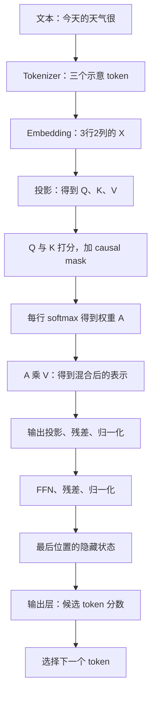

# Transformer 原理与计算参考

这份计算附录保留了较完整的公式、矩阵算例与 Python 小实验。

各章末尾配有问题与完整解答；计算题给出步骤，实验题说明修改后的预期现象及原因。

[主教程《Transformer：从一句话到一次回答》](Transformer-零基础学习指南.md)已经把背景、术语、计算用途、生成与训练放在同一篇正文里连续讲解。本附录补充更完整的数值推演和实现细节。

## 0. 内容范围与数字说明

本附录包括基础数学、注意力计算、处理块、不同结构、训练与生成，以及完整教学算例、代码实验和术语表。

本次补充把神经网络、CNN、RNN、LSTM、序列到序列学习放回 Transformer 出现的背景中，并增加自回归概率、一次参数更新、GPU 资源估算，以及 ChatGPT、Agent、Jev、世界模型与 AGI 的概念边界。原有第 0—20 章、小实验和章末原题均保留。

快速查找：[基础数学](#3-先补最少的数学数字向量矩阵和参数) · [Attention 手算](#7-attention真正拆开这台信息混合器) · [完整算例](#12-把组件串起来一次前向计算的教学示意) · [学习实验](#15-两个无需-gpu-的小实验) · [术语表](#17-术语速查每个词先记一句话)

贯穿本文的两个例子是：

> 理解句子：“小明借了一本书，读完后把它还给了图书馆。”
>
> 生成文本：“今天的天气很……”

一个用于解释上下文关系，一个用于解释如何继续生成。文中所有小向量、概率和 token ID，除非明确说明，都是为了教学构造的，不是从真实大模型提取的结果。

### 本章想一想与解答

**问题 1：文中的小向量算出了合理的结果，能不能据此认定真实模型内部也使用这些数字？**

**解答：** 不能。这里的数字经过人为选择，是为了把计算过程展示清楚。它们可以用来检验“这一步怎么算”，不能当成真实模型的测量结果。真实模型使用什么数字，要看它的参数和实际输入。

## 1. Transformer 到底是什么

### 1.1 先区分“设计图”与“具体成品”

如果我给你一套房屋设计方案，它规定房间怎样排列、门怎样连接，但它还不是一栋已经建好的房子。

Transformer 也类似：它规定一类神经网络怎样安排计算模块、怎样让不同位置交换信息。训练过程按照这种结构调整大量数字参数，最终得到一个具体模型。

```text
Transformer 架构：怎样组织计算
          ↓ 加上配置、数据与训练
具体模型：结构 + 学到的参数
          ↓ 接收输入并计算
输出：分类结果、表示向量、翻译或生成文本等
```

所以，Transformer、某个聊天模型、某个聊天网站，是三个层次。一个聊天网站可能使用 Transformer 模型，也还需要接口、应用和其他系统。

### 1.2 它与 AI、深度学习、大语言模型的关系

AI 是很大的领域。机器学习是让系统从数据学习规律的一类方法。深度学习使用多层神经网络。Transformer 是深度学习中的一种重要架构。

LLM，大语言模型，是一类大规模处理语言的模型；很多现代 LLM 使用 Transformer。Transformer 也能用于图像、语音等，不只用于聊天。

你可以暂时画成：

```text
AI → 机器学习 → 深度学习 → Transformer 架构
                                  ↓ 常见应用
                           很多现代语言模型
```

这是帮助理解层次的示意，不意味着所有 AI 都采用 Transformer，也不意味着所有 Transformer 都是大语言模型。

其中还需要补上“神经网络”这一层。神经网络是一类把可调数值计算连接起来的模型；深度学习通常用其中具有多层表示学习能力的网络。浅层神经网络也是神经网络，但“用了神经网络”不等于已经属于通常所说的深度学习。机器学习还包括决策树等其他方法，不要求每一种方法都经过神经网络。

| 名称 | 它主要回答什么 | 一个具体例子 |
| --- | --- | --- |
| 人工智能，AI | 怎样让机器完成识别、预测、规划等智能任务 | 一个自动回答问题的系统 |
| 机器学习 | 怎样从数据改善任务表现 | 根据历史房屋数据学习估价规律 |
| 神经网络 | 用哪类带参数的计算模型学习 | 输入经过加权相加和非线性函数，再产生输出 |
| 深度学习 | 怎样用多层网络学习逐步变换的表示 | 从图像像素逐步学习用于识别的特征 |
| Transformer | 这些网络模块怎样组织、怎样结合不同位置的信息 | 用注意力和逐位置计算处理一句话 |
| 大语言模型，LLM | 模型的规模与主要建模对象是什么 | 用大规模数据训练、处理语言序列的模型 |

“深”不是有一个适用于所有论文的神奇层数门槛。这里要掌握的是关系：深度学习使用神经网络，神经网络的范围又不限于深度网络；Transformer 是其中一种组织计算的方式。

### 1.3 神经网络是不是在模拟一个人的大脑

“神经网络”这个名字有生物学灵感，但学习 Transformer 时，不需要把它想成一个数字化的人脑。

先把它理解成：**许多可调整参数的数值计算模块连接在一起，通过数据学习输入与目标之间的关系。**

一个最小例子是：

```text
输入数字 → 与参数相乘 → 加起来 → 经过某种函数 → 输出数字
```

复杂网络会重复和组合这样的操作。模型的能力来自结构、参数、训练数据和训练过程，而不是因为里面有一个会读书的小人。

把这个最小计算真的算一次。假设输入是两个数字 `[2, 1]`，对应的可调权重是 `[0.5, -1]`，再加一个可调常数 `0.5`：

```text
加权相加：2×0.5 + 1×(-1) + 0.5 = 0.5
把负数变成0、非负数原样保留：输出仍是0.5
```

加上的常数叫**偏置**，它让输出不必只由输入相乘决定。最后使用的规则叫 **ReLU 激活函数**；激活函数是在加权结果上再施加的一道计算规则。这里的 ReLU 不是直线规则：输入小于 0 时被截成 0，大于 0 时才原样保留。

这样的一个小计算单元常被称作人工神经元。让多个单元一起处理输入，再把它们的输出交给下一组，就形成多层网络。训练调整的是权重和偏置等参数；运行时的 `0.5` 则是这一次输入计算得到的结果。这个例子只解释结构，没有把两个输入数字指定为任何真实的语义特征。

### 1.4 学习这套结构时，要一直问四个问题

1. 当前要解决什么问题？
2. 输入和输出分别是什么？
3. 这一组件具体做了什么计算？
4. 少了它会有什么困难？

下面每一章都围绕这四件事展开。

### 本章想一想与解答

**问题 1：拿到了 Transformer 的结构图，就等于拿到了一个能聊天的模型吗？**

**解答：** 不等于。结构图说明模块如何连接；实际模型还需要具体配置和参数，通常要经过合适训练才能具备相应能力。就像房屋图纸规定房间和门的位置，但不能直接当成已经建好的房屋使用。

**问题 2：“这个系统使用 AI，所以内部一定是 Transformer。”这句话哪里有问题？**

**解答：** AI 包含很多方法，Transformer 只是其中一种网络架构。即使某个应用使用 Transformer，应用也还包含输入处理、接口等其他部分。不能把大领域、模型架构、具体模型和应用产品当成同一个东西。

**问题 3：神经网络和深度学习是两个互不相关的算法吗？刚才的人工神经元靠什么变得更适合任务？**

**解答：** 二者是有包含关系的概念：深度学习通常使用多层神经网络，神经网络也可以很浅。人工神经元本身只有明确的数值规则；训练用样本和目标调整权重、偏置，使整个网络在任务上的表现改善。单纯把单元数量加多、把网络叫作“深度”，不能代替合适的数据和训练。

## 2. Transformer 为什么出现：先理解它要解决什么问题

### 2.1 语言不是互不相关的单词列表

比较两句话：

```text
银行今天暂停营业。
河岸今天水位上涨。
```

英文里 `bank` 既可能表示银行，也可能表示河岸。要判断词的意思，就得看周围内容。

再看一小段故事：

```text
小明借了一本书。
他读完以后，把它还给了图书馆。
```

“他”指小明，“它”指书。读懂第二句，需要结合第一句，而不是只看最后一个词。

语言系统至少要处理：词义、顺序、前后关系、较远的信息依赖。这就是背景。

### 2.2 早期做法：把规则写出来

一个很简单的问答系统可以这样写：

```text
如果问题包含“天气”，返回固定的天气说明。
如果问题包含“感冒”，返回固定的健康说明。
```

它容易解释、容易控制，但遇到“出门要不要带伞”可能识别不到与天气的关系。你必须不断添加规则。

机器学习试图从数据里学到更一般的规律。深度学习进一步用多层计算学习复杂表示。

### 2.2.1 CNN：先解决附近内容怎样组成局部线索

识别一张照片时，如果把每个像素都当成毫无联系的独立数字，就很难利用“相邻像素组成边缘、边缘组成形状”这样的规律。一个有用的办法是让同一组小权重在图片不同位置反复计算，提取局部线索。这类网络叫 **CNN，卷积神经网络**。

先把图片简化成一排亮度数字 `[1, 2, 0, 3]`。用两个权重 `[1, -1]`，每次看相邻两个数，向右移动一格：

```text
第一次：[1,2] → 1×1 + 2×(-1) = -1
第二次：[2,0] → 2×1 + 0×(-1) =  2
第三次：[0,3] → 0×1 + 3×(-1) = -3
得到：[-1, 2, -3]
再用ReLU保留正值：[0, 2, 0]
```

这组权重在比较左右亮度差；它没有识别出“猫”。真实网络会学习许多组权重、多层组合，还会处理颜色通道等更多数字。在深度学习实现里，这种滑动加权相加常统称卷积操作；严格数学中的卷积还涉及核的翻转，此处按常见网络实现说明。

CNN 的关键是**局部连接和参数共享**：一小块只直接处理附近位置，同一组权重又可以用于许多位置。层数增加等做法能够扩大可利用的范围，CNN 也能处理文本或声音，因此不能记成“只会看图”。它是与循环网络、注意力网络并行发展的路线，不是 RNN 的旧版本。

### 2.3 RNN：像一个人逐字读，边读边记

RNN 是循环神经网络。可以暂时这样想：

```text
读第 1 个词 → 更新脑中的笔记
读第 2 个词 → 根据上一步笔记继续更新
读第 3 个词 → 继续更新
```

这个方向很自然，因为语言有顺序。但它带来两个重要问题：

- **逐步依赖**：第 3 步要等第 2 步，第 2 步要等第 1 步。训练时不容易把整段序列中的位置同时大规模计算。
- **远处信息不容易保留**：很长的句子里，早期重要信息可能难以通过多次更新传到后面。LSTM、GRU 等结构改善了这一点，但没有让问题完全消失。

就像一个人读几十页故障报告，只能不断改写一张小便签。想准确保留所有关键细节并不容易。

还有一个背景：一些早期序列到序列系统，尝试把输入句子压成一份固定长度表示，再让另一部分网络据此生成输出。

像你读完整本书，只准带一张便签进入考场。书越长、细节越多，便签就越难覆盖所有需要的信息。

这不是说所有 RNN 系统只能这样做，而是说明早期编码—解码设计中的一种重要困难。Attention 的发展，让输出过程可以更直接地结合输入各位置的表示。

### 2.3.1 把 RNN 的“笔记更新”算成数字

RNN 的笔记叫**隐藏状态**，也就是到当前这一步为止计算出的中间数字。为了便于手算，假设每个输入和每份状态都只有一个数，更新规则为：

```text
本步状态 = tanh(本步输入 + 0.5×上步状态)
初始状态 = 0
```

`tanh` 叫双曲正切函数，它把任意实数平滑地映射到 `-1` 与 `1` 之间。这里只需知道 `tanh(0)=0`、`tanh(1)≈0.7616`，其余值可以用计算器算。

输入依次为 `1`、`0`：

```text
第1步：tanh(1 + 0.5×0)      ≈ 0.7616
第2步：tanh(0 + 0.5×0.7616) ≈ 0.3634
```

第 2 个输入虽然是 0，第 2 步状态仍不为 0，因为它使用了上一步的结果。这就是“过去影响现在”的具体数值含义。也正因为有这条依赖，第 2 步要等待第 1 步。

真实 RNN 用向量和矩阵进行相应更新，而非只用一个数。长序列训练时，误差信息要经过多次这样的变换向前面传回，可能逐渐变得太小或太大，这叫**梯度消失或梯度爆炸**；梯度是描述参数微小变化如何影响训练目标的量。它们是优化困难，不只是“便签太小”这一比喻能完整解释的现象。

### 2.3.2 LSTM：让网络学习保留多少、写入多少

如果每读一步都把旧笔记彻底改写，重要信息可能很快丢失。LSTM，长短期记忆网络，是一种带有专门记忆通道和门控的循环网络；它让网络学会控制旧信息的保留、新信息的写入以及输出。

先把记忆简化成一个数。某一步有以下人为设置的计算结果：

```text
旧记忆 c_old = 0.8
保留比例 f = 0.75
写入比例 i = 0.5
候选新内容 g = 0.4
新记忆 c_new = f×c_old + i×g
             = 0.75×0.8 + 0.5×0.4
             = 0.8
```

`f` 叫遗忘门，控制保留多少旧记忆；`i` 叫输入门，控制写入多少候选内容。这些“门”通常是由当前输入和上一隐藏状态经过可训练变换，再用 **sigmoid 函数**得到的 0 到 1 之间的数。sigmoid 把实数平滑压到这个区间，便于表示比例。门不是人手动为每句话开关的机械装置。

还可以用输出门控制把多少记忆影响带到这一时刻的隐藏状态。如果输出门 `o=0.25`，则本例：

```text
新隐藏状态 h = o×tanh(c_new)
             = 0.25×tanh(0.8)
             ≈ 0.1660
```

因此，LSTM 的记忆状态 `c` 和对外参与后续计算的隐藏状态 `h` 是两份相关但不同的数字。真实模型中它们是向量，各个门也是向量，上述乘法对应逐项相乘。这条加法记忆通道改善了长距离信息和梯度的传递，但每一步仍依赖前一步，也不保证无限记忆。GRU 是另一种门控循环设计，此处不把它的细节与 LSTM 混用。

### 2.3.3 Seq2seq：怎样让输入和输出长度不同

翻译时，三段英文不一定恰好对应三段中文，所以“每读一个输入就输出一个词”不够灵活。一个自然安排是：先用一部分网络处理整句输入，再让另一部分网络根据处理结果生成目标句子，直到结束。

这叫 **sequence-to-sequence，序列到序列学习，简称 seq2seq**。处理输入的部分叫编码器，生成目标的部分叫解码器；这些名称描述职责，不要求内部必须使用 Transformer。

```text
英文输入 → 循环网络编码器 → 固定长度的向量
                                  ↓
                     循环网络解码器 → 逐步生成中文
```

2014 年 Sutskever 等人的代表性工作用多层 LSTM 实现这一安排。在这种版本中，输入越长，需要通过固定长度表示承载的细节就越多。它不像 ZIP 那样保证能还原原文；训练只要求这份表示有助于目标任务。

同期发展的注意力翻译系统保留输入多个位置的表示，让每个输出步骤按需要组合它们。例如生成“猫”时，可以更直接利用英文 `cats` 对应的位置。Bahdanau 等人的注意力翻译论文于 2014 年公开、发表于 ICLR 2015；它使用循环网络，也早于 2017 年 Transformer。因此，seq2seq 是任务与系统安排，注意力是信息结合机制，Transformer 是一类网络架构，三者不是同义词。

### 2.4 Attention：需要什么信息，就去结合相关位置

Attention 的直觉是：处理当前位置时，不必完全依赖一份不断被压缩的历史笔记，可以按相关程度结合其他位置的信息。

比如处理“把它还给图书馆”里的“它”，系统可以结合前面的“书”。遇到“他”，可以结合前面的人名。

Attention 在 Transformer 之前就已经被使用。2017 年的《Attention Is All You Need》提出了一种主要依靠 Attention 的序列建模架构，也就是 Transformer。

### 2.5 它带来什么变化：更直接的联系与更多并行计算

Transformer 可以让不同位置直接通过注意力结合信息，而不必只沿着一条逐步更新的状态链传递。

它还可以把多个位置的许多计算组织成矩阵运算。在训练和处理已知输入时，这种结构适合大规模并行计算。

但这里有一个常见误会：

> “Transformer 能并行，所以聊天时整篇回答可以同时生成。”

一般的自回归生成仍然需要先知道前一个 token，才能决定后一个 token。**已知输入的处理可以大规模并行，尚未确定的输出通常仍有前后依赖。** 后面讲 Prefill 与 Decode 时，你会看到这个区别怎样直接影响延迟。

### 2.6 把这段发展史放回人工智能的大图景

发展过程不是“某一年出现新方法，所有旧方法立即消失”。规则、搜索、统计学习、神经网络与不同网络架构长期并存，也常在同一个系统里配合使用。

| 阶段或代表节点 | 当时着重解决的问题 | 与这份教程的关系 |
| --- | --- | --- |
| 20 世纪中叶的早期 AI 与神经网络研究 | 怎样用符号规则、搜索或可学习计算描述智能任务 | AI 从来不只等于一种神经网络 |
| 1980 年代多层网络训练的发展 | 多层参数怎样根据误差共同调整 | 反向传播让误差影响能够沿计算关系求出；不是 Transformer 发明的 |
| 1990 年代 CNN、LSTM 等路线发展 | 怎样利用局部结构，怎样保留序列中的重要信息 | 不同任务需要不同计算组织方式 |
| 2012 年 AlexNet 的代表性图像识别结果 | 数据、网络训练与 GPU 计算怎样共同支持较大的视觉模型 | 深度学习在 Transformer 之前已取得重要进展 |
| 2014 年的 seq2seq 与注意力翻译工作 | 怎样处理不同长度的序列，怎样读取更细致的输入信息 | Transformer 的直接研究背景 |
| 2017 年 Transformer | 怎样用注意力组织序列中的信息交互，并提高已知序列的并行计算能力 | 本文的主角 |
| 2018 年 GPT、BERT 等语言预训练模型 | 怎样先学习广泛语言模式，再用于具体任务 | 相似组件可以服务不同训练目标与可见范围 |
| 2019 年 GPT-2、2020 年 GPT-3 的代表工作 | 能否用任务提示或少量输入示例，让同一个预训练模型处理不同任务 | 任务信息可以通过上下文提供；这不等于运行时微调参数，也不宣称提示与少样本研究始于此时 |
| 2022 年 InstructGPT | 怎样让续写模型更符合用户指令与意图 | 人工示范、回答排序和人类反馈用于后训练，实际调整参数 |
| 2022 年 ChatGPT 的公开发布 | 怎样让经过训练的语言模型以对话方式面向用户 | 产品入口、训练方式和模型架构需要分别理解 |

这是一条围绕 Transformer 整理的学习线索，不是人工智能全部历史。资料索引列于第 20 章；表中时间用于标记代表工作，不宣称某一篇论文单独发明了整类方法。

还可以从计算上并排比较：

| 方法 | 一个位置怎样获取其他信息 | 主要计算约束 |
| --- | --- | --- |
| CNN | 用局部窗口和共享权重，叠层后扩大范围 | 单层通常只直接连接有限邻域 |
| RNN | 把上一时刻状态传给下一时刻 | 同一序列的循环步骤存在依赖 |
| LSTM | 在循环中用门控制记忆更新 | 改善记忆通路，但保留循环依赖 |
| 带注意力的循环 seq2seq | 循环解码，同时结合输入各位置表示 | 注意力缓解输入信息瓶颈，循环计算仍在 |
| Transformer | 用注意力直接结合可见位置，并逐位置加工 | 标准全注意力的关系计算随长度平方增长；自回归输出仍逐步确定 |

### 本章回顾

Transformer 的核心背景是：语言需要结合上下文；旧的逐步处理方式有并行和长距离依赖方面的困难；Attention 提供了更直接的信息结合机制。

你现在还不需要记住公式。先记住：**它是一种更适合组织上下文计算、也适合大规模矩阵运算的网络设计。**

### 本章想一想与解答

**问题 1：“书”和“它”隔了很长一段话，注意力提供了什么帮助？是不是隔得远也必然理解正确？**

**解答：** 在可见范围内，注意力可以让当前位置直接结合远处位置的信息，减少对逐步传递一份历史笔记的依赖。但它是否找到了有用线索、后续是否处理正确，仍取决于模型能力和具体输入。更直接的信息通路提供了机会，不是正确性的保证。

**问题 2：既然多个位置能一起计算，为什么聊天时通常仍要逐步生成？**

**解答：** 训练样本和用户输入中的 token 已经给定，可以组织多个位置的计算；回答里的后续 token 还没有确定。常见自回归生成要先选出一个 token，再让下一步参考它。已知输入能并行处理，不表示未知输出之间没有依赖。

**问题 3：CNN、RNN、LSTM、seq2seq、Attention 是五代依次完全替代的产品吗？**

**解答：** 不是。CNN、RNN 是不同的网络设计，LSTM 属于循环网络；seq2seq 描述输入序列到输出序列的任务与安排；Attention 是组合相关信息的机制。它们有不同层次，也能组合。例如循环 seq2seq 可以加入 Attention，Transformer 也可以用来实现 seq2seq。

**问题 4：LSTM 例子中，若遗忘门从 0.75 变为 0.25，其余不变，新记忆是多少？这说明什么？**

**解答：** 新记忆变成 `0.25×0.8 + 0.5×0.4 = 0.4`。变化来自旧记忆的保留比例下降，而不是修改了候选内容。门控让网络能够以数值方式调整信息保留，但本例的门值由我们指定，不能据此声称训练后的网络总会保留人类认为重要的内容。

## 3. 先补最少的数学：数字、向量、矩阵和参数

### 3.1 标量：一个数字

`3`、`0.5`、`-2` 都是一个数字。数学里常把单个数字叫作标量。

一个人的年龄、一杯水的温度，都可以用单个数字表示。

### 3.2 向量：一串有顺序的数字

```text
[0.2, -0.7, 1.4, 0.1]
```

这是一个 4 维向量。“4 维”只是在说它有 4 个数字，不是在说四维空间里的神秘事物。

例如我们可以人为用三个数字描述水果：

```text
[甜度, 酸度, 大小]
```

假想的苹果是 `[7, 3, 5]`，柠檬是 `[2, 9, 3]`。这里只是演示“一串数字可以携带多项信息”。

这个例子中每个数字有我们手动指定的意义。但模型内部的向量通常是训练学出来的表示，不能简单给每一维贴上“语法”“情绪”“水果”这样的标签。

**类比的用处是理解“多项信息可以装进一串数字”，它并不说明神经网络每一维都能被人直接解释。**

### 3.3 矩阵：把许多向量排成一个表

```text
          第1维   第2维   第3维
token A    0.2    -0.7     1.4
token B    0.8     0.1    -0.3
token C   -0.5     0.4     0.9
```

这是一个 3 行 3 列的矩阵。

假设一句话分成 100 个 token，每个 token 用 4,096 个数字表示。那么整句的一份表示可以是：

```text
100 × 4096
```

数字 `4096` 是一个教学示例中的隐藏维度，实际模型可能不同。

你可以把矩阵想成二维数组。模型里还会出现多个维度的数组，例如：

```text
[批次大小, token 数, 隐藏维度]
```

这种更一般的多维数组，常叫作**张量，Tensor**。别被名字吓住，先把它理解成“带形状的数字数组”。

### 3.4 点积：把对应位置相乘再相加

假设：

```text
a = [1, 2]
b = [3, 4]
```

点积就是：

```text
a · b = 1×3 + 2×4 = 11
```

后面 Attention 会用点积产生相关性分数。点积受到方向和数值大小的影响，不必把它等同于经过归一化的余弦相似度。

### 3.5 矩阵乘法：批量做“加权相加”

假设输入 `x = [2, 3]`，用一组权重产生两个输出：

```text
输出1 = 2×0.5 + 3×1.0 = 4.0
输出2 = 2×(-1.0) + 3×0.2 = -1.4
```

这就是一种线性变换。很多输入和很多输出一起算，就可以组织成矩阵乘法。

Transformer 里有大量这类运算。看上去复杂的文本处理，最终被组织成对许多数字的乘法、加法和其他函数运算。

### 3.6 参数与隐藏状态：不要把两类数字混淆

| 类型 | 来自哪里 | 什么时候变化 |
| --- | --- | --- |
| 参数、权重 | 训练学习得到 | 训练、微调时被更新 |
| 激活值、隐藏状态 | 当前输入经过网络计算产生 | 不同输入、不同层的结果通常不同 |

像一台榨汁机：结构和设定好比参数；当前水果经过加工得到的结果，好比激活值。换水果，不必重新制造一台机器，但当前结果会变化。

这个类比只解释两类状态。真正的模型参数与激活值都是数值数组。

**隐藏状态不是隐藏起来的一段中文推理稿，而是中间计算的向量表示。**

### 3.7 “7B 模型”的 B 是什么

`B` 是 billion，十亿。`7B` 大致表示 70 亿个参数。

它不表示 7GB，也不表示能处理 70 亿字的上下文。参数数量、权重文件大小、上下文长度、显存占用是不同概念。

一个参数占多少字节，取决于存储格式。例如 FP16、BF16 通常每个数占 2 字节，FP32 占 4 字节。低位量化还能使用更少的位数，但会有额外元数据及其他开销。

### 3.8 读公式时常见的几个符号

| 符号 | 怎样读 | 小例子 |
| --- | --- | --- |
| `x²` | x 的平方，自己乘自己 | `3² = 9` |
| `√x` / `sqrt(x)` | 平方根，哪个非负数的平方等于 x | `√9 = 3`，`√2 ≈ 1.4142` |
| `Σ` | 把指定的一组数加起来 | `1+2+3 = 6` |
| `exp(x)` | 指数函数 `eˣ`，这里用来把分数转成正数 | `exp(0)=1`，`exp(1)≈2.7183` |
| `ln(x)` | 自然对数，与 `exp` 互相对应 | `ln(exp(1))=1` |
| `f(x)` | 把 x 输入函数 f | 如果 `f(x)=2x`，则 `f(3)=6` |
| `ᵀ` | 矩阵转置，交换行列 | 2 行 3 列转成 3 行 2 列 |

转置可以直接看数字：

```text
原矩阵：                转置：
[ [1, 2, 3],            [ [1, 4],
  [4, 5, 6] ]             [2, 5],
                          [3, 6] ]
```

公式不需要一次背下来。比如读到 softmax，只需要先知道 `exp` 会让分数变成正数，而且更大的分数会得到更大的值；再除以总和，就得到加起来等于 1 的权重。

### 本章想一想与解答

**问题 1：6 个 token，每个用 8 个数字表示，排成的矩阵有多少行、多少列？如果再多一个 token，必须把每个向量改成 9 维吗？**

**解答：** 原来是 6 行 8 列。增加一个 token 后可以变成 7 行 8 列：变化的是位置数量，也就是行数；每个位置使用多少个数字，是另一个维度，不必跟着变成 9。分清这两件事，就更容易读懂后面的矩阵形状。

**问题 2：`[2, -1]` 与 `[3, 4]` 的点积是多少？结果能不能直接当成百分比？**

**解答：** 点积是 `2 × 3 + (-1) × 4 = 2`。这个 2 是计算得到的分数，不是 2% 或 200% 的概率；其他输入下还可能得到负数。后面会通过相应步骤把多个分数转换成可分配的比例。

**问题 3：同一模型回答两句话时，中间向量不同，是否说明参数数量也发生了变化？“7B”又是在数什么？**

**解答：** 中间向量是当前输入的计算结果，可以改变，而参数数量通常保持不变。7B 大致表示 70 亿个参数，数的是模型中可学习的数字，不是在数当前句子的字数，也不是直接说明文件大小为 7GB。

## 4. 一次提问的完整旅程：从文本到文本

现在想象你让模型续写：

> 今天的天气很……

### 4.1 先看整体流程

```text
原始问题
  ↓ 应用组织消息、使用模型要求的聊天模板
输入文本
  ↓ tokenizer 分词
token ID 序列
  ↓ embedding 查表
每个 token 的向量
  ↓ 结合位置信息，经过多层 Transformer
上下文相关的隐藏状态
  ↓ 输出层计算词表中每个 token 的分数
下一个 token 的概率分布
  ↓ 选择一个 token
把新 token 接到序列后面
  ↓ 继续生成，直到满足停止条件
tokenizer 解码 → 用户看到的回答
```

这是一幅简化流程图。先看清每一步输入什么、输出什么，后面再逐一拆开。

### 4.2 聊天消息为什么需要模板

你发出的请求可能长这样：

```json
{
  "messages": [
    {"role": "system", "content": "你是一位耐心的老师。"},
    {"role": "user", "content": "请解释彩虹为什么会出现。"}
  ]
}
```

模型计算时并不是直接理解这个 JSON 对象。服务通常会按模型要求，把角色、内容和分隔符组织成 token 序列。

像一份剧本用角色名区分不同人的台词，模型训练时也需要学习区分不同角色和消息边界。

对于聊天模型，配套的 tokenizer 和 chat template 是输入表达方式的一部分。它们不是 Attention 的替代品，而是在计算前告诉模型“这些内容是什么角色说的”。

### 4.3 一次普通回答是在使用学好的参数

模型先经过训练，得到一组参数。之后，新的输入可以使用这组参数进行计算。

收到一条消息后，模型运行一系列计算生成输出。这叫推理。它一般不会为这一条消息再训练一次模型。

如果应用保存了你的对话记录，那是应用的存储行为。它不等于模型权重已经被这段对话永久改写。

### 4.4 为什么用户看到的是“一点点往外冒”

服务可以在每次生成新内容后，通过流式接口把结果发给用户，而不是等全文结束。

生成单位是 token；网络发送单位可能是一个或多个 token 对应的文本片段。中文字符、网络 chunk 和 token 不保证一一对应。

因此，屏幕上每跳出一段文字，不必然代表模型刚刚只生成了一个汉字。

### 本章想一想与解答

**问题 1：给聊天内容加上“用户、助手”等角色标记，是不是就完成了注意力计算？**

**解答：** 没有。聊天模板负责按照模型的约定组织输入，让角色和消息边界有合适的表示。之后仍需要分词、查向量，再进入模型内部计算。可以类比剧本上的角色标签：标签帮助区分台词属于谁，但标签本身并没有完成对台词关系的分析。

**问题 2：屏幕一次出现三个汉字，就说明模型一次生成了三个 token 吗？**

**解答：** 不能这样判断。文字与 token 的对应取决于分词器，网络接口又可能把多个结果合在一次发送。因此要分清分词单位、生成步骤与发送片段，不能单看屏幕刷新就推断内部 token 数。

## 5. Tokenizer 与 Embedding：为什么文字必须先变成数字

### 5.1 Tokenizer 在做什么

Tokenizer 是一套把文本转换成 token ID、再把 ID 转回文本的规则和数据。

教学上可以想象：

```text
“今天的天气很”
    ↓ 示意拆分，不代表任何真实 tokenizer 的结果
[“今天”, “的”, “天气”, “很”]
    ↓ 示意 ID
[1250, 842, 9917, 63]
```

实际拆分会受 tokenizer 类型、词表和文本内容影响。英文的 `unbelievable` 可能是一个 token，也可能被拆成多个片段。中文也可能按字、词片段或其他方式编码。

**token ID 是一个编号。编号 9917 不比编号 842 更“重要”，也不表示数学意义上的大小关系。**

### 5.2 为什么不用“一字一个编号”就结束

模型需要一种可计算的表示，表达不同片段之间学到的关系。

Embedding 可以理解成一个大表：

```text
token ID       对应的一串数字
   842         [0.12, -0.35, 0.81, ...]
  1250         [0.44,  0.09, -0.22, ...]
  9917         [-0.18, 0.63, 0.27, ...]
```

查到的向量会进入后续计算。这些表项通常是模型参数的一部分，通过训练学到。

### 5.3 词典编号与词的表示不是同一件事

一本词典可能把“苹果”放在第 200 页，“香蕉”放在第 900 页。页码只是位置，不能直接用页码差判断两个词的关系。

token ID 也类似。Embedding 则给每个 ID 一份可计算的向量表示，训练会调整这些数字，使整个任务的预测更好。

两个向量的关系可以反映模型学到的某些相似性，但不能保证每一对词的几何关系都有简单的人类解释。

### 5.4 静态查表与上下文表示有什么区别

同一个 token ID，在同一模型的输入 embedding 表里，会查到相同的基础向量。

但它随后经过 Transformer，会结合所在句子的上下文。最终表示可以不同。

例如英文 `bank`：

```text
I deposited money at the bank.   → 周围内容与存钱有关
I sat on the river bank.        → 周围内容与河岸有关
```

基础 token 表示并不需要为每种情境都建立一个完全不同的编号。后面的上下文计算会帮助区分使用方式。实际 tokenizer 也可能受到空格等因素影响，这里只解释同一 token 的情况。

### 5.5 为什么字数与 token 数不一样

中文、英文、标点、数字，都可能按照不同片段拆分。100 个字符并不保证恰好对应 100 个 token。

因此“上下文有 8,192 token”说的是模型输入序列的单位数量，不是汉字数。

常见的生成模型需要为输入和后续输出共同考虑长度。模型也会在达到输出上限或遇到终止条件时停止。

这与本文主线的联系是：**Transformer 处理的是 token 位置组成的序列，序列长度是后续 Attention 的重要维度。**

### 本章想一想与解答

**问题 1：如果把 token 编号 842 换成 1250，能否继续用 embedding 表原来的第 842 项？**

**解答：** 一般不能直接这样替换。编号的作用就是定位配套表项；换成 1250，就应当按该编号查到相应向量。模型参数与分词器编号约定是配套的，不能只凭编号都是整数，就随意调换它们代表的内容。

**问题 2：同一个 `bank` token 在两句话里查到相同向量，为什么最终还能分别与银行、河岸有关？**

**解答：** 查表只提供基础表示。后面的上下文计算会结合“存钱”或“河流”等不同内容，产生不同的中间表示。相同编号不要求在所有句子里都得到完全相同的最终结果。

**问题 3：一个模型的总上下文上限假设是 8,192 token，输入已经占 8,000 token，就能再输出 8,192 token 吗？**

**解答：** 如果这里的 8,192 指输入和输出共同占用的总长度，那么理论上只剩 `8192 − 8000 = 192` 个 token 的空间，还要遵守服务的其他限制。并且这里统计的是实际送入的 token，包括适用的模板和特殊标记，不只是用户看见的汉字。

## 6. 位置：模型怎么知道谁在前、谁在后

### 6.1 同样的词，顺序不同，意思不同

```text
小猫追小狗。
小狗追小猫。
```

两句话里有相同的主要词，但意思不一样。

只做不带位置信息、也不带顺序限制的 Attention，无法充分表达序列顺序。Transformer 需要某种位置机制。

### 6.2 给内容加上“位置坐标”

原始 Transformer 使用位置编码，经典做法是把表示位置的向量加入 token 的 embedding。

```text
输入表示 = token 内容向量 + 位置向量
```

就像读一本书，需要知道句子的先后顺序。只把每页上的词全部放进袋子，内容还在，但情节顺序就丢失了。

### 6.3 原始位置编码的一个小例子

原始 Transformer 使用正弦和余弦函数构造位置向量。你现在不必记住整个公式，只看一个 4 维的例子：

```text
位置 0 → [0.0000,  1.0000, 0.0000, 1.0000]
位置 1 → [0.8415,  0.5403, 0.0100, 1.0000]
位置 2 → [0.9093, -0.4161, 0.0200, 0.9998]
```

不同维度使用不同变化频率。这样每个位置有一组数字坐标，可以与内容向量结合。

比喻成多只转速不同的钟：有的指针转得快，有的慢，它们一起帮助描述位置。

两个 token 内容相同，但位置不同，就能通过位置机制带入不同信息。它没有把词变成“有序字符串算法”，仍然是在给数值计算增加顺序相关的表示。

### 6.4 现代模型里常见的 RoPE

RoPE 是旋转位置编码。直观地说，它根据位置改变 Query、Key 的表示，使相关性计算能够包含位置信息，尤其是相对位置关系。

初学时不用推导旋转矩阵。先知道两件事：

- 原始 Transformer 的加法位置编码与现代模型的 RoPE，并不是同一种实现。
- 模型可靠处理长文本的能力，与训练、位置机制等有关，不能只靠给位置编号增加更多数字来保证。

“能输入很长”与“能准确理解全部细节”并不是同一件事。后面谈上下文时会继续解释。

### 本章想一想与解答

**问题 1：某个 token 向量是 `[1, 2]`，教学用的位置向量是 `[0.2, -0.1]`，相加得到什么？这一步是否生成了新的词？**

**解答：** 逐项相加得到 `[1.2, 1.9]`。它仍然是当前位置的数字表示，只是加入了位置信息；没有因此增加一个 token，也没有直接选出新的文字。

**问题 2：所有 Transformer 的位置机制，都是把位置向量加到 embedding 上吗？**

**解答：** 不是。原始 Transformer 采用这种做法，但本章也介绍了 RoPE，它在相应 Q、K 的数值变换中引入位置关系。不同做法作用的具体位置不同，共同目标是让计算利用顺序和位置，不能只看名字就套用同一操作。

## 7. Attention：真正拆开这台“信息混合器”

这是全文最值得慢慢读的一章。先理解一次注意力计算，再去理解多头和完整网络，会轻松很多。

### 7.1 它究竟在干什么

对序列中的某个位置，Attention 会：

1. 计算这个位置与可见位置的相关性分数。
2. 把分数转换成一组权重。
3. 按权重混合其他位置提供的信息。

这不是在复制某一个词，而是在产生一个新的数字向量。

例子：

> “小明借了一本书，读完以后，把它还给了图书馆。”

处理“它”时，结合前面的“书”等内容，可以形成更有上下文的表示。

实际模型可能使用很复杂、并不容易解释的模式。我们用自然语言关系帮助理解机制，不能据此声称某个头一定在做人类式的因果推理。

### 7.2 用查资料来理解 Q、K、V

假设你去图书馆寻找“有关恐龙的资料”。

- **Q，Query**：你当前在寻找什么。
- **K，Key**：每条候选资料用来与你的需求比较的表示。
- **V，Value**：一旦这条资料相关，它能够提供给你的内容表示。

资料标题很像用于匹配的 Key，资料内容很像 Value。但真实网络里，它们都不是字符串标题，而是数字向量。

特别注意：**Q 不等于用户整句问题，K 不等于数据库主键，V 不等于完整原文。** 这是为了理解功能的比喻。

### 7.3 Q、K、V 从哪里来

在自注意力里，三者通常来自同一批输入隐藏状态 `X`，经过三套不同的权重变换：

```text
Q = X × W_Q
K = X × W_K
V = X × W_V
```

`W_Q`、`W_K`、`W_V` 是训练学到的参数。模型用不同变换，让同一位置在“提出需求”“供人匹配”“提供信息”三个角色下拥有不同的表示。

像同一本书可以有一份适合检索的摘要，也有实际正文。它们服务于不同目的；在模型里，则通过不同数值变换形成这些角色。

### 7.4 第一步：算相关性分数

我们只算一个 Query，并使用很小的二维向量：

```text
Q  = [1, 0]
K₁ = [1, 0]
K₂ = [0, 1]
K₃ = [1, 1]
```

点积结果是：

```text
Q · K₁ = 1
Q · K₂ = 0
Q · K₃ = 1
```

这表示在这组人为设计的数字里，位置 1 和位置 3 得分相同，都高于位置 2。

这些数字只是演示计算，**不是从某个真实模型提取的语义数据**。

### 7.5 为什么要除以 √dₖ

`dₖ` 是 Key、Query 的维度。这个例子有两个数字，所以 `dₖ = 2`。

缩放后的分数约为：

```text
[1 / √2, 0 / √2, 1 / √2]
≈ [0.7071, 0, 0.7071]
```

为什么要缩放？向量维度增大时，在常见的统计假设下，点积的数值波动会变大。特别大的分数容易让下一步 softmax 过于集中，影响训练的数值和梯度表现。

你可以先把它理解成：**把打分尺度调整到更合适的范围。** 这里除的是维度的平方根，不是 token 数。

### 7.6 第二步：softmax 把分数变成权重

softmax 的规则是：对每个分数取指数，再除以所有指数之和。

```text
权重ᵢ = exp(分数ᵢ) / Σ exp(所有可见分数)
```

对刚才的分数，得到约：

```text
[0.4011, 0.1978, 0.4011]
```

它们都非负，加起来等于 1。

像你决定从三份资料里分别吸收约 40%、20%、40% 的信息。但这是数学上的混合系数，不是模型对资料真实性的人工判断。

实现时常先减去所有分数中的最大值，再计算指数，以避免数值过大。这不会改变数学上的 softmax 结果。

### 7.7 第三步：按权重混合 Value

现在假设：

```text
V₁ = [10, 0]
V₂ = [0, 10]
V₃ = [6, 6]
```

输出就是：

```text
输出 = 0.4011×V₁ + 0.1978×V₂ + 0.4011×V₃
     ≈ [6.418, 4.384]
```

注意：输出并不等于 `V₁`、`V₂` 或 `V₃` 中的任意一个，而是它们的加权组合。

此时“Attention 做什么”已经落到具体计算了：**相关性打分 → 归一化权重 → 混合信息。**

### 7.8 把所有位置一起算，就得到常见公式

```text
Attention(Q, K, V) = softmax(QKᵀ / √dₖ + M) V
```

逐个翻译：

| 部分 | 含义 |
| --- | --- |
| `QKᵀ` | 把每个 Query 与每个 Key 的点积一起算出来 |
| `ᵀ` | 转置，为矩阵乘法调整行列方向 |
| `/ √dₖ` | 调整打分尺度 |
| `M` | 可选的 mask：规定哪些位置不允许被使用 |
| `softmax` | 对每个 Query 的可见候选分数转换成权重 |
| 最后的 `V` | 按权重混合信息 |

如果有 100 个 token，普通全注意力的打分关系会形成约 `100 × 100` 的表。每一行对应一个位置“看”其他位置的程度。

### 7.9 Mask：为什么有些位置不允许看

生成式语言模型训练时，不能预测前面的词却提前偷看后面的正确答案。

例如训练序列：

```text
今天  的  天气  很  晴朗
```

在某个位置预测下一个 token 时，常见的 causal mask 只允许结合当前位置及更早的位置，不能结合未来位置。

```text
           第1位 第2位 第3位 第4位
第1位能看    ✓     ×     ×     ×
第2位能看    ✓     ✓     ×     ×
第3位能看    ✓     ✓     ✓     ×
第4位能看    ✓     ✓     ✓     ✓
```

实现时，常把禁止位置的分数设为负无穷；softmax 后这些位置的权重为 0。

**mask 不是用户权限系统。** 它是网络内部限制信息流的机制。真正的租户权限、数据授权仍要由应用和平台设计。

### 7.10 为什么长上下文会变贵

普通全注意力的两两关系数量与序列长度的平方相关：

```text
1,000 个 token → 约 1,000,000 个位置对
2,000 个 token → 约 4,000,000 个位置对
```

长度翻倍，这部分关系数量会变成约四倍。因果遮罩会改变常数，但没有消除这个数量级。

这描述的是标准全注意力的核心关系计算，**不能把整个模型的总耗时也一律说成四倍**。其他计算、优化内核、缓存和硬件瓶颈都会影响实际表现。

后面你还会看到：FlashAttention 可以显著减少中间数据的读写与存储，但不会凭空消除普通全注意力的全部两两关系计算。

### 7.11 为什么要分 Q、K、V 三套变换

你可能会问：既然都是同一份输入，为什么不直接用它比较、再原样输出？

因为“怎样比较相关性”和“应该传递什么信息”是两种任务。让模型学习不同变换，可以给这两种任务不同的表示空间。

例如一句话里的动词想结合相应对象。提出需求的一侧与被匹配的一侧，可以学习不同的特征组合；被传递的内容还可以再用另一套表示。

这不是人预先给 Q 写规则：“只看动词”；训练通过整体目标调整相关参数。

也要分清两个层次：

```text
W_Q、W_K、W_V：模型学好的参数，普通推理时通常不变
Q、K、V：当前输入计算出来的结果，输入变了，它们通常也会变
```

第 12 章把三个权重设成一样，只是特殊的教学设定。

### 7.12 再算一次：三套投影确实不同的时候

为了看清“同一份输入怎样形成三个角色”，这里另设一个三位置、二维的例子。所有数字仍是教学构造，与前面第 7.4 节及后面第 12 章的例子分别计算，不互相替换。

```text
X   = [[1,0], [0,1], [1,1]]
W_Q = [[1,1], [0,1]]
W_K = [[1,0], [1,1]]
W_V = [[2,0], [0,3]]
```

行向量乘矩阵时，每一列给出一个输出坐标。例如最后一行 `x=[1,1]`：

```text
q = [1×1 + 1×0, 1×1 + 1×1] = [1,2]
k = [1×1 + 1×1, 1×0 + 1×1] = [2,1]
v = [1×2 + 1×0, 1×0 + 1×3] = [2,3]
```

把三行都算完：

```text
Q = [[1,1], [0,1], [1,2]]
K = [[1,0], [1,1], [2,1]]
V = [[2,0], [0,3], [2,3]]
```

只追踪最后位置，假设它能看见全部三个位置。它的 Q 是 `[1,2]`，先与三份 K 比较，再组合三份 V：

```text
点积：[1×1+2×0, 1×1+2×1, 1×2+2×1] = [1,3,4]
除以√2：约 [0.7071, 2.1213, 2.8284]
softmax：约 [0.0743, 0.3057, 0.6200]

输出第一维 = 0.0743×2 + 0.3057×0 + 0.6200×2 ≈ 1.3886
输出第二维 = 0.0743×0 + 0.3057×3 + 0.6200×3 ≈ 2.7770
```

末尾结果使用未舍入的权重计算。这一步输出的是约 `[1.3886,2.7770]` 的向量，还需要经过输出投影、其他子层及最终词表打分。三套参数的分工现在可以直接从数字看出：换 `W_Q` 或 `W_K` 会影响匹配分数；只换 `W_V`，在其余计算不变时，会改变被组合的内容，但不会改变这一层这一次已经由 Q/K 决定的权重。

### 本章回顾

如果现在仍觉得抽象，抓住三句：

- Q、K 决定“该结合哪些信息、各占多少”。
- V 提供“被结合的信息”。
- 输出是信息混合后的新表示，随后还要进入其他计算层。

### 本章想一想与解答

**问题 1：如果有 4 个位置，Q、K、V 都是 4 行 2 列，打分表和注意力输出分别是什么形状？**

**解答：** Q 的每一行与 K 的 4 行分别比较，所以打分表是 4 行 4 列。每行权重再组合 4 份二维 V，得到一个二维输出；4 行都做完，输出是 4 行 2 列。注意力改变了各位置的表示，并没有在这一步把 4 个 token 变成 4 个新词。

**问题 2：想屏蔽一个位置，把它的分数改成 0 就够了吗？**

**解答：** 不够，因为 `exp(0) = 1`，它仍会占用一部分比例。本章的做法是在 softmax 之前把禁止位置设成负无穷，对应权重才为 0；这一行还需要有允许参考的位置。不要把普通零分误当成屏蔽标记。

**问题 3：K 的一行和 V 的一行虽然来自同一个位置，为什么不能直接把最后一步的 V 换成 K？**

**解答：** K 是参与匹配的表示，V 是被传递的表示，二者可以经过不同参数变换。擅自用 K 替换 V，就改变了这套模型实际执行的计算。教学例子可以特意令二者相同，但那是特定设定，不能推广成通用规则。

**问题 4：标准全注意力的长度从 4 增加到 8，所有位置对的数量怎样变化？能直接说整个模型耗时也翻四倍吗？**

**解答：** 全部位置对从 `4 × 4 = 16` 增至 `8 × 8 = 64`，变为 4 倍。这只描述这部分关系数量。整个模型还有其他计算，实际耗时也受实现与硬件影响，所以不能直接把 4 倍套到整个请求上。

**问题 5：第 7.12 节中，只把 `W_V` 的两个非零数都乘 2，其他设置不变，会发生什么？**

**解答：** Q、K 和注意力权重保持相同，而三份 V 都变为原来的两倍。因此本次注意力混合结果也变为两倍，约 `[2.7772,5.5541]`。这说明匹配依据与传递内容是可区分的。进入后续残差、归一化和其他层后，最终概率未必也按两倍变化，不能把这一局部结论套到完整网络。

## 8. 一个 Transformer Block：Attention 之外还有什么

### 8.1 Multi-head Attention：从多个学习到的角度混合信息

一个 Attention head，可以理解成一套 Q/K/V 计算。

Multi-head Attention 使用多套这样的计算，然后把结果组合起来。

类比阅读一句话：“小明在下雨前把书放进了书包。”

- 一个视角可能侧重词与词的指代关系。
- 一个视角可能侧重动作与对象的关系。
- 一个视角可能侧重时间和其他上下文关系。

不同视角可能提供不同信息。但真实模型的头并没有预先被指定成“指代头”“动作头”“时间头”；这些只是帮助理解多视角组合的比喻。

对于经典多头注意力，一个常见配置是：

```text
隐藏维度 d_model = 4096
Query 头数 n_heads = 32
每头维度 d_head = 128
32 × 128 = 4096
```

这种计算不是把同一份 4,096 维结果完整复制 32 遍。经典结构通常让每个头使用较小的表示，再拼接和投影。现代 GQA、MLA 等结构还有不同细节。

再用一个更小的形状说明：假设 6 个 token、每个表示 8 维，使用 2 个头，每头 4 维。

```text
输入 X：              6 × 8
第一个头的 Q/K/V：    各为 6 × 4
第二个头的 Q/K/V：    各为 6 × 4
每个头的关系分数：    6 × 6
每个头混合后的结果：  6 × 4
拼接两个头：          6 × 8
输出投影后：          6 × 8
```

两个头都处理这些位置，并不是把前 3 个 token 分给头 1、后 3 个分给头 2。

而且每个头的投影可以综合原向量的全部维度；不要把它理解成永远只拿原向量的一小段。常见实现把多套投影一起计算，再 reshape 成不同头。

最后的输出投影会继续组合各头的结果。这样得到的表示维度可以与输入一致，方便后面做残差相加。

### 8.2 FFN/MLP：每个位置继续做非线性加工

Attention 主要负责位置之间的信息结合。

FFN，前馈网络，也常被称作 MLP，会对每个位置的向量进一步变换。一个简化形式是：

```text
FFN(x) = 激活函数(x × W₁ + b₁) × W₂ + b₂
```

这里沿用把 x 写成一行向量的约定。先把向量转换到另一个维度，经过非线性处理，再变换回来。

“非线性”你可以这样理解：如果连续很多层都只有简单线性变换，它们整体还能合并成一次线性变换。加入非线性，网络才能表达更复杂的关系。

经典 FFN 常扩大中间维度；很多现代模型采用 SwiGLU 等带门控的结构，不能一概套用同一公式。

同一层的 FFN 通常对每个位置使用相同的参数，各位置输入不同，输出也可以不同。不同层则通常有各自的参数。FFN 不会在这一步直接把其他 token 的向量拿来混合，但它的输入已经可以包含前面的 Attention 带来的上下文信息。

**Attention 让不同位置结合信息，FFN 则进一步加工每个位置的表示。它们分工不同，二者都很重要。**

### 8.3 Residual：保留原信息的通道

残差连接可以简化理解成：

```text
新结果 = 原来的 x + 某个子层对 x 的处理结果
```

像你在原稿上增加修改意见，保留原来的内容，同时加入新的加工结果。

这种结构帮助深层网络训练，也让信息和梯度更容易传递。严格说，它是数值向量的相加，不是保存多份文本版本。

### 8.4 Normalization：让内部数值更容易被处理

LayerNorm、RMSNorm 是常见的归一化方式。

直觉上，它们帮助管理向量的数值尺度，使网络的计算和训练更稳定。两者公式不同，不必当成完全相同的算法。

以一个简化的 LayerNorm 为例，输入是 `[1, 2, 3]`：

```text
平均值 = 2
方差 = ((1−2)² + (2−2)² + (3−2)²) / 3 = 2/3
每个数字先减平均值，再除以标准差
结果约为 [-1.2247, 0, 1.2247]
```

实际公式还会在方差上加入很小的 `epsilon`，避免分母出问题，并通常使用可学习的缩放和偏移：

```text
LayerNorm(x) = gamma × (x − mean(x)) / sqrt(var(x) + epsilon) + beta
```

这里的统计通常针对一个 token 的隐藏维度计算，不是在整个批次上计算同一组统计量。

RMSNorm 主要使用均方根尺度，不做同样的减均值操作。这也是为什么两者不能简单视为一个名称的不同写法。

它处理的是模型内部数字的尺度，不是把原文改成统一大小写。

### 8.5 一个常见的现代 Pre-norm Block

下面是简化结构，具体模型可能有差异：

```text
输入 x
  ↓
Norm → Attention → 与 x 相加
  ↓ 得到 y
Norm → FFN/MLP → 与 y 相加
  ↓
Block 输出
```

原始 Transformer 与现代模型在归一化位置等细节上不同。我们用这张图建立主线，不把它说成所有 Transformer 的唯一结构。

### 8.6 为什么要堆很多层

一层得到的上下文表示，会成为下一层的输入。多层计算可以逐步形成更复杂的表示。

不要机械理解成“第一层一定学词，第二层一定学语法，第三层一定学逻辑”。这是过度简化。不同层学到的功能可能交叠，具体行为需要研究。

多层的价值在于让表示经过多次上下文结合和非线性加工。层数、宽度和训练方式会共同影响能力，不能简单地认为“只要再加一层，就一定更聪明”。

### 本章想一想与解答

**问题 1：6 个 token、隐藏维度 8、两个头且每头 4 维，每个头的关系表为什么是 6×6，而不是 4×4？**

**解答：** 关系表比较的是“哪个位置与哪个位置”，所以两个方向数的都是 6 个 token。每头的 4 维，是每次比较时参与点积的数字数量。每个头输出 6×4，两个头拼接后成为 6×8，这两种维度的作用不同。

**问题 2：同一层 FFN 对所有位置使用相同参数，为什么输出还能不同？**

**解答：** 相同参数规定相同的计算规则，但各位置输入的向量可以不同。例如规则都是“乘 2”，输入 1 和输入 3 仍会得到 2 和 6。共享参数不等于强制所有结果相同。

**问题 3：LayerNorm 对 `[1, 2, 3]` 得到约 `[-1.2247, 0, 1.2247]`，里面有负数、总和也不是 1，是不是算错了？**

**解答：** 没有。这个简化例子先减去均值 2，再除以标准差 `√(2/3)`，就会得到这些结果。LayerNorm 调整数值尺度，不负责生成概率；非负且总和为 1，是这里 softmax 输出的性质，不能套到每一种归一化上。

## 9. Encoder、Decoder 与常见模型家族

### 9.1 原始 Transformer：读入一段，再生成另一段

原始论文面向机器翻译，包含 Encoder 和 Decoder。

```text
英文句子 → Encoder → 一组输入表示
                         ↓ 供 Decoder 使用
               Decoder → 逐步生成中文句子
```

Encoder 用自注意力处理输入；Decoder 有受因果限制的自注意力，还会使用 Cross-attention 结合 Encoder 输出。

### 9.2 用一次翻译把原始结构走一遍

假设输入是英文：

```text
I love cats.
```

目标是生成中文：“我爱猫。”

**第一步：Encoder 读输入。**

输入经过分词、embedding 与位置机制，再经过多层 Encoder Block。每个 Block 里有自注意力和 FFN，以及残差和归一化。

普通 Encoder 自注意力通常允许输入位置结合整段输入。例如 `love` 可以结合前面的 `I` 与后面的 `cats`。最终得到每个输入位置的上下文表示。

这里的“编码”是形成向量表示，不是把英文压缩成 ZIP，也不是加密。

**第二步：Decoder 从起始符号开始。**

假想生成过程：

```text
<BOS>                 → 预测“我”
<BOS> 我              → 预测“爱”
<BOS> 我 爱           → 预测“猫”
<BOS> 我 爱 猫        → 预测句号或终止符号
```

`<BOS>` 是方便理解的起始符号写法，真实 tokenizer 和模型的约定可能不同。

**第三步：Decoder 内部有两次不同的信息结合。**

先用 masked self-attention，结合已经存在的中文前缀。然后用 cross-attention，结合 Encoder 给出的英文输入表示。随后还会经过 FFN 等加工。

```text
已生成中文 → 因果自注意力 → 当前 Decoder 表示
                                  ↓ 作为 Q
英文的 Encoder 输出 → 作为 K、V → Cross-attention
                                  ↓
                              FFN 等后续计算
                                  ↓
                           下一个中文 token 的分数
```

Decoder 能看完整英文输入，不代表它可以偷看尚未生成的中文正确答案。源语言输入与目标语言后续是两种不同信息。

**第四步：继续生成直到停止。**

推理时，每次选一个后续 token；训练时，目标中文序列已经给定，可以在 mask 限制下并行计算多个位置的预测。

### 9.3 Self-attention 与 Cross-attention

- **Self-attention**：Q、K、V 来自同一序列的相关表示。例如一句话内部不同位置互相结合信息。
- **Cross-attention**：Q 来自一侧，K、V 来自另一侧。例如翻译 Decoder 根据已生成内容，结合 Encoder 的输入表示。

不要认为所有模型都有 Cross-attention。很多聊天大模型采用 Decoder-only 架构，没有原始 Encoder-Decoder 中那套独立的交叉注意力结构。

### 9.4 三种常见方向

| 架构方向 | 典型特点 | 常见用途或代表家族 |
| --- | --- | --- |
| Encoder-only | 通常能结合输入两侧的信息 | BERT 类文本表示、分类；很多 embedding 模型 |
| Decoder-only | 通常用因果注意力，逐步预测下一个 token | GPT 类，以及许多 Llama、Qwen、DeepSeek 等生成模型家族 |
| Encoder-Decoder | 先编码输入，再基于输入生成输出 | 原始 Transformer、T5 类任务 |

这只是分类入口。一个家族可能有多种模型，实际产品还可能包含多模态编码器或混合结构，要查看具体模型说明。

比如做阅读理解或文本分类，你可能希望一句话里的某个位置能结合两边的信息。Encoder 的双向上下文很适合这类表示任务。

比如逐步续写，你必须避免用尚未确定的后文预测当前输出。Decoder-only 的因果结构适合这条主线。

但架构选择并不把所有用途完全隔开。Decoder 模型也能通过训练和任务组织完成很多分析任务。

### 9.5 原始论文的一个具体规模

原始论文的 base 配置使用 6 个 Encoder 层、6 个 Decoder 层，隐藏维度 512、8 个注意力头、FFN 中间维度 2,048。

你不用背这些数字。它们说明：前面画的 Block 会重复堆叠，而且真实网络中的向量比二维算例宽得多。

现代模型配置不同，不能拿这套数字去描述所有 Transformer。

### 9.6 现代大模型为什么不像原论文一模一样

后来大家在结构和工程上做了很多变化，例如：

- RoPE 等位置机制。
- RMSNorm、Pre-norm 等结构选择。
- SwiGLU 等 FFN 设计。
- GQA/MQA，用更少的 Key/Value 头减少缓存压力。
- MoE，让部分计算选择不同专家。
- 优化 Attention 内核和缓存组织。

所以“读懂原始 Transformer”是基础；“运行一个现代模型”还要看它的配置与推理引擎支持。

### 本章想一想与解答

**问题 1：翻译 “I love cats” 时，译文已经生成“我爱”。交叉注意力的 Q、K、V 分别来自哪里？**

**解答：** Q 来自解码器当前处理的译文表示，K、V 来自编码器处理的英文原文表示。已有中文通过自注意力形成相应表示，再借助交叉注意力利用英文信息。它能看完整英文，不等于能偷看还没生成的中文“猫”。

**问题 2：一个模型没有独立编码器，也不是 6 层、512 维，还能是 Transformer 吗？**

**解答：** 可以。6 层、512 维是原论文某个配置的数字，不是所有 Transformer 必须满足的定义。Decoder-only 等结构会重新组合这些模块，层数和维度也可以不同。判断时要看具体的计算组织方式。

## 10. 模型怎样一个 token 一个 token 地生成回答

### 10.1 Logits：先给所有候选打分

经过多层计算后，输出层会给词表中的每个候选 token 一个分数，常叫 logits。

教学例子：当前文本是“今天的天气很”。候选片段的假想分数为：

```text
晴朗    3
寒冷    2
潮湿    1
```

这三个候选和分数都是人为构造的，不代表真实 tokenizer 或模型输出。

通过 softmax 转换成概率，约为：

```text
晴朗：0.6652
寒冷：0.2447
潮湿：0.0900
```

真实词表可能有很多万项，远不止三个候选。

### 10.2 怎么从概率中选一个

常见方式包括：

- **Greedy，贪心选择**：每次取概率最大的候选。
- **采样**：按照概率随机选，不总是选第一名。
- **Temperature，温度**：调整分布的尖锐或平缓程度。
- **Top-k**：只从概率最高的 k 个候选中选。
- **Top-p**：保留累计概率达到指定阈值的候选集合，再采样。

通常温度作用在 logits 上：`logits / T`。`T` 大于 0；温度更小，分布通常更集中。服务里 `temperature=0` 常被作为贪心模式的特殊配置，不是直接做除以零。

例如这组分数：

```text
T = 1：约 [0.6652, 0.2447, 0.0900]
T = 2：约 [0.5065, 0.3072, 0.1863]
```

后者更平缓，低分候选被选中的机会变大。

再看 top-p：如果原始概率约为 `[0.6652, 0.2447, 0.0900]`，设置 `top_p=0.8`，第一个候选的累计概率还没到 0.8，加入第二个才超过。因此保留前两个候选，再在它们之间重新归一化并采样。

top-k 则看数量。例如 `top_k=2` 保留最高的两个，不根据累计概率决定数量。

**温度不是可靠性的旋钮。** 温度低可以减少某些随机性，但不能保证事实正确、命令安全或回答唯一。硬件和实现也可能造成细微差异。

### 10.3 生成一个，再把它接回去

```text
输入：今天的天气很
生成：晴

新的序列：今天的天气很晴
生成：朗

新的序列：今天的天气很晴朗
继续生成……
```

这是自回归生成的直觉。后一个 token 的选择依赖已经确定的前文。这里假设“晴”“朗”分别是两个 token，真实拆分以具体 tokenizer 为准。

模型不断延长已有序列；它通常不是从固定答案库里抽取一个完整句子。

### 10.4 什么时候停

可能的停止原因有：

- 生成了模型的终止 token。
- 达到了请求的最大输出长度。
- 遇到了配置的停止条件。
- 请求被取消，或发生错误。

回答被截断，不一定是模型“不知道了”，也可能是输出长度限制。终止条件是生成流程的一部分。

### 10.5 为什么“说得像真的”不等于“真的”

模型训练中学到了语言模式和许多知识，但下一个 token 的概率并不等同于事实核验结果。

例如问“明天北京会不会下雨”，一个没有实时天气数据的模型可能仍然写出听起来很确定的回答。语言形式可以很自然，事实却没有足够依据。

再比如让它算很复杂的乘法，它可能沿着常见表达生成一个看起来合理的数字，但没有像计算器一样保证逐位运算正确。

因此要区分：

- **语言生成能力**：能否把话组织得自然。
- **事实依据**：是否有可靠信息支持。
- **任务正确性**：结果是否符合实际要求。

更强的模型可能在很多任务上表现更好，但“用了 Transformer”本身并不是正确性的保证。

### 10.6 自回归怎样写成概率与算法

先考虑一个更小的问题：模型要产生两个 token 的答案。第一步选出了什么，会改变第二步可用的前文，所以第二步的概率必须写成“在第一步已经选出某项的条件下”。这种给定条件后的概率叫**条件概率**。

用 `x` 表示输入，`y₁`、`y₂` 表示两个输出 token，则这段答案的联合概率可以分解为：

```text
P(y₁,y₂ | x) = P(y₁ | x) × P(y₂ | x,y₁)
```

竖线 `|` 读作“已知右边这些条件时”，`P` 表示概率。更多 token 时继续乘下去：

```text
P(y₁,…,y_T | x) = ∏ P(y_t | x,y₁,…,y_(t−1))
                   t=1到T
```

`∏` 表示把每一步的项相乘，`T` 是这里考虑的输出长度。这条概率分解来自概率的链式法则；自回归语言模型学习各步条件分布，并沿着这条依赖逐步生成。若要表示一条完整结束的答案，还应把终止标记的概率或相应长度处理纳入约定。

举一个固定两步、刻意构造的数字例子：

```text
第1步：P(A)=0.6，P(B)=0.4
若选A，第2步：P(X|A)=0.5，P(Y|A)=0.5
若选B，第2步：P(X|B)=0.9，P(Y|B)=0.1

AX：0.6×0.5=0.30       AY：0.6×0.5=0.30
BX：0.4×0.9=0.36       BY：0.4×0.1=0.04
```

第一步贪心会选择 A，但最高概率的完整两步结果是 BX。这说明“每一步选当前最高概率”未必找到整段最高概率结果；更不能把它自动理解成“找到事实最正确的答案”。

不考虑缓存优化时，一段容易理解的生成伪代码是：

```text
序列 = 输入的token
重复，直到达到输出长度上限：
    用模型处理当前序列，得到最后位置的候选分数
    按贪心或采样规则选一个token
    若它是终止标记：结束
    把它接到序列后面
返回新增部分对应的文本
```

实际服务通常缓存可复用的历史计算；缓存改变工作量，不改变“用已确定内容预测后续”的含义。这里的“自回归”是一种条件建模和生成安排，不是 Transformer 的别名，也不是单独一种注意力公式。

### 10.7 生成式、语言模型、自回归、Transformer 分别说哪件事

一个系统既可能判断现有内容的类别，也可能生成新的内容。“生成式”强调能够产生文本、图像等内容；并不承诺生成内容真实、原创或永不重复训练片段。

**语言模型**学习语言序列的统计规律，能够为相应文本或后续片段建立概率模型。“大语言模型”强调大规模的参数、数据与训练，但“大”没有跨所有时期和机构完全统一的数值门槛。

**自回归**说明生成时怎样依赖已经确定的前文。**Transformer**说明内部怎样组织计算。一个常见聊天模型可以同时是“大语言模型、生成式模型、自回归模型、采用 Transformer 的模型”，因为这些词各自描述不同方面。

也存在非自回归的生成方法，以及用于表示或分类的 Transformer。把多个名称画成一条必然的一对一对应关系，会错过这些区别。

### 本章想一想与解答

**问题 1：本章三个候选的概率约为 `[0.6652, 0.2447, 0.0900]`。`top_p=0.8` 保留哪些候选？留下来的概率还直接用原值吗？**

**解答：** 第一项累计约 0.6652，还没到 0.8；加上第二项后累计约 0.9099，已经达到阈值，所以保留前两个。随后要让它们的概率重新加起来等于 1：用各自概率除以两者总和，得到约 `[0.7311, 0.2689]`，第三项不参与这次采样。

**问题 2：把温度降低，或者总选概率最高的候选，是否就能保证事实正确？**

**解答：** 不能。它们改变的是候选选择的分布或规则，没有自动补充事实依据。如果错误候选本来就排第一，更坚定地选择第一名仍然会错。减少随机性与提高事实可靠性，需要分别看待。

**问题 3：回答写到一半停下，能不能立刻判断“模型没知识可说了”？**

**解答：** 不能。还可能是达到输出长度限制、触发停止条件、请求取消或发生错误。停止是一种生成流程的结果，单靠“停了”不能确定内部知识状况；需要检查实际停止原因。

**问题 4：两步例子里，为什么 BX 的概率高于 AX，贪心却可能得到 AX？**

**解答：** BX 的联合概率是 `0.4×0.9=0.36`，AX 是 `0.6×0.5=0.30`。第一步贪心只比较当前的 0.6 与 0.4，会先选 A；它没有把选择 B 后的第二步分布一起比较。若 A 后平局时选 X，就得到 AX。局部最高与整体最高是不同问题，概率高低与事实正确性也仍需区分。

**问题 5：所有 Transformer 都必须不断生成下一个 token 吗？**

**解答：** 不必。Transformer 可以被训练来产生表示、判断类别或完成其他任务；生成式模型也可以使用其他架构或生成方法。判断一个模型时，要分别看架构、训练目标、输入输出以及实际运行流程，不能由一个名称推出其余全部属性。

## 11. 模型怎样学习：训练、微调与推理

### 11.1 预训练：用大量样本学习预测

以常见的自回归语言模型为例，训练任务可以简化理解成：

```text
看到“今天”          → 预测“的”
看到“今天 的”       → 预测“天气”
看到“今天 的 天气”  → 预测“很”
```

模型先给出预测，再与训练文本中的真实后续比较。如果预测不好，就调整参数，让以后更可能预测正确。

真实训练使用海量数据、多种处理和复杂工程，这个例子只是解释目标。

### 11.2 Loss：把“预测差多少”转换成一个数字

训练需要一个可优化的目标，常见语言建模会使用交叉熵损失。

直觉上：如果正确 token 的预测概率很低，惩罚更大；如果它的概率更高，惩罚更小。

这个损失评价的是训练目标下的预测表现。训练损失变低，并不自动意味着每个业务问题都回答正确。

### 11.3 反向传播与优化器：怎样改参数

一轮训练通常包含：

```text
前向计算 → 得到预测
计算 loss → 知道目标表现
反向传播 → 计算各参数应怎样调整的梯度
优化器更新 → 改变参数
```

梯度可以先理解成“这个参数变化一点，会使目标怎样变化”的信息。优化器利用这种信息调整参数。

一个最简的梯度下降更新是：

```text
新参数 = 旧参数 − 学习率 × 梯度
```

假设旧参数为 `1.0`、学习率为 `0.1`、梯度为 `2.0`，新参数就是 `0.8`。这个数字只演示更新公式；实际一次更新是否改善目标，还与步长和问题有关。Adam 等优化器还使用额外状态，不只是这一条最简公式。

像你在调系统参数，但这里的调整来自数学计算，且可能同时涉及几十亿个数字。

### 11.4 为什么训练能同时处理很多位置

训练数据中的后续内容已经给定。模型可以在因果 mask 的限制下，同时计算许多位置的预测，再与各位置的目标比较。这常被称为 teacher forcing 的训练方式。

“目标已知”并不等于“当前预测可以偷看未来”。mask 会限制当前表示能使用的信息。

推理时，后续输出还没有被确定。因此通常需要逐步生成。这解释了为什么**训练阶段的序列并行能力，不等于聊天输出没有顺序依赖**。

### 11.5 SFT：教模型按任务和对话形式回答

SFT 是监督微调。用准备好的输入和期望回答继续训练，让模型更适应指令、领域或格式。

比如你准备了大量经过校验的样本：

```text
输入：请给一个小学生解释为什么会下雨。
输出：水蒸发到空中，遇到合适条件凝结成小水滴……
```

模型可以学习这种回答形式和领域模式。偏好优化等后训练方法，还可能进一步调整回答倾向。

模型可以学习更适合任务的表达方式，但微调不等于给它安装一个永远准确、实时更新的百科全书。模型仍需要质量评估。

### 11.6 LoRA：少改一部分，而不是更新所有参数

LoRA 是一种常见的参数高效微调方法。直觉上，它冻结大部分基础权重，在某些位置加入较小的可训练低秩更新。

它可以减少需要训练的参数和相应的优化器状态，但不代表完全不需要加载基础模型，也不代表训练没有激活值和显存开销。

QLoRA 常结合量化基础模型和低秩微调，以进一步降低资源需求。实际支持与开销要看软件和模型。

**LoRA 是训练/适配方法；量化是数值表示方法。两者可以组合，但不是同一个概念。**

### 11.7 最后把训练与推理并排看

| 问题 | 训练 | 普通推理 |
| --- | --- | --- |
| 手里有什么 | 输入样本与训练目标 | 新的输入与已训练好的参数 |
| 主要做什么 | 计算预测、损失、梯度，再更新参数 | 根据现有参数计算输出 |
| 参数通常变化吗 | 会 | 不会 |
| 正确后续是否已给定 | 训练样本中通常有目标 | 生成出来以前没有确定 |
| 结果是什么 | 更新后的模型 | 回答、表示向量或其他任务结果 |

它们使用许多相同的前向计算组件，但目标和额外步骤不同。

如果你能解释“同一个 Transformer 为什么既能训练，又能推理”，你就已经跨过一个很重要的理解门槛。

### 11.8 再补三个训练常识

**参数通常不是人手写的语义规则。** 常见做法是初始化参数，再让训练不断更新。第 12 章手动写矩阵，是为了演示计算，不是训练真实模型的常规方式。

**损失可以用具体数字理解。** 只看一个正确目标 token，简化交叉熵为 `−ln(p)`：

```text
正确 token 概率 p = 0.8 → 损失约 0.2231
正确 token 概率 p = 0.1 → 损失约 2.3026
```

概率越低，这一项损失越大。训练通常会对多个有效位置的损失进行适当聚合。

**记住训练样本，不等于学会处理新问题。** 一个学生如果只记住试卷答案，遇到换个说法的新题可能不会做。这类似过拟合。模型需要在没有用于参数训练的适当评估数据上检查表现。

Dropout 是一种训练时常用的正则化手段：随机屏蔽一部分激活值，减少某些过度依赖。普通推理时通常关闭。不同模型是否使用以及用在哪里，要看具体结构；不是每个现代模型都使用同样配置。

### 11.9 从概率到一次真正的参数更新

前面的“旧参数减学习率乘梯度”说明了更新规则，但梯度从哪里来？我们把模型缩成一个只有一个参数的二选一预测器，让这条链完整出现一次。

假设只有两个候选 A、B，正确答案是 A。参数 `w` 决定 A 的分数，B 的分数固定为 0：

```text
候选分数：[w, 0]
A的概率 p = exp(w) / (exp(w)+1)
损失 L = −ln(p)
```

这里 p 表示正确候选 A 的概率，L 表示损失。先看这条关系链：`w → p → L`。**局部变化率**描述前一个量微小改变时，后一个量怎样随之变化；求这个量的运算叫作**求导**。下面用 `dL/dp` 表示损失对概率的局部变化率，用 `dp/dw` 表示概率对参数的局部变化率。

```text
由 L = −ln(p)：dL/dp = −1/p
由 p = exp(w)/(exp(w)+1)：dp/dw = exp(w)/(exp(w)+1)² = p(1−p)
```

第一行使用自然对数的求导规则：`ln(p)` 的局部变化率为 `1/p`，前面的负号使它变成 `−1/p`。第二行使用指数与商的求导规则，得到分母的平方；代回 p 就可写成 `p(1−p)`。平方上标 ² 表示自己乘自己。

把相邻步骤的局部变化率相乘，叫作**链式法则**。沿损失向参数倒着计算，得到：

```text
损失对w的梯度 dL/dw = (dL/dp) × (dp/dw)
                    = (−1/p) × p(1−p) = p−1
```

当 `w=0` 时，两个分数相等，`p=0.5`，损失约 `0.6931`。此时损失对概率的局部变化率为 `−2`，概率对 w 的局部变化率为 `0.25`，相乘得到梯度 `−0.5`，也就是 `p−1` 的结果。负号说明在这个位置，微小增加 w 会使损失降低。

反向传播把这样的局部关系沿完整网络传回，求出许多参数的梯度；这一步提供调整依据，还没有更新参数。随后优化器才根据梯度和步长等设置作更新。

取学习率 `0.2`，执行一次最简梯度下降：

```text
w_new = 0 − 0.2×(-0.5) = 0.1
更新后的A概率 = exp(0.1)/(exp(0.1)+1) ≈ 0.5250
更新后的损失 ≈ 0.6444
```

这一次，正确候选的概率从 0.5 上升到约 0.5250，损失从约 0.6931 降到约 0.6444。我们因此可以说这个教学样本上的这一次更新改善了目标；不能据此宣布所有新样本都会改善，也不能把这一个输出参数当成完整 Transformer 的全部训练。

### 11.10 真值、遮罩、并行计算怎样同时成立

假设训练文本按示意 token 拆为 `小猫｜喜欢｜吃鱼｜<结束>`。构造输入与目标时错开一位：

| 输入位置 | 该位置允许结合的内容 | 训练目标 |
| --- | --- | --- |
| 小猫 | 小猫 | 喜欢 |
| 喜欢 | 小猫、喜欢 | 吃鱼 |
| 吃鱼 | 小猫、喜欢、吃鱼 | `<结束>` |

“喜欢”同时出现在第一行的目标和第二行的输入，并不矛盾：它在第二行已经是前缀的一部分；第一行受因果遮罩限制，看不到第二行这个输入。每行的损失在得到本行预测后，再与相应目标比较。

这些输入都已知，所以同一层可以把多个位置组织为矩阵运算。上一层还要先于下一层，一次参数更新也要等待相应梯度；这里说的并行主要指已知序列中的许多位置，不是所有训练步骤都没有先后顺序。

推理时若模型在“小猫”后选了“正在”，下一轮输入就使用它实际选出的“正在”，而不是自动补上训练中的“喜欢”。这解释了为什么训练中的已知前缀与运行时模型自己形成的前缀可能不同，也解释了为什么生成效果需要单独评估。

### 本章想一想与解答

**问题 1：正确 token 的概率从 0.1 提高到 0.5，按 `−ln(p)` 计算的损失怎样变化？**

**解答：** 原来约为 `−ln(0.1) = 2.3026`，后来约为 `−ln(0.5) = 0.6931`，所以这一项损失降低。这衡量的是给目标分配的概率，不只是最后一次采样是否碰巧选对。

**问题 2：按最简更新公式，旧参数是 1.0、学习率是 0.1、梯度是 −2.0，新参数是多少？负梯度是不是说参数一定要减小？**

**解答：** 新参数是 `1.0 − 0.1 × (-2.0) = 1.2`，反而增大了。最简梯度下降是沿梯度的反方向调整，所以负梯度对应向增大的方向迈一小步。这个例子说明更新规则，不能保证任意步长下损失都一定降低。

**问题 3：LoRA 冻结了大部分原始参数，是否就不算训练？把新知识写在问题里又算什么？**

**解答：** LoRA 仍然训练它新增或指定的可学习参数，因此属于训练或微调方法。把信息写进问题，普通情况下只是改变当前输入，并没有更新参数。关键是有没有根据学习目标调整可学习数字，而不是是否改动了全部原始参数。

**问题 4：第 11.9 节如果正确答案换成 B，`w=0` 时应怎样调整 w？**

**解答：** 仍用 p 表示 A 的概率，B 的概率就是 `1−p`，损失变成 `−ln(1−p)`。此时损失对 p 的局部变化率为 `1/(1−p)`，而 `dp/dw=p(1−p)` 不变，相乘得到梯度 p；在 `w=0` 时就是 0.5。用同样学习率 0.2，得到 `w_new=0−0.2×0.5=−0.1`，降低 A 的分数，B 的概率相应升至约 0.5250。梯度方向由具体目标和当前预测共同决定，不是所有参数都应该统一增加或统一减小。

## 12. 把组件串起来：一次前向计算的教学示意

前面把组件拆开讲，现在我们把它们接起来。

**本章使用人为设定的小数字，目的是展示计算流程。它没有经过语言训练，不具备真实语言能力。** 实际模型会更宽、更深、有更多头，也会使用训练得到的权重。

为方便手算，本例只使用一个头、一个 Block，暂时省略位置信息与 Dropout。Block 采用便于演示的 Post-norm 结构；第 8 章展示的是常见现代 Pre-norm，两种排列要分清。

### 12.1 输入：三个 token，各有两个数字

假想 tokenizer 把“今天的天气很”分成：

```text
[“今天的”, “天气”, “很”]
```

假想 embedding 查表后，得到：

```text
X = [ [1, 0],     ← 今天的
      [0, 1],     ← 天气
      [1, 2] ]    ← 很
```

`X` 的形状是 `3 × 2`：三行代表三个 token，两列代表隐藏维度。

这些维度没有被定义成“天气属性”和“形容词属性”。它们只是示意数值。

### 12.2 产生 Q、K、V

把三套权重都设为二维单位矩阵，方便你看清后续步骤：

```text
W_Q = W_K = W_V = [ [1, 0],
                    [0, 1] ]
```

单位矩阵乘上向量，会保留原值，所以本例中：

```text
Q = K = V = X
```

真实模型通常不会让三套权重恰好相同。不要从这个演示记成“Q、K、V 本来就是同一个东西”。

### 12.3 一起算出三个位置的关系

点积矩阵：

```text
QKᵀ = [ [1, 0, 1],
        [0, 1, 2],
        [1, 2, 5] ]
```

例如左下角的 `1` 来自 `[1,2]·[1,0]`；右下角的 `5` 来自 `[1,2]·[1,2]`。

除以 `√2`，再加 causal mask：

```text
[ [0.7071,   −∞,       −∞],
  [0,        0.7071,   −∞],
  [0.7071,   1.4142,   3.5355] ]
```

每一行做 softmax，得到约：

```text
A = [ [1.0000, 0.0000, 0.0000],
      [0.3302, 0.6698, 0.0000],
      [0.0501, 0.1017, 0.8482] ]
```

你可以检查：每行加起来为 1，被遮住的位置为 0。

第一行只允许看第一个位置；第二行看前两个；第三行看全部三个。这就是 mask 在数值上的效果。

### 12.4 用 A 混合 V

```text
Attention 输出 = A × V

约为：
[ [1.0000, 0.0000],
  [0.3302, 0.6698],
  [0.8983, 1.7981] ]
```

第三行可以手算：

```text
0.0501×[1,0] + 0.1017×[0,1] + 0.8482×[1,2]
≈ [0.8983, 1.7981]
```

位置数量仍然是 3。Attention 没有在这一步直接生成一个新词，而是更新了这三个位置的数字表示。

### 12.5 残差与第一层归一化

本例的 Attention 输出投影也设为单位矩阵，因此不改变上述结果。

接下来做残差相加。只继续追踪最后一个位置：

```text
原输入最后一行：  [1, 2]
Attention 结果：  [0.8983, 1.7981]
相加：            [1.8983, 3.7981]
```

做 LayerNorm，设可学习缩放为 1、偏移为 0，加入很小的 epsilon：

```text
归一化后约为 [-1, 1]
```

因为只有两个维度，这个例子会产生非常简单的归一化结果。真实的高维隐藏状态没有这么简化。

### 12.6 FFN、第二次残差与归一化

为了只展示步骤，把 FFN 两套矩阵都设为单位矩阵、偏置为 0。使用 ReLU：

```text
ReLU(x) = max(0, x)
```

也就是正数保留，负数变成 0。

```text
FFN 输入：                [-1, 1]
线性变换、ReLU、线性变换： [0, 1]
残差相加：                [-1, 2]
再次 LayerNorm：           约 [-1, 1]
```

实际 FFN 通常有不同中间维度和学习到的复杂变换。此处没有假装它是一个能理解语义的真实 FFN，只是在展示数据怎样流过组件。

### 12.7 用最后一个位置产生候选分数

现在最后一个位置得到隐藏状态 `h ≈ [-1, 1]`。

为了少算数字，本例只展示三个候选的相对分数；真实输出层通常覆盖完整词表。

假设它们的输出列向量分别是：

```text
“晴”： [0, 1]
“冷”： [1, 0]
“湿”： [-1, -1]
```

分别与 `h` 点积：

```text
晴：(-1)×0 + 1×1       ≈ 1
冷：(-1)×1 + 1×0       ≈ -1
湿：(-1)×(-1) + 1×(-1) ≈ 0
```

在这三个候选中做 softmax：

```text
晴：约 0.6652
冷：约 0.0900
湿：约 0.2447
```

贪心选择会选“晴”。新序列就是“今天的天气很晴”，接下来继续产生后续 token。

这里的结果来自我们人为设定的数字，**不证明模型理解了真实天气**。但你已经看到了从输入到候选输出的主要数值路径。

### 12.8 现在回头看总流程



不要把所有节点都叫“Attention”。Attention 只是其中的一部分。

你现在可以尝试自己回答：

1. 哪一步负责不同 token 之间结合信息？
2. 哪一步只是改变每个位置的向量？
3. 哪一步真正决定要输出哪个 token？

答案分别是：Attention；逐位置的 FFN/归一化等；输出层之后的候选选择。每一步的职责应该清楚分开。

### 本章想一想与解答

**问题 1：本例第一行注意力权重是 `[1, 0, 0]`，是不是说明模型经过判断，确信第一个位置最重要？**

**解答：** 不能这样理解。第一行只有第一个位置可见，另外两个被遮罩排除，因此全部比例只能分给它。这首先是可见范围和归一化共同造成的结果，不是对三个位置充分比较后得出的“重要性结论”。

**问题 2：用本例第三行比例 `[0.0501, 0.1017, 0.8482]` 与三份 V，怎样得到注意力结果？**

**解答：** 第一维是 `0.0501 × 1 + 0.1017 × 0 + 0.8482 × 1 = 0.8983`；第二维是 `0.0501 × 0 + 0.1017 × 1 + 0.8482 × 2 = 1.7981`。结果约为 `[0.8983, 1.7981]`，不是“晴”这个 token。这里使用已四舍五入的比例，所以与使用完整精度时的末位数字可能略有差异。

**问题 3：这个玩具网络最后选择了“晴”，是不是说明我们已经训练出了一个懂天气的模型？**

**解答：** 没有。输入向量、各个变换和输出映射都由我们人为设置，并未通过数据学习天气规律。它证明这些计算能够串起来产生候选结果；它不证明结果有真实天气依据，也不证明换一个句子仍能正确回答。

## 13. 上下文是什么，模型有哪些“记忆”

### 13.1 上下文是当前提供给模型的内容

你问“它的作者是谁”，如果前面没说是哪本书，这句话缺少必要信息。

如果上下文是：

```text
用户：我最近在读《西游记》。
助手：你想了解哪方面？
用户：它的作者是谁？
```

模型可以利用前文形成对“它”的表示，再生成回答。

这里的上下文包括当前被组织进输入序列的相关内容。聊天界面能显示十个月前的记录，不代表当前一次计算必然包含全部记录。

模型一次计算可处理的 token 数有上限，这个范围叫作**上下文窗口**。对常见自回归聊天模型，输入和生成内容通常共享这份空间，还可能分别受到服务限制。例如教学假设窗口为 8,000 个 token、为输出预留 1,000 个时，输入最多剩 7,000 个；应用说明、当前问题、选入的历史与资料都要占用输入空间。这不是某个产品版本的容量说明。

应用可能选择、截取、概括旧历史，或检索相关记录再放回输入，具体策略因产品而异。保存在界面或数据库中的整段对话，不会自动成为模型这次看到的全部上下文；这些输入安排也不等于训练参数。

### 13.2 三种不同的“记住”

| 现象 | 主要依靠什么 | 会不会自动改模型参数 |
| --- | --- | --- |
| 模型知道一些训练中学到的语言与知识 | 参数中的学习结果 | 已在训练中形成 |
| 模型结合你刚刚提供的故事 | 当前上下文与隐藏状态 | 普通推理通常不会 |
| 应用下次还能显示旧聊天 | 应用保存的消息记录 | 保存聊天本身不会 |

所以“你刚告诉它一个名字，它下一句能用这个名字”，并不能证明它已经永久训练记住这个名字。

像你暂时记住一道题的条件来解题，与通过长期学习掌握某种方法，是不同层次。

### 13.3 Prefill 与 Decode：只从计算流程理解

对常见自回归生成：

- **Prefill**：处理已经确定的输入序列，得到相应隐藏状态及可复用中间结果。
- **Decode**：继续产生尚未确定的后续 token。

前面的输入都已知，可以把许多位置的计算一起组织；后面的词还没有选出来，通常要逐步继续。

像先读好题目，再一句句组织答案。第一个输出 token 的选择通常可以来自处理输入末尾所得的结果，不一定还需要另外一轮完整计算。

### 13.4 KV Cache：避免把同一段前文反复重算

如果生成了 100 个 token，每一步都把旧前文完整重算，会有很多重复工作。

常见的因果 Transformer 推理保存历史位置在各层的 Key 和 Value。新位置用当前 Query 去结合历史 K/V，并把自己的新 K/V 加进去。

```text
历史位置的 K/V：已经算好，保留
新位置的 Q/K/V：本次计算
当前 Q 结合可见 K/V → 新表示 → 继续产生结果
```

历史 Query 通常不参与这一步的新查询，因此标准路径主要缓存 K/V。

为什么能复用？在因果结构下，新增后文不会改变旧位置本来能看到的前文；相应历史计算在兼容的执行条件下仍可使用。

这种缓存是推理的中间状态，不是永久知识库，不会让模型参数自动增长。

### 13.5 上下文越长，为什么理解仍可能出问题

长文本能被接受，不表示每个细节都会被同样可靠地使用。训练分布、位置机制、任务难度和模型能力都会影响效果。

比如给一个学生 200 页材料，允许他翻阅，不等于他在任何题目上都能准确找到并理解相关段落。

同样，Attention 权重也不是“理解程度”的直接评分。一个位置得到较大权重，不足以证明模型正确理解了它。

### 本章想一想与解答

**问题 1：聊天界面能显示去年的消息，是否说明这次模型计算一定看到了那些消息？**

**解答：** 不一定。界面显示依赖应用存储；模型能使用哪些文字，取决于应用这次实际放进输入的内容，以及上下文窗口允许的范围。应用可能选择、截取、概括或检索旧消息，但并非所有产品都采用同一策略。因此“存过”“显示了”“这次送入了模型”是三个不同事实；选择输入也不会自动更新模型参数。

**问题 2：历史位置既算过 Q，也算过 K、V，为什么新位置主要复用 K、V？**

**解答：** 新位置已经有自己的 Q，需要拿它与历史 K 比较，再按比例组合历史 V。历史 Q 是旧位置当时用来匹配的表示，不是本次新查询所需要的那个 Q。因此标准的这条生成路径主要缓存 K、V，而不是把所有旧计算一概存下来供同样用途使用。

**问题 3：把输入第一句话改掉，却沿用整段旧输入的 KV Cache，会有什么问题？**

**解答：** 修改处以及依赖它的后续位置可能需要得到新的表示和 K、V，旧缓存未必再与输入匹配。必须重新计算受影响的部分，或使用经过正确判断的缓存复用方式。能够复用的依据是输入和执行条件兼容，不是“缓存里已经有数字”。

## 14. 读现代模型时会碰到的几个变化

这一章说明常见变体修改了前述结构中的哪些部位，以及这些修改解决什么问题。

### 14.1 GQA 与 MQA：让多个 Query 头共享 K/V

经典多头注意力里，Query 头与 K/V 头通常一一配套。

GQA 使用较少的 K/V 头，让一组 Query 头共享相应 K/V；MQA 使用更少的单组 K/V。

```text
经典示意：8 个 Query 头，8 组 K/V
GQA 示意：8 个 Query 头，2 组 K/V，每组被几个 Query 头使用
```

它主要改变头之间的组织方式，减少某些中间状态和存储成本；“打分—softmax—加权混合”的核心直觉仍然有用。

### 14.2 RoPE、RMSNorm、SwiGLU

这些名词分别涉及不同部位：

- RoPE：位置相关机制。
- RMSNorm：内部数值归一化方式。
- SwiGLU：常见的门控 FFN 设计。

不要因为名字都很陌生，就把它们当成三种 Attention。回到前面的结构图，你就能知道它们各自替换或改进哪里。

### 14.3 MoE：部分 FFN 使用专家路由

MoE，混合专家，在某些结构中使用路由机制，把 token 分配给部分专家网络处理。

像不同题目交给适合的几位老师，但这只是帮助理解“选择部分处理模块”的比喻。

它不等于几个聊天机器人先开会投票。许多 MoE 模型仍包含 Transformer 的注意力主线，只是部分模块的组织方式变化了。

### 14.4 FlashAttention：改变计算实现

FlashAttention 通过更合适的分块和内存访问组织，高效计算相应注意力。

你可以把它理解成“用更高效的施工方法实现同类计算”，而不是用它代替 Q/K/V 的基本概念。

对于标准密集全注意力，优化中间存储与读写，并不等于把全部两两关系计算都变成线性数量。

### 14.5 看到新名词时，先问它改的是哪里

```text
改位置机制？改注意力组织？改 FFN？改归一化？
还是没有改变架构，而是改变训练方式或计算实现？
```

掌握基本结构以后，新名词就有地方放。这样你不会每次看到一种模型介绍，都感觉要从头再学一遍。

### 本章想一想与解答

**问题 1：RoPE、RMSNorm、SwiGLU 是不是三种相互替代的注意力？**

**解答：** 不是。RoPE 处理位置关系，RMSNorm 处理内部数值尺度，SwiGLU 属于 FFN 的计算设计。它们作用在不同部位，可以出现在同一个模型里。把名字放回具体部件，就能理解它们分别改变了什么。

**问题 2：8 个 Query 头原来各有一组 K/V，改为共用 2 组，在其他条件相同时，K/V 缓存数量变成多少？整个模型是不是也缩成四分之一？**

**解答：** 如果每个 K/V 头的维度、数据格式、层数和序列长度相同，这部分缓存由 8 组变为 2 组，是原来的四分之一。但 Query 计算、其他参数和其他中间结果仍然存在，不能把这个比例当成整个模型的大小比例。

**问题 3：用了 FlashAttention，是不是就不用算位置之间的关系了？**

**解答：** 不是。它通过调整分块和内存读写方式，更高效地完成相应注意力计算。对标准密集全注意力，位置对的计算仍然存在；减少中间表的存储和读写，不等于取消这些关系，也不等于改变了 Q/K/V 的基本角色。

## 15. 两个无需 GPU 的小实验

实验的目标是看见机制，不是训练一个会聊天的模型。不需要安装 PyTorch，只使用 Python 标准库。

每段程序配有输入、输出及用途说明，用于复现前文已经解释的数值变化。

### 15.1 实验一：观察 softmax 与温度

把下面代码保存到 `softmax_demo.py`，用 `python3 softmax_demo.py` 运行。也可以放进 Python 交互环境。

```python
import math


def softmax(scores):
    largest = max(scores)
    values = [math.exp(x - largest) for x in scores]
    total = sum(values)
    return [x / total for x in values]


logits = [3.0, 2.0, 1.0]
for temperature in [1.0, 2.0]:
    probabilities = softmax([x / temperature for x in logits])
    print(temperature, [round(x, 4) for x in probabilities])
```

输出：

```text
1.0 [0.6652, 0.2447, 0.09]
2.0 [0.5065, 0.3072, 0.1863]
```

你可以做三个改动：

1. 把温度改为 `0.5`，看分布是否更集中。
2. 把分数都加上 `100`，看概率是否仍然相同。
3. 把最高分改为 `10`，看第一项概率怎样变化。

第二个现象很重要：所有分数同时平移，不会改变 softmax 的数学结果。这解释了为什么代码先减去最大分数。

不要把温度设为 0 来运行这个公式。真实接口的零温度配置通常用特殊路径处理。

### 15.2 实验二：复现第 12 章的 Attention 和 Block

下面代码是独立可运行的。保存到 `transformer_toy.py`，运行 `python3 transformer_toy.py`。

它将输出因果注意力权重、最后位置的 Attention 结果、Block 结果，以及三个候选的概率。

```python
import math


def softmax(scores):
    largest = max(scores)
    values = [math.exp(x - largest) for x in scores]
    total = sum(values)
    return [x / total for x in values]


def attention(x, causal=True):
    # 教学设定：Q = K = V = x，隐藏维度为 2。
    all_weights = []
    outputs = []
    for i, query in enumerate(x):
        scores = []
        for j, key in enumerate(x):
            score = sum(a * b for a, b in zip(query, key)) / math.sqrt(2)
            if causal and j > i:
                score = -math.inf
            scores.append(score)
        weights = softmax(scores)
        mixed = [
            sum(weight * value[d] for weight, value in zip(weights, x))
            for d in range(2)
        ]
        all_weights.append(weights)
        outputs.append(mixed)
    return all_weights, outputs


def layer_norm(vector):
    mean = sum(vector) / len(vector)
    variance = sum((x - mean) ** 2 for x in vector) / len(vector)
    return [(x - mean) / math.sqrt(variance + 1e-5) for x in vector]


def pretty(vector):
    return "[" + ", ".join(f"{x:.4f}" for x in vector) + "]"


x = [[1.0, 0.0], [0.0, 1.0], [1.0, 2.0]]
weights, mixed = attention(x)
hidden = []
for original, result in zip(x, mixed):
    first = layer_norm([a + b for a, b in zip(original, result)])
    ffn = [max(0.0, value) for value in first]
    final = layer_norm([a + b for a, b in zip(first, ffn)])
    hidden.append(final)

last = hidden[-1]
logits = [last[1], last[0], -last[0] - last[1]]
probabilities = softmax(logits)

print("注意力权重：")
for row in weights:
    print(pretty(row))
print("最后位置的 Attention：", pretty(mixed[-1]))
print("最后位置的 Block 输出：", pretty(last))
print("晴、冷、湿的概率：", pretty(probabilities))
```

输出：

```text
注意力权重：
[1.0000, 0.0000, 0.0000]
[0.3302, 0.6698, 0.0000]
[0.0501, 0.1017, 0.8482]
最后位置的 Attention： [0.8983, 1.7981]
最后位置的 Block 输出： [-1.0000, 1.0000]
晴、冷、湿的概率： [0.6652, 0.0900, 0.2447]
```

### 15.3 改三个地方，验证自己是否懂了

**改动 A：关掉因果遮罩。** 把 `attention(x)` 改成 `attention(x, causal=False)`。

看前两行的权重：它们现在也能结合第三个位置。注意这演示的是注意力可见范围变化，不是自动得到一个经过训练的 Encoder。

**改动 B：把第三个输入向量改成 `[10.0, 20.0]`，保留因果遮罩。**

前两个位置的 Attention 输出应不受第三个位置变化影响，因为它们不能看未来。第三个位置自己的结果会变。

**改动 C：改变 FFN。** 把 `ffn` 那一行暂时改成 `ffn = [0.0, 0.0]`。

这模拟在此处没有加入新的 FFN 变换结果。残差路径还会把前一份表示带下去。因为二维 LayerNorm 会让许多不同数值变成近似相同的两个数，仅看最后概率可能变化很小；要同时打印 `first`、`ffn` 和归一化前的向量观察。

这也提醒你：单个过度简化的玩具模型，不能用来评判真实模型组件的价值。它适合验证数据流，不适合评价语言能力。

### 15.4 实验之后，应该学到什么

- Attention 权重由输入和变换产生，不是人手写固定的“注意力比例”。
- mask 能具体阻断未来位置的信息影响。
- Attention 输出是向量，不是已经决定好的文字。
- 残差、归一化和 FFN 是后续的独立步骤。
- 输出概率由最后的隐藏状态和输出映射产生。

如果你能观察改动后哪些结果变了、哪些结果没变，并解释原因，就已经在理解机制，而不是只背名词。

### 本章想一想与解答

**问题 1：第一个实验提出的三个改动，各自应该观察到什么？**

**解答：** 每个改动都从原始分数 `[3, 2, 1]` 独立开始，不把三个改动累计在一起；没有单独说明时，温度使用 1。

| 单独做的改动 | 三个候选的概率，保留四位小数 | 原因 |
| --- | --- | --- |
| 温度改为 0.5 | `[0.8668, 0.1173, 0.0159]` | 实际送入 softmax 的分数变成 `[6, 4, 2]`，差距扩大，分布更集中 |
| 每个分数都加 100 | `[0.6652, 0.2447, 0.0900]` | 所有指数都乘上相同倍数，除以总和时这个倍数被约掉 |
| 只把最高分从 3 改为 10 | `[0.9995, 0.0003, 0.0001]` | 第一项相对其余项的差距扩大，得到更大的比例 |

最后一行显示值因舍入不恰好加成 1，完整精度的结果仍归一化。共同平移的结果也解释了代码为什么可以先减去最大值：不改变比例，同时减小指数计算过大的风险。

**问题 2：第二个实验中，关掉因果遮罩的改动 A，以及只改变第三个输入的改动 B，怎样核对结果？**

**解答：** 两个改动也独立运行。原始输入是 `[[1,0], [0,1], [1,2]]`。

改动 A 只关掉遮罩，前两行注意力权重约变成 `[0.4011, 0.1978, 0.4011]` 和 `[0.1400, 0.2840, 0.5760]`。它们给第三个位置分配了非零比例；对应输出约为 `[0.8022, 1.0000]` 和 `[0.7160, 1.4359]`。第三行本来就能看到全部三个位置，所以不因这次关闭遮罩而改变。

改动 B 恢复因果遮罩，仅把最后一个输入改为 `[10,20]`。前两个注意力输出仍约为 `[1,0]` 和 `[0.3302,0.6698]`，最后一个输出则约为 `[10,20]`。原因是前两个位置看不到被修改的未来位置，而第三个位置参与自己的新计算。这里核对的是 Attention 输出，还没有经过后面的残差和归一化。

**问题 3：改动 C 把 FFN 输出设成全 0，最终候选概率保留四位小数后竟然没变，是否说明 FFN 没用？**

**解答：** 不能这样推断。本例最后位置的 `first` 约为 `[-1,1]`：原 FFN 约输出 `[0,1]`，残差相加约得 `[-1,2]`；把 FFN 设为全 0 后，相加则约得 `[-1,1]`。中间结果已经不同。

但这两个二维向量经过本例的 LayerNorm 后，都接近 `[-1,1]`，因此两种情况下最后的候选概率保留四位小数都是 `[0.6652,0.0900,0.2447]`。差异被这个极简设置和显示精度掩盖了，不能据此评价真实高维、经过训练的 FFN 的价值。

## 16. 进一步解开八个疑惑

### 16.1 数字为什么能与词义联系起来

数字本身没有天生的“猫”或“快乐”的含义。

模型训练时，这些数字经过同一套计算，影响最终预测。为了让许多样本上的预测更好，训练会调整 embedding、注意力和其他模块的参数。最终，某些数字关系能够支持语义相关任务。

像一个人学习一套编码：最初某个符号没有意义，后来它在大量使用场景中与对象、行为和关系联系起来。模型的过程是数值优化，不是人类的主观体验；这个比喻只是帮助理解“意义来自使用和学习关系”。

### 16.2 模型里的知识是不是一篇篇原文

通常不能把权重看成一个按文件存放的文档库。参数是分布在许多数值中的学习结果。

模型可能记住某些训练片段，也可能泛化出模式，但这并不保证它能像检索系统一样准确返回任意来源、页码和最新版本。

因此“模型能说出一段内容”和“模型对这段内容具有可靠的可追溯来源”要分开评估。

### 16.3 Decoder-only 没有 Encoder，怎样读取问题

用户问题也被放进输入 token 序列，经过 Decoder 的各层计算。

在常见因果结构中，越靠后的位置可以结合越多前文。处理输入末尾时，相应表示可以利用整段可见输入，然后产生下一个 token 的分数。

所以它能处理输入，只是没有原始 Encoder-Decoder 架构中独立的 Encoder 堆栈和对应的 Cross-attention。

### 16.4 输入长短变化，矩阵为什么还能计算

假设隐藏维度固定为 8，一句话有 5 个 token，另一句话有 20 个 token：

```text
输入1：5 × 8
输入2：20 × 8
```

同一套 `8 × 8` 投影矩阵，可以分别变成 `5 × 8` 和 `20 × 8` 的结果。变化的是位置数量，隐藏维度仍匹配。

Attention 的关系矩阵则相应变成 `5 × 5` 或 `20 × 20`。

因此输入序列长度可以变化，不必为每种长度重新训练一整套投影参数。位置与长度上限仍受模型设计和训练等条件影响。

### 16.5 为什么还会有 Padding Mask

把不同长度的句子组成一个批次时，常见实现会给短序列补齐位置，例如：

```text
句子1：我 喜欢 猫 <PAD> <PAD>
句子2：我 今天 特别 喜欢 猫
```

`<PAD>` 是占位，不能当成正常内容参与相应注意力或训练目标。Padding mask 用于处理这些位置。

它与 causal mask 分工不同：一个处理补齐的无效位置，一个限制未来信息。实际还需要按框架约定处理损失中的无效目标。

### 16.6 Attention 权重大就代表正确理解了吗

权重只说明某次计算如何加权对应 Value。

它可能提供解释线索，但不能单独证明词义、事实或因果关系已经被正确理解。不同头和层还会继续变换表示。

打分可以是负数；softmax 后权重非负；Value 本身可以包含负数，所以最终向量也可以有负数。不要把所有数字都当成“置信度”。

### 16.7 头多、层多，就一定更好吗

更多计算结构可能提供更大的表达能力，但效果还依赖训练、数据、维度配置和任务。

固定隐藏维度下，增加头数还可能让每个头变窄；增加层数则带来训练与优化难度。

就像增加更多工具能帮助完成复杂任务，但工具数量不能代替合适的设计和使用方式。

### 16.8 Transformer 怎样用于图像或其他内容

文本的 token 来自 tokenizer。图像模型可以把图片切成小块，将每个 patch 转成向量，再结合位置信息处理。

例如一张图被切成若干块，网络用注意力结合不同区域的信息，从而支持分类或其他任务。声音、视频也可以通过合适的输入表示进入相应结构。

“token”在更一般的语境里可以表示序列单位，不必永远是一段文字。具体模型的输入编码、任务目标和输出方式会变化。

### 本章想一想与解答

**问题 1：输入从 5 个 token 增加到 20 个 token，隐藏维度仍为 8，同一套 8×8 变换参数还能用吗？**

**解答：** 能。原来是 `5×8` 乘 `8×8`，得到 `5×8`；现在是 `20×8` 乘 `8×8`，得到 `20×8`。每个位置的数字长度仍然匹配这套变换。注意力关系表则从 `5×5` 变成 `20×20`，位置数量改变了，但不必因此给每种输入长度另造一套参数。

**问题 2：Padding mask 和因果遮罩都叫 mask，它们能互相代替吗？**

**解答：** 不能直接互换。Padding mask 处理的是为了补齐长度而添加的无效占位；因果遮罩处理的是当前位置不能读取未来内容的限制。一个位置可以是正常文字，但因为在未来而不可见；也可以位于前面，却只是无效占位。需要按各自原因限制相应信息，训练损失还要正确处理无效目标。

**问题 3：注意力比例都是非负数，为什么注意力输出还可能为负？**

**解答：** 因为 V 里的数字可以为负。例如两份一维 V 是 `[-2]` 和 `[1]`，比例是 0.8 与 0.2，输出就是 `[0.8 × (-2) + 0.2 × 1] = [-1.4]`。非负的是混合比例，不是被混合的内容，也不能把输出的每个数字都当成置信度。

## 17. 术语速查：每个词先记一句话

| 术语 | 入门解释 |
| --- | --- |
| 架构，Architecture | 网络模块怎样组织的一套设计 |
| 参数/权重，Parameter/Weight | 训练会调整的数值 |
| Token | 输入/输出序列的处理单位；文本 token 不保证等于一个字 |
| Tokenizer | 文本与 token ID 之间的转换规则和配套数据 |
| 词表，Vocabulary | 模型处理的 token 集合及其编号关系 |
| Embedding | 把 ID 映射成可计算的向量表示 |
| 隐藏维度，Hidden size / d_model | 一个位置的中间表示通常有多少个数字 |
| 隐藏状态，Hidden state | 当前输入在某一层计算产生的中间向量 |
| 位置编码 | 向计算提供顺序和位置相关信息 |
| Attention | 打分、归一化，再按权重混合信息 |
| Self-attention | 从同一序列表示形成相应 Q/K/V 的注意力 |
| Cross-attention | Q 与 K/V 来自不同侧表示的注意力 |
| Q / Query | 用于提出匹配需求的向量 |
| K / Key | 用于参与匹配的向量 |
| V / Value | 被加权组合的内容向量 |
| Head | 一套注意力计算视角 |
| Multi-head | 组合多套注意力计算的结果 |
| Causal mask | 限制位置不能使用未来信息的遮罩 |
| Padding mask | 处理补齐的无效位置 |
| Softmax | 把一组分数转换为非负、总和为 1 的权重 |
| FFN / MLP | 对每个位置继续做非线性加工的网络 |
| ReLU | 一个简单激活函数：负数变 0，正数保留 |
| Residual / 残差 | 把输入与子层结果相加的连接 |
| LayerNorm | 对一个位置的隐藏维度进行相应归一化 |
| RMSNorm | 基于均方根尺度的另一种常见归一化 |
| Block / Layer | 一组相互配合的模块；“层”一词有时指其中小模块，需看上下文 |
| Encoder | 把输入处理成上下文表示的网络部分 |
| Decoder | 根据已有信息产生目标表示/输出的网络部分 |
| Logits | 输出候选的未归一化分数 |
| Autoregressive / 自回归 | 把已有结果接回序列，再预测后续 |
| Temperature / 温度 | 调整候选概率分布的尖锐程度 |
| Loss / 损失 | 衡量训练目标表现的可优化数值 |
| Gradient / 梯度 | 描述参数变化对目标影响的计算结果 |
| Backpropagation / 反向传播 | 计算参数梯度的过程 |
| Optimizer / 优化器 | 利用梯度等状态更新参数的算法 |
| Pretraining / 预训练 | 从大量数据学习通用模式的训练阶段 |
| Finetuning / 微调 | 在已有模型上继续训练以适应需求 |
| Inference / 推理 | 使用已准备好的参数处理新输入 |
| Context / 上下文 | 当前计算可使用的前文与相关输入 |
| KV Cache | 保存可复用的 Key/Value 中间状态 |

上表将前文术语与各自的计算用途对应起来。

### 本章想一想与解答

**问题 1：`W_Q`、本次算出的 Q，以及注意力权重，都叫“数字”，它们到底有什么区别？**

**解答：** 可以按来源和用途区分：

| 对象 | 来自哪里 | 本次做什么 |
| --- | --- | --- |
| `W_Q` | 训练学到的参数 | 把输入表示变换成 Q |
| Q | 当前输入经过变换的结果 | 与 K 比较，产生匹配分数 |
| 注意力权重 | 当前分数经过 softmax 的结果 | 决定各份 V 在组合中占多少比例 |

普通推理时，第一项通常固定；后两项可能随输入变化。看到“权重”一词，要判断它指模型参数，还是本次计算的混合比例。

**问题 2：Loss、反向传播、优化器应该怎样连起来？只要反向传播结束，参数就必然已经更新了吗？**

**解答：** 先通过 loss 衡量预测与目标的差距，再反向传播计算梯度，最后由优化器执行更新。反向传播与更新是不同步骤，求出了梯度不等于已经修改参数。把这些词对应到具体动作，比把名称背熟更能说明理解程度。

## 18. 理解检查与自测

下面用四组问题检查背景、注意力、完整计算流程和常见变体之间的联系。

### 18.1 用自己的话讲清背景

完成条件：能解释架构与模型、token 与字、ID 与 embedding、内容与位置的区别；能说明为什么语言需要上下文。

小练习：拿“我把苹果放在桌上，它很甜”这句话，解释“它”为什么需要前文才能理解。

这里的“理解”先指人类对例子的理解，不是证明某个模型已经完成正确指代。

### 18.2 手算一次 Attention

完成条件：看到 `softmax(QKᵀ / √dₖ + M)V`，能逐步翻译；能解释 Q、K、V 为什么分开，以及多头怎样组合。

小练习：在第 7 章的例子中，把 Query 改为 `[0,1]`，重新计算分数、权重和输出。观察哪些位置权重变化。

再解释 FFN、残差和归一化各负责什么，别把它们全部归到 Attention 名下。

### 18.3 串起完整网络与训练

完成条件：能画出 Encoder-Decoder 与 Decoder-only 的简图；能说明训练时为什么目标已知却仍要遮住未来；能追踪最后一个位置怎样得到下一个 token 的分数。

小练习：拿纸写一条训练样本，把每个输入前缀与应预测的下一个 token 对齐。

```text
序列：小猫 喜欢 吃鱼
输入位置“ 小猫 ”的目标：喜欢
输入位置“ 喜欢 ”的目标：吃鱼
```

第二个输入位置的表示仍可以通过因果注意力结合前面的“小猫”。这里只用词作示意，真实 tokenizer 可能拆得不同。

### 18.4 解释上下文与常见变体

完成条件：能解释模型参数与当前上下文的区别、KV Cache 为什么能复用、现代模型的变化分别发生在网络哪个部位。

小练习：看到“某模型采用 RoPE、GQA、RMSNorm、SwiGLU”，尝试把每个词放进你画的结构图，不用马上记所有公式。

### 最后做一次“五分钟复述”

不用看文档，尽量用普通话讲：

> 一句话先被拆成 token，再查成向量，结合位置信息。每层里，注意力让各位置结合相关内容，FFN 进一步加工，残差和归一化配合这些计算。生成模型用最后位置的结果给词表候选打分，选择后续 token，再继续。训练时用真实目标计算损失，反向传播并更新参数。

如果你能说清这段话里每一步的作用，再能手算一个小例子，就有了继续读论文和模型代码的基础。

### 本章想一想与解答

**问题 1：18.1 的“我把苹果放在桌上，它很甜”，为什么通常把“它”理解为苹果？**

**解答：** 需要同时使用前文出现的对象和后面的描述。“苹果”和“桌子”都在前文里，但“很甜”通常描述可品尝的食物，因此苹果更符合这个线索。只查“它是代词”，无法得到这层关系。这解释的是例子中的线索，并不声称任意模型都会正确利用它。

**问题 2：18.2 把 Query 改成 `[0,1]`，保持第 7 章三个 K、三个 V 不变，完整结果是什么？**

**解答：** 三个 K 仍是 `[1,0]`、`[0,1]`、`[1,1]`，三个 V 仍是 `[10,0]`、`[0,10]`、`[6,6]`。逐步计算如下：

1. 点积：`[0,1]` 与三个 K 分别得到 `[0,1,1]`。
2. 除以 `√2`：约为 `[0,0.7071,0.7071]`。
3. softmax：比例约为 `[0.1978,0.4011,0.4011]`。
4. 按比例组合 V，使用未舍入的比例计算，输出约为 `[4.3844,6.4178]`。

第一维来自“第一份的 10”和“第三份的 6”的加权相加；第二维来自“第二份的 10”和“第三份的 6”的加权相加。与原来相比，第一份比例下降、第二份上升、第三份不变。Q 改变的是匹配需求，V 没有随这次设定一起改掉。

**问题 3：18.3 的“小猫｜喜欢｜吃鱼”怎样对应输入与预测目标？“喜欢”位置为什么能看“小猫”？**

**解答：** “小猫”位置的目标是下一个片段“喜欢”；“喜欢”位置的目标是下一个片段“吃鱼”。第二个位置可见“小猫、喜欢”，因为它们都是当前位置或前文；不可提前看到目标“吃鱼”。至于最后的“吃鱼”之后预测什么，需要训练序列给出后续片段或相应结束标记，不能凭这个片段自行编造一个确定目标。

**问题 4：18.4 中的 RoPE、GQA、RMSNorm、SwiGLU，分别放在模型的哪个部分？**

**解答：** RoPE 对应位置机制；GQA 对应注意力头之间怎样共享 K/V；RMSNorm 对应归一化；SwiGLU 对应 FFN 的加工方式。因此，一个模型介绍同时列出这四个词，是在描述不同部件的设计选择。它们并不是四个完整模型，也不是四种互斥的学习路线。

## 19. 与你正在学的运维知识，简单连一下

Transformer 内部有大量矩阵和向量运算，所以大规模模型常使用 GPU 加速。参数与中间状态需要占用设备内存，输入更长、计算更多，就会带来更多资源需求。

Kubernetes 位于外部运行管理层，负责安排和维护承载模型的工作负载；它不参与模型内部的 Q/K/V 计算。

三者的联系可以表述为：

```text
Transformer：内部怎样计算
GPU：这些数值计算在哪里高效执行
Kubernetes：运行这些程序的工作负载怎样被管理
```

模型内部的计算决定了相应资源需求，运行平台负责承载和管理执行这些计算的程序。

### 19.1 GPU 在哪些计算中帮忙

回看第 7 章，一份输入 X 要与许多权重相乘，Q 又要与许多 K 比较。每个输出数字都要做一串乘法、加法，而许多输出数字可以同时计算。

例如 `3×2` 矩阵乘 `2×2` 矩阵，结果有 `3×2=6` 个数字。每个数字由两次乘法和一次相加得到。六个输出可以分工计算，之后再形成整个结果。真实模型把这种工作扩大到成千上万个维度、很多层、很多输入。

GPU 是图形处理器，早期主要用于图形计算，后来被广泛用于适合并行的通用数值任务。它有大量并行执行资源，部分硬件单元还专门加速特定数值格式的矩阵运算。CPU 是中央处理器，擅长组织程序、处理多样的控制逻辑和许多一般任务。它们通常配合工作，不能简单理解成“GPU 在任何程序上都更快”。

把 `1000×4096` 的输入乘 `4096×4096` 的权重，按一次乘法和一次加法分别记一次浮点运算，工作量约为：

```text
2×1000×4096×4096 ≈ 335.5亿次浮点运算
```

这里使用常见的 `2mnk` 近似计数，忽略末次少一个加法等细节。**FLOP** 指一次浮点运算，**FLOPS** 指每秒能完成多少次这样的运算。峰值 FLOPS 是某些条件下的硬件指标，真实模型的速度还受内存读写、数据格式和实现影响。

### 19.2 为什么显存不是只装一个模型文件

GPU 本地用于存放数据的内存叫**显存**。执行模型时，需要存放参数，以及当前计算产生和复用的中间数据。生成时还常需保存 KV Cache；训练时通常还有梯度、优化器状态和用于反向传播的激活值。

| 数据 | 为什么需要它 | 主要随什么增长 |
| --- | --- | --- |
| 权重参数 | 定义模型的可学习计算 | 参数数量、存储精度 |
| 当前激活与工作空间 | 保存正在执行的中间结果和计算缓冲 | 批量、序列长度、模型结构、实现 |
| KV Cache | 复用已处理前文的 K/V | 并发序列数、已处理 token 数、层数、K/V 头配置 |
| 训练梯度与优化器状态 | 决定并执行参数更新 | 可训练参数、优化器和数值格式 |

所以，估算一个 7B 模型、每个参数 2 字节，只能先算出：

```text
约70亿×2字节 = 约140亿字节 = 约14GB
```

这里 GB 按十亿字节计算；若用 `1 GiB=2³⁰` 字节，则约 `13.0 GiB`。这只是理想的参数存储估算，不能据此承诺一张“14GB 显存”的卡就能完成任意推理或训练。具体配置仍要加入其他数据和框架开销。

### 19.3 手算一份 KV Cache 要多大

为了看清上下文如何消耗显存，设一个教学配置：32 层、每层 8 个 K/V 头、每头 128 个数字、一条序列已有 4096 个 token，K/V 每个数占 2 字节。它可以同时有更多 Query 头；缓存估算用的是 **K/V 头数**。

一个 token 在一层的 K 和 V 一共需要：

```text
2份 × 8个头 × 128个数 × 2字节 = 4096字节
```

再乘序列长度和层数：

```text
2 × 32 × 8 × 128 × 4096 × 2
= 536,870,912字节
= 0.5GiB
```

这是普通、未压缩、每层都按相同结构缓存的理想估算。把序列增长到 8192 token，这部分约为 1 GiB；同时运行 4 条各 4096 token 的序列，这部分约为 2 GiB。具体服务还可能有分块管理、分配余量、量化、滑动窗口或其他缓存设计，实际占用应看实现。

这里也能看出为什么“每个用户只多问一句话”仍可能增加资源：参数可以由同一模型服务共享，但不同请求的上下文和相应缓存通常需要分别管理。

### 19.4 为什么有 GPU，输出仍然一个接一个

GPU 可以把一大批已知数字的计算分工执行，却不能提前知道尚未选出的 token。Prefill 时输入已知，较大的矩阵计算通常有更多并行机会；Decode 时要等待每个后续 token 确定，再进行下一步。

在某些模型和批量设置下，Decode 的主要瓶颈可能是从显存读入权重或历史 K/V 的速度，这叫**内存带宽限制**。把更多请求组织成批量，可以改变硬件利用率和吞吐量，但也会影响缓存占用和请求延迟。不能只看 GPU 的峰值算力，就预测一个用户每秒一定能看到多少 token。

因此评估服务时，可以分开观察：第一个输出出现要等多久、后续 token 产生得多快、同时服务多人时总共完成多少工作。这些指标关注不同问题，不保证随同一个优化一起改善。

### 19.5 GPU、训练进展与多卡协作

现代深度学习的发展得益于数据、训练方法、网络设计、软件实现和硬件能力的共同变化。GPU 让大量重复数值计算变得更可承担，因此帮助研究者训练更大的网络、进行更多实验；它没有单独发明注意力，也不自动提供正确答案。

当一张卡装不下或计算太慢，可以让多张卡合作。例如把不同训练样本分给不同卡，最后汇总梯度；也可以把模型的矩阵或不同层拆到多张卡上。前者常叫数据并行，后两类涉及模型的张量并行或流水线并行。跨卡需要传输数据、同步结果，因此卡数翻倍未必让总速度翻倍。

Kubernetes 等平台可以帮助安排这些程序使用哪些机器和资源。具体的矩阵运算、梯度计算与跨卡通信，由模型软件、计算库和相应运行系统完成。理解这一边界，有助于把“模型算得怎样”“硬件执行多快”“服务怎样运行”分别定位。

### 本章想一想与解答

**问题 1：模型回答错了，能不能直接认定是 GPU 不够快，或者 Kubernetes 没管理好？**

**解答：** 不能只凭错误回答下这个结论。硬件与运行平台负责执行和承载服务，而回答内容还依赖模型参数、输入和生成过程。程序顺利运行不等于答案正确，答案错误也不能单独证明运行平台故障。需要根据具体证据区分问题来自哪里。

**问题 2：第 19.3 节的 0.5 GiB KV Cache，如果改为 16 个 K/V 头，其余条件不变，是多少？**

**解答：** 头数从 8 翻倍到 16，这部分缓存也翻倍为 1 GiB。这里数的是实际保存 K/V 的头，不是随意拿 Query 头数代入。参数、其他激活和工作空间还要另算，因此 1 GiB 不是整项服务的全部显存。

**问题 3：GPU 能同时算很多数，为什么不能把还没确定的整篇回答一次算完？**

**解答：** 常见自回归流程把已经选择的 token 当成后续输入的一部分。后续分布依赖这些选择，所以存在算法上的先后关系。硬件能加速每一步，也能同时处理多个请求，但不能仅凭更多并行单元消除这种依赖。特殊解码优化有自己的条件，不能用来断言所有输出都已完全并行。

## 20. 参考资料与本文的核验范围

### 20.1 资料及其对应主题

1. [The Illustrated Transformer — Jay Alammar](https://jalammar.github.io/illustrated-transformer/)：图解文章，适合用另一套图像重新理解各模块。本文列它作为延伸阅读，不把比喻当成算法定义。
2. [Attention Is All You Need — 2017 原始论文](https://arxiv.org/abs/1706.03762)：包含原始架构图、各模块定义、训练设置与实验结果。
3. [The Annotated Transformer — Harvard NLP](https://nlp.seas.harvard.edu/annotated-transformer/)：把 Attention、Multi-head、FFN、位置编码和完整结构与代码联系起来。
4. [Harvard NLP 的配套源码](https://github.com/harvardnlp/annotated-transformer)：本文核对了其中的注意力、多头投影、FFN 和位置编码实现。文章/代码的某些实现选择与原始论文排列可能不同，阅读时要留意注释。
5. [RoFormer / RoPE 论文](https://arxiv.org/abs/2104.09864)：介绍旋转位置编码的设计与性质。

本次源码核对使用的 Harvard 仓库提交为 `debc9fd747bb2123160a98046ad1c2d4da44a567`，对应[固定版本文件](https://github.com/harvardnlp/annotated-transformer/blob/debc9fd747bb2123160a98046ad1c2d4da44a567/the_annotated_transformer.py)。

### 20.2 哪些内容实际做了检查

- 第 7、10、12 章的主要数字算例进行了独立计算核对。
- 第 15 章两段标准库 Python 程序已在 Python 3.12 中运行，输出与文档一致。
- 检查了注意力每行权重和为 1、被遮罩未来位置权重为 0，以及修改未来位置不影响前面因果 Attention 输出。
- 检查了去掉遮罩后的可见范围变化，以及 softmax 的共同平移不变性。
- 章末新增的数值解答已独立核对，包括候选概率重新归一化、修改 Query，以及第 15 章调整温度、修改输入、关闭遮罩和将 FFN 输出置零的实验结果。

这些检查验证的是教学计算与数据流。第 12、15 章的玩具网络没有经过语言训练；本文也没有声称它具有真实聊天、语义理解或事实判断能力。

### 20.3 本次新增内容的资料与阅读边界

本次补充的核对日期为 **2026-10-02**。下面将实际读取的官方资料与便于继续研究的原始材料入口分开说明；动态产品信息只按所列版本和证据范围使用。

**本次实际读取并用于核对的官方资料：**

| 来源 | 在本文支持什么 |
| --- | --- |
| [TensorFlow NMT 教程](https://github.com/tensorflow/nmt/blob/master/README.md) | 循环编码器/解码器、seq2seq、注意力、训练给定目标与推理回填预测内容的区别 |
| [OpenAI GPT-2 模型代码](https://github.com/openai/gpt-2/blob/master/src/model.py)与[生成代码](https://github.com/openai/gpt-2/blob/master/src/sample.py) | 因果注意力、逐步采样与历史状态复用；不代表所有聊天模型的内部实现 |
| [GPT-2 官方模型卡，固定版本](https://github.com/openai/gpt-2/blob/9b63575ef42771a015060c964af2c3da4cf7c8ab/model_card.md)及该仓库的 README、提示生成代码 | 2019 年工作的模型背景与从提示续写的实现；零样本评测细节归于下面的原论文入口，不声称本次读过其全文 |
| [GPT-3 作者仓库 README，固定版本](https://github.com/openai/gpt-3/blob/d7a9bb505df6f630f9bab3b30c889e52f22eb9ea/README.md) | 2020 年论文摘要明确区分任务示例放在输入中，与梯度更新或微调；本次读到的是 README 收录的摘要 |
| [InstructGPT 作者仓库 README](https://github.com/openai/following-instructions-human-feedback/blob/5c0534c78136809ab0118c5c1b74d159befa2467/README.md)与[模型卡](https://github.com/openai/following-instructions-human-feedback/blob/5c0534c78136809ab0118c5c1b74d159befa2467/model-card.md)，固定版本 | 2022 年从 GPT-3 出发，以人工示范做监督微调，再用排序数据与人类反馈继续训练的路线 |
| [OpenAI 早期人类偏好学习代码](https://github.com/openai/lm-human-preferences)与[总结任务的反馈训练代码](https://github.com/openai/summarize-from-feedback) | 人类比较数据、奖励模型与语言模型优化的分工；不用于声称已还原 ChatGPT 各版本训练流程 |
| [PyTorch 自动求导教程](https://github.com/pytorch/tutorials/blob/main/beginner_source/basics/autogradqs_tutorial.py) | 自动求导、梯度与计算图；本文单参数算例另行独立计算 |
| [NVIDIA CUTLASS](https://github.com/NVIDIA/cutlass)与[Megatron-LM](https://github.com/NVIDIA/Megatron-LM) | GPU 矩阵计算和分布式 Transformer 训练的工程背景；不用于承诺某张卡的实际吞吐 |
| [OpenAI Agents SDK 的 Agent 说明](https://github.com/openai/openai-agents-python/blob/main/docs/agents.md)与[运行循环](https://github.com/openai/openai-agents-python/blob/main/docs/running_agents.md) | 模型、指令、工具及运行循环的一种具体实现；不是所有 Agent 的唯一标准 |
| [LangChain TypeSafe 固定版本类型定义](https://github.com/langchain-ai/langchain/blob/ff46bb478bfbef98dd35ea705fa4e92a33881142/libs/partners/typesafe/langchain_typesafe/types.py)与[README](https://github.com/langchain-ai/langchain/blob/ff46bb478bfbef98dd35ea705fa4e92a33881142/libs/partners/typesafe/README.md) | Noul、Choice、Score 字段，以及 `confidence` 与类别概率的区别 |
| [Cloudflare Jev 固定版本目录](https://github.com/cloudflare/cloudflare-docs/blob/1805e7cc6c565a8d94eb633c41596758d2025cc0/src/content/catalog-models/typesafe-jev.json) | Jev 的结构化评估说明、对应目录配置和示例字段；目录样例不是本项目实际调用结果 |
| [I-JEPA](https://github.com/facebookresearch/ijepa)、[V-JEPA](https://github.com/facebookresearch/jepa)、[V-JEPA 2](https://github.com/facebookresearch/vjepa2)官方项目 | 图像/视频表示预测、V-JEPA 2 与动作条件版本的区别，以及相关 Transformer 组件；与 TypeSafe AI Jev 分开介绍 |

**原始材料入口与延伸阅读：**

- [Sequence to Sequence Learning with Neural Networks](https://arxiv.org/abs/1409.3215)：2014 年的 LSTM 编码—解码代表论文。
- [Neural Machine Translation by Jointly Learning to Align and Translate](https://arxiv.org/abs/1409.0473)：2014 年公开、发表于 ICLR 2015 的注意力翻译论文。与同期 seq2seq 工作一起理解，不强行排成单一路线的先后替代。
- [Long Short-Term Memory](https://doi.org/10.1162/neco.1997.9.8.1735)：1997 年的 LSTM 原始论文。本文的标量门控例子用于解释常见 LSTM 机制，不冒充原文的实验数据。
- [Learning representations by back-propagating errors](https://doi.org/10.1038/323533a0)：1986 年多层网络误差反向传播的代表工作，不把该论文视作自动求导整个领域唯一的起点。
- [Introducing ChatGPT](https://openai.com/index/chatgpt/)：ChatGPT 原始发布材料入口。本文未在本次环境中读取该网页，不据此增加最新版本、最新用户规模等动态断言。
- [Language Models are Unsupervised Multitask Learners](https://cdn.openai.com/better-language-models/language_models_are_unsupervised_multitask_learners.pdf)：2019 年 GPT-2 零样本任务迁移研究的原论文入口，本次未直接读取论文正文。

上面这组网页列为原始资料入口，不把“列出链接”当成“本次逐页已经联网读取”。历史与机制部分结合前述实际读取的官方教程、代码和已明确标示的代表工作来整理。

用户提供的[博客文章](https://www.cnblogs.com/sing1ee/p/23040079)在本次环境中直接访问返回 403，未取得网页正文；用户随后提供的文章文本用于理解 Jev 主题与核对文中数字。本文将它作为**用户提供的二手材料**，并用上述官方类型定义、目录资料核对能确认的接口事实。本文没有调用 Jev 服务，没有复现文章的性能测试，也没有独立证明厂商报告的校准效果。

本次还独立计算了新增的 RNN/LSTM 状态、非单位 Q/K/V 投影、自回归分支概率、单参数梯度更新、GPU 运算量与 KV 字节数、Agent 成功率示意、Score 期望值、决策阈值和博客倍率。原有两段 Python 实验及原题保留，并重新执行检查；数字正确只支持相应教学计算，不扩大成实际模型能力结论。

### 本章想一想与解答

**问题 1：算例运行成功、每行比例加起来等于 1，究竟证明了什么？能证明模型真的理解故事吗？**

**解答：** 它们能支持“这些教学数字按所写步骤计算，得到相应结果”，以及所检查的遮罩或数据流性质。它们不能单独证明语言理解、事实判断或实际任务能力。验证结论应与检查范围对应：检查的是小算例，就报告小算例正确；真实模型是否完成任务，需要针对真实模型和任务进行验证。

## 21. ChatGPT 为什么让大语言模型走进大众视野

### 21.1 先看用户原来要跨过什么门槛

一个模型即使能续写文字，普通用户也未必知道怎样使用它。可能要先配置软件、了解接口，再把问题改写成模型能够继续补全的格式。能产生文字，与能被大量人直接用来办事，中间还隔着交互设计和任务适配。

可以从几个前后相接的问题理解 GPT 路线。2018 年 GPT 先做语言预训练，再用任务数据微调，把已有表示用于具体任务。2019 年 GPT-2 进一步研究无需每项任务另作微调的迁移；其中的零样本设置，是不给当前任务的示范答案，利用任务提示尝试完成任务。这是研究设置，不代表所有任务都能可靠完成。

如果只说明任务不够，还能在输入里给少量示例。2020 年 GPT-3 系统比较了零样本、单样本和少样本设置；其官方 README 收录的论文摘要明确说明，这些评估通过文本提供任务与示例，没有梯度更新或微调。这里的**上下文学习**描述对本次输入中任务线索的利用，不等于参数训练；提示和少样本研究也并非始于 GPT-3。

会按提示续写以后，还需要让模型更符合用户指令。2022 年 InstructGPT 用人工示范进行监督微调，再以回答排序数据和 RLHF 继续训练。它改变了模型参数，解决的是回答行为与用户意图的匹配问题。这条后训练路线，与预训练能力、后面的聊天交互共同构成理解 ChatGPT 的背景；相应官方资料及阅读边界见第 20.3 节。

ChatGPT 于 2022 年 11 月公开发布，把经过对话相关训练的语言模型放进一个容易使用的聊天入口。用户直接写“给小学生解释下雨”“帮我修改邮件”“这里的代码为什么报错”，就能看到相应回答，并继续追问。这里描述的是发布时形成的大众使用入口，不是对 2026 年任何具体在用模型版本的断言。

例如，用户要求“解释 Transformer”，第一轮回答太难，可以接着说“先不用公式”“拿做菜打比方”“再给两个数字的例子”。应用把所选对话内容再次组织进模型输入，模型据此生成后续回答。这种来回调整，比要求用户一次写出完美提示更容易上手。

### 21.2 能力、训练与产品怎样配合

从学习机制上，可以把几件事分别看：

| 部分 | 解决的困难 | 不能由此自动推出的结论 |
| --- | --- | --- |
| 大规模预训练 | 从很多文本学习语言模式及能支持任务的表示 | 每个事实都正确、所有知识都最新 |
| 指令与对话相关训练 | 让回答更符合用户任务、对话角色和输出要求 | 只要语气像助手就完成了任务 |
| 偏好相关训练 | 根据评价信号调整回答的某些倾向 | 人类偏好分数等于客观真理 |
| 聊天界面与多轮上下文 | 降低使用门槛，让用户能够追问和修改要求 | 每轮消息都会永久更新模型参数 |
| 应用服务 | 组织请求、保存记录、处理流式输出等 | 应用界面本身就是 Transformer 架构 |

为什么这套组合容易引发广泛尝试？它把可观察的语言能力、自然语言交互、常见任务和较低的试用门槛放在了一起。用户也容易分享一段回答、一个使用方法或一次意外结果，促进更多人尝试。

这是对可见产品特征与使用机制的解释，不是一次能够测出各因素贡献比例的社会学实验。教程不需要靠未经核实的用户增长数字，才能说明这些区别。

### 21.3 人类反馈为什么不等于“让模型讨好人”

**RLHF** 是“来自人类反馈的强化学习”。在一种常见流程中，人类先比较不同回答，系统学习一个用于评价回答的奖励模型，再用相应优化过程调整语言模型。奖励模型是一个根据输入给出评价分数的模型，不是独立的事实公证员。

人类可以偏好清楚、有依据、承认不确定性的回答，也可以在任务标准中重视其他属性。评价数据和目标设计会影响学到的倾向；如果信号有偏差，模型也可能学到迎合偏好、回避问题或其他不希望出现的行为。因此不能把 RLHF 简化成“必然讨好人”，也不能把“用了人类反馈”当成永远正确的保证。

不同模型的后训练流程并不完全相同。有的方法直接根据偏好样本优化，而不完整采用上述每个阶段。公开的早期人类反馈代码能帮助理解方法，却不能据此还原某个未公开版本聊天产品的全部训练细节。

### 21.4 从一句客服需求区分模型与产品

假设用户说：“这笔重复扣款怎么处理？”语言模型可以根据已有信息写一段说明。如果应用要知道真实订单、交易状态和退款是否已经完成，还需要相应数据和系统接口。

```text
语言模型：根据输入形成表示，并生成后续内容
聊天应用：组织消息、显示回答、保存所需记录
业务系统：提供实际订单、交易状态及授权范围内的操作
```

这三个部分配合，才可能完成一个具体业务任务。对话自然是有用的能力，但准确查到订单、合理判断处理路径、正确执行操作仍是另外需要解决的问题。下一章的 Agent 会把模型与这些外部步骤连接起来。

### 本章想一想与解答

**问题 1：ChatGPT 受到关注，能否说明 Transformer 是 2022 年才出现的？**

**解答：** 不能。Transformer 的原始论文发表于 2017 年，语言预训练、对话适配和应用服务又在此基础上继续发展。架构提出、模型训练和产品发布发生在不同层次，也可以发生在不同年份。产品让普通人更容易接触相关能力，不等于它的所有技术组件都在发布当天才被发明。

**问题 2：用户说“讲得再简单一点”，助手马上改变回答方式，说明参数已经被重新训练了吗？**

**解答：** 普通对话通常只是把新要求放进本轮输入。相同参数处理不同输入，会得到不同的隐藏状态和候选分布，从而改变回答。是否另外保存偏好、记录数据或用于以后训练，属于应用和训练流程问题，不能仅由这次回答变化推断。

**问题 3：人类更喜欢的一段回答，一定更真实吗？**

**解答：** 不一定。清楚、礼貌、简短和事实正确可以相关，却不是同一件事；人类评价也可能依据不完整信息。偏好相关训练使用什么标准、评价者能看到什么证据，会影响结果。若任务要求事实可靠，还需要匹配该要求的数据、工具与评估。

## 22. Agent：怎样把一次回答接成可执行的任务流程

### 22.1 从“告诉我怎么查”到“查完再回答”

用户问：“工单 417 的重复扣款问题现在是什么状态？”只生成一段通用说明不够，因为答案取决于外部系统里的实际记录。一个可用的应用需要先查询工单，再理解查询结果，必要时继续查交易，最后给出有依据的结论。

把模型与工具、状态和控制流程连接起来，使系统能够围绕目标选择或执行多步操作，是常见 **LLM Agent，语言模型智能体** 的做法。更广义的 Agent 研究还包含许多不用语言模型的系统；这里集中讲与 Transformer 学习有关的应用形式。

“工具”可以是一个查询函数、搜索接口或代码执行器。模型生成调用意图或结构化参数；应用程序读取这些参数，执行真正的函数，再把结果交回模型。仅仅在文本里写出“我已经查了”，并不意味着工具实际运行过。

### 22.2 用一份工单走一遍循环

下面的记录完全是教学示例，不代表任何真实用户、订单或系统操作。

```text
目标：查清工单417是否属于重复扣款，并提出处理建议

第1步：应用把目标和工具说明送入模型上下文：
       名称 get_ticket；用途“按编号查工单”；输入 id 为必填整数
第2步：模型生成约定格式的请求：
       {"type":"tool_call","name":"get_ticket","arguments":{"id":417}}
第3步：应用检查名称、字段、类型与允许范围，调用实际查询函数
第4步：应用把返回的工单文字和关联订单号放入下一轮输入；
       模型据此提出查询相应交易记录
第5步：应用执行后续查询，把交易状态、时间和金额作为工具结果回传
第6步：模型根据结果生成解释或提出下一步建议
第7步：应用按任务完成条件结束，或按既定规则继续
```

第 2 步使用的是教学 JSON 约定：`type` 标明调用请求，`name` 是工具名称，`arguments` 是本次输入值；不是厂商通用协议，也不是已经执行的 API 请求。这里的 `id=417` 是**调用参数**，与模型训练得到的数值参数不同。工具说明先进入上下文，模型才知道如何按约定提出调用；实际执行与结果回传仍由应用负责。

请求格式正确不代表查到正确记录。返回“没有这张工单”与“查询失败”也不同：前者是在本次查询范围内未找到，后者表示未取得可靠结果。应用应把相应状态交回后续处理，模型不能把两种情况都改写成“问题已查清”或“退款已完成”。

每次模型运行仍可以执行前面学过的分词、向量、Transformer 和自回归生成。Agent 增加的是围绕这些运行的调用循环与外部能力，没有要求把注意力公式换成一种叫“Agent”的新公式。

### 22.3 状态放在哪里，谁在决定下一步

跨多步执行时，系统需要知道已经查过什么、得到了什么、接下来还缺什么。这份随任务变化的记录叫**状态**。状态可以保存在应用对象、数据库和模型输入里；它不要求每一步都改写模型权重。

| 部分 | 在工单例子中保存或决定什么 |
| --- | --- |
| 模型上下文 | 当前被送入的用户目标、部分历史、工具结果 |
| 应用状态 | 工单号、已完成步骤、工具返回值、执行次数等 |
| 工具 | 按参数查询业务数据或执行相应操作 |
| 控制流程 | 是否调用模型、是否执行工具、何时继续或停止 |

有些系统把更多步骤写成固定流程，有些允许模型根据观察结果选择下一步。实际应用常同时使用两者。因此“有 Agent”不意味着所有决定都由模型自由作出；一条固定规则、一项类型检查或另一类预测模型，都可以参与同一个流程。

### 22.4 多做一步，为什么不一定更可靠

假设一个任务有五个必须成功的环节，每步正确率都为 95%，并额外假设这些成功事件相互独立、任何一步失败都会使全任务失败。那么完整成功率为：

```text
0.95⁵ ≈ 0.7738，即约77.4%
```

真实环节常互相关联，也可能有重试、校验和纠错，因此不能直接用这个公式预测所有 Agent。它解释的只是：即使每一步单独看起来不错，多步任务仍可能积累错误。

针对工单流程，可以检查查询是否真的返回了目标工单、金额单位是否一致、工具是否报错、后续结论是否引用了真实结果。这些核验与模型选择相配合，才有助于提高整段任务的完成质量。不能仅用“模型回复看起来合理”评价全部执行过程。

### 22.5 停止条件与可执行范围是流程的一部分

一个循环如果没有终点，可能反复查询同一件事。因此系统要有任务完成条件、最大步骤数、出错处理等控制。例如工单数据缺失时返回“缺少交易记录”，而不是反复编造一份查询结果。

涉及业务操作时，应用还要明确有哪些可调用工具及其允许参数。模型输出“退款”这几个字，与业务系统实际执行一次退款，必须通过明确的接口和业务规则连接起来。是否需要人工复核，取决于具体任务、授权和错误代价；不是每个 Agent 定义上都必须每步由人点击确认。

### 22.6 下一步为什么可能需要专门判断组件

同一张工单往往还带有一些有限选项的问题：这是“账单、技术还是账户”类问题？是否包含敏感信息？处理优先级属于哪个等级？这些问题未必需要一大段解释，可能只需要一个类别、一个评分或相应概率。

可以让通用语言模型回答，也可以使用规则、传统分类器或专门的结构化评估组件。选择取决于数据、准确性、延迟、成本、可解释性和工程要求。下一章的 Jev 是其中一个具体产品方向；它与 Agent 的关系，是某个判断环节与整个任务系统的关系。

### 本章想一想与解答

**问题 1：把一个模型接上查询工具，它就变成了新的神经网络架构吗？**

**解答：** 不必。模型本身可以保持相同架构和参数，应用负责组织工具说明、执行调用、保存状态、回传结果和控制循环。新增的是系统行为及其连接方式。判断内部架构仍要查看模型，而不能由“Agent”这个应用名称直接推出。

**问题 2：模型说“已经退款”，怎样才能认定退款实际发生？**

**解答：** 需要看业务工具是否被实际调用、请求是否通过相应规则、系统返回什么状态，以及必要时查询到的最终记录。自然语言陈述是模型输出；交易状态是外部系统事实。只有语言上出现了成功描述，还不能证明实际操作成功。

**问题 3：五步各 95% 的例子得到约 77.4%，能否直接当成真实 Agent 的成功率？**

**解答：** 不能。这个结果依赖每步独立、成功率相同且任一步失败就全局失败的假设。实际流程可能有关联错误，也可能通过校验恢复。应在真实任务与完成标准下测量全流程成功率，教学乘法只用来说明多步可靠性需要整体考虑。

## 23. Jev：结构化判断、概率与实际决策怎样连接

### 23.1 用户材料里的 Jev 指什么

本章讨论的是用户提供文章中的 **TypeSafe AI Jev**。已核对的官方集成资料将它描述为针对给定状态进行结构化评估的模型：输入一段文本或 JSON 状态，以及指定类型的问题，得到二元、类别或有序评分相关结果。

例如，继续处理工单 417：

```text
状态：用户称同一订单被扣款两次，附有交易时间和金额。
问题一：这份信息是否包含敏感内容？
问题二：工单属于账单、技术、账户三类中的哪一类？
问题三：按给定标准，紧急程度属于低、中、高中的哪一档？
```

这三个问题分别需要是否判断、多选一和有序等级，未必需要三段长篇自由回答。Jev 暴露的接口为这些结果规定了类型和相应数值字段，再由应用决定怎样使用。

**JSON** 是一种常见的数据表示格式，用字段名、字符串、数字、列表等组织信息。例如 `{"ticket_id": 417, "category": "billing"}` 表示带工单号和类别的对象。能按 JSON 读写，只说明数据形状满足约定；字段中的类别仍可能判断错。

本章的 Jev 与 **JEPA** 名字不同、研究内容也不同。JEPA 是预测表示的一类研究思路，不能因为字母相似就把两者归为同一个模型。以下内容围绕已经确认的 Jev 展开。

### 23.2 三类输出怎样对应具体问题

按照已核对的 LangChain TypeSafe 类型定义，三类结果可以这样理解：

| 问题类型 | 适合表达的问题 | 返回结果中需要读懂的量 |
| --- | --- | --- |
| Noul，二元判断 | “是否属于重复扣款？” | `noul` 是“是”的概率值，范围 0—1；该答案类型没有独立的 `confidence` 字段 |
| Choice，多选一 | “账单、技术、账户，哪一类？” | 所选类别 `choice`、类别概率分布 `probabilities`，以及另一个 `confidence` 数值 |
| Score，有序评分 | “按给定标准，低、中、高哪一档？” | 等级对应关系、各等级概率，以及按 `0,1,2,…` 编码计算的期望评分 `score` 等 |

Choice 的官方类型注释明确说明，`confidence` 反映概率分布的集中程度，**不是所选类别的概率**。它也不能未经实测就解释成“这次有 80% 的概率正确”。名字叫“置信度”，不代表所有产品、所有字段都采用同一个统计定义。

Score 的值可以是小数。假设把低、中、高依次编码为 `0,1,2`，给出教学分布 `[0,0.96,0.04]`：

```text
期望评分 = 0×0 + 1×0.96 + 2×0.04 = 1.04
```

`1.04` 是按编码求出的平均意义上的评分，不是出现了一种新的“第 1.04 档”。编码后的差值也不自动等于业务损失差值；“高”比“中”多危险多少，还要由业务定义。

具体问题必须写清判断标准。只说“重要吗”，而不说明对谁重要、怎样判定，接口即使返回合法数字，也未必符合应用的真实需要。本文解释字段语义，不把这些教学状态和分布当成本次实际调用 Jev 的结果。

### 23.3 概率为什么需要校准

假设模型对 100 张相似工单都预测“重复扣款概率约为 0.8”。过后取得可信标签，发现其中约 80 张确实是重复扣款。这说明在这批条件相近的样本上，预测概率与发生频率大致对应。

这种概率与长期观察频率相符的性质叫**校准**。检查时通常要使用没有用来直接拟合这些预测结果的评估数据，按概率区间等方式比较；样本太少时，观察比例本身也会波动。

如果模型每次报 0.8，实际却只有 50% 为真，就不能把它的 0.8 直接当成可靠发生率。即使某批数据上校准得不错，也仍可能有单次判断错误；换到不同语言、领域或工单分布后，还需要重新检查。

校准和分类准确率也不同。设某份数据正负样本恰好各半，一个模型对所有样本都报 0.5，在这份数据整体上可以得到概率与频率匹配的结果，却没有区分哪些具体样本为真的能力。因此，评估既要看概率是否可信，也要看模型能否有效区分不同情况。

用户材料提到厂商的 RLCD，即其所称“面向校准决策的强化学习”，以及 System One Model 这一产品定位，用来强调快速、专门的判断。本文把这些名称作为厂商相关主张处理，不从宣传名称推出校准效果已经获得独立验证，也不把“系统一”比喻当成已经证明的脑科学对应关系。API 返回概率，与已经在某项真实任务上证明校准良好，是两件需要不同证据支持的事。

### 23.4 概率怎样变成行动：阈值来自代价与规则

模型给出概率之后，应用还要选择行动。例如，某流程判断一份拟发送的摘要是否含敏感内容，`p` 表示“含敏感内容”的估计概率。仅为演示，设两个动作及其代价如下：

```text
允许发送：若实际含敏感内容，代价100；否则代价0。
阻止发送：若实际不含敏感内容，耽误工作代价1；否则代价0。
```

这里的 100 和 1 是人为设定的相对代价，不是通用业务标准。在假设 p 可用、只比较这两种动作且其他因素固定的条件下：

```text
允许的期望代价 = 100×p
阻止的期望代价 = 1×(1−p)
允许的期望代价更小时：100p < 1−p
                         p < 1/101 ≈ 0.0099
```

如果 `p=0.02`，虽然预测“不含敏感内容”的概率是 0.98，允许的期望代价仍为 2，阻止约为 0.98；按这组设定，应选择阻止。它说明阈值不能机械地对所有任务使用 0.5，也不能把“98%”自动当成足够好。

真实应用还可能有复核、补充信息、缩小输出内容等第三种动作，以及独立的授权规则。概率比较不会代替这些条件。本例是在给定假设下解释如何计算决策，不保证某个阈值能消除全部错误。

### 23.5 Jev 放在 Agent 流程的哪里

回到工单示例，一种可理解的组合是：

```text
查询工具返回工单和交易记录
    ↓
应用形成需要判断的state及明确问题
    ↓
结构化评估组件给出类别、评分或概率
    ↓
应用按业务条件选择下一步
    ├─ 交给账单流程
    ├─ 补查交易信息
    └─ 转交相应复核流程
    ↓
语言模型根据已经取得的信息组织用户可读的说明
```

state 就是本次评估使用的状态信息。模型看到哪些信息，取决于应用具体送入什么；一份完整业务数据库不会因为调用了这个接口就自动成为它的输入。

Jev 可以用于这样的判断环节，但“选择哪种组件”仍需比较实际效果。其判断、工具查询与语言生成，分别承担不同职责。整个 Agent 还需要状态管理、调用执行与停止条件，不能用一个分类结果替代全部流程。

### 23.6 怎样与规则、经典分类器、语言模型比较

| 方案 | 适合优先考虑的情况 | 仍需检查什么 |
| --- | --- | --- |
| 明确规则 | 条件可以直接写出，例如字段是否缺失、金额是否超过固定上限 | 边界是否清楚，例外是否覆盖 |
| 经典分类器或专门训练的神经分类器 | 有代表性标注数据，类别和输入任务相对稳定 | 新数据效果、概率质量、维护成本 |
| 通用语言模型配合结构化输出 | 判断需要较丰富的上下文解释，或要与生成任务结合 | 格式和语义正确性、延迟、成本、稳定性 |
| Jev 等结构化评估产品 | 接口形式与二元、类别、有序评分任务匹配 | 实际任务表现、校准、集成限制及运行成本 |

通用语言模型也能在约束解码、结构化输出接口或后续校验配合下返回 JSON；“LLM 只能输出无结构字符串”不是合理比较前提。反过来，有限的类别集合也不保证判断正确、问题本身合理或输入信息充足。

这些比较说的是任务与接口。当前已核对的类型定义和目录条目不足以确定 Jev 的完整底层网络、训练细节或解码方式，因此本文不根据输出形状断言“它不用 Transformer”或“它完全不用自回归”。“决策模型”也不是与 Transformer 架构互斥的技术分类。

### 23.7 怎样阅读博客里的速度与成本数字

用户提供的博客文本给出过下面一组单次示例数值。这里将它们作为文章报告的数字核对算术，**不是本项目独立测得的性能**：

| 比较项目 | 文中给出的数值 | 直接相除得到的倍率 |
| --- | --- | --- |
| 延迟 | 8.566 秒与 0.114 秒 | `8.566 / 0.114 ≈ 75.14` |
| 成本 | 0.013880 美元与 0.000081 美元 | `0.013880 / 0.000081 ≈ 171.36` |

这两组数值本身不能推出文章另处出现的“193.6 倍”和“444.6 倍”。不同倍率可能来自其他样本或统计口径，但没有对应说明时，不能把它们当成同一次对照实验的等价说法。

即使倍率算对，还要知道比较了什么：输入是否相同、输出要求是否相同、错误率是否接近、请求是否并发、延迟是否包含网络、成本怎样计费。每百万输入 token 的价格比，也不自动等于完成一次任务的总成本比。

截至本次 2026-10-02 的资料核对，Cloudflare 官方固定目录文件包含 32,000 上下文、按输入 token 计费等信息；该条目只能支持其所列配置，不是任意输入上的性能或准确性承诺。产品别名、版本和价格可能变化，实际接入应以对应版本说明为准。

### 23.8 接口事实、厂商主张与独立验证分开记录

读完一个模型介绍后，可以把获得的信息放到三类证据中：

1. **可由接口或代码核对的事实**：接收哪些字段、支持哪些问题类型、结果对象里有哪些数值。这是本次对官方 LangChain 类型定义与 Cloudflare 目录做的核对。
2. **厂商或文章报告的能力**：例如强调校准、低延迟或某个训练名称。它们说明提供方怎样描述产品，需要保留归属和适用范围。
3. **在目标任务上实测的结果**：例如同一批工单上的误判率、概率校准、端到端延迟和总成本。本项目没有运行 Jev 服务或复现这类评估。

这三类证据相互补充。清楚区分它们，才能把新产品放回 Transformer、语言模型和 Agent 的整体知识图景，而不会把一个接口名称误读成全部内部原理已经公开。

### 本章想一想与解答

**问题 1：Choice 返回某类概率 0.87，同时 `confidence` 是 0.8，这两个数是否矛盾？**

**解答：** 不必然矛盾。官方类型说明中，类别概率与分布集中程度的 `confidence` 是不同量，因此不要求相等。还不能把其中任何一个数未经验证就解释成当前样本的客观正确率。先确认字段定义，再用真实标签评估概率质量，是两步不同的工作。

**问题 2：Score 得到 1.04，是否说明系统返回了不合法的小数等级？**

**解答：** 不一定。该接口的 score 可以是等级编码的期望值；对 `[0,1,2]` 和概率 `[0,0.96,0.04]`，计算结果恰好是 1.04。应用若需要最终离散等级，要另外说明选择方式和业务意义，不能把期望评分与某个原始档位混为一谈。

**问题 3：模型在一批数据上校准良好，是否说明每个预测为 0.8 的样本都会正确？**

**解答：** 不是。校准关注一组相似概率预测与观察频率的对应；预测 0.8 的样本仍允许有一部分不发生。还要关注模型是否区分得开、数据是否变化，以及业务错误代价。因此校准支持更合理地使用概率，不提供逐个样本的正确保证。

**问题 4：Jev 返回结构化结果，能否据此认定它不使用 Transformer、比所有 LLM 都便宜，而且已经是 AGI？**

**解答：** 三项都不能由结果格式推出。架构需要内部技术资料；成本需要同条件、同目标的具体比较；AGI 涉及更广泛的能力与评价标准。当前可以据官方接口确认的是它怎样接收问题并返回相应类型，不能把接口事实扩大成这些额外结论。

## 24. AGI 与世界模型：研究目标不等于一个产品标签

### 24.1 为什么还需要讨论“通用”

一个系统能高质量翻译，不代表它能控制机器人；一个系统能把工单分到正确部门，也不代表它能处理从未见过的物理环境。人们因此关心：是否能让系统在许多不同任务和新环境中学习、迁移、推理与行动，而不必每遇到一类问题就重新设计专用方案。

**AGI** 通常指人工通用智能，是围绕广泛、可迁移能力提出的研究目标。不同研究者和机构对“多广”“多强”“需要多少自主性”等条件有不同定义，尚没有跨全行业统一且被普遍接受的验收标准。

因此讨论 AGI 时，首先要给出采用的定义、任务范围、允许的工具与资源，以及评估办法。仅仅能聊天、调用工具、返回置信度，或某项考试分数很高，都只支持相应范围内的能力结论。

### 24.2 几个容易混在一起的概念

| 名称 | 在这份教程中处于哪个层次 | 需要什么证据来判断 |
| --- | --- | --- |
| Transformer | 网络计算架构 | 模块、连接方式与实际实现 |
| 大语言模型 | 大规模语言建模的模型类别 | 输入输出、训练方式、模型说明 |
| ChatGPT | 面向用户的对话产品 | 具体版本、产品功能与实际行为 |
| LLM Agent | 模型与工具、状态、控制流程组成的应用系统 | 完整任务执行与结果核验 |
| Jev | 提供结构化评估接口的具体模型产品 | 对应版本的接口定义和目标任务评估 |
| AGI | 关于广泛智能能力的研究目标与评价议题 | 事先明确的标准及足够广泛、可靠的验证 |

这些名称不能排成“Transformer 升级成 LLM，LLM 升级成 Agent，Agent 再改名 AGI”的产品版本链。一个系统可以在不同层次同时使用其中多个概念，但每个词仍需要自己的说明。

### 24.3 世界模型关注什么，JEPA 又是什么

如果机器人想把杯子推向目标位置，除了识别“这里有杯子”，还可能需要预测“向某个方向施力后，杯子和其他物体会怎样变化”。用模型表示环境状态及其变化规律、帮助预测行动后果，是**世界模型**研究的一类核心问题。不同研究对这个词的范围也有差别。

JEPA，全称 Joint Embedding Predictive Architecture，可理解为“联合嵌入预测架构”。先把观察内容转换成数值表示，再预测有关目标的表示，是其重要思路；不要求一定逐像素重建图像，也不因为使用预测就自动得到完整决策系统。

官方 I-JEPA 项目涉及图像被遮住区域的表示预测，V-JEPA 涉及视频表示学习。已核对的 V-JEPA 2 官方资料还区分基础视频表示模型与加入机器人交互数据、动作条件的 V-JEPA 2-AC。后者进一步关联动作后果预测和规划，不能把所有版本的能力都赋给任意一个 JEPA 模型。

在这些官方实现中，视觉 Transformer 可以作为组成部分。因此，预测表示的学习方式、Transformer 的网络组件，以及机器人怎样选择行动，可以发生在同一个系统的不同环节。**JEPA 与上一章的 TypeSafe AI Jev 是不同名称、不同资料来源，不能相互代替。**

### 24.4 从“看起来聪明”走向可检查的能力

评价一个系统时，可以先列清实际任务：是否能把学到的方法迁移到新问题；是否能发现信息不足并适当补充；是否能可靠使用工具；是否能在连续多步执行后核验结果；在环境变化时，表现怎样改变。

这些问题需要有代表性的任务、明确的完成条件和可以重复检查的结果。演示成功是有价值的观察，但一次精心挑选的例子和广泛可靠的能力之间，仍有评估工作要做。对于 AGI 这样的研究目标，定义与证据都应写清，不能只从产品热度或架构名称推断。

### 本章想一想与解答

**问题 1：一个 Agent 连续完成了查资料、算数和写报告三个任务，能否仅凭这次演示宣布它达到 AGI？**

**解答：** 这次演示支持它在给定条件下完成了这些步骤，但不足以覆盖“通用能力”的全部要求。还需要说明采用什么定义、能迁移到哪些新任务、失败范围是什么、是否可重复。先给出评估标准，再讨论证据是否满足，比从一次成功直接命名更准确。

**问题 2：世界模型预测了环境下一步，是否已经决定机器人应采取什么动作？**

**解答：** 不一定。预测回答“在相应条件下可能发生什么”；决策还需要目标、可行动作、约束，以及比较不同后果的规则。例如都能预测杯子位置，并不自动确定机器人应该保护杯子、移动杯子还是避开杯子。预测模型可以支持规划，但不是完整任务系统的全部。

**问题 3：JEPA 预测表示、Jev 返回类型化判断，是否说明它们都是不用神经网络的 AGI 算法？**

**解答：** 不能这样推断。JEPA 是一种表示预测研究思路，相关实现可以使用 Transformer 等神经网络；Jev 在本教程里是根据官方接口介绍的具体结构化评估产品，内部架构不能由返回类型猜定。两者名称不同，描述层次也不同，更没有因为“能预测”或“能判断”就自动达到某个统一 AGI 标准。
