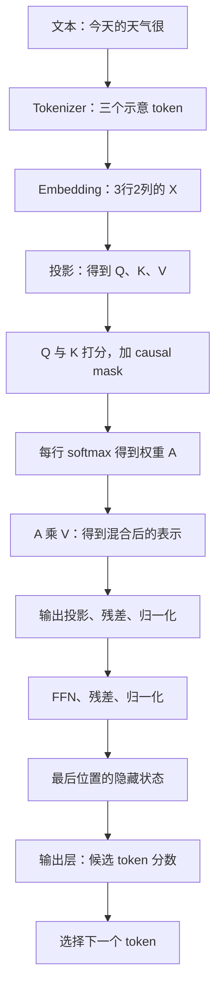

# Transformer 原理与计算参考

> 这是一份按需查阅的详细参考，包含公式、矩阵、术语和代码。
>
> **第一次学习，请先读：[用一个故事读懂 Transformer](Transformer-零基础学习指南.md)。**
>
> 基础故事读顺以后，再根据想了解的问题查本页；不需要按顺序全部读完。

> 主角：Transformer。读者不需要先学过机器学习、高等数学或模型开发。
>
> 目标：看懂它为什么出现，一句话如何变成数字，Attention 如何计算，各个组件怎样组成网络，以及它怎样训练和生成文本。
>
> 写法：先讲问题与直觉，再讲步骤和数字；比喻只帮助入门，随后说明真正的机制。GPU 与 Kubernetes 只在最后作简短联系。
>
> 整理日期：2026-10-01。

## 0. 阅读方法与学习地图

这是一份可以反复查阅的学习文档，不需要一次全部记住。

- **第 1—6 章：建立基础。** 架构是什么、旧方法遇到什么问题、token/向量/位置分别是什么。
- **第 7—8 章：理解核心。** Attention、Q/K/V、多头、FFN、残差和归一化。
- **第 9—11 章：理解完整工作方式。** Encoder/Decoder、生成、训练与推理。
- **后续章节：串成一个整体。** 完整例子、进阶概念、实验、常见误解、学习路线与参考资料。

第一遍先读例子和文字解释，公式可以暂时跳过。第二遍回来手算第 7 章，再做后面的实验。第三遍尝试不用术语解释一次完整流程。

快速查找：[基础数学](#3-先补最少的数学数字向量矩阵和参数) · [Attention 手算](#7-attention真正拆开这台信息混合器) · [完整算例](#12-把组件串起来一次前向计算的教学示意) · [学习实验](#15-两个无需-gpu-的小实验) · [术语表](#17-术语速查每个词先记一句话)

贯穿本文的两个例子是：

> 理解句子：“小明借了一本书，读完后把它还给了图书馆。”
>
> 生成文本：“今天的天气很……”

一个用于解释上下文关系，一个用于解释如何继续生成。文中所有小向量、概率和 token ID，除非明确说明，都是为了教学构造的，不是从真实大模型提取的结果。

### 最先理解的十句话

1. **Transformer 是一种神经网络架构**，也就是组织计算的方法。
2. **架构是一套设计，模型是按设计训练得到的具体产物。**
3. **文字要先转成 token ID，再转成向量，模型才能对它计算。**
4. **向量是一串数字，矩阵是多串数字组成的表。**
5. **Attention 让一个位置按相关程度结合其他位置的信息。**
6. **Q、K 用来产生匹配分数，V 是被加权混合的信息。**
7. **Transformer 不只有 Attention，还包含 FFN、残差、归一化等结构。**
8. **位置机制帮助网络表达先后顺序。**
9. **常见生成式语言模型反复选择下一个 token，逐步形成回答。**
10. **训练调整参数，普通推理使用参数；会生成通顺文本不等于事实必然正确。**

## 1. Transformer 到底是什么

### 1.1 先区分“设计图”与“具体成品”

如果我给你一套房屋设计方案，它规定房间怎样排列、门怎样连接，但它还不是一栋已经建好的房子。

Transformer 也类似：它规定一类神经网络怎样安排计算模块、怎样让不同位置交换信息。训练过程按照这种结构调整大量数字参数，最终得到一个具体模型。

```text
Transformer 架构：怎样组织计算
          ↓ 加上配置、数据与训练
具体模型：结构 + 学到的参数
          ↓ 接收输入并计算
输出：分类结果、表示向量、翻译或生成文本等
```

所以，Transformer、某个聊天模型、某个聊天网站，是三个层次。一个聊天网站可能使用 Transformer 模型，也还需要接口、应用和其他系统。

### 1.2 它与 AI、深度学习、大语言模型的关系

AI 是很大的领域。机器学习是让系统从数据学习规律的一类方法。深度学习使用多层神经网络。Transformer 是深度学习中的一种重要架构。

LLM，大语言模型，是一类大规模处理语言的模型；很多现代 LLM 使用 Transformer。Transformer 也能用于图像、语音等，不只用于聊天。

你可以暂时画成：

```text
AI → 机器学习 → 深度学习 → Transformer 架构
                                  ↓ 常见应用
                           很多现代语言模型
```

这是帮助理解层次的示意，不意味着所有 AI 都采用 Transformer，也不意味着所有 Transformer 都是大语言模型。

### 1.3 神经网络是不是在模拟一个人的大脑

“神经网络”这个名字有生物学灵感，但学习 Transformer 时，不需要把它想成一个数字化的人脑。

先把它理解成：**许多可调整参数的数值计算模块连接在一起，通过数据学习输入与目标之间的关系。**

一个最小例子是：

```text
输入数字 → 与参数相乘 → 加起来 → 经过某种函数 → 输出数字
```

复杂网络会重复和组合这样的操作。模型的能力来自结构、参数、训练数据和训练过程，而不是因为里面有一个会读书的小人。

### 1.4 学习这套结构时，要一直问四个问题

1. 当前要解决什么问题？
2. 输入和输出分别是什么？
3. 这一组件具体做了什么计算？
4. 少了它会有什么困难？

下面每一章都围绕这四件事展开。

## 2. Transformer 为什么出现：先理解它要解决什么问题

### 2.1 语言不是互不相关的单词列表

比较两句话：

```text
银行今天暂停营业。
河岸今天水位上涨。
```

英文里 `bank` 既可能表示银行，也可能表示河岸。要判断词的意思，就得看周围内容。

再看一小段故事：

```text
小明借了一本书。
他读完以后，把它还给了图书馆。
```

“他”指小明，“它”指书。读懂第二句，需要结合第一句，而不是只看最后一个词。

语言系统至少要处理：词义、顺序、前后关系、较远的信息依赖。这就是背景。

### 2.2 早期做法：把规则写出来

一个很简单的问答系统可以这样写：

```text
如果问题包含“天气”，返回固定的天气说明。
如果问题包含“感冒”，返回固定的健康说明。
```

它容易解释、容易控制，但遇到“出门要不要带伞”可能识别不到与天气的关系。你必须不断添加规则。

机器学习试图从数据里学到更一般的规律。深度学习进一步用多层计算学习复杂表示。

### 2.3 RNN：像一个人逐字读，边读边记

RNN 是循环神经网络。可以暂时这样想：

```text
读第 1 个词 → 更新脑中的笔记
读第 2 个词 → 根据上一步笔记继续更新
读第 3 个词 → 继续更新
```

这个方向很自然，因为语言有顺序。但它带来两个重要问题：

- **逐步依赖**：第 3 步要等第 2 步，第 2 步要等第 1 步。训练时不容易把整段序列中的位置同时大规模计算。
- **远处信息不容易保留**：很长的句子里，早期重要信息可能难以通过多次更新传到后面。LSTM、GRU 等结构改善了这一点，但没有让问题完全消失。

就像一个人读几十页故障报告，只能不断改写一张小便签。想准确保留所有关键细节并不容易。

还有一个背景：一些早期序列到序列系统，尝试把输入句子压成一份固定长度表示，再让另一部分网络据此生成输出。

像你读完整本书，只准带一张便签进入考场。书越长、细节越多，便签就越难覆盖所有需要的信息。

这不是说所有 RNN 系统只能这样做，而是说明早期编码—解码设计中的一种重要困难。Attention 的发展，让输出过程可以更直接地结合输入各位置的表示。

### 2.4 Attention：需要什么信息，就去结合相关位置

Attention 的直觉是：处理当前位置时，不必完全依赖一份不断被压缩的历史笔记，可以按相关程度结合其他位置的信息。

比如处理“把它还给图书馆”里的“它”，系统可以结合前面的“书”。遇到“他”，可以结合前面的人名。

Attention 在 Transformer 之前就已经被使用。2017 年的《Attention Is All You Need》提出了一种主要依靠 Attention 的序列建模架构，也就是 Transformer。

### 2.5 它带来什么变化：更直接的联系与更多并行计算

Transformer 可以让不同位置直接通过注意力结合信息，而不必只沿着一条逐步更新的状态链传递。

它还可以把多个位置的许多计算组织成矩阵运算。在训练和处理已知输入时，这种结构适合大规模并行计算。

但这里有一个常见误会：

> “Transformer 能并行，所以聊天时整篇回答可以同时生成。”

一般的自回归生成仍然需要先知道前一个 token，才能决定后一个 token。**已知输入的处理可以大规模并行，尚未确定的输出通常仍有前后依赖。** 后面讲 Prefill 与 Decode 时，你会看到这个区别怎样直接影响延迟。

### 本章回顾

Transformer 的核心背景是：语言需要结合上下文；旧的逐步处理方式有并行和长距离依赖方面的困难；Attention 提供了更直接的信息结合机制。

你现在还不需要记住公式。先记住：**它是一种更适合组织上下文计算、也适合大规模矩阵运算的网络设计。**

## 3. 先补最少的数学：数字、向量、矩阵和参数

### 3.1 标量：一个数字

`3`、`0.5`、`-2` 都是一个数字。数学里常把单个数字叫作标量。

一个人的年龄、一杯水的温度，都可以用单个数字表示。

### 3.2 向量：一串有顺序的数字

```text
[0.2, -0.7, 1.4, 0.1]
```

这是一个 4 维向量。“4 维”只是在说它有 4 个数字，不是在说四维空间里的神秘事物。

例如我们可以人为用三个数字描述水果：

```text
[甜度, 酸度, 大小]
```

假想的苹果是 `[7, 3, 5]`，柠檬是 `[2, 9, 3]`。这里只是演示“一串数字可以携带多项信息”。

这个例子中每个数字有我们手动指定的意义。但模型内部的向量通常是训练学出来的表示，不能简单给每一维贴上“语法”“情绪”“水果”这样的标签。

**类比的用处是理解“多项信息可以装进一串数字”，它并不说明神经网络每一维都能被人直接解释。**

### 3.3 矩阵：把许多向量排成一个表

```text
          第1维   第2维   第3维
token A    0.2    -0.7     1.4
token B    0.8     0.1    -0.3
token C   -0.5     0.4     0.9
```

这是一个 3 行 3 列的矩阵。

假设一句话分成 100 个 token，每个 token 用 4,096 个数字表示。那么整句的一份表示可以是：

```text
100 × 4096
```

数字 `4096` 是一个教学示例中的隐藏维度，实际模型可能不同。

你可以把矩阵想成二维数组。模型里还会出现多个维度的数组，例如：

```text
[批次大小, token 数, 隐藏维度]
```

这种更一般的多维数组，常叫作**张量，Tensor**。别被名字吓住，先把它理解成“带形状的数字数组”。

### 3.4 点积：把对应位置相乘再相加

假设：

```text
a = [1, 2]
b = [3, 4]
```

点积就是：

```text
a · b = 1×3 + 2×4 = 11
```

后面 Attention 会用点积产生相关性分数。点积受到方向和数值大小的影响，不必把它等同于经过归一化的余弦相似度。

### 3.5 矩阵乘法：批量做“加权相加”

假设输入 `x = [2, 3]`，用一组权重产生两个输出：

```text
输出1 = 2×0.5 + 3×1.0 = 4.0
输出2 = 2×(-1.0) + 3×0.2 = -1.4
```

这就是一种线性变换。很多输入和很多输出一起算，就可以组织成矩阵乘法。

Transformer 里有大量这类运算。看上去复杂的文本处理，最终被组织成对许多数字的乘法、加法和其他函数运算。

### 3.6 参数与隐藏状态：不要把两类数字混淆

| 类型 | 来自哪里 | 什么时候变化 |
| --- | --- | --- |
| 参数、权重 | 训练学习得到 | 训练、微调时被更新 |
| 激活值、隐藏状态 | 当前输入经过网络计算产生 | 不同输入、不同层的结果通常不同 |

像一台榨汁机：结构和设定好比参数；当前水果经过加工得到的结果，好比激活值。换水果，不必重新制造一台机器，但当前结果会变化。

这个类比只解释两类状态。真正的模型参数与激活值都是数值数组。

**隐藏状态不是隐藏起来的一段中文推理稿，而是中间计算的向量表示。**

### 3.7 “7B 模型”的 B 是什么

`B` 是 billion，十亿。`7B` 大致表示 70 亿个参数。

它不表示 7GB，也不表示能处理 70 亿字的上下文。参数数量、权重文件大小、上下文长度、显存占用是不同概念。

一个参数占多少字节，取决于存储格式。例如 FP16、BF16 通常每个数占 2 字节，FP32 占 4 字节。低位量化还能使用更少的位数，但会有额外元数据及其他开销。

### 3.8 读公式时常见的几个符号

| 符号 | 怎样读 | 小例子 |
| --- | --- | --- |
| `x²` | x 的平方，自己乘自己 | `3² = 9` |
| `√x` / `sqrt(x)` | 平方根，哪个非负数的平方等于 x | `√9 = 3`，`√2 ≈ 1.4142` |
| `Σ` | 把指定的一组数加起来 | `1+2+3 = 6` |
| `exp(x)` | 指数函数 `eˣ`，这里用来把分数转成正数 | `exp(0)=1`，`exp(1)≈2.7183` |
| `ln(x)` | 自然对数，与 `exp` 互相对应 | `ln(exp(1))=1` |
| `f(x)` | 把 x 输入函数 f | 如果 `f(x)=2x`，则 `f(3)=6` |
| `ᵀ` | 矩阵转置，交换行列 | 2 行 3 列转成 3 行 2 列 |

转置可以直接看数字：

```text
原矩阵：                转置：
[ [1, 2, 3],            [ [1, 4],
  [4, 5, 6] ]             [2, 5],
                          [3, 6] ]
```

公式不需要一次背下来。比如读到 softmax，只需要先知道 `exp` 会让分数变成正数，而且更大的分数会得到更大的值；再除以总和，就得到加起来等于 1 的权重。

## 4. 一次提问的完整旅程：从文本到文本

现在想象你让模型续写：

> 今天的天气很……

### 4.1 先看整体流程

```text
原始问题
  ↓ 应用组织消息、使用模型要求的聊天模板
输入文本
  ↓ tokenizer 分词
token ID 序列
  ↓ embedding 查表
每个 token 的向量
  ↓ 结合位置信息，经过多层 Transformer
上下文相关的隐藏状态
  ↓ 输出层计算词表中每个 token 的分数
下一个 token 的概率分布
  ↓ 选择一个 token
把新 token 接到序列后面
  ↓ 继续生成，直到满足停止条件
tokenizer 解码 → 用户看到的回答
```

这是一幅简化流程图。先看清每一步输入什么、输出什么，后面再逐一拆开。

### 4.2 聊天消息为什么需要模板

你发出的请求可能长这样：

```json
{
  "messages": [
    {"role": "system", "content": "你是一位耐心的老师。"},
    {"role": "user", "content": "请解释彩虹为什么会出现。"}
  ]
}
```

模型计算时并不是直接理解这个 JSON 对象。服务通常会按模型要求，把角色、内容和分隔符组织成 token 序列。

像一份剧本用角色名区分不同人的台词，模型训练时也需要学习区分不同角色和消息边界。

对于聊天模型，配套的 tokenizer 和 chat template 是输入表达方式的一部分。它们不是 Attention 的替代品，而是在计算前告诉模型“这些内容是什么角色说的”。

### 4.3 一次普通回答是在使用学好的参数

模型先经过训练，得到一组参数。之后，新的输入可以使用这组参数进行计算。

收到一条消息后，模型运行一系列计算生成输出。这叫推理。它一般不会为这一条消息再训练一次模型。

如果应用保存了你的对话记录，那是应用的存储行为。它不等于模型权重已经被这段对话永久改写。

### 4.4 为什么用户看到的是“一点点往外冒”

服务可以在每次生成新内容后，通过流式接口把结果发给用户，而不是等全文结束。

生成单位是 token；网络发送单位可能是一个或多个 token 对应的文本片段。中文字符、网络 chunk 和 token 不保证一一对应。

因此，屏幕上每跳出一段文字，不必然代表模型刚刚只生成了一个汉字。

## 5. Tokenizer 与 Embedding：为什么文字必须先变成数字

### 5.1 Tokenizer 在做什么

Tokenizer 是一套把文本转换成 token ID、再把 ID 转回文本的规则和数据。

教学上可以想象：

```text
“今天的天气很”
    ↓ 示意拆分，不代表任何真实 tokenizer 的结果
[“今天”, “的”, “天气”, “很”]
    ↓ 示意 ID
[1250, 842, 9917, 63]
```

实际拆分会受 tokenizer 类型、词表和文本内容影响。英文的 `unbelievable` 可能是一个 token，也可能被拆成多个片段。中文也可能按字、词片段或其他方式编码。

**token ID 是一个编号。编号 9917 不比编号 842 更“重要”，也不表示数学意义上的大小关系。**

### 5.2 为什么不用“一字一个编号”就结束

模型需要一种可计算的表示，表达不同片段之间学到的关系。

Embedding 可以理解成一个大表：

```text
token ID       对应的一串数字
   842         [0.12, -0.35, 0.81, ...]
  1250         [0.44,  0.09, -0.22, ...]
  9917         [-0.18, 0.63, 0.27, ...]
```

查到的向量会进入后续计算。这些表项通常是模型参数的一部分，通过训练学到。

### 5.3 词典编号与词的表示不是同一件事

一本词典可能把“苹果”放在第 200 页，“香蕉”放在第 900 页。页码只是位置，不能直接用页码差判断两个词的关系。

token ID 也类似。Embedding 则给每个 ID 一份可计算的向量表示，训练会调整这些数字，使整个任务的预测更好。

两个向量的关系可以反映模型学到的某些相似性，但不能保证每一对词的几何关系都有简单的人类解释。

### 5.4 静态查表与上下文表示有什么区别

同一个 token ID，在同一模型的输入 embedding 表里，会查到相同的基础向量。

但它随后经过 Transformer，会结合所在句子的上下文。最终表示可以不同。

例如英文 `bank`：

```text
I deposited money at the bank.   → 周围内容与存钱有关
I sat on the river bank.        → 周围内容与河岸有关
```

基础 token 表示并不需要为每种情境都建立一个完全不同的编号。后面的上下文计算会帮助区分使用方式。实际 tokenizer 也可能受到空格等因素影响，这里只解释同一 token 的情况。

### 5.5 为什么字数与 token 数不一样

中文、英文、标点、数字，都可能按照不同片段拆分。100 个字符并不保证恰好对应 100 个 token。

因此“上下文有 8,192 token”说的是模型输入序列的单位数量，不是汉字数。

常见的生成模型需要为输入和后续输出共同考虑长度。模型也会在达到输出上限或遇到终止条件时停止。

这与本文主线的联系是：**Transformer 处理的是 token 位置组成的序列，序列长度是后续 Attention 的重要维度。**

## 6. 位置：模型怎么知道谁在前、谁在后

### 6.1 同样的词，顺序不同，意思不同

```text
小猫追小狗。
小狗追小猫。
```

两句话里有相同的主要词，但意思不一样。

只做不带位置信息、也不带顺序限制的 Attention，无法充分表达序列顺序。Transformer 需要某种位置机制。

### 6.2 给内容加上“位置坐标”

原始 Transformer 使用位置编码，经典做法是把表示位置的向量加入 token 的 embedding。

```text
输入表示 = token 内容向量 + 位置向量
```

就像读一本书，需要知道句子的先后顺序。只把每页上的词全部放进袋子，内容还在，但情节顺序就丢失了。

### 6.3 原始位置编码的一个小例子

原始 Transformer 使用正弦和余弦函数构造位置向量。你现在不必记住整个公式，只看一个 4 维的例子：

```text
位置 0 → [0.0000,  1.0000, 0.0000, 1.0000]
位置 1 → [0.8415,  0.5403, 0.0100, 1.0000]
位置 2 → [0.9093, -0.4161, 0.0200, 0.9998]
```

不同维度使用不同变化频率。这样每个位置有一组数字坐标，可以与内容向量结合。

比喻成多只转速不同的钟：有的指针转得快，有的慢，它们一起帮助描述位置。

两个 token 内容相同，但位置不同，就能通过位置机制带入不同信息。它没有把词变成“有序字符串算法”，仍然是在给数值计算增加顺序相关的表示。

### 6.4 现代模型里常见的 RoPE

RoPE 是旋转位置编码。直观地说，它根据位置改变 Query、Key 的表示，使相关性计算能够包含位置信息，尤其是相对位置关系。

初学时不用推导旋转矩阵。先知道两件事：

- 原始 Transformer 的加法位置编码与现代模型的 RoPE，并不是同一种实现。
- 模型可靠处理长文本的能力，与训练、位置机制等有关，不能只靠给位置编号增加更多数字来保证。

“能输入很长”与“能准确理解全部细节”并不是同一件事。后面谈上下文时会继续解释。

## 7. Attention：真正拆开这台“信息混合器”

这是全文最值得慢慢读的一章。先理解一次注意力计算，再去理解多头和完整网络，会轻松很多。

### 7.1 它究竟在干什么

对序列中的某个位置，Attention 会：

1. 计算这个位置与可见位置的相关性分数。
2. 把分数转换成一组权重。
3. 按权重混合其他位置提供的信息。

这不是在复制某一个词，而是在产生一个新的数字向量。

例子：

> “小明借了一本书，读完以后，把它还给了图书馆。”

处理“它”时，结合前面的“书”等内容，可以形成更有上下文的表示。

实际模型可能使用很复杂、并不容易解释的模式。我们用自然语言关系帮助理解机制，不能据此声称某个头一定在做人类式的因果推理。

### 7.2 用查资料来理解 Q、K、V

假设你去图书馆寻找“有关恐龙的资料”。

- **Q，Query**：你当前在寻找什么。
- **K，Key**：每条候选资料用来与你的需求比较的表示。
- **V，Value**：一旦这条资料相关，它能够提供给你的内容表示。

资料标题很像用于匹配的 Key，资料内容很像 Value。但真实网络里，它们都不是字符串标题，而是数字向量。

特别注意：**Q 不等于用户整句问题，K 不等于数据库主键，V 不等于完整原文。** 这是为了理解功能的比喻。

### 7.3 Q、K、V 从哪里来

在自注意力里，三者通常来自同一批输入隐藏状态 `X`，经过三套不同的权重变换：

```text
Q = X × W_Q
K = X × W_K
V = X × W_V
```

`W_Q`、`W_K`、`W_V` 是训练学到的参数。模型用不同变换，让同一位置在“提出需求”“供人匹配”“提供信息”三个角色下拥有不同的表示。

像同一本书可以有一份适合检索的摘要，也有实际正文。它们服务于不同目的；在模型里，则通过不同数值变换形成这些角色。

### 7.4 第一步：算相关性分数

我们只算一个 Query，并使用很小的二维向量：

```text
Q  = [1, 0]
K₁ = [1, 0]
K₂ = [0, 1]
K₃ = [1, 1]
```

点积结果是：

```text
Q · K₁ = 1
Q · K₂ = 0
Q · K₃ = 1
```

这表示在这组人为设计的数字里，位置 1 和位置 3 得分相同，都高于位置 2。

这些数字只是演示计算，**不是从某个真实模型提取的语义数据**。

### 7.5 为什么要除以 √dₖ

`dₖ` 是 Key、Query 的维度。这个例子有两个数字，所以 `dₖ = 2`。

缩放后的分数约为：

```text
[1 / √2, 0 / √2, 1 / √2]
≈ [0.7071, 0, 0.7071]
```

为什么要缩放？向量维度增大时，在常见的统计假设下，点积的数值波动会变大。特别大的分数容易让下一步 softmax 过于集中，影响训练的数值和梯度表现。

你可以先把它理解成：**把打分尺度调整到更合适的范围。** 这里除的是维度的平方根，不是 token 数。

### 7.6 第二步：softmax 把分数变成权重

softmax 的规则是：对每个分数取指数，再除以所有指数之和。

```text
权重ᵢ = exp(分数ᵢ) / Σ exp(所有可见分数)
```

对刚才的分数，得到约：

```text
[0.4011, 0.1978, 0.4011]
```

它们都非负，加起来等于 1。

像你决定从三份资料里分别吸收约 40%、20%、40% 的信息。但这是数学上的混合系数，不是模型对资料真实性的人工判断。

实现时常先减去所有分数中的最大值，再计算指数，以避免数值过大。这不会改变数学上的 softmax 结果。

### 7.7 第三步：按权重混合 Value

现在假设：

```text
V₁ = [10, 0]
V₂ = [0, 10]
V₃ = [6, 6]
```

输出就是：

```text
输出 = 0.4011×V₁ + 0.1978×V₂ + 0.4011×V₃
     ≈ [6.418, 4.384]
```

注意：输出并不等于 `V₁`、`V₂` 或 `V₃` 中的任意一个，而是它们的加权组合。

此时“Attention 做什么”已经落到具体计算了：**相关性打分 → 归一化权重 → 混合信息。**

### 7.8 把所有位置一起算，就得到常见公式

```text
Attention(Q, K, V) = softmax(QKᵀ / √dₖ + M) V
```

逐个翻译：

| 部分 | 含义 |
| --- | --- |
| `QKᵀ` | 把每个 Query 与每个 Key 的点积一起算出来 |
| `ᵀ` | 转置，为矩阵乘法调整行列方向 |
| `/ √dₖ` | 调整打分尺度 |
| `M` | 可选的 mask：规定哪些位置不允许被使用 |
| `softmax` | 对每个 Query 的可见候选分数转换成权重 |
| 最后的 `V` | 按权重混合信息 |

如果有 100 个 token，普通全注意力的打分关系会形成约 `100 × 100` 的表。每一行对应一个位置“看”其他位置的程度。

### 7.9 Mask：为什么有些位置不允许看

生成式语言模型训练时，不能预测前面的词却提前偷看后面的正确答案。

例如训练序列：

```text
今天  的  天气  很  晴朗
```

在某个位置预测下一个 token 时，常见的 causal mask 只允许结合当前位置及更早的位置，不能结合未来位置。

```text
           第1位 第2位 第3位 第4位
第1位能看    ✓     ×     ×     ×
第2位能看    ✓     ✓     ×     ×
第3位能看    ✓     ✓     ✓     ×
第4位能看    ✓     ✓     ✓     ✓
```

实现时，常把禁止位置的分数设为负无穷；softmax 后这些位置的权重为 0。

**mask 不是用户权限系统。** 它是网络内部限制信息流的机制。真正的租户权限、数据授权仍要由应用和平台设计。

### 7.10 为什么长上下文会变贵

普通全注意力的两两关系数量与序列长度的平方相关：

```text
1,000 个 token → 约 1,000,000 个位置对
2,000 个 token → 约 4,000,000 个位置对
```

长度翻倍，这部分关系数量会变成约四倍。因果遮罩会改变常数，但没有消除这个数量级。

这描述的是标准全注意力的核心关系计算，**不能把整个模型的总耗时也一律说成四倍**。其他计算、优化内核、缓存和硬件瓶颈都会影响实际表现。

后面你还会看到：FlashAttention 可以显著减少中间数据的读写与存储，但不会凭空消除普通全注意力的全部两两关系计算。

### 7.11 为什么要分 Q、K、V 三套变换

你可能会问：既然都是同一份输入，为什么不直接用它比较、再原样输出？

因为“怎样比较相关性”和“应该传递什么信息”是两种任务。让模型学习不同变换，可以给这两种任务不同的表示空间。

例如一句话里的动词想结合相应对象。提出需求的一侧与被匹配的一侧，可以学习不同的特征组合；被传递的内容还可以再用另一套表示。

这不是人预先给 Q 写规则：“只看动词”；训练通过整体目标调整相关参数。

也要分清两个层次：

```text
W_Q、W_K、W_V：模型学好的参数，普通推理时通常不变
Q、K、V：当前输入计算出来的结果，输入变了，它们通常也会变
```

第 12 章把三个权重设成一样，只是特殊的教学设定。

### 本章回顾

如果现在仍觉得抽象，抓住三句：

- Q、K 决定“该结合哪些信息、各占多少”。
- V 提供“被结合的信息”。
- 输出是信息混合后的新表示，随后还要进入其他计算层。

## 8. 一个 Transformer Block：Attention 之外还有什么

### 8.1 Multi-head Attention：从多个学习到的角度混合信息

一个 Attention head，可以理解成一套 Q/K/V 计算。

Multi-head Attention 使用多套这样的计算，然后把结果组合起来。

类比阅读一句话：“小明在下雨前把书放进了书包。”

- 一个视角可能侧重词与词的指代关系。
- 一个视角可能侧重动作与对象的关系。
- 一个视角可能侧重时间和其他上下文关系。

不同视角可能提供不同信息。但真实模型的头并没有预先被指定成“指代头”“动作头”“时间头”；这些只是帮助理解多视角组合的比喻。

对于经典多头注意力，一个常见配置是：

```text
隐藏维度 d_model = 4096
Query 头数 n_heads = 32
每头维度 d_head = 128
32 × 128 = 4096
```

这种计算不是把同一份 4,096 维结果完整复制 32 遍。经典结构通常让每个头使用较小的表示，再拼接和投影。现代 GQA、MLA 等结构还有不同细节。

再用一个更小的形状说明：假设 6 个 token、每个表示 8 维，使用 2 个头，每头 4 维。

```text
输入 X：              6 × 8
第一个头的 Q/K/V：    各为 6 × 4
第二个头的 Q/K/V：    各为 6 × 4
每个头的关系分数：    6 × 6
每个头混合后的结果：  6 × 4
拼接两个头：          6 × 8
输出投影后：          6 × 8
```

两个头都处理这些位置，并不是把前 3 个 token 分给头 1、后 3 个分给头 2。

而且每个头的投影可以综合原向量的全部维度；不要把它理解成永远只拿原向量的一小段。常见实现把多套投影一起计算，再 reshape 成不同头。

最后的输出投影会继续组合各头的结果。这样得到的表示维度可以与输入一致，方便后面做残差相加。

### 8.2 FFN/MLP：每个位置继续做非线性加工

Attention 主要负责位置之间的信息结合。

FFN，前馈网络，也常被称作 MLP，会对每个位置的向量进一步变换。一个简化形式是：

```text
FFN(x) = 激活函数(x × W₁ + b₁) × W₂ + b₂
```

这里沿用把 x 写成一行向量的约定。先把向量转换到另一个维度，经过非线性处理，再变换回来。

“非线性”你可以这样理解：如果连续很多层都只有简单线性变换，它们整体还能合并成一次线性变换。加入非线性，网络才能表达更复杂的关系。

经典 FFN 常扩大中间维度；很多现代模型采用 SwiGLU 等带门控的结构，不能一概套用同一公式。

同一层的 FFN 通常对每个位置使用相同的参数，各位置输入不同，输出也可以不同。不同层则通常有各自的参数。FFN 不会在这一步直接把其他 token 的向量拿来混合，但它的输入已经可以包含前面的 Attention 带来的上下文信息。

**Attention 让不同位置结合信息，FFN 则进一步加工每个位置的表示。它们分工不同，二者都很重要。**

### 8.3 Residual：保留原信息的通道

残差连接可以简化理解成：

```text
新结果 = 原来的 x + 某个子层对 x 的处理结果
```

像你在原稿上增加修改意见，保留原来的内容，同时加入新的加工结果。

这种结构帮助深层网络训练，也让信息和梯度更容易传递。严格说，它是数值向量的相加，不是保存多份文本版本。

### 8.4 Normalization：让内部数值更容易被处理

LayerNorm、RMSNorm 是常见的归一化方式。

直觉上，它们帮助管理向量的数值尺度，使网络的计算和训练更稳定。两者公式不同，不必当成完全相同的算法。

以一个简化的 LayerNorm 为例，输入是 `[1, 2, 3]`：

```text
平均值 = 2
方差 = ((1−2)² + (2−2)² + (3−2)²) / 3 = 2/3
每个数字先减平均值，再除以标准差
结果约为 [-1.2247, 0, 1.2247]
```

实际公式还会在方差上加入很小的 `epsilon`，避免分母出问题，并通常使用可学习的缩放和偏移：

```text
LayerNorm(x) = gamma × (x − mean(x)) / sqrt(var(x) + epsilon) + beta
```

这里的统计通常针对一个 token 的隐藏维度计算，不是在整个批次上计算同一组统计量。

RMSNorm 主要使用均方根尺度，不做同样的减均值操作。这也是为什么两者不能简单视为一个名称的不同写法。

它处理的是模型内部数字的尺度，不是把原文改成统一大小写。

### 8.5 一个常见的现代 Pre-norm Block

下面是简化结构，具体模型可能有差异：

```text
输入 x
  ↓
Norm → Attention → 与 x 相加
  ↓ 得到 y
Norm → FFN/MLP → 与 y 相加
  ↓
Block 输出
```

原始 Transformer 与现代模型在归一化位置等细节上不同。我们用这张图建立主线，不把它说成所有 Transformer 的唯一结构。

### 8.6 为什么要堆很多层

一层得到的上下文表示，会成为下一层的输入。多层计算可以逐步形成更复杂的表示。

不要机械理解成“第一层一定学词，第二层一定学语法，第三层一定学逻辑”。这是过度简化。不同层学到的功能可能交叠，具体行为需要研究。

多层的价值在于让表示经过多次上下文结合和非线性加工。层数、宽度和训练方式会共同影响能力，不能简单地认为“只要再加一层，就一定更聪明”。

## 9. Encoder、Decoder 与常见模型家族

### 9.1 原始 Transformer：读入一段，再生成另一段

原始论文面向机器翻译，包含 Encoder 和 Decoder。

```text
英文句子 → Encoder → 一组输入表示
                         ↓ 供 Decoder 使用
               Decoder → 逐步生成中文句子
```

Encoder 用自注意力处理输入；Decoder 有受因果限制的自注意力，还会使用 Cross-attention 结合 Encoder 输出。

### 9.2 用一次翻译把原始结构走一遍

假设输入是英文：

```text
I love cats.
```

目标是生成中文：“我爱猫。”

**第一步：Encoder 读输入。**

输入经过分词、embedding 与位置机制，再经过多层 Encoder Block。每个 Block 里有自注意力和 FFN，以及残差和归一化。

普通 Encoder 自注意力通常允许输入位置结合整段输入。例如 `love` 可以结合前面的 `I` 与后面的 `cats`。最终得到每个输入位置的上下文表示。

这里的“编码”是形成向量表示，不是把英文压缩成 ZIP，也不是加密。

**第二步：Decoder 从起始符号开始。**

假想生成过程：

```text
<BOS>                 → 预测“我”
<BOS> 我              → 预测“爱”
<BOS> 我 爱           → 预测“猫”
<BOS> 我 爱 猫        → 预测句号或终止符号
```

`<BOS>` 是方便理解的起始符号写法，真实 tokenizer 和模型的约定可能不同。

**第三步：Decoder 内部有两次不同的信息结合。**

先用 masked self-attention，结合已经存在的中文前缀。然后用 cross-attention，结合 Encoder 给出的英文输入表示。随后还会经过 FFN 等加工。

```text
已生成中文 → 因果自注意力 → 当前 Decoder 表示
                                  ↓ 作为 Q
英文的 Encoder 输出 → 作为 K、V → Cross-attention
                                  ↓
                              FFN 等后续计算
                                  ↓
                           下一个中文 token 的分数
```

Decoder 能看完整英文输入，不代表它可以偷看尚未生成的中文正确答案。源语言输入与目标语言后续是两种不同信息。

**第四步：继续生成直到停止。**

推理时，每次选一个后续 token；训练时，目标中文序列已经给定，可以在 mask 限制下并行计算多个位置的预测。

### 9.3 Self-attention 与 Cross-attention

- **Self-attention**：Q、K、V 来自同一序列的相关表示。例如一句话内部不同位置互相结合信息。
- **Cross-attention**：Q 来自一侧，K、V 来自另一侧。例如翻译 Decoder 根据已生成内容，结合 Encoder 的输入表示。

不要认为所有模型都有 Cross-attention。很多聊天大模型采用 Decoder-only 架构，没有原始 Encoder-Decoder 中那套独立的交叉注意力结构。

### 9.4 三种常见方向

| 架构方向 | 典型特点 | 常见用途或代表家族 |
| --- | --- | --- |
| Encoder-only | 通常能结合输入两侧的信息 | BERT 类文本表示、分类；很多 embedding 模型 |
| Decoder-only | 通常用因果注意力，逐步预测下一个 token | GPT 类，以及许多 Llama、Qwen、DeepSeek 等生成模型家族 |
| Encoder-Decoder | 先编码输入，再基于输入生成输出 | 原始 Transformer、T5 类任务 |

这只是分类入口。一个家族可能有多种模型，实际产品还可能包含多模态编码器或混合结构，要查看具体模型说明。

比如做阅读理解或文本分类，你可能希望一句话里的某个位置能结合两边的信息。Encoder 的双向上下文很适合这类表示任务。

比如逐步续写，你必须避免用尚未确定的后文预测当前输出。Decoder-only 的因果结构适合这条主线。

但架构选择并不把所有用途完全隔开。Decoder 模型也能通过训练和任务组织完成很多分析任务。

### 9.5 原始论文的一个具体规模

原始论文的 base 配置使用 6 个 Encoder 层、6 个 Decoder 层，隐藏维度 512、8 个注意力头、FFN 中间维度 2,048。

你不用背这些数字。它们说明：前面画的 Block 会重复堆叠，而且真实网络中的向量比二维算例宽得多。

现代模型配置不同，不能拿这套数字去描述所有 Transformer。

### 9.6 现代大模型为什么不像原论文一模一样

后来大家在结构和工程上做了很多变化，例如：

- RoPE 等位置机制。
- RMSNorm、Pre-norm 等结构选择。
- SwiGLU 等 FFN 设计。
- GQA/MQA，用更少的 Key/Value 头减少缓存压力。
- MoE，让部分计算选择不同专家。
- 优化 Attention 内核和缓存组织。

所以“读懂原始 Transformer”是基础；“运行一个现代模型”还要看它的配置与推理引擎支持。

## 10. 模型怎样一个 token 一个 token 地生成回答

### 10.1 Logits：先给所有候选打分

经过多层计算后，输出层会给词表中的每个候选 token 一个分数，常叫 logits。

教学例子：当前文本是“今天的天气很”。候选片段的假想分数为：

```text
晴朗    3
寒冷    2
潮湿    1
```

这三个候选和分数都是人为构造的，不代表真实 tokenizer 或模型输出。

通过 softmax 转换成概率，约为：

```text
晴朗：0.6652
寒冷：0.2447
潮湿：0.0900
```

真实词表可能有很多万项，远不止三个候选。

### 10.2 怎么从概率中选一个

常见方式包括：

- **Greedy，贪心选择**：每次取概率最大的候选。
- **采样**：按照概率随机选，不总是选第一名。
- **Temperature，温度**：调整分布的尖锐或平缓程度。
- **Top-k**：只从概率最高的 k 个候选中选。
- **Top-p**：保留累计概率达到指定阈值的候选集合，再采样。

通常温度作用在 logits 上：`logits / T`。`T` 大于 0；温度更小，分布通常更集中。服务里 `temperature=0` 常被作为贪心模式的特殊配置，不是直接做除以零。

例如这组分数：

```text
T = 1：约 [0.6652, 0.2447, 0.0900]
T = 2：约 [0.5065, 0.3072, 0.1863]
```

后者更平缓，低分候选被选中的机会变大。

再看 top-p：如果原始概率约为 `[0.6652, 0.2447, 0.0900]`，设置 `top_p=0.8`，第一个候选的累计概率还没到 0.8，加入第二个才超过。因此保留前两个候选，再在它们之间重新归一化并采样。

top-k 则看数量。例如 `top_k=2` 保留最高的两个，不根据累计概率决定数量。

**温度不是可靠性的旋钮。** 温度低可以减少某些随机性，但不能保证事实正确、命令安全或回答唯一。硬件和实现也可能造成细微差异。

### 10.3 生成一个，再把它接回去

```text
输入：今天的天气很
生成：晴

新的序列：今天的天气很晴
生成：朗

新的序列：今天的天气很晴朗
继续生成……
```

这是自回归生成的直觉。后一个 token 的选择依赖已经确定的前文。这里假设“晴”“朗”分别是两个 token，真实拆分以具体 tokenizer 为准。

模型不断延长已有序列；它通常不是从固定答案库里抽取一个完整句子。

### 10.4 什么时候停

可能的停止原因有：

- 生成了模型的终止 token。
- 达到了请求的最大输出长度。
- 遇到了配置的停止条件。
- 请求被取消，或发生错误。

回答被截断，不一定是模型“不知道了”，也可能是输出长度限制。终止条件是生成流程的一部分。

### 10.5 为什么“说得像真的”不等于“真的”

模型训练中学到了语言模式和许多知识，但下一个 token 的概率并不等同于事实核验结果。

例如问“明天北京会不会下雨”，一个没有实时天气数据的模型可能仍然写出听起来很确定的回答。语言形式可以很自然，事实却没有足够依据。

再比如让它算很复杂的乘法，它可能沿着常见表达生成一个看起来合理的数字，但没有像计算器一样保证逐位运算正确。

因此要区分：

- **语言生成能力**：能否把话组织得自然。
- **事实依据**：是否有可靠信息支持。
- **任务正确性**：结果是否符合实际要求。

更强的模型可能在很多任务上表现更好，但“用了 Transformer”本身并不是正确性的保证。

## 11. 模型怎样学习：训练、微调与推理

### 11.1 预训练：用大量样本学习预测

以常见的自回归语言模型为例，训练任务可以简化理解成：

```text
看到“今天”          → 预测“的”
看到“今天 的”       → 预测“天气”
看到“今天 的 天气”  → 预测“很”
```

模型先给出预测，再与训练文本中的真实后续比较。如果预测不好，就调整参数，让以后更可能预测正确。

真实训练使用海量数据、多种处理和复杂工程，这个例子只是解释目标。

### 11.2 Loss：把“预测差多少”转换成一个数字

训练需要一个可优化的目标，常见语言建模会使用交叉熵损失。

直觉上：如果正确 token 的预测概率很低，惩罚更大；如果它的概率更高，惩罚更小。

这个损失评价的是训练目标下的预测表现。训练损失变低，并不自动意味着每个业务问题都回答正确。

### 11.3 反向传播与优化器：怎样改参数

一轮训练通常包含：

```text
前向计算 → 得到预测
计算 loss → 知道目标表现
反向传播 → 计算各参数应怎样调整的梯度
优化器更新 → 改变参数
```

梯度可以先理解成“这个参数变化一点，会使目标怎样变化”的信息。优化器利用这种信息调整参数。

一个最简的梯度下降更新是：

```text
新参数 = 旧参数 − 学习率 × 梯度
```

假设旧参数为 `1.0`、学习率为 `0.1`、梯度为 `2.0`，新参数就是 `0.8`。这个数字只演示更新公式；实际一次更新是否改善目标，还与步长和问题有关。Adam 等优化器还使用额外状态，不只是这一条最简公式。

像你在调系统参数，但这里的调整来自数学计算，且可能同时涉及几十亿个数字。

### 11.4 为什么训练能同时处理很多位置

训练数据中的后续内容已经给定。模型可以在因果 mask 的限制下，同时计算许多位置的预测，再与各位置的目标比较。这常被称为 teacher forcing 的训练方式。

“目标已知”并不等于“当前预测可以偷看未来”。mask 会限制当前表示能使用的信息。

推理时，后续输出还没有被确定。因此通常需要逐步生成。这解释了为什么**训练阶段的序列并行能力，不等于聊天输出没有顺序依赖**。

### 11.5 SFT：教模型按任务和对话形式回答

SFT 是监督微调。用准备好的输入和期望回答继续训练，让模型更适应指令、领域或格式。

比如你准备了大量经过校验的样本：

```text
输入：请给一个小学生解释为什么会下雨。
输出：水蒸发到空中，遇到合适条件凝结成小水滴……
```

模型可以学习这种回答形式和领域模式。偏好优化等后训练方法，还可能进一步调整回答倾向。

模型可以学习更适合任务的表达方式，但微调不等于给它安装一个永远准确、实时更新的百科全书。模型仍需要质量评估。

### 11.6 LoRA：少改一部分，而不是更新所有参数

LoRA 是一种常见的参数高效微调方法。直觉上，它冻结大部分基础权重，在某些位置加入较小的可训练低秩更新。

它可以减少需要训练的参数和相应的优化器状态，但不代表完全不需要加载基础模型，也不代表训练没有激活值和显存开销。

QLoRA 常结合量化基础模型和低秩微调，以进一步降低资源需求。实际支持与开销要看软件和模型。

**LoRA 是训练/适配方法；量化是数值表示方法。两者可以组合，但不是同一个概念。**

### 11.7 最后把训练与推理并排看

| 问题 | 训练 | 普通推理 |
| --- | --- | --- |
| 手里有什么 | 输入样本与训练目标 | 新的输入与已训练好的参数 |
| 主要做什么 | 计算预测、损失、梯度，再更新参数 | 根据现有参数计算输出 |
| 参数通常变化吗 | 会 | 不会 |
| 正确后续是否已给定 | 训练样本中通常有目标 | 生成出来以前没有确定 |
| 结果是什么 | 更新后的模型 | 回答、表示向量或其他任务结果 |

它们使用许多相同的前向计算组件，但目标和额外步骤不同。

如果你能解释“同一个 Transformer 为什么既能训练，又能推理”，你就已经跨过一个很重要的理解门槛。

### 11.8 再补三个训练常识

**参数通常不是人手写的语义规则。** 常见做法是初始化参数，再让训练不断更新。第 12 章手动写矩阵，是为了演示计算，不是训练真实模型的常规方式。

**损失可以用具体数字理解。** 只看一个正确目标 token，简化交叉熵为 `−ln(p)`：

```text
正确 token 概率 p = 0.8 → 损失约 0.2231
正确 token 概率 p = 0.1 → 损失约 2.3026
```

概率越低，这一项损失越大。训练通常会对多个有效位置的损失进行适当聚合。

**记住训练样本，不等于学会处理新问题。** 一个学生如果只记住试卷答案，遇到换个说法的新题可能不会做。这类似过拟合。模型需要在没有用于参数训练的适当评估数据上检查表现。

Dropout 是一种训练时常用的正则化手段：随机屏蔽一部分激活值，减少某些过度依赖。普通推理时通常关闭。不同模型是否使用以及用在哪里，要看具体结构；不是每个现代模型都使用同样配置。

## 12. 把组件串起来：一次前向计算的教学示意

前面把组件拆开讲，现在我们把它们接起来。

**本章使用人为设定的小数字，目的是展示计算流程。它没有经过语言训练，不具备真实语言能力。** 实际模型会更宽、更深、有更多头，也会使用训练得到的权重。

为方便手算，本例只使用一个头、一个 Block，暂时省略位置信息与 Dropout。Block 采用便于演示的 Post-norm 结构；第 8 章展示的是常见现代 Pre-norm，两种排列要分清。

### 12.1 输入：三个 token，各有两个数字

假想 tokenizer 把“今天的天气很”分成：

```text
[“今天的”, “天气”, “很”]
```

假想 embedding 查表后，得到：

```text
X = [ [1, 0],     ← 今天的
      [0, 1],     ← 天气
      [1, 2] ]    ← 很
```

`X` 的形状是 `3 × 2`：三行代表三个 token，两列代表隐藏维度。

这些维度没有被定义成“天气属性”和“形容词属性”。它们只是示意数值。

### 12.2 产生 Q、K、V

把三套权重都设为二维单位矩阵，方便你看清后续步骤：

```text
W_Q = W_K = W_V = [ [1, 0],
                    [0, 1] ]
```

单位矩阵乘上向量，会保留原值，所以本例中：

```text
Q = K = V = X
```

真实模型通常不会让三套权重恰好相同。不要从这个演示记成“Q、K、V 本来就是同一个东西”。

### 12.3 一起算出三个位置的关系

点积矩阵：

```text
QKᵀ = [ [1, 0, 1],
        [0, 1, 2],
        [1, 2, 5] ]
```

例如左下角的 `1` 来自 `[1,2]·[1,0]`；右下角的 `5` 来自 `[1,2]·[1,2]`。

除以 `√2`，再加 causal mask：

```text
[ [0.7071,   −∞,       −∞],
  [0,        0.7071,   −∞],
  [0.7071,   1.4142,   3.5355] ]
```

每一行做 softmax，得到约：

```text
A = [ [1.0000, 0.0000, 0.0000],
      [0.3302, 0.6698, 0.0000],
      [0.0501, 0.1017, 0.8482] ]
```

你可以检查：每行加起来为 1，被遮住的位置为 0。

第一行只允许看第一个位置；第二行看前两个；第三行看全部三个。这就是 mask 在数值上的效果。

### 12.4 用 A 混合 V

```text
Attention 输出 = A × V

约为：
[ [1.0000, 0.0000],
  [0.3302, 0.6698],
  [0.8983, 1.7981] ]
```

第三行可以手算：

```text
0.0501×[1,0] + 0.1017×[0,1] + 0.8482×[1,2]
≈ [0.8983, 1.7981]
```

位置数量仍然是 3。Attention 没有在这一步直接生成一个新词，而是更新了这三个位置的数字表示。

### 12.5 残差与第一层归一化

本例的 Attention 输出投影也设为单位矩阵，因此不改变上述结果。

接下来做残差相加。只继续追踪最后一个位置：

```text
原输入最后一行：  [1, 2]
Attention 结果：  [0.8983, 1.7981]
相加：            [1.8983, 3.7981]
```

做 LayerNorm，设可学习缩放为 1、偏移为 0，加入很小的 epsilon：

```text
归一化后约为 [-1, 1]
```

因为只有两个维度，这个例子会产生非常简单的归一化结果。真实的高维隐藏状态没有这么简化。

### 12.6 FFN、第二次残差与归一化

为了只展示步骤，把 FFN 两套矩阵都设为单位矩阵、偏置为 0。使用 ReLU：

```text
ReLU(x) = max(0, x)
```

也就是正数保留，负数变成 0。

```text
FFN 输入：                [-1, 1]
线性变换、ReLU、线性变换： [0, 1]
残差相加：                [-1, 2]
再次 LayerNorm：           约 [-1, 1]
```

实际 FFN 通常有不同中间维度和学习到的复杂变换。此处没有假装它是一个能理解语义的真实 FFN，只是在展示数据怎样流过组件。

### 12.7 用最后一个位置产生候选分数

现在最后一个位置得到隐藏状态 `h ≈ [-1, 1]`。

为了少算数字，本例只展示三个候选的相对分数；真实输出层通常覆盖完整词表。

假设它们的输出列向量分别是：

```text
“晴”： [0, 1]
“冷”： [1, 0]
“湿”： [-1, -1]
```

分别与 `h` 点积：

```text
晴：(-1)×0 + 1×1       ≈ 1
冷：(-1)×1 + 1×0       ≈ -1
湿：(-1)×(-1) + 1×(-1) ≈ 0
```

在这三个候选中做 softmax：

```text
晴：约 0.6652
冷：约 0.0900
湿：约 0.2447
```

贪心选择会选“晴”。新序列就是“今天的天气很晴”，接下来继续产生后续 token。

这里的结果来自我们人为设定的数字，**不证明模型理解了真实天气**。但你已经看到了从输入到候选输出的主要数值路径。

### 12.8 现在回头看总流程



不要把所有节点都叫“Attention”。Attention 只是其中的一部分。

你现在可以尝试自己回答：

1. 哪一步负责不同 token 之间结合信息？
2. 哪一步只是改变每个位置的向量？
3. 哪一步真正决定要输出哪个 token？

答案分别是：Attention；逐位置的 FFN/归一化等；输出层之后的候选选择。每一步的职责应该清楚分开。

## 13. 上下文是什么，模型有哪些“记忆”

### 13.1 上下文是当前提供给模型的内容

你问“它的作者是谁”，如果前面没说是哪本书，这句话缺少必要信息。

如果上下文是：

```text
用户：我最近在读《西游记》。
助手：你想了解哪方面？
用户：它的作者是谁？
```

模型可以利用前文形成对“它”的表示，再生成回答。

这里的上下文包括当前被组织进输入序列的相关内容。聊天界面能显示十个月前的记录，不代表当前一次计算必然包含全部记录。

### 13.2 三种不同的“记住”

| 现象 | 主要依靠什么 | 会不会自动改模型参数 |
| --- | --- | --- |
| 模型知道一些训练中学到的语言与知识 | 参数中的学习结果 | 已在训练中形成 |
| 模型结合你刚刚提供的故事 | 当前上下文与隐藏状态 | 普通推理通常不会 |
| 应用下次还能显示旧聊天 | 应用保存的消息记录 | 保存聊天本身不会 |

所以“你刚告诉它一个名字，它下一句能用这个名字”，并不能证明它已经永久训练记住这个名字。

像你暂时记住一道题的条件来解题，与通过长期学习掌握某种方法，是不同层次。

### 13.3 Prefill 与 Decode：只从计算流程理解

对常见自回归生成：

- **Prefill**：处理已经确定的输入序列，得到相应隐藏状态及可复用中间结果。
- **Decode**：继续产生尚未确定的后续 token。

前面的输入都已知，可以把许多位置的计算一起组织；后面的词还没有选出来，通常要逐步继续。

像先读好题目，再一句句组织答案。第一个输出 token 的选择通常可以来自处理输入末尾所得的结果，不一定还需要另外一轮完整计算。

### 13.4 KV Cache：避免把同一段前文反复重算

如果生成了 100 个 token，每一步都把旧前文完整重算，会有很多重复工作。

常见的因果 Transformer 推理保存历史位置在各层的 Key 和 Value。新位置用当前 Query 去结合历史 K/V，并把自己的新 K/V 加进去。

```text
历史位置的 K/V：已经算好，保留
新位置的 Q/K/V：本次计算
当前 Q 结合可见 K/V → 新表示 → 继续产生结果
```

历史 Query 通常不参与这一步的新查询，因此标准路径主要缓存 K/V。

为什么能复用？在因果结构下，新增后文不会改变旧位置本来能看到的前文；相应历史计算在兼容的执行条件下仍可使用。

这种缓存是推理的中间状态，不是永久知识库，不会让模型参数自动增长。

### 13.5 上下文越长，为什么理解仍可能出问题

长文本能被接受，不表示每个细节都会被同样可靠地使用。训练分布、位置机制、任务难度和模型能力都会影响效果。

比如给一个学生 200 页材料，允许他翻阅，不等于他在任何题目上都能准确找到并理解相关段落。

同样，Attention 权重也不是“理解程度”的直接评分。一个位置得到较大权重，不足以证明模型正确理解了它。

## 14. 读现代模型时会碰到的几个变化

这一章是原理主线的延伸。第一遍可以跳过，先把原始结构和完整算例弄懂。

### 14.1 GQA 与 MQA：让多个 Query 头共享 K/V

经典多头注意力里，Query 头与 K/V 头通常一一配套。

GQA 使用较少的 K/V 头，让一组 Query 头共享相应 K/V；MQA 使用更少的单组 K/V。

```text
经典示意：8 个 Query 头，8 组 K/V
GQA 示意：8 个 Query 头，2 组 K/V，每组被几个 Query 头使用
```

它主要改变头之间的组织方式，减少某些中间状态和存储成本；“打分—softmax—加权混合”的核心直觉仍然有用。

### 14.2 RoPE、RMSNorm、SwiGLU

这些名词分别涉及不同部位：

- RoPE：位置相关机制。
- RMSNorm：内部数值归一化方式。
- SwiGLU：常见的门控 FFN 设计。

不要因为名字都很陌生，就把它们当成三种 Attention。回到前面的结构图，你就能知道它们各自替换或改进哪里。

### 14.3 MoE：部分 FFN 使用专家路由

MoE，混合专家，在某些结构中使用路由机制，把 token 分配给部分专家网络处理。

像不同题目交给适合的几位老师，但这只是帮助理解“选择部分处理模块”的比喻。

它不等于几个聊天机器人先开会投票。许多 MoE 模型仍包含 Transformer 的注意力主线，只是部分模块的组织方式变化了。

### 14.4 FlashAttention：改变计算实现

FlashAttention 通过更合适的分块和内存访问组织，高效计算相应注意力。

你可以把它理解成“用更高效的施工方法实现同类计算”，而不是用它代替 Q/K/V 的基本概念。

对于标准密集全注意力，优化中间存储与读写，并不等于把全部两两关系计算都变成线性数量。

### 14.5 看到新名词时，先问它改的是哪里

```text
改位置机制？改注意力组织？改 FFN？改归一化？
还是没有改变架构，而是改变训练方式或计算实现？
```

掌握基本结构以后，新名词就有地方放。这样你不会每次看到一种模型介绍，都感觉要从头再学一遍。

## 15. 两个无需 GPU 的小实验

实验的目标是看见机制，不是训练一个会聊天的模型。不需要安装 PyTorch，只使用 Python 标准库。

如果你暂时不会 Python，也可以先读输入与输出。代码只是帮助你确认数字怎样变化，理解主线不以会编程为前提。

### 15.1 实验一：观察 softmax 与温度

把下面代码保存到 `softmax_demo.py`，用 `python3 softmax_demo.py` 运行。也可以放进 Python 交互环境。

```python
import math


def softmax(scores):
    largest = max(scores)
    values = [math.exp(x - largest) for x in scores]
    total = sum(values)
    return [x / total for x in values]


logits = [3.0, 2.0, 1.0]
for temperature in [1.0, 2.0]:
    probabilities = softmax([x / temperature for x in logits])
    print(temperature, [round(x, 4) for x in probabilities])
```

输出：

```text
1.0 [0.6652, 0.2447, 0.09]
2.0 [0.5065, 0.3072, 0.1863]
```

你可以做三个改动：

1. 把温度改为 `0.5`，看分布是否更集中。
2. 把分数都加上 `100`，看概率是否仍然相同。
3. 把最高分改为 `10`，看第一项概率怎样变化。

第二个现象很重要：所有分数同时平移，不会改变 softmax 的数学结果。这解释了为什么代码先减去最大分数。

不要把温度设为 0 来运行这个公式。真实接口的零温度配置通常用特殊路径处理。

### 15.2 实验二：复现第 12 章的 Attention 和 Block

下面代码是独立可运行的。保存到 `transformer_toy.py`，运行 `python3 transformer_toy.py`。

它将输出因果注意力权重、最后位置的 Attention 结果、Block 结果，以及三个候选的概率。

```python
import math


def softmax(scores):
    largest = max(scores)
    values = [math.exp(x - largest) for x in scores]
    total = sum(values)
    return [x / total for x in values]


def attention(x, causal=True):
    # 教学设定：Q = K = V = x，隐藏维度为 2。
    all_weights = []
    outputs = []
    for i, query in enumerate(x):
        scores = []
        for j, key in enumerate(x):
            score = sum(a * b for a, b in zip(query, key)) / math.sqrt(2)
            if causal and j > i:
                score = -math.inf
            scores.append(score)
        weights = softmax(scores)
        mixed = [
            sum(weight * value[d] for weight, value in zip(weights, x))
            for d in range(2)
        ]
        all_weights.append(weights)
        outputs.append(mixed)
    return all_weights, outputs


def layer_norm(vector):
    mean = sum(vector) / len(vector)
    variance = sum((x - mean) ** 2 for x in vector) / len(vector)
    return [(x - mean) / math.sqrt(variance + 1e-5) for x in vector]


def pretty(vector):
    return "[" + ", ".join(f"{x:.4f}" for x in vector) + "]"


x = [[1.0, 0.0], [0.0, 1.0], [1.0, 2.0]]
weights, mixed = attention(x)
hidden = []
for original, result in zip(x, mixed):
    first = layer_norm([a + b for a, b in zip(original, result)])
    ffn = [max(0.0, value) for value in first]
    final = layer_norm([a + b for a, b in zip(first, ffn)])
    hidden.append(final)

last = hidden[-1]
logits = [last[1], last[0], -last[0] - last[1]]
probabilities = softmax(logits)

print("注意力权重：")
for row in weights:
    print(pretty(row))
print("最后位置的 Attention：", pretty(mixed[-1]))
print("最后位置的 Block 输出：", pretty(last))
print("晴、冷、湿的概率：", pretty(probabilities))
```

输出：

```text
注意力权重：
[1.0000, 0.0000, 0.0000]
[0.3302, 0.6698, 0.0000]
[0.0501, 0.1017, 0.8482]
最后位置的 Attention： [0.8983, 1.7981]
最后位置的 Block 输出： [-1.0000, 1.0000]
晴、冷、湿的概率： [0.6652, 0.0900, 0.2447]
```

### 15.3 改三个地方，验证自己是否懂了

**改动 A：关掉因果遮罩。** 把 `attention(x)` 改成 `attention(x, causal=False)`。

看前两行的权重：它们现在也能结合第三个位置。注意这演示的是注意力可见范围变化，不是自动得到一个经过训练的 Encoder。

**改动 B：把第三个输入向量改成 `[10.0, 20.0]`，保留因果遮罩。**

前两个位置的 Attention 输出应不受第三个位置变化影响，因为它们不能看未来。第三个位置自己的结果会变。

**改动 C：改变 FFN。** 把 `ffn` 那一行暂时改成 `ffn = [0.0, 0.0]`。

这模拟在此处没有加入新的 FFN 变换结果。残差路径还会把前一份表示带下去。因为二维 LayerNorm 会让许多不同数值变成近似相同的两个数，仅看最后概率可能变化很小；要同时打印 `first`、`ffn` 和归一化前的向量观察。

这也提醒你：单个过度简化的玩具模型，不能用来评判真实模型组件的价值。它适合验证数据流，不适合评价语言能力。

### 15.4 实验之后，应该学到什么

- Attention 权重由输入和变换产生，不是人手写固定的“注意力比例”。
- mask 能具体阻断未来位置的信息影响。
- Attention 输出是向量，不是已经决定好的文字。
- 残差、归一化和 FFN 是后续的独立步骤。
- 输出概率由最后的隐藏状态和输出映射产生。

如果你能观察改动后哪些结果变了、哪些结果没变，并解释原因，就已经在理解机制，而不是只背名词。

## 16. 进一步解开八个疑惑

### 16.1 数字为什么能与词义联系起来

数字本身没有天生的“猫”或“快乐”的含义。

模型训练时，这些数字经过同一套计算，影响最终预测。为了让许多样本上的预测更好，训练会调整 embedding、注意力和其他模块的参数。最终，某些数字关系能够支持语义相关任务。

像一个人学习一套编码：最初某个符号没有意义，后来它在大量使用场景中与对象、行为和关系联系起来。模型的过程是数值优化，不是人类的主观体验；这个比喻只是帮助理解“意义来自使用和学习关系”。

### 16.2 模型里的知识是不是一篇篇原文

通常不能把权重看成一个按文件存放的文档库。参数是分布在许多数值中的学习结果。

模型可能记住某些训练片段，也可能泛化出模式，但这并不保证它能像检索系统一样准确返回任意来源、页码和最新版本。

因此“模型能说出一段内容”和“模型对这段内容具有可靠的可追溯来源”要分开评估。

### 16.3 Decoder-only 没有 Encoder，怎样读取问题

用户问题也被放进输入 token 序列，经过 Decoder 的各层计算。

在常见因果结构中，越靠后的位置可以结合越多前文。处理输入末尾时，相应表示可以利用整段可见输入，然后产生下一个 token 的分数。

所以它能处理输入，只是没有原始 Encoder-Decoder 架构中独立的 Encoder 堆栈和对应的 Cross-attention。

### 16.4 输入长短变化，矩阵为什么还能计算

假设隐藏维度固定为 8，一句话有 5 个 token，另一句话有 20 个 token：

```text
输入1：5 × 8
输入2：20 × 8
```

同一套 `8 × 8` 投影矩阵，可以分别变成 `5 × 8` 和 `20 × 8` 的结果。变化的是位置数量，隐藏维度仍匹配。

Attention 的关系矩阵则相应变成 `5 × 5` 或 `20 × 20`。

因此输入序列长度可以变化，不必为每种长度重新训练一整套投影参数。位置与长度上限仍受模型设计和训练等条件影响。

### 16.5 为什么还会有 Padding Mask

把不同长度的句子组成一个批次时，常见实现会给短序列补齐位置，例如：

```text
句子1：我 喜欢 猫 <PAD> <PAD>
句子2：我 今天 特别 喜欢 猫
```

`<PAD>` 是占位，不能当成正常内容参与相应注意力或训练目标。Padding mask 用于处理这些位置。

它与 causal mask 分工不同：一个处理补齐的无效位置，一个限制未来信息。实际还需要按框架约定处理损失中的无效目标。

### 16.6 Attention 权重大就代表正确理解了吗

权重只说明某次计算如何加权对应 Value。

它可能提供解释线索，但不能单独证明词义、事实或因果关系已经被正确理解。不同头和层还会继续变换表示。

打分可以是负数；softmax 后权重非负；Value 本身可以包含负数，所以最终向量也可以有负数。不要把所有数字都当成“置信度”。

### 16.7 头多、层多，就一定更好吗

更多计算结构可能提供更大的表达能力，但效果还依赖训练、数据、维度配置和任务。

固定隐藏维度下，增加头数还可能让每个头变窄；增加层数则带来训练与优化难度。

就像增加更多工具能帮助完成复杂任务，但工具数量不能代替合适的设计和使用方式。

### 16.8 Transformer 怎样用于图像或其他内容

文本的 token 来自 tokenizer。图像模型可以把图片切成小块，将每个 patch 转成向量，再结合位置信息处理。

例如一张图被切成若干块，网络用注意力结合不同区域的信息，从而支持分类或其他任务。声音、视频也可以通过合适的输入表示进入相应结构。

“token”在更一般的语境里可以表示序列单位，不必永远是一段文字。具体模型的输入编码、任务目标和输出方式会变化。

## 17. 术语速查：每个词先记一句话

| 术语 | 入门解释 |
| --- | --- |
| 架构，Architecture | 网络模块怎样组织的一套设计 |
| 参数/权重，Parameter/Weight | 训练会调整的数值 |
| Token | 输入/输出序列的处理单位；文本 token 不保证等于一个字 |
| Tokenizer | 文本与 token ID 之间的转换规则和配套数据 |
| 词表，Vocabulary | 模型处理的 token 集合及其编号关系 |
| Embedding | 把 ID 映射成可计算的向量表示 |
| 隐藏维度，Hidden size / d_model | 一个位置的中间表示通常有多少个数字 |
| 隐藏状态，Hidden state | 当前输入在某一层计算产生的中间向量 |
| 位置编码 | 向计算提供顺序和位置相关信息 |
| Attention | 打分、归一化，再按权重混合信息 |
| Self-attention | 从同一序列表示形成相应 Q/K/V 的注意力 |
| Cross-attention | Q 与 K/V 来自不同侧表示的注意力 |
| Q / Query | 用于提出匹配需求的向量 |
| K / Key | 用于参与匹配的向量 |
| V / Value | 被加权组合的内容向量 |
| Head | 一套注意力计算视角 |
| Multi-head | 组合多套注意力计算的结果 |
| Causal mask | 限制位置不能使用未来信息的遮罩 |
| Padding mask | 处理补齐的无效位置 |
| Softmax | 把一组分数转换为非负、总和为 1 的权重 |
| FFN / MLP | 对每个位置继续做非线性加工的网络 |
| ReLU | 一个简单激活函数：负数变 0，正数保留 |
| Residual / 残差 | 把输入与子层结果相加的连接 |
| LayerNorm | 对一个位置的隐藏维度进行相应归一化 |
| RMSNorm | 基于均方根尺度的另一种常见归一化 |
| Block / Layer | 一组相互配合的模块；“层”一词有时指其中小模块，需看上下文 |
| Encoder | 把输入处理成上下文表示的网络部分 |
| Decoder | 根据已有信息产生目标表示/输出的网络部分 |
| Logits | 输出候选的未归一化分数 |
| Autoregressive / 自回归 | 把已有结果接回序列，再预测后续 |
| Temperature / 温度 | 调整候选概率分布的尖锐程度 |
| Loss / 损失 | 衡量训练目标表现的可优化数值 |
| Gradient / 梯度 | 描述参数变化对目标影响的计算结果 |
| Backpropagation / 反向传播 | 计算参数梯度的过程 |
| Optimizer / 优化器 | 利用梯度等状态更新参数的算法 |
| Pretraining / 预训练 | 从大量数据学习通用模式的训练阶段 |
| Finetuning / 微调 | 在已有模型上继续训练以适应需求 |
| Inference / 推理 | 使用已准备好的参数处理新输入 |
| Context / 上下文 | 当前计算可使用的前文与相关输入 |
| KV Cache | 保存可复用的 Key/Value 中间状态 |

不要一次背完。每学会一个组件，再回来确认它的一句话定义。

## 18. 建议的学习顺序与自测

你不必按固定日期推进。下面是四个阶段，每个阶段的完成条件比学习天数更有用。

### 阶段一：用自己的话讲清背景

阅读第 1—6 章。

完成条件：能解释架构与模型、token 与字、ID 与 embedding、内容与位置的区别；能说明为什么语言需要上下文。

小练习：拿“我把苹果放在桌上，它很甜”这句话，解释“它”为什么需要前文才能理解。

这里的“理解”先指人类对例子的理解，不是证明某个模型已经完成正确指代。

### 阶段二：手算一次 Attention

阅读第 7—8 章，做第 15.1 节实验。

完成条件：看到 `softmax(QKᵀ / √dₖ + M)V`，能逐步翻译；能解释 Q、K、V 为什么分开，以及多头怎样组合。

小练习：在第 7 章的例子中，把 Query 改为 `[0,1]`，重新计算分数、权重和输出。观察哪些位置权重变化。

再解释 FFN、残差和归一化各负责什么，别把它们全部归到 Attention 名下。

### 阶段三：串起完整网络与训练

阅读第 9—12 章，运行第 15.2 节实验。

完成条件：能画出 Encoder-Decoder 与 Decoder-only 的简图；能说明训练时为什么目标已知却仍要遮住未来；能追踪最后一个位置怎样得到下一个 token 的分数。

小练习：拿纸写一条训练样本，把每个输入前缀与应预测的下一个 token 对齐。

```text
序列：小猫 喜欢 吃鱼
输入位置“ 小猫 ”的目标：喜欢
输入位置“ 喜欢 ”的目标：吃鱼
```

第二个输入位置的表示仍可以通过因果注意力结合前面的“小猫”。这里只用词作示意，真实 tokenizer 可能拆得不同。

### 阶段四：理解上下文，再读现代变化

阅读第 13—16 章，参考术语表。

完成条件：能解释模型参数与当前上下文的区别、KV Cache 为什么能复用、现代模型的变化分别发生在网络哪个部位。

小练习：看到“某模型采用 RoPE、GQA、RMSNorm、SwiGLU”，尝试把每个词放进你画的结构图，不用马上记所有公式。

### 最后做一次“五分钟复述”

不用看文档，尽量用普通话讲：

> 一句话先被拆成 token，再查成向量，结合位置信息。每层里，注意力让各位置结合相关内容，FFN 进一步加工，残差和归一化配合这些计算。生成模型用最后位置的结果给词表候选打分，选择后续 token，再继续。训练时用真实目标计算损失，反向传播并更新参数。

如果你能说清这段话里每一步的作用，再能手算一个小例子，就有了继续读论文和模型代码的基础。

## 19. 与你正在学的运维知识，简单连一下

Transformer 内部有大量矩阵和向量运算，所以大规模模型常使用 GPU 加速。参数与中间状态需要占用设备内存，输入更长、计算更多，就会带来更多资源需求。

Kubernetes 位于外部运行管理层，负责安排和维护承载模型的工作负载；它不参与模型内部的 Q/K/V 计算。

你现在可以先建立这条联系：

```text
Transformer：内部怎样计算
GPU：这些数值计算在哪里高效执行
Kubernetes：运行这些程序的工作负载怎样被管理
```

学习这份文档时，先掌握第一行即可。等 Transformer 主线清楚了，再单独学习 GPU 和模型服务运维，会更容易理解资源开销来自哪里。

## 20. 参考资料与本文的核验范围

### 20.1 建议按这个顺序继续阅读

1. [The Illustrated Transformer — Jay Alammar](https://jalammar.github.io/illustrated-transformer/)：图解文章，适合用另一套图像重新理解各模块。本文列它作为延伸阅读，不把比喻当成算法定义。
2. [Attention Is All You Need — 2017 原始论文](https://arxiv.org/abs/1706.03762)：优先看架构图与第 3 节。第一次不用强行读懂全部实验和推导。
3. [The Annotated Transformer — Harvard NLP](https://nlp.seas.harvard.edu/annotated-transformer/)：把结构与代码联系起来。可以先只看 Attention、Multi-head、FFN、位置编码，再理解完整网络。
4. [Harvard NLP 的配套源码](https://github.com/harvardnlp/annotated-transformer)：本文核对了其中的注意力、多头投影、FFN 和位置编码实现。文章/代码的某些实现选择与原始论文排列可能不同，阅读时要留意注释。
5. [RoFormer / RoPE 论文](https://arxiv.org/abs/2104.09864)：基础掌握后，再看旋转位置编码。属于进阶阅读，不是开始学习的前提。

本次源码核对使用的 Harvard 仓库提交为 `debc9fd747bb2123160a98046ad1c2d4da44a567`，对应[固定版本文件](https://github.com/harvardnlp/annotated-transformer/blob/debc9fd747bb2123160a98046ad1c2d4da44a567/the_annotated_transformer.py)。

### 20.2 哪些内容实际做了检查

- 第 7、10、12 章的主要数字算例进行了独立计算核对。
- 第 15 章两段标准库 Python 程序已在 Python 3.12 中运行，输出与文档一致。
- 检查了注意力每行权重和为 1、被遮罩未来位置权重为 0，以及修改未来位置不影响前面因果 Attention 输出。
- 检查了去掉遮罩后的可见范围变化，以及 softmax 的共同平移不变性。

这些检查验证的是教学计算与数据流。第 12、15 章的玩具网络没有经过语言训练；本文也没有声称它具有真实聊天、语义理解或事实判断能力。

回到你的学习目标：先让每个术语都对应一个具体动作，再把动作串成整套流程。理解了这条链，Transformer 就会从一个很大的名字，变成你能够逐步解释的结构。
