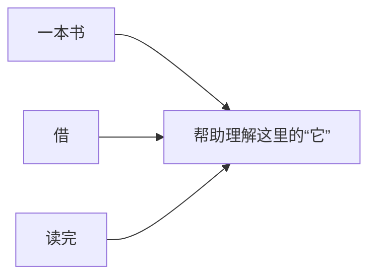

# Transformer 入门：从一句话开始

Transformer 是许多聊天模型采用的一套设计。它有一个重要做法：**处理文字时，让有关联的内容互相提供线索。**

我们就从这件事讲起。

这篇先讲故事和过程。你不用先会数学，也不用边看边背缩写。今天只读前面三节，也可以。

## 1. 先看“它”指什么

读这句话：

> 小明从图书馆借了一本书，读完后把它还了回去。

如果问你：“小明还回去的是什么？”

你会回答：“一本书。”

你为什么知道？因为你把句子里的几处信息联系起来了：

- 前面说他借了**一本书**。
- 后面说他已经**读完**。
- 所以这里的**“它”**，指的是那本书。

这个过程对人来说很自然，你可能根本没有刻意分析。

但如果只给你一个孤零零的“它”，你就没法确定。

“它”可能是书，也可能是伞、杯子或别的东西。**要知道这里的“它”指什么，就得结合前面说了什么。**

前后这些相关内容，我们常叫它“上下文”。这个词不神秘，就是你读一句话时会参考的前后内容。

现在，我们要让计算机也能利用这种联系。

这就是进入 Transformer 的第一步：先看到问题——**文字之间有关系，不能把每个词完全拆开理解。**

## 2. 把相关的线索联系起来

还是这句话：

> 小明从图书馆借了一本书，读完后把**它**还了回去。

处理“它”这个位置时，前面的“书”“借”“读完”等内容，都能提供线索。

离得最近的词，未必就是最有用的词。比如“它”前面紧挨着“把”，只看“把”，仍然不知道它指什么。

因此，我们希望计算机能做到：

> 从允许参考的其他位置中，找出与当前位置相关的信息，让不同线索发挥不同程度的作用。

“书”与这个指代关系很相关，就应该对结果产生合适的影响；其他位置也可以提供辅助信息。

把几条相关线索画出来，可以这样看：

这是一张阅读关系示意图。箭头表示线索可以提供帮助，没有表示具体的计算数值。

在实际计算里，不是只能选中一个词、把其他词全部丢掉，而是会把多个位置提供的信息按不同的比例结合起来。

**这种给不同信息分配不同影响比例、再把它们结合起来的方法，叫“注意力”。英文是 Attention。**

先记住它做什么，英文以后见多了自然会熟悉。

### 换一个词，相关线索也会变

把故事稍微改一下：

> 小明借了一把伞，天晴后把它还了回去。

这次，“它”指的是伞。

所以，我们需要的不是一条固定规则：“看到它，就回答书。”而是根据当前这句话，利用当前的相关信息。

这正是注意力有用的地方：**它怎样结合信息，会受到当前输入的影响。**

上面的指代关系是帮助理解机制的例子。真实模型里进行的是数字计算，不会真的在文字上画一根“它指向书”的线；能否答对，还取决于学得怎么样。

## 3. 有了注意力，为什么还需要一整套 Transformer

把相关线索取过来，只完成了一部分工作。还需要加工这些信息，才能让它们帮助后面的判断。

可以想象你第一次读故事时，只注意到“书”；再仔细整理一下，才把“谁借了书”“从哪里借的”“后来做了什么”联系得更清楚。

Transformer 把类似的工作安排成多轮计算。每一轮主要会做这些事情：

- **参考相关位置的信息。** 利用注意力，把适合结合的线索带进来。
- **加工当前的信息。** 对刚得到的结果继续处理，形成新的处理结果。
- **结合原有信息。** 在加工过程中，把原有信息与新结果结合，让后面的计算能在已有基础上继续处理。

实际结构还有帮助计算稳定进行的步骤。第一遍先理解上面这几个动作就够了。

你可以这样想：

**初步信息 → 结合上下文 → 加工整理 → 再结合、再整理 → 得到后面任务可以使用的结果。**

这里的“整理”不是生成一份中文笔记，而是更新计算中的数字。我们先用阅读和做批注的感觉，帮助理解信息为什么需要反复加工。

也不要把每一轮当成预先指定的任务，例如“第一轮只找人名，第二轮只找物品”。真实模型里的分工更复杂，是学习过程中形成的。

现在可以更完整地认识 Transformer 了：

> **它是一套组织信息处理的设计：用注意力结合相关信息，再配合其他加工步骤，经过多轮处理，形成适合任务使用的结果。**

注意力是其中很重要的一部分。整套安排起来，才是我们正在学习的 Transformer。

读到这里可以先停一下。你已经知道它为什么需要上下文、注意力在做什么，以及为什么还需要反复加工。

## 4. 它怎样把处理结果变成回答

下面重点看聊天模型怎样使用这套结构。

你把故事和问题一起给它：

> 故事：小明从图书馆借了一本书，读完后把它还了回去。
>
> 问题：小明还回去的是什么？

经过前面说的多轮计算，模型得到一份与当前输入有关的处理结果。

接下来，它会计算：**在这些内容后面，接上什么文字比较合适？**

比如后续可能接“书”，也可能接“伞”“不知道”等。学得合适的模型，应该更倾向于与故事相符的回答。

模型通常会先选出一小段文字，把它接到已经有的内容后面，然后再决定下一小段。

用一个简化的续写过程来理解：

> 先有故事和问题。
>
> 补出“一本”。
>
> 再结合已有内容，补出“书”。
>
> 回答完成后停止。

这里只是为了演示分段生成。真实模型怎样拆分文字，可能和这个例子不同。

这也解释了为什么聊天界面上的回答，常常是一点点出现的：它在逐步生成，应用又把新产生的内容陆续显示出来。

### 每次只补一点，为什么能写很长的回答

因为新补出的内容，也会成为后续可参考的内容。

像接着写一个故事：写完第一句，再根据已有故事写第二句。但模型一次处理的文字片段，通常比一句话更小。

反复进行，就能形成一整段回答。

这里有一件事要记清：**Transformer 提供处理信息的结构；逐步续写，是很多聊天模型使用这种结构的方式。** 有些采用 Transformer 的模型用于分类、找相似内容等，并不一定生成聊天回答。

## 5. 它是怎样学会这些关系的

前面一直在说“学得合适的模型”。这里的“学”，可以先理解成：**做很多练习，根据结果调整内部的数字。**

例如，有一份文字材料：

> 小明借了一本书，读完后把它还给了图书馆。

练习时，可以给模型前面的一段内容，让它预测接下来是什么，再与材料里的实际后文比较。

开始时，它可能经常猜错。训练程序根据预测与目标之间的差距，调整模型内部那些可以修改的数字。

这些数字会影响它怎样处理信息、怎样给后续文字打分。你可以暂时把它们想成一大批可调整的小旋钮。

**练习 → 比较结果 → 调整数字 → 再练习。**

经过很多不同的材料，它有机会学到词语的用法、句子的关系，以及许多与知识和任务有关的模式。

它需要见到的不只是“借书”这一句话，还包括许多不同内容。这样才有机会在新句子里也利用学到的规律。

### “设计方法”和“具体模型”有什么区别

Transformer 说的是：这些计算步骤怎样组织。

具体模型说的是：按一定结构和配置，把内部数字训练好以后，得到的那个可以使用的东西。

同样采用 Transformer 设计的两个模型，可能学过不同数据、大小不同、训练方式也不同，所以能力可以相差很大。

### 你提问时，它通常是在使用已有的学习结果

当你发出一个普通聊天问题时，模型通常使用已经训练好的数字来回答。

如果你前一句说“小明借的是伞”，它下一句能结合这条信息，说明它在利用当前对话。**这不等于它每次聊天都重新训练，也不等于它把这句话永久学进去了。**

用学习和答题来比喻：训练像平时做练习，普通聊天更像拿着已经学会的方法解一道新题。

## 6. 为什么 Transformer 这套设计受到重视

为了理解改进方向，可以想象一种处理长文章的办法：

> 读一点，更新一张摘要便签，再接着读。后面的处理不断依赖前面的摘要。

一些早期方法有类似的困难：当内容变长、关系隔得很远时，信息传递与保留会更难；有些步骤又必须等前一步完成。

注意力提供了一条更直接的路线：处理某个位置时，可以结合其他相关位置保留下来的信息。

回到我们的故事，即使“它”与“书”之间隔了不少内容，也有机会直接结合两者的相关信息，而不是只依靠最近的几个词。

Transformer 把注意力和其他处理步骤组织成了一套很有效的结构。2017 年的论文《Attention Is All You Need》提出了这套架构；注意力这个想法在它之前就已经存在。

它还有一个重要特点：对已经给定的文字，许多位置的计算可以一起组织起来执行。这让大规模训练更容易利用并行计算能力。

“并行”在这里可以先理解成“很多小计算同时做”。它并不表示聊天时尚未确定的整篇答案，已经在一瞬间全部生成。

这一节先记住两点就够了：**它方便不同位置结合信息，也适合组织大量计算。**

## 7. 最后补上：计算机真的在直接“读汉字”吗

前面的例子一直在说“书”“它”“相关线索”。实际计算时，模型会先把文字转换成数字。

大致经过这样的过程：

1. 把文字拆成一些可处理的小片段。
2. 为每个片段找到一组用来代表它的数字。
3. 用这些数字进行前面讲的联系、加工和整理。
4. 根据最后的结果，决定接下来输出哪些文字片段。

为什么要转成数字？因为模型内部的基本操作，是对数字做计算。

文字只是你看到的输入和输出形式。

你现在不用先学一整章矩阵，才有资格理解前面的故事。先知道：**我们用文字讲的信息关系，在模型里是通过数字表示和数字运算来处理的。** 后面想弄清每一步怎样算时，再学习公式会更有方向。

### 把全部过程接起来

还是“小明还回去的是什么”这个问题：

**收到故事和问题 → 把文字变成数字 → 多轮结合上下文并加工 → 给下一小段文字打分 → 选出来接上 → 继续生成，直到停止。**

现在再看“Transformer”这个名字，它就不只是一个很大的陌生词了。你已经知道这套结构在流程里承担什么工作。

## 8. 第一遍学到这里，就可以停

试着用自己的话说这三件事：

- **上下文为什么重要：** 单独看“它”不够，结合前面的“书”等内容，才有相关线索。
- **Transformer 在做什么：** 让相关信息通过注意力结合起来，再经过多轮加工，形成后面任务可用的结果。
- **聊天模型怎样回答：** 使用训练中学到的规律，参考当前输入，一小段一小段继续生成。

不用和这里的措辞完全一样。你能说明意思，就已经建立了第一层理解。

也记住一个限度：会组织自然的语言，不保证每次都把事实说对。这里的故事很简单；复杂问题仍可能让模型判断失误。

---

## 第二遍再看：把熟悉的步骤和几个名字对上

下面默认折叠。哪个步骤让你好奇，再点开哪一项。今天不用全部展开。

“一小段文字”为什么叫 token？

前面说，模型通常每次生成一小段文字。模型处理的这种基本片段，常叫 **token**。

一个 token 可能是一个字，也可能是词的一部分、一个标点或其他片段。不能直接把 token 数当成汉字数。

所以“逐个生成 token”，可以先读成：**逐个生成模型处理的文字片段。**

文字是怎样变成一串数字的？

先把文字片段换成编号，再根据编号找到一份数字表示。把编号映射成数字表示的这一步，常叫 **embedding**。

你还会看到“向量”这个词。初学时把它理解成“一串有顺序的数字”就可以了。

比如给“书”某一份可计算的表示，并不意味着里面每个数字都有“页数”“颜色”这样的固定中文标签。那些数字是通过训练调整出来的，后面会继续结合上下文加工。

现在只需要对应起来：**embedding 帮文字片段进入数字计算；向量是用来表示信息的一串数字。**

“注意力”里面的 Q、K、V 在分工做什么？

用找资料来比喻：你带着一个需求，比较几份资料是否相关，再从它们那里取用有帮助的内容。

- **Q**：参与表达“当前需要怎样的信息”。
- **K**：参与比较“其他位置与当前需求怎样相关”。
- **V**：提供最后被结合起来的信息。

在模型里，三者都是根据输入计算出的数字，不是真的中文提问、资料标题和正文。

前面说的注意力，可以在这里再细分一点：**先比较，再决定各份信息的比例，最后按比例组合。**

这一步先对上分工就好。公式可以等想手算时再看。

“多头”和“一层一层”，是在说什么？

**多头**可以先理解成：同一轮处理时，使用多套注意力计算，得到不同的结果，再把它们组合起来。不同计算可以学到不同的信息关系。

它们没有被人预先命名成“找人名的头”“找书的头”。这些只是帮助想象多个角度的比喻。

**一层一层**，对应前面讲的多轮处理：一组计算的结果，继续交给下一组计算使用。

所以，“多个头”与“多层”是两种安排：前者在一轮里组合多套注意力，后者把多轮计算接起来。

为什么还看到“训练”和“推理”这两个词？

**训练**：用数据和目标来调整模型的数字，让它逐渐学会处理任务。

**推理**：使用已经准备好的模型，对当前输入进行计算，得到输出。

这里的“推理”是一个技术用语，不只指人类所说的逻辑推理。让模型续写几个字，也属于一次模型推理。

把它对应回前面的故事：**训练像做练习来学习，推理像使用已经学会的方法来处理新题。**

## 以后想深入，再往哪里看

如果现在读起来已经顺畅，就先停在这里。下一次只挑一个自己想弄清的问题。

想看注意力的数字究竟怎样算，或者想运行一个小实验，可以查这份独立页面：

**[Transformer 原理与计算参考](Transformer-原理与计算参考.md)**

里面保留了完整算例、公式、代码和术语解释。它是一份查阅资料，不需要把全部内容一次学完。

与你正在学的运维知识，只需要先连上一句话：**GPU 帮助大量计算高效执行；Kubernetes 管理运行这些程序的工作负载。Transformer 讲的是程序内部怎样组织信息处理。**

本篇的故事和“读书、做练习”比喻，是为了说明计算的作用，不代表计算机具有人的主观阅读体验。更精确的结构与原始资料链接，放在参考页中。
