# Transformer：从一句话到一次回答

Transformer 是一种组织计算步骤的设计方法。用来处理文字时，它会把有关联的信息结合起来，经过多轮加工，让这些信息帮助完成理解、判断或生成文字等任务。

下面沿着一个完整例子展开：先看计算机要解决什么问题、以前采用过哪些办法，再看文字怎样进入计算、内部怎样处理、回答和训练怎样发生。最后把这些知识接到 ChatGPT、能调用工具的系统以及结构化判断上。需要用到的术语会在出现的地方解释。

顺着阅读即可，也可以点击下面的章节入口复习：

- [第 1–2 章：建立问题与历史背景](#1-先弄清楚我们想让计算机做什么)。
- [第 3–9 章：拆开内部计算](#3-第一步让文字进入数字计算)。
- [第 10–14 章：串起生成与训练](#10-怎样从数字变成回答)。
- [第 15–19 章：理解硬件、聊天产品、执行任务、决策与通用智能的关系](#15-这些计算为什么常用-gpu)。

后面的内容会在当地补齐理解所需的说明。

每章末尾都有“想一想与解答”。问题围绕本章内容，答案紧接着解释原因、计算步骤或容易混淆的地方。

静态插图都可以点击打开原图；手机阅读时可放大看数字，图下也有逐步的读图说明。即使暂时不看图，也可以沿正文的例子完成计算。

## 1. 先弄清楚：我们想让计算机做什么

读这句话：

> 小明从图书馆借了一本书，读完后把它还了回去。

如果问你“小明还回去的是什么”，你会说“一本书”。

你能回答，是因为把前后的信息联系起来了：前面说借了一本书，后面说读完了，因此这里的“它”指的是书。

这些帮助你理解当前内容的前后文字，叫作**上下文（理解某处内容时可以参考的前后文字或相关信息）**。

只看一个孤零零的“它”，就无法知道它指什么。换一句话：

> 小明借了一把伞，天晴后把它还了回去。

这次，“它”指伞。同一个字，在不同上下文里指向不同东西。

所以，计算机处理语言时，需要能利用词与词之间的联系。仅仅存一张“这个词是什么意思”的词典还不够，因为当前句子会改变它的具体含义。

我们这篇要解释的，就是计算机怎样把这些联系变成可以执行的计算。

### 本章想一想与解答

**问题 1：如果词典已经写明“它是一个代词”，为什么计算机还需要看前面的故事？**

**解答：** 词典说明这个字的一般用途，却没有说明这一次在指什么。借书的故事里，它可能指书；借伞的故事里，它可能指伞。确定这次的对象，需要把当前文字与前面的线索联系起来。这就是上下文发挥作用的地方。

**问题 2：只要看到了上下文，就一定能确定“他”指谁吗？例如“小明告诉小刚，他明天出发”。**

**解答：** 不一定。这句话里的“他”可能指小明，也可能指小刚，单靠这一句没有充分依据确定。上下文提供线索，但线索也可能不够。合理的处理应当承认这里有歧义，或者补充信息，而不是把猜测当成确定答案。

## 2. Transformer 出现以前，计算机怎样学习和处理语言

开头的借书问题，人往往很快就能回答。困难在于：怎样把这种处理能力交给计算机，让它也能面对换了人物、物品和表达方式的新句子？

### 2.1 先写规则，为什么写着写着就不够用了

最直接的办法，是人把做法写清楚。例如，遇到“借了一本书……把它还回去”，就规定“它”指书。再为借伞、借笔等情况添加规则。

但句子稍微变一下，规则就可能失效：“小明把书放在桌子上，因为它有些摇晃。”这里的“它”更可能指桌子。只规定“代词指前面最近的名词”也不可靠，因为表达方式还可以继续变化。

让计算机完成识别、预测、语言处理、规划等通常需要智能的任务，是**人工智能（Artificial Intelligence，简称 AI）**研究的范围。把知识和推理步骤明确写出来，是其中一条重要路线，常称为**符号方法（用符号、规则和逻辑关系表示与处理知识的方法）**。

如果把某个领域专家总结的规则集中起来，按照“满足这些条件，就作出这种判断”的方式工作，就可以构成**专家系统（利用明确的领域知识和规则辅助判断的系统）**。规则清楚、范围明确时，这样的做法仍然有用；遇到语言中大量例外，逐条补齐规则就很困难。

“人工智能”这个名称出现在 1955 年提出、为 1956 年达特茅斯夏季研究项目准备的提案中。[史1] 这是领域命名的一项历史节点，不表示此前没有自动计算、逻辑推理或机器学习方面的探索。

### 2.2 另一条路：给例子，让程序调整自己的做法

假设要识别垃圾邮件。人可以先写一条规则：“出现‘免费’，就判为垃圾邮件。”但正常通知也会说“免费讲座”，垃圾邮件也会换一种说法。

另一种做法是给程序很多已经标好“垃圾邮件／正常邮件”的例子，让它根据判断差距调整内部数字。它可能逐渐学到，单个“免费”不够，发件人信息、多个词的组合等也有帮助。

这种利用数据调整做法的方法叫作**机器学习（让计算系统从样本中学习规律，并用来处理新输入的一类方法）**。AI 是要研究和完成的较大范围，机器学习是实现其中许多任务的一条路线。并非所有 AI 都必须通过学习获得规则。

负责根据输入计算结果的这套程序及其计算依据，可以称为**模型（按一定结构和内部设置，把输入变成输出的计算系统）**。这不是专指聊天软件；邮件分类器也可以是一个模型。

模型内部那些学习时可以调整、之后参与计算的数字，叫作**参数**。可以把它们想成一批小旋钮：调法不同，同一封邮件的判断就可能不同。这个比喻只对应“数值可调整、调整会影响结果”，程序里并没有真的旋钮。

让模型处理样本、衡量输出与目标的差距、据此调整参数，这个学习过程叫作**训练**。训练后的模型能否处理好没见过的邮件，还要用新的例子检验；背熟训练样本，并不等于掌握了适用于新情况的规律。这种在新例子上仍然有用的能力，叫作**泛化**。

### 2.3 神经网络里，到底连着什么

我们先把一封邮件简化成两个数：某类可疑词出现 2 次，某类正常通知词出现 1 次。选取这种能供计算使用的输入信息，叫作准备**特征（用来描述当前对象的信息）**。这两个数只是教学假设，真实邮件判断远比这复杂。

现在人为规定一小步计算：第一个数乘 0.6，第二个数乘 -0.4，再加 0.1。

> `2 × 0.6 + 1 × (-0.4) + 0.1 = 0.9`。

0.6、-0.4 和 0.1 是这一步的参数。前两个控制输入各自怎样影响结果；最后额外加上的数叫作**偏置（即使输入为零，也可以调整输出起点的参数）**。算出的 0.9 只是一个中间数，还不是“90% 是垃圾邮件”。

再让这个数经过一个规则，例如“负数变成 0，正数不变”。这里 0.9 仍是 0.9；如果前面的结果是 -0.5，就变成 0。这样的步骤可以根据输入范围产生不同处理效果。

把“接收数字、乘以参数并相加、再按某种规则处理”的小单元连接起来，就得到**神经网络（由许多带可学习参数的数值计算单元连接而成的一类模型）**。小单元常叫作**人工神经元**。名字受到生物神经系统启发，但这里执行的是数字运算，不能据此认定它与人脑的工作方式相同。

把同一步产生的一组结果送到下一组单元继续处理，就形成一层接一层的网络。**层**描述这样的一组处理步骤与它所在的位置，不是给计算机真的加一层硬件。

这条路线有很长的前史：1943 年已有把神经活动简化为数学逻辑单元的工作。

1950 年代的**感知机（用可调整参数对输入作简单分类的一类早期模型）**，探索了怎样从例子中调整判断。

后来，研究者继续发展多层网络的训练方法，1980 年代反向传播在神经网络训练中的应用得到重要推广。这里的**反向传播**先理解为“沿已做过的计算，往回求各参数该怎样调整的依据”；第 12 章会把损失、梯度和更新动作算出来。[史6] 神经网络与深度学习都不是在聊天产品出现后才突然产生的。

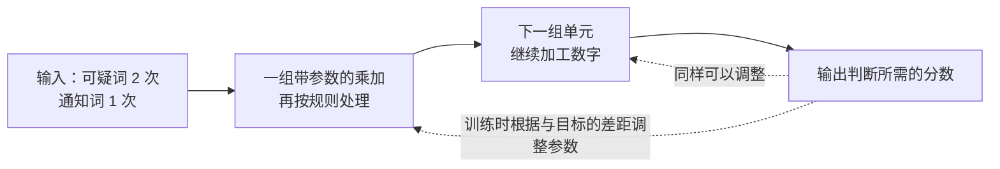

图中实线是输入到结果的计算过程，虚线表示训练会影响参数。虚线没有画出求调整方向的具体算法，也不表示把判断结果原样倒着塞回网络。

### 2.4 深度学习，是不是另一种完全不同的东西

如果只做很少几步加工，模型能组织的信息关系可能受到限制。把多层可学习的计算接起来，前一层产生的结果再供后一层使用，就有机会逐步形成更适合任务的表示。

例如识别图片时，模型可以从像素的明暗、颜色关系出发，在多层计算中组合局部形状和更大的结构。**像素**就是组成数字图片的一小格颜色记录。这里说“可以形成”，不是规定每一层都必须对应一个人能命名的部件。

使用多层神经网络进行学习，通常叫作**深度学习**。“深”主要指计算层次多，不等于“像人一样想得深”。机器学习还有许多其他方法，不都采用神经网络；神经网络也不都很深。

关系可以这样读：AI 中有机器学习，机器学习中有神经网络方法，使用多层神经网络的深度学习是其中一类做法。

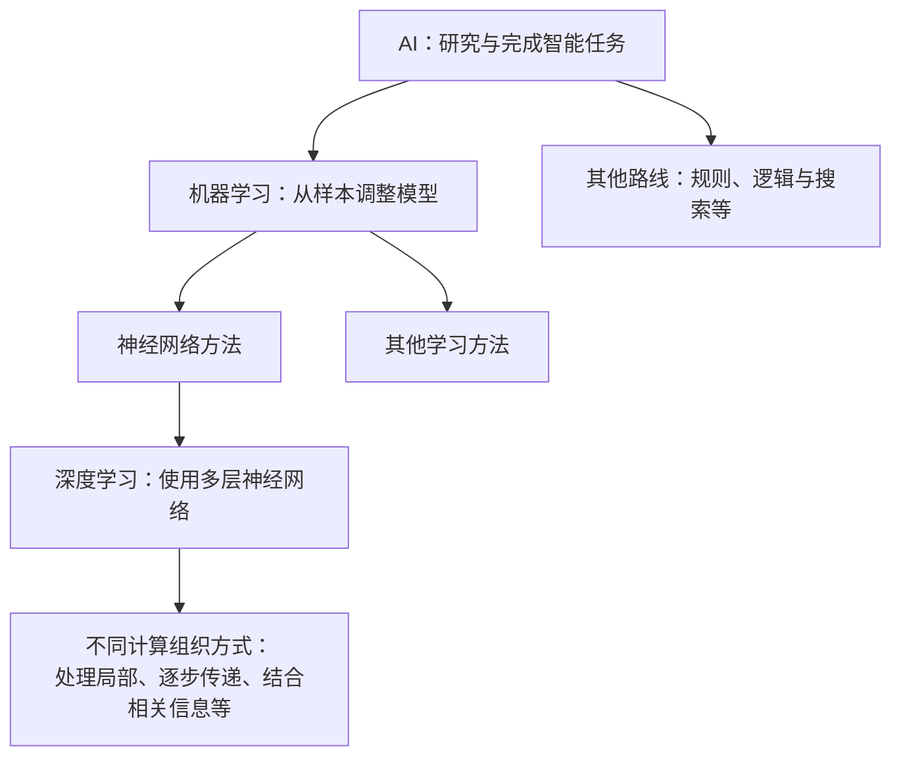

这里的箭头表示“包含的路线或做法”，不是年代先后，也不是所有系统都只能选一条；一个实际系统可以组合规则和学习方法。最后一行说明网络还可以采用不同的信息处理方式，接下来用图片和语言逐个说明。

### 2.5 不同神经网络，主要在怎样组织计算上不同

一张图片和一句话有不同的结构：图片中相邻小块很有关系，句子中先后顺序和远处的线索都可能重要。设计网络时，可以相应安排哪些输入先一起处理、哪些结果传到哪里。

一种基本安排是把前一层的数字送给后一层的多个单元做乘加，通常称为**全连接网络（在相邻的两层之间，让后一层的每个单元都接收前一层各单元输入的网络）**。它可以处理固定数量的输入特征，但不会仅凭这种连接方式自动获得适合语言的顺序处理规则。

处理图片时，可以用同一套小计算在图片的不同局部反复执行，例如先看一小块，再移到下一小块。这类计算叫作**卷积**，以它为重要组成部分的网络叫作**卷积神经网络（Convolutional Neural Network，CNN）**。重复使用同一套参数，让不同位置可以用同样的办法寻找局部图案；经过多层，影响范围可以扩大。

处理语言时，还可以读一段、更新一份内部记录，再继续读下一段。这种沿着按顺序排列的输入，反复使用同一套更新计算的结构，叫作**循环神经网络（Recurrent Neural Network，RNN）**。这里的“循环”是计算步骤重复使用，不是在循环播放一句话。

这些网络与 Transformer 都可以使用参数、训练、乘加运算及多层处理。它们的差别主要在信息怎样连接和传递，不能理解成“以前是神经网络，后来改用 Transformer，就不属于神经网络了”。

### 2.6 按顺序读一句话，会遇到什么困难

仍然读“小明借了一本书，读完后把它还了回去”。用 RNN 的思路，可以类比为边读边改一张笔记：读到“借书”时记下物品，读到“读完”时补上动作，再带着当前笔记处理“它”。

在真实计算中，“笔记”是一组内部数字，叫作**状态（记录当前计算已经保留哪些信息的内部表示）**。处理一个新位置时，把该位置的输入与上一位置的状态结合起来，算出新状态。模型并没有在笔记里写中文摘要。


这条路线可以处理变长的句子，但有两类困难。第一，前面有关“书”的信息要经过许多次状态更新，才能影响后面的“它”；内容长、关系复杂时，保留和学会传递关键细节并不容易。第二，后一位置需要前一位置的状态，单层内部的这条计算链不能随意把各位置完全独立开来同时完成。

为更好地保留信息，研究者提出过**长短期记忆网络（Long Short-Term Memory，LSTM）**，它是 RNN 的一种重要变体。[史2] 它增加一条保存信息的状态通路，并用学习得到的控制量，决定旧信息保留多少、新信息写入多少。

可以把这些控制量类比为阀门，所以它们常叫作**门（控制信息通过程度的计算）**。阀门比喻说明“通过量可以调节”；真实的门通常通过数字乘法控制信息，没有机械开关。LSTM 改善了长期依赖的学习问题，但仍然要沿着序列更新状态。

### 2.7 从“只带一份记录”到“需要时再参考各处”

把一串输入变成另一串输出的任务，叫作**序列到序列（sequence-to-sequence，常简写为 seq2seq）**。翻译就是一个例子：一串原文变成一串译文。早期一种常见方案，会先按顺序读完整句原文，把它压入一份固定长度的内部表示，然后用这份表示逐步写译文。[史3] 这类似先读完一封长信，只带着有限长度的笔记去转述；原文越复杂，要在有限记录中保留所有细节就越困难。

一个改进是保留原文各位置经过处理的记录。生成某个译文片段时，再计算此刻更应该参考哪些位置，并把相应信息组合起来。比如翻译到猫这个对象时，可以更多地利用原文中对应的词。

这个“按当前需要，计算不同来源的参考程度，再结合内容”的做法，叫作**注意力（Attention）**。注意力先于 Transformer 出现；2014 年公开、后发表于 ICLR 2015 的神经机器翻译工作，就是重要来源之一。[史4] 它可以与 RNN 结合，并非只有 Transformer 才能使用。

生活中的“回头看原信”，帮助理解为什么保留多个信息来源有用。真实计算是在数字表示之间算分数、分配比例、相加，不是程序有意识地决定翻阅哪一句。

### 2.8 Transformer 改变了什么

既然可以让不同位置直接交换相关信息，研究者进一步尝试：能不能主要依靠这种机制组织序列内部的信息处理，不再把 RNN 的逐位置状态传递作为主干？

2017 年的论文 *Attention Is All You Need* 提出了 Transformer。[变1] 它把注意力与其他逐位置处理步骤组合成可重复的计算单元，并额外提供位置信息，让计算能够利用顺序。原始论文的主要验证任务是机器翻译，不是聊天网站。

**架构**就是计算步骤怎样排列、信息怎样在步骤之间传递的设计。Transformer 是一种神经网络架构；采用它的深层模型仍属于深度学习。

它带来两项重要变化：在允许参考的范围内，某个位置可以通过一次注意力计算利用较远位置的信息；对于已经给定的输入，同一层的多个位置可以一起组织计算，减少逐位置等待。

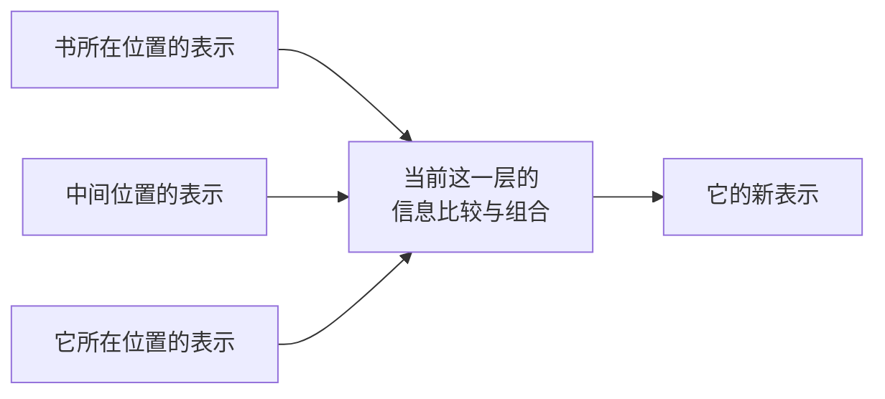

图中画的是信息可以怎样到达“它”这个位置，没有表示模型已经一定判断正确。各位置仍要使用上一层的结果；生成新文字时，也仍可能要等待前一个输出。这些区别决定了“更多并行计算”不等于“任何工作都能一次做完”。

把几种设计并排看，可以避免把新旧关系想成替换了整个 AI：

| 设计 | 主要怎样组织信息 | 对这个选择的限制要怎样理解 |
| --- | --- | --- |
| 全连接网络 | 对给定的一组输入进行层层乘加与加工 | 如何表示变长句子、顺序和关系，还需要相应设计 |
| CNN | 在不同位置重复局部计算，再逐层扩大信息范围 | 擅长利用局部结构，不只用于图片，也可以用于序列 |
| RNN / LSTM | 用前一位置的状态参与下一位置更新 | 能处理顺序，但沿位置存在计算依赖 |
| Transformer | 根据当前表示，直接结合允许参考位置的信息 | 标准的全范围注意力在长输入上需要大量两两比较 |

每种设计都有适用条件，实际系统也可以组合它们。“传统神经网络”没有一条统一的技术边界，不能把它理解为与 Transformer 互不相干的另一大类。

### 2.9 先认识训练和使用，再进入 Transformer 内部

一个具体模型的能力，不仅取决于架构，还取决于它使用了多少参数、怎样的数据，以及参数怎样被训练。

对文字模型，一种常见训练任务是预测后文。例如样本为“小明借了一本书”，让模型根据“小明借了一本”预测接下来是什么，再拿预测与实际的“书”比较，调整参数。经过大量不同样本，它才可能学到可用于新句子的规律。

训练完成后，使用这些参数处理一个新输入，叫作**推理（使用准备好的模型，对当前输入进行计算并得到输出）**。这里的“推理”是技术用语，翻译、续写几个字也算，不只指做逻辑题。

AI 的发展也不是一条新方法出现就彻底消灭旧方法的直线。研究经历过进展、过高期待和投入降温；规则、统计学习和神经网络等路线长期共存。2010 年代，更多数据、更强计算设备和训练方法的进展推动了深度学习的应用；2012 年 AlexNet 在图像识别上的成果，是其中一个代表例子。[史5] 硬件让训练更可行，算法和数据决定训练在做什么，三者要配合。

下面先跟着一个已经训练好的 Transformer 看一次输入怎样变成输出。你会看到：文字先变成数字，各位置组合有关信息，最后再把处理结果变成候选文字。学习训练过程时，再回到“这些控制计算的数字怎样调整”。


### 本章想一想与解答

**问题 1：两个人都采用 Transformer 设计，做出的模型表现就一定相同吗？**

**解答：** 不一定。架构规定怎样组织计算，而参数、训练数据和训练方法会影响具体能力。可以类比两所学校采用相同的课程安排，学生学过的材料、练习过程和掌握程度仍然可能不同。相同的计算设计不等于相同的学习结果。

**问题 2：模型刚刚答错，我在下一条消息里告诉它正确答案，这就完成了一次训练吗？**

**解答：** 普通聊天中通常没有。你的纠正成为了新的输入，模型可以根据这条信息重新计算；训练则还需要用目标和差距去调整参数。判断关键在于“有没有更新参数”，而不是“回答有没有变化”。

**问题 3：让模型翻译一句它以前没见过的话，为什么也叫推理？它又没在做数学证明。**

**解答：** 这里的“推理”指使用准备好的参数处理输入。翻译、续写、回答问题都可以属于推理。它描述的是模型所处的使用阶段，不要求任务本身是逻辑推导。

**问题 4：Transformer 与神经网络、深度学习是三个互相替代的东西吗？**

**解答：** 不是。神经网络是一类用可学习参数连接数值计算的模型；深度学习使用多层神经网络；Transformer 是组织这种网络的一种架构。它主要改变信息怎样结合与传递，并没有取消参数、训练和神经网络计算。

**问题 5：RNN 已经能按顺序读文字，为什么还要增加注意力？Transformer 又进一步改变了哪里？**

**解答：** 顺序状态传递要求前面信息经过多次更新才能影响远处，还存在逐位置等待。早期注意力让输出位置可以按需要组合保留下来的各处记录；Transformer 进一步把注意力作为序列内部信息交互的重要主干，使已知输入的多个位置在同一层中更容易一起计算。注意力先于 Transformer 出现，生成时的前后依赖也没有因此全部消失。

**问题 6：给垃圾邮件模型更多训练例子，它就一定能判断好任何新邮件吗？**

**解答：** 不能保证。样本可能缺少新邮件中的表达，也可能有错误标注；模型还可能过度依赖训练数据中特有的线索。训练样本上正确与新例子上仍然正确是两件事，所以需要用未参与训练的合适例子检验泛化能力。

## 3. 第一步：让文字进入数字计算

计算机不会直接拿“书”这个汉字做乘法。它需要先把文字转换成可以计算的数字。

### 3.1 把文字拆成小片段

模型会使用**token（文本处理中的基本片段）**。一个 token 可能是一个字、词的一部分、标点或其他片段，所以 token 不等于“一个汉字”。

为了说明用途，我们把故事示意拆成：

> 小明｜从｜图书馆｜借了｜一本｜书｜，｜读完｜后｜把｜它｜还了｜回去｜。

竖线只是帮你看清片段边界。这是教学切法，实际模型的切法可能不同。

把这些片段按先后顺序排在一起，就得到**序列（按顺序排列的一串内容，这里指这一串 token）**。

执行这种切分并转换编号的工具，叫作**tokenizer（分词器：按照配套规则，把文本转成 token 编号，并能把编号转回文字的工具）**。

每种片段有自己的编号，例如假设“书”的编号是 17，“伞”的编号是 42。**编号只用于识别片段，不表示 42 比 17 更重要，也不表示两个词的含义相差 25。**

### 3.2 给每个片段一份可计算的表示

上一节给“书”“伞”等片段分配了编号。编号解决了“这是哪个片段”的问题，却没有告诉模型怎样利用这个片段的信息。

这就像买饮料时，只知道两瓶饮料的商品编号，并不能判断哪瓶更甜。编号当然也能相减，但编号相差多少，与口味差多少没有直接关系。要比较口味，需要另外准备能描述饮料的信息。

#### 先看怎样用几个数字描述一瓶饮料

假设我们给饮料的甜度、酸度分别打分，都是 0 到 10 分，数字越大表示这种味道越强。这些分数是人为设定的例子。

再约定一个固定顺序：先记甜度，再记酸度。

| 饮料 | 甜度评分 | 酸度评分 | 按“甜度、酸度”的顺序记录 |
| --- | --- | --- | --- |
| 甲 | 8 | 2 | `[8, 2]` |
| 乙 | 3 | 7 | `[3, 7]` |

这时，`[8, 2]` 就是在说：“这瓶饮料的甜度是 8，酸度是 2。”方括号把两个数放成一组，逗号把它们隔开。

看这两组记录，我们可以比较出甲更甜、乙更酸。这些数字能用于比较，是因为它们记录了相应的信息；商品编号本身没有提供这种信息。

#### 这样一组有顺序的数字，就叫向量

数学上把这种**按顺序排列的一组数字叫作向量**。在这里，可以把它理解成一张按固定顺序填了数字的信息卡。

顺序很重要：按刚才的约定，`[8, 2]` 是“甜度 8、酸度 2”，`[2, 8]` 则是“甜度 2、酸度 8”。即使包含同样的两个数字，交换位置后，表示的内容也变了。

一组里有多少个数字，就称它有多少个**维度（向量中数值位置的数量）**。`[8, 2]` 有两个数字，所以是二维向量。如果再加一个记录苦味的数字，写成 `[8, 2, 1]`，就是三维向量。

这里的“二维”“三维”是在数一张信息卡上有几格数字，不是在数有几瓶饮料。类似地，一个 token 可以对应一个包含很多数字的向量，并不要求一个数字就对应一个 token。

饮料的例子说明：一组数字可以一起描述一个对象，供程序比较和处理。不过，这个例子里每格的含义由我们提前规定；模型里的数字通常没有这样逐格命名。

#### 把饮料的两格数字画出来

先画一条横着的直线，按顺序标上 0、1、2 等数字，用它记录甜度。这条线叫作**横轴**，本图中越往右，甜度评分越大。

再画一条竖着的直线，同样标上数字，用它记录酸度。这条线叫作**纵轴**，本图中越往上，酸度评分越大。

让两条线在各自的 0 处相交，这个交点叫作**原点**，用 `[0, 0]` 表示。图中每个小方格的宽、高都代表 1 分。

[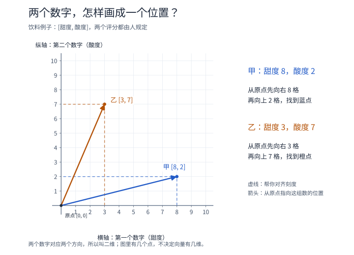](images/vector-drink-coordinates.svg)

沿着图，给饮料甲的 `[8, 2]` 找位置：

1. 第一个数字是 8，从原点沿横轴向右找到 8。
2. 第二个数字是 2，从刚才的位置向上数 2 格。
3. 在那里画一个点，它就同时记录了“甜度 8、酸度 2”。这组表示点的位置的数字，也叫作这个点的**坐标**。

饮料乙的 `[3, 7]` 则是先向右 3 格，再向上 7 格。图中甲更靠右、乙更靠上，正好对应“甲更甜、乙更酸”。

图里的虚线帮助你把点与轴上的刻度对齐。彩色箭头从原点指向相应的点，是画向量的另一种方式：点标出这组数对应的位置，箭头把从原点到那个位置的方向和长度画出来。它没有表示饮料真的在移动。

每份记录只需要两个数字，对应横、竖两个方向，所以是二维。即使在这张图上再画十瓶饮料，只要仍然每瓶只记录甜度和酸度，每个向量就仍然是二维。

#### 回到文字：根据编号，查到对应的向量

模型也会为每种 token 准备一组数字。可以把这些记录排成一张表，用 token 编号查找对应的记录。下面仍然用两个数字举例，实际编号和数值都是假设的：

| 片段 | 假设编号 | 假设的数字表示 |
| --- | --- | --- |
| 书 | 17 | `[0.2, -0.4]` |
| 伞 | 42 | `[-0.1, 0.7]` |

当输入中出现“书”这个片段时，程序就可以按这样的过程处理：

1. 分词器给出“书”的编号 17。
2. 用编号 17，在这张表中找到对应的记录。
3. 取出这一行的 `[0.2, -0.4]`，送给后续计算。

这个**根据 token 编号取得对应数字向量的步骤，叫作 embedding（嵌入）**；存放这些向量的表就叫 embedding 表。这里的操作是查表，不是把 17 拆开，也不是对 17 做一次固定的算术就必然得到 `[0.2, -0.4]`。

因此，这里的 `[0.2, -0.4]` 就是“书”对应的二维向量：第一个数字是 0.2，第二个数字是 -0.4，整组数字一起参与计算。真实模型通常会为一个 token 使用更多数字，例如几百个或几千个；同一张 embedding 表里的各个向量长度相同，具体长度由模型设计决定。

#### 这些数字的含义，为什么不能逐个翻译

饮料例子中，我们事先规定了第一格是甜度、第二格是酸度。但是模型里的第一格通常没有被规定为“知识”，第二格也没有被规定为“纸张”。不能据此把“书”的 0.2 和 -0.4 分别翻译成两个固定的中文属性。

这些数字怎样变得有用？从头训练一个模型时，embedding 表通常先填入随机产生的数字。模型用查到的向量参与后续计算，预测接下来的文字，再与训练材料里的实际后文比较。

例如，材料里出现“小明借了一本书”。模型根据“小明借了一本”预测后文，如果预测与实际的“书”有差距，训练就会据此调整有关参数，其中可以包括 embedding 表中的数字，以及后续计算使用的参数。

经过大量不同样本的训练，表里的数字与后面的计算逐渐配合起来，有机会支持对词语用法和关系的处理。**有用的是这一组数字与后续计算的配合，不是某个小数天生就带着一个中文含义。** 这也是为什么不能随便换一组随机数，就指望已经训练好的模型保持相同表现。

表里的这些数字属于模型参数的一部分。普通推理按照编号取用已经准备好的向量，不会因为查了一次表，就重新学习或改写表中的数字。

#### “像坐标”可以怎样理解

现在，把同样的画法用到“书”和“伞”的示例向量。这里的横轴只叫“第一个数字”，纵轴只叫“第二个数字”，因为没有为它们预先规定甜度、酸度之类的含义。

这次会遇到负数，因此把横轴向左、纵轴向下延伸：第一个数为正时向右找，为负时向左找；第二个数为正时向上找，为负时向下找。每个小方格的宽、高都代表 0.1。

[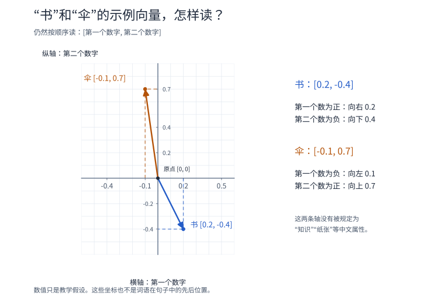](images/vector-token-coordinates.svg)

按图中的蓝色虚线读“书”的 `[0.2, -0.4]`：从原点先向右 0.2，也就是两小格；再向下 0.4，也就是四小格，到达蓝点。第二个数带负号，所以往下找。

“伞”的 `[-0.1, 0.7]` 则是先向左 0.1，再向上 0.7，到达橙点。它的第一个数带负号，所以往左找。

不过，这个点没有表示一本书在房间里的实际位置，也没有表示“书”排在句子的第几个位置。模型中的小数、负数参与的是数值计算，负号本身没有“好”或“坏”的含义。

把向量画成点，可以帮助观察一些数字关系。但不能仅凭两个点靠得近，就断定对应词语在任何句子里意思都相同。模型还会对这些数字进行计算，并结合具体上下文；真实向量有很多维时，也仍然可以按一串数字处理，不必把它画在纸上。

#### 模型拿到这组数字以后，能做什么

有了向量，模型就可以让多个数字一起参与运算。例如，仅为演示乘加，假设取第一个数乘以 3，再加上第二个数乘以 1：

> `0.2 × 3 + (-0.4) × 1 = 0.2`。

这个结果同时用到了原向量里的两个数字。这里的乘数和结果都只是教学例子，算出 0.2 并不等于得到了“书是什么意思”的文字答案。真实模型会使用许多由参数控制的计算，逐步加工向量，并结合其他位置提供的信息。

所以，编号在这里负责找到对应记录，向量负责把学到的数字送进后续计算。给词语一份向量，是让它进入计算过程的起点；还需要结合它出现的句子，才能进一步处理这一次的含义。

### 3.3 为什么同一个词还能有不同含义

在模型参数不变时，同一个 token 编号，在同一模型的 embedding 表里会查到同一份基础向量。

但它进入句子之后，还会结合周围内容继续计算。比如“它”出现在借书的故事里，与出现在借伞的故事里，经过上下文处理后可以得到不同的结果。

这里加工的是当前输入对应的数字表示，不意味着把 embedding 表里的原记录改写了。同一份基础向量，可以在不同上下文里参与计算，得到不同的新表示。

因此要分清：**刚查到的基础向量**，以及**结合这次上下文之后的向量**。前者是起点，后者才逐步包含这一次输入的相关信息。

### 3.4 很多片段的数字放在一起，就是一张表

一段话有很多 token，每个 token 有自己的向量。把这些向量一行一行排起来，就得到**矩阵（按行、列排列的一张数字表）**。

例如三个 token，每个有两个数字，就可以排成“三行两列”。

“矩阵”在这里不是额外一层神秘东西，只是把许多数字组织在一起，方便批量计算。后面我们会继续用小表和简单乘加解释计算过程。

先让这张表真正参与一次计算。假设两行输入分别是 `[2, 3]` 和 `[4, 1]`，每行都按同一规则加工：第一个新数等于“原第一个数 × 1 + 原第二个数 × 2”，第二个新数等于“原第一个数 × 0 + 原第二个数 × 1”。

| 输入的一行 | 第一个新数 | 第二个新数 | 输出的一行 |
| --- | --- | --- | --- |
| `[2, 3]` | `2 × 1 + 3 × 2 = 8` | `2 × 0 + 3 × 1 = 3` | `[8, 3]` |
| `[4, 1]` | `4 × 1 + 1 × 2 = 6` | `4 × 0 + 1 × 1 = 1` | `[6, 1]` |

把输入两行排成一张表，把两组乘数也排成表，就能把同一批乘加简写成**矩阵乘法（按行与列配对，做对应相乘再相加的一种计算）**：

```text
输入表           参数表          输出表
[2  3]           [1  0]          [8  3]
[4  1]     ×     [2  1]     =    [6  1]
```

例如输出左上角的 8，来自输入第一行 `[2, 3]` 与参数第一列 `[1, 2]`：`2 × 1 + 3 × 2`。输出右上角的 3，则使用同一输入行与参数第二列 `[0, 1]`。

这不是让两个表同一格的数字各自相乘。输入每行有几个数，参数表每列就要有几个数，才能一一配对。本例都是两个；参数有两列，因此每行会产生两个输出数。输入增加几行时，可以继续使用同一张参数表，所以句子变长并不意味着每次都要重新设计这套参数。

### 本章想一想与解答

**问题 1：“伞”的编号是 42，“书”的编号是 17，能不能据此说“伞”更重要，或者它们的含义相差 25？**

**解答：** 都不能。编号的用途是让系统知道要查哪个片段，就像图书编号不表示书的内容有多重要。查到的向量才会参与后续数值计算；编号相减没有这里所说的词义差距含义。

**问题 2：两句话里的“它”如果使用同一个 token 编号，基础向量相同，模型岂不是永远分不清它指书还是伞？**

**解答：** 基础向量只是起点，后面还会结合当前句子的内容继续计算。借书故事提供“书”“读完”等线索，借伞故事提供“伞”“天晴”等线索，因此同一个起点可以产生不同的上下文表示。这里改变的是本次计算得到的表示，普通推理不需要为此改写 embedding 表里的原向量。

**问题 3：100 个汉字是不是必然变成 100 行数字？每行有 4 个数字，是不是表示它包含 4 个 token？**

**解答：** 两个说法都不成立。汉字怎样拆成 token 要看分词器，100 个字不保证得到 100 个 token。在这里“一行表示一个 token”的排列方式下，行数表示 token 数，每行的数字个数表示向量维度。例如 3 个 token、每个 4 维，就得到 3 行 4 列的表。

**问题 4：饮料记录 `[8, 2]` 和 `[2, 8]` 包含同样两个数字，为什么不是同一个向量？它们各有几维？**

**解答：** 向量保留数字的排列顺序。在约定“先甜度、后酸度”以后，前者是甜度 8、酸度 2，后者是甜度 2、酸度 8，所以描述不同。两者都包含两个数字，因此都是二维向量。这里的维度数的是每组里有几个数字，不是数字加起来有多大。

**问题 5：“书”的示例向量是 `[0.2, -0.4]`，能不能说 0.2 代表知识、-0.4 代表纸张，或者负数表示这个词不好？**

**解答：** 都不能这样认定。与人工规定甜度、酸度的饮料例子不同，模型通常没有为每一格预先指定一个中文属性。数字通过训练与后续计算配合，整组参与对语言的处理；小数和负数都是正常的计算数值，不能凭正负判断词语好坏。表里的具体数值还是教学假设，不能当成某个真实模型的实际记录。

**问题 6：普通推理遇到编号 17 时，要临时随机生成一组数字吗？查表和训练这张表有什么区别？**

**解答：** 在本章的查表方式下，模型取出已经存好的第 17 号记录，也就是示例中的 `[0.2, -0.4]`。随机数可以用作从头训练时的起点；训练会根据预测与目标的差距调整有关数字。普通推理使用准备好的表，不会为每次出现的“书”随机生成一份新记录，也不会仅因查表就修改参数。

**问题 7：怎样在图上找到“伞”的 `[-0.1, 0.7]`？如果再画十个词的点，这张图里的向量会变成十维吗？**

**解答：** 从原点先向左 0.1，再向上 0.7，就找到它的位置：第一个数的正负决定左右，第二个数的正负决定上下。增加十个点，只是增加十份记录；每份仍然只有两个数字、使用横纵两个方向，所以仍然是二维向量。只有给每份记录增加数值位置，向量的维度才会增加。

## 4. 第二步：把顺序也告诉模型

比较这两句话：

> 小明借走了书。
>
> 书借走了小明。

主要词相同，但顺序变了，意思就不同。

因此，模型不能只知道“有哪些片段”，还需要知道它们处于什么位置。为计算加入位置信息的方法，叫作**位置编码（用数值向计算提供顺序和位置相关信息的方法）**。

可以类比一本书的内容与页码：内容告诉你写了什么，页码帮助你知道它在什么顺序中。

原始 Transformer 会给不同位置准备相应的位置向量，再与 token 的基础向量相加。向量相加，就是对应位置的数字分别相加。

为了只看清这个动作，假设某个片段的向量是 `[2, 3]`，它的位置向量是 `[0.1, 0.2]`，相加就得到 `[2.1, 3.2]`。这些仍是人为举例的数字，真实位置向量按相应规则产生。

再把同样的相加动作接到第 3 章的查表例子上：这次用“书”的基础向量 `[0.2, -0.4]`，看看它出现在两个位置时，送给后续计算的数字怎样变化。

[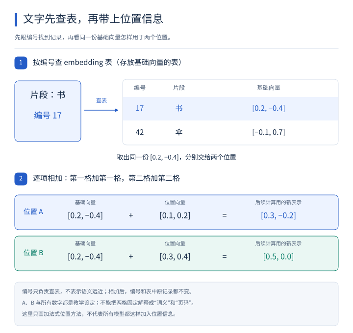](images/embedding-position.svg)

按图从上往下读，箭头表示查到的数字接着送入哪一步计算：

1. 先由“书”找到编号 `17`，再按编号取出表中的 `[0.2, -0.4]`。编号用于定位记录；不能因为 `17` 比 `42` 小，就认为“书”和“伞”的意思有某种远近关系。
2. 两条位置分支都从同一份基础向量出发。位置 A 逐项相加：`[0.2, -0.4] + [0.1, 0.2] = [0.3, -0.2]`；位置 B 逐项相加：`[0.2, -0.4] + [0.3, 0.4] = [0.5, 0.0]`。第一格与第一格相加，第二格与第二格相加。
3. 两个结果不同，但“书”的编号仍是 `17`，embedding 表中原来的记录仍是 `[0.2, -0.4]`。变化的是这次送给后续计算的表示，查表和相加没有改写原表。

A、B 以及这些位置数字都是教学设定。前面的“内容与页码”只说明为什么需要顺序信息，不能把结果中的第一格固定叫“词义”、第二格固定叫“页码”。本图只说明这里的相加方法，不能把它套到下文介绍的其他位置方法上。

现代模型也有其他加入位置信息的方式，但要解决的问题相同：让计算能够利用“谁在前面、谁在后面”等信息。

原始论文的位置向量并不是给每个位置随便取一组数字。它使用**正弦、余弦（两种随输入平滑变化、按一定规律重复起伏的数学函数）**，在不同数值位置安排不同变化速度，形成可计算的位置记录。[变1] 上面 `[0.1, 0.2]` 只是展示向量相加，没有假装算出了原论文的真实位置编码。

还有一种常见方法，会根据片段所在位置，把参与信息比较的数字成对作旋转式变换。可以把二维向量想成前面图中的箭头：位置改变，按约定规则改变箭头的方向，再用变化后的数字参与比较。这叫作 **RoPE（Rotary Position Embedding，旋转位置编码）**。[变2]

这里的“旋转”有明确的数字计算规则，不是转动文字的字形；真实向量有许多数，会成对处理。它让后续两处信息的比较能够反映相对位置，也不需要先给原向量加上前面那种位置向量。两种方法具体做法不同，都是为了解决顺序不能丢失的问题。

在上面的加法例子里，每个片段已经有了包含自身内容和位置信息的数字表示。但知道“它”位于哪里，还不足以知道“它”指的是书。下一步，需要让“它”所在位置的数字结合其他位置提供的线索。

### 本章想一想与解答

**问题 1：“小猫追小狗”和“小狗追小猫”包含相同的主要词，为什么不能只把这些词当成一袋物品来处理？**

**解答：** 因为谁追谁取决于顺序。只记录“有小猫、有小狗、有追这个动作”，会丢失这两句话的区别。位置机制让计算能够利用顺序，帮助模型形成不同的表示；是否正确处理，仍要靠学到的参数和后续计算。

**问题 2：同一个 token 的基础向量是 `[2, 3]`。两个位置的向量分别是 `[0.1, 0.2]` 和 `[0.3, 0.4]`，相加以后一样吗？这是否把 token 编号改掉了？**

**解答：** 相加后分别是 `[2.1, 3.2]` 和 `[2.3, 3.4]`，所以不一样。它改变的是送入后续计算的数字表示，没有修改 token 编号。相同内容因为处于不同位置，可以带着不同的位置信息参与计算。

## 5. 第三步：把不同位置的相关信息结合起来

回到故事中的“它”：

> 小明从图书馆借了一本书，读完后把**它**还了回去。

“书”“借”“读完”等内容，都能帮助解释这里的“它”。但它们提供的帮助不一定相同。

这里要解决的是两个相连的问题：哪些位置的信息更值得参考？确定了参考的程度之后，怎样把它们提供的信息带到当前位置？

先用一件日常生活里的事，把这个过程完整走一遍，再回到模型的数字计算。

### 5.1 先走完一个例子：找资料学做番茄炒蛋

#### 先明确自己遇到了什么问题

假设你第一次做番茄炒蛋。你知道要用番茄和鸡蛋，却不知道番茄怎样处理、鸡蛋什么时候下锅、两样东西怎样合在一起炒。

现在，你面前有三本书：《家常菜做法》《厨房食材处理》《汽车维修》。你的目标是从资料里学到能帮助自己做这道菜的办法。

这时候，仅仅知道“面前有三本书”没有解决问题。你需要先判断哪些书更可能有帮助，然后从中获得具体做法。

#### 用书名和目录，判断哪些资料相关

你先看《家常菜做法》的书名，再翻目录，发现其中有“番茄炒蛋”这一节。这和你正在做的事直接相关，因此它很值得重点参考。

再看《厨房食材处理》，目录里有“番茄怎样切”“鸡蛋怎样打散”。它未必给出完整的炒菜流程，但能帮助解决准备食材的问题，所以也有用。

《汽车维修》的目录主要讲轮胎、发动机等内容。对于这次学做菜的需求，它能提供的帮助很少。

你在这里做了一次比较：把“我想学做番茄炒蛋”这个需求，与每本书介绍自己内容的书名、目录放在一起看，判断它们是否相关。换成“我想学换轮胎”，同样三本书的重要程度就会改变。

#### 判断相关以后，还要读实际的制作步骤

找到目录里的“番茄炒蛋”，并不等于已经知道怎样做。这个标题告诉你去哪里找，却没有把具体步骤交给你。

你还要翻到正文，读到类似这样的过程：先把鸡蛋打散，炒至成形后盛出；接着炒番茄；最后把鸡蛋倒回锅里合炒。你从这些内容里，才获得了可以照着操作的步骤。

如果还不清楚番茄怎样切，就再读《厨房食材处理》中的相关说明，用它补充准备食材的细节。

因此，**“用来判断资料是否相关的信息”和“真正拿来解决问题的内容”，用途不同。** 书名、目录帮助你判断该参考哪里，具体步骤帮助你完成做菜。它们有联系，但只拿到前者，并不能代替后者。

#### 几份资料都有帮助，就有主有次地结合

最后，你可以主要按照《家常菜做法》的流程做菜，同时用《厨房食材处理》补充切番茄、打鸡蛋的细节。《汽车维修》对这次做菜基本没有帮助。

这里的“重点参考一本书”，并不意味着另外一本有用的书就完全不能参与。你可以从几份资料吸收不同内容，只是依赖的程度不同。

把这个过程连起来，就是：带着当前需求判断各份资料的相关程度，再结合它们实际提供的内容，其中更相关的资料可以发挥更大的作用。

模型也需要一种办法，让当前位置更多地结合某些位置提供的信息，同时结合其他可参考位置的信息。它通过计算得到各份信息的使用比例，再按比例组合信息。这个机制叫作**注意力（Attention：计算各份信息应占的比例，再按比例组合信息的机制）**。

找书的例子帮助我们理解“先判断参考程度，再结合内容”这两个相连的动作。人会阅读和理解制作步骤；模型在这里处理的是一串串数字，按照算出的比例做乘法和加法。“注意力”这个名称不表示模型像人一样有意识地决定翻哪本书。

### 5.2 把找资料的过程，逐步对应到模型计算

回到借书的故事。第 3、4 章已经说明，每个文字片段都有一串可以参与计算的数字。现在要做的，是让“它”所在位置的数字结合“书”等位置提供的信息。

找资料的过程里，有当前的需求，有资料用来参与比较的说明，还有真正取用的内容。下面逐个对应它们在模型中的用途。

#### 先对应“我这次需要什么”

做菜时，你带着“我想学做番茄炒蛋”的需求去找资料。模型处理某个位置时，也需要一份用于寻找相关信息的数字表示。

这份表示叫作 **Q（Query，查询向量：当前位置用来与可参考信息进行比较的一串数字）**。“查询”可以借用“带着需求找资料”来理解，但模型没有在内部写下一句“我想知道什么”；它准备的是数字。

例如，处理故事里的“它”时，就用“它”这个位置的查询向量去参与后续比较。这里的 Q 对应一个位置的计算用途，并不等于用户输入的整句问题。

#### 再对应“这份资料拿什么参与比较”

你有了做菜的需求，还得有每本书的书名、目录等说明，才能判断它与需求是否相关。只有需求，缺少比较对象，就无法作出这次判断。

在模型里，每个可参考位置也会提供一串用于比较的数字，叫作 **K（Key，键向量：供查询向量比较、计算相关程度的一串数字）**。

于是，当前位置的 Q 可以分别与各个可参考位置的 K 进行计算，每比较一份，就得到一个分数。这些分数表示模型在这次计算中怎样给不同信息分配参考程度，不能直接当成“这份信息一定正确”的保证。

书名和目录只是帮助理解 K 的用途。真实模型并不会先给每个词写出一份中文目录，而是直接对数字进行计算。

#### 最后对应“真正取用的内容”

比较完成后，还需要内容来解决问题。就像你发现《家常菜做法》很相关，仍然要阅读其中的制作步骤；如果只把书名抄下来，做菜的问题还没有解决。

模型里用于实际组合的那份数字表示，叫作 **V（Value，值向量：这个位置提供给信息组合步骤的一串数字）**。它对应的是“取用内容”这个用途，而不是“参与相关程度比较”这个用途。

每个来源的 K 和 V 要配套看：某个位置用自己的 K 参与比较，算出的比例随后用在同一位置的 V 上。就像根据一本书的目录判断它有帮助后，接着读的是这本书的内容。

这样，完整过程才连接起来：**用当前位置的 Q 与各个可参考位置的 K 算分数，把分数转换成比例，再用这些比例组合对应的 V。** K 参与前面的比较，V 参与后面的内容组合；这就是它们用途不同的地方。

“组合 V”在计算中也有具体含义：把每份 V 里的数字分别乘以这份信息的比例，再将对应数值位置的结果相加。这样得到的仍然是一串数字，供后续步骤继续处理，还没有直接输出“书”这个字。

这里的 V 也不是从原文抄出来的一段中文，更不是一本书的全部正文。Q、K、V 都是数字；找书的比喻只对应它们在计算中的用途。

#### 为什么一个位置也要准备这三种数字

在当前讨论的“同一段话内部相互参考”场景里，一个位置既需要结合其他位置的信息，也可能为其他位置提供信息。因此，它要为不同用途分别做好准备。

例如，计算“它”这个位置的新表示时，用的是“它”自己的 Q：拿它与可以参考的位置的 K 比较，再按照比例组合那些位置的 V。

当另一个位置允许参考“它”时，用来比较的是“它”的 K，用来提供内容的是“它”的 V。这里换了要更新表示的位置，也就换了发起这次比较的 Q。

所以，“它”并不是永远只充当查询方，“书”也不是永远只提供内容。每个位置都可以准备自己的 Q、K、V；这次计算具体用哪一份，取决于正在更新哪个位置、它可以参考哪些位置。

#### 这些数字怎样从已有表示中产生

它们不是把一句话切成前、中、后三段，也不是把某个位置的一串数字切成三截。模型会把**同一个位置已有的数字表示，分别交给三套用途不同的计算，产生对应的 Q、K、V**。

这里的计算可以从简单的乘加理解：用已有的数字分别乘以一些指定的数，再把结果相加，就能得到新的数字。那些控制“乘多少”的数，就是第 2 章介绍的参数。

先只看怎样产生一份 Q。假设某个位置已有的表示是 `[2, 3]`，我们人为规定：

- 新向量的第一个数，用原来的第一个数乘以 1，再加上原来的第二个数乘以 2：`2 × 1 + 3 × 2 = 8`。
- 新向量的第二个数，用原来的第一个数乘以 0，再加上原来的第二个数乘以 1：`2 × 0 + 3 × 1 = 3`。

这样就从 `[2, 3]` 算出了 Q：`[8, 3]`。这说明“产生一种新表示”可以是明确的数字运算，不需要把中文句子拆成几个角色。

产生 K 和 V 时，也从这个位置已有的表示出发，但使用各自的参数计算。把用途分开，模型就有机会分别学到适合比较、适合传递内容的数字表示，不必要求同一串数同时承担全部用途。

把另外两份也补出来，就能看到一次完整的准备过程。仍从同一个 `[2, 3]` 出发，再人为指定两套规则：

| 准备的表示 | 第一个数怎样算 | 第二个数怎样算 | 结果 |
| --- | --- | --- | --- |
| Q | `2 × 1 + 3 × 2` | `2 × 0 + 3 × 1` | `[8, 3]` |
| K | `2 × 1 + 3 × 1` | `2 × (-1) + 3 × 1` | `[5, 1]` |
| V | `2 × 1 + 3 × 0` | `2 × 0 + 3 × 2` | `[2, 6]` |

可以把这些乘数分别排成三张参数矩阵，再用第 3 章已经说明的矩阵乘法批量处理整句话。每个位置的输入不同，所以结果可能不同；在同一层的这一套注意力计算里，各位置使用的是同一套 Q 参数、同一套 K 参数、同一套 V 参数，而不是每来一个词就另训练三套规则。

上面的数值只是教学设定，8 并不被规定为“做菜需求有多强”。真实模型使用更多数字，并通过训练调整参数，使这些计算产生的表示有助于完成任务。采用前面介绍的 RoPE 时，通常还会根据位置对 Q、K 作相应旋转变换，再让它们参与比较。

现在把“三本书各有什么用”和“同一份数字怎样算出三种表示”放在一张图里，对照刚才的例子读：

[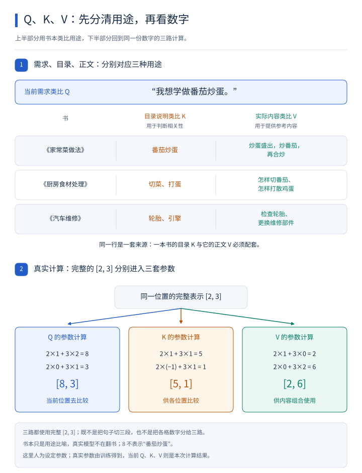](images/qkv-books-and-vectors.svg)

读图时先看上半部分，再沿下半部分的分支看数字怎样产生：

1. 先读需求“我想学做番茄炒蛋”，再逐本对照目录与内容。《家常菜做法》的“番茄炒蛋”目录对应“炒蛋盛出，炒番茄，再合炒”；《厨房食材处理》的“切菜、打蛋”对应怎样切番茄、怎样打散鸡蛋；《汽车维修》的“轮胎、引擎”对应检查轮胎、更换维修部件。目录帮助判断相关性，实际内容供后续参考；同一本书的两栏配套，正如同一来源的 K、V 必须配套。
2. 下半部分的三路箭头都从完整的 `[2, 3]` 出发，各自使用一套参数。例如 Q 的第一格是 `2 × 1 + 3 × 2 = 8`，第二格是 `2 × 0 + 3 × 1 = 3`；其余两路按上表得到 K 的 `[5, 1]` 和 V 的 `[2, 6]`。箭头没有把句子切成三段，也没有把 2 分给 Q、3 分给 K。
3. 再看结果的用途：Q 让当前位置去比较，K 供各位置比较，其中也可以包括允许参考自己时的当前位置；V 供内容组合使用。书本只是用途比喻，真实模型在计算数字，并没有翻书，数字 `8` 也不固定代表“番茄炒蛋”。

图中的乘数是为手算设置的示例参数；真实参数通过训练得到。用这些参数处理本次输入，才产生这一次的 Q、K、V，下面继续区分这两类数字。

#### 训练学到的参数，与本次算出的结果有什么区别

在刚才的例子里，控制乘法的那两组数——第一组 1、2，第二组 0、1——是计算 Q 所用的参数；输入 `[2, 3]` 经过计算得到的 `[8, 3]`，才是这一次的 Q。

假如参数不变，送入这一步的表示换成 `[4, 1]`，仍然按相同方法计算：第一个数是 `4 × 1 + 1 × 2 = 6`，第二个数是 `4 × 0 + 1 × 1 = 1`。这次得到的 Q 就是 `[6, 1]`。

Q 变了，但计算所用的参数没有变。K 和 V 也是同样的道理：它们是参数处理当前表示后产生的结果，可以随着输入的变化而变化。

普通推理使用已经训练好的参数处理输入；训练才会根据任务表现去调整这些参数。因此，模型用原有参数为新输入计算 Q、K、V，并不等于重新训练。

### 本章想一想与解答

**问题 1：我已经从目录里找到了“番茄炒蛋”，为什么还需要翻到正文？这与 K、V 的区别有什么关系？**

**解答：** 目录帮助你判断这本书可能解决问题，但没有交代先炒什么、后放什么。还要阅读实际制作步骤，才能获得有用的内容。对应到模型，K 用于与 Q 比较，V 才是后面按比例组合的信息。同一位置的 K、V 彼此配套，却承担不同工作。书的目录和正文是比喻，真实的 K、V 都是一串数字。

**问题 2：既然《家常菜做法》最有帮助，为什么还要结合《厨房食材处理》？模型又怎样理解这种“结合”？**

**解答：** 一本书可以提供整体流程，另一本补充切番茄、打鸡蛋的方法，重点参考前者仍然可以从后者受益。在模型里，结合有明确的数值含义：按计算得到的比例乘各份 V，再将对应数值位置相加。它不要求只能保留分数最高的一份，也不是把几段中文直接拼接起来。

**问题 3：Q、K、V 都来自同一句话，为什么还要分成三种？是不是把句子切成三份？**

**解答：** 区分的是用途：Q 是当前位置用来发起比较的表示，K 是各个来源参与比较的表示，V 是这些来源实际交给组合步骤的表示。当前讨论的计算会从每个位置已有的同一份数字出发，分别用不同参数得到这三种表示，让模型有机会为不同用途学到合适的表示。它没有把前半句指定成 Q、后半句指定成 K 或 V。

**问题 4：计算“它”时，为什么“它”所在位置除了 Q，也要准备 K 和 V？**

**解答：** “它”需要结合信息时，用自己的 Q 参与比较；其他位置允许参考“它”时，需要用“它”的 K 参与比较，再用“它”的 V 提供内容。一个位置可以在不同计算中承担不同用途，并非某个词永远只负责找信息、另一个词永远只提供信息。

**问题 5：如果“书”所在位置得分最高，注意力是不是就直接输出了“书”？**

**解答：** 不是。分数会先变成各份信息应占的比例，再按比例组合 V，得到一个新向量。其他可参考位置也可能贡献信息。产生文字答案是后续步骤，这里得到的仍是数字表示；得分最高也不等于已经保证答案正确。

**问题 6：把本章乘加例子的输入从 `[2, 3]` 换成 `[4, 1]`，Q 为什么变成了 `[6, 1]`？这是否说明模型已经重新训练？**

**解答：** 仍然使用原先的两组乘数：第一项是 `4 × 1 + 1 × 2 = 6`，第二项是 `4 × 0 + 1 × 1 = 1`。输入变了，所以计算结果可以变；参数仍然是第一组 1、2 和第二组 0、1，没有发生更新。这与普通推理的情况一致：本次的 Q、K、V 可以因输入改变而不同，不能据此认定模型重新训练了。

## 6. 把“比较相关程度”真正算一次

第 5 章已经说明了怎样从已有表示产生 Q、K、V，以及它们分别用在什么地方。现在还需要算清楚：怎样由 Q 和 K 得到参考比例，又怎样用这些比例组合 V？

下面回到“它”参考“书”等位置的故事，用几个小数字完整走一次。每一步都接着上一步的结果计算。

这里另选一组已经准备好的 Q、K、V，从比较开始计算；它们不承接上一章演示“怎样产生 Q”时用的数值。这些都是独立构造的教学数字，不是实际模型的词义记录，也不是一个完整模型。

### 6.1 先准备一个 Q 和三个 K

假设要更新的是“它”所在位置的表示，它的 Q 是 `[1, 0]`。为看清计算，这里只选三个可参考位置，它们的 K 分别是：

| 可参考的信息 | 假设的 K |
| --- | --- |
| “书”所在位置 | `[1, 0]` |
| “图书馆”所在位置 | `[0, 1]` |
| “读完”所在位置 | `[1, 1]` |

这里每个向量都只有两个数字。

一种常见的比较方法叫作**点积（把两个等长向量对应位置的数字相乘，再把乘积加起来）**。

例如 `[1, 2]` 与 `[3, 4]` 的点积是：

> 1 × 3 + 2 × 4 = 11。

在我们的例子里，用 Q 分别与三个 K 做点积：

| 比较对象 | 计算 | 分数 |
| --- | --- | --- |
| 书 | 1 × 1 + 0 × 0 | 1 |
| 图书馆 | 1 × 0 + 0 × 1 | 0 |
| 读完 | 1 × 1 + 0 × 1 | 1 |

得到 `[1, 0, 1]`。在这组人为设定的数字中，第一个和第三个位置分数相同，高于第二个。

分数相同来自这里的数字设定，不代表所有真实模型在这个故事里都会这么分配注意力。

### 6.2 调整一下打分的大小

常见的 Transformer 注意力会把分数除以 Q/K 维度的平方根。

**平方根（一个非负数，自己乘自己可以得到原来的数）**，例如 4 的平方根是 2，因为 2 × 2 = 4。

这里的向量有两个数字，维度是 2，2 的平方根约为 1.4142。因此：

> `[1, 0, 1]` ÷ 1.4142，约得到 `[0.7071, 0, 0.7071]`。

这个动作叫作**缩放（用一个系数调整数值的大小）**。当向量维度很大时，在常见条件下点积分数的波动会增大；缩放有助于让下一步的比例分配保持在更适合计算和训练的范围。

### 6.3 把分数变成可以分配的比例

刚才的分数还不能直接当百分比：它们的总和不是 1，一般情况下还可能有负数。

我们要把它们变成一组非负、加起来等于 1 的比例。按固定规则把输入变成输出，在数学上叫作**函数（按照给定规则计算输入所对应的输出）**。

这里会用到 **softmax（把一组分数转换成非负且总和为 1 的比例的一种函数）**。它的操作是：先把每个分数转换成正数，再让每个正数除以它们的总和。

第一步使用**指数运算（这里记作 exp(x)，意思是让常数 e 取 x 次方；e 约等于 2.7183）**。例如，e 的 1 次方就是 e，2 次方就是 e × e，0 次方规定为 1；小数次方则是把这套运算连续延伸。计算器和程序可以给出对应结果。

使用这条转换规则时，即使原分数为负数，结果也是正数；原分数越大，转换后的正数也越大。因此，这些结果可以继续用来分配比例。

你可以直接跟着这组结果看：

| 调整后的分数 | 指数运算得到的正数 | 除以总和后的比例 |
| --- | --- | --- |
| 0.7071 | 约 2.0281 | 约 0.4011，即 40.11% |
| 0 | 1 | 约 0.1978，即 19.78% |
| 0.7071 | 约 2.0281 | 约 0.4011，即 40.11% |

这些正数的总和约为 5.0562。例如第一项的比例就是 2.0281 ÷ 5.0562，约等于 0.4011。

现在，我们得到了三个信息来源各自的分配比例。它们叫作**注意力权重（本次计算中，各份信息被加权组合时使用的比例）**。

这里“权重”说的是本次算出来的比例；你有时看到的“模型权重”，则通常是在说模型学到的参数。两种说法要看上下文区分。

从输入到比例，可以沿图再读一次：

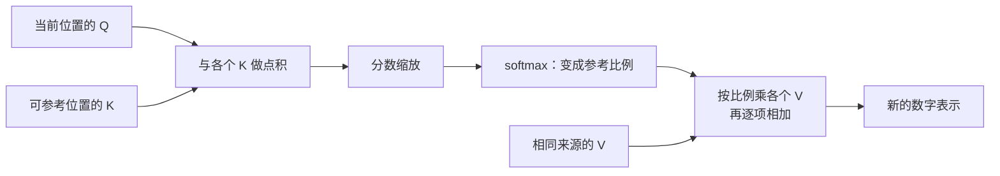

比例由 Q 和 K 算出，组合的内容来自 V，所以图中 V 的箭头直接通向组合步骤。若某些位置被禁止参考，计算比例前还要排除它们；下一章会用防止偷看答案的例子说明这条规则。

在继续组合 V 之前，先用两组独立的小例子看清分数差距的影响。下面只比较两个位置，不是把上面三个来源的算例改掉：

[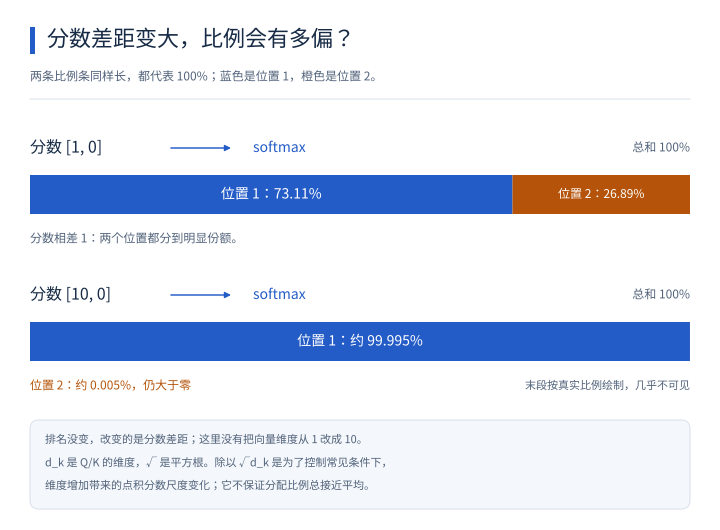](images/softmax-score-gap.svg)

先看第一组分数 `[1, 0]`，沿箭头经过 softmax，得到约 `[73.11%, 26.89%]`；再看第二组 `[10, 0]`，得到约 `[99.995%, 0.005%]`。两条比例条的总长度相同，都表示 `100%`，颜色和位置标签一起标明对应哪一项。第二条的末段按真实比例画出，几乎看不见，但第二项仍大于零。

两组都是第一项排名在前，变化的是分数差距：从 1 扩大到 10 后，分配接近由第一项独占。这里没有把向量的维度从 1 改为 10。

这也帮助理解第 6.2 节为什么要缩放。常见写法 `√d_k` 中，`d_k` 表示 Q、K 向量的维度，`√` 表示平方根；本章三来源算例的维度为 2，所以除以的是 `√2`。除以维度的平方根，是为了控制常见条件下维度增加带来的点积分数尺度变化，并不保证每次注意力比例都接近平均。

### 6.4 按比例组合 V

假设三个位置实际提供的 V 是：

| 位置 | 假设的 V | 使用比例 |
| --- | --- | --- |
| 书 | `[10, 0]` | 约 0.4011 |
| 图书馆 | `[0, 10]` | 约 0.1978 |
| 读完 | `[6, 6]` | 约 0.4011 |

输出就是把这些向量按比例相加。

先算输出的第一个数字：

> 0.4011 × 10 + 0.1978 × 0 + 0.4011 × 6 ≈ 6.42。

再算第二个数字：

> 0.4011 × 0 + 0.1978 × 10 + 0.4011 × 6 ≈ 4.38。

所以，输出约为 `[6.42, 4.38]`。这是把多份信息结合起来得到的新向量。

下面把第 6.1 节到这里的同一组数字接起来，追踪每个来源怎样贡献到输出的两格里。

[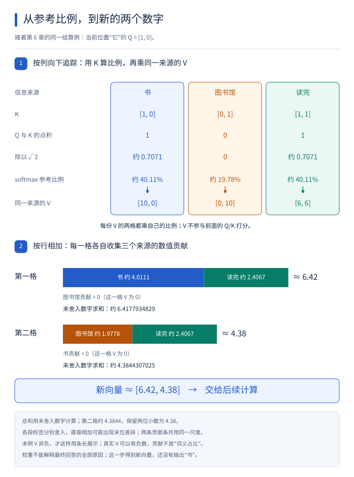](images/attention-weighted-values.svg)

读图分三步，箭头把同一来源的打分、比例和内容组合连接起来：

1. 先看上半部分，从“它”的 `Q = [1, 0]` 开始。与“书”“图书馆”“读完”的 K 点积得到 `[1, 0, 1]`，除以 `√2` 后，再经过 softmax 得到约 `40.11%`、`19.78%`、`40.11%`。V 没有参与前面的 Q/K 打分。
2. 沿来源追踪到下半部分，按列核对：某个 K 算出的比例，必须乘到同一来源的 V 上。“书”的第一格贡献约为 `4.0111`，第二格贡献为 `0`；后者是因为 V 的第二格为 `0`，并不是“书”的权重为零。
3. 再按输出的两行分别相加：第一格接收约 `4.0111`、`0`、`2.4067` 的贡献，第二格接收约 `0`、`1.9778`、`2.4067` 的贡献。每一行只汇总相应那一格的数字，得到新向量的第一格和第二格。

正文和图中的短小数方便阅读，实际计算使用未提前舍入的权重：`0.4011120926797859`、`0.1977758146404282`、`0.4011120926797859`。第一格总和约为 `6.4177934829`，保留两位小数为 `6.42`；第二格总和约为 `4.3844307025`。用未舍入的数字计算，第二格总和约为 `4.3844`，保留两位小数为 `4.38`。图中各段标签分别舍入，因此直接相加可能出现末位差异。

本例的 V 都是非负数，所以能用条长表示各项贡献；真实 V 可以包含负数。这些长度表示数值贡献，不能读作“某个词占了多少词义”，注意力权重也不能解释最终回答的全部原因。这一步只得到 `[6.42, 4.38]` 这个新向量。

**注意力这一步产出的是新的数字表示，还没有直接决定输出“书”这个字。** 这个结果还要继续经过后面的计算。

到这里，“Q、K、V”已经对应上具体动作了：用 Q 和 K 算分数，把分数变成比例，再按比例组合 V。

### 本章想一想与解答

**问题 1：某个位置的打分是 0，是不是说明它经过 softmax 后的比例也是 0？**

**解答：** 不是。指数运算会把 0 转成 1，这个正数还会参与总和与比例计算。例如两个可见位置的分数都是 0，就先得到 `[1, 1]`，再除以总和 2，得到 `[0.5, 0.5]`。不要把“原始分数为 0”和“最终使用比例为 0”混为一谈。

**问题 2：两份 V 分别是 `[10, 0]` 和 `[0, 8]`，比例分别为 75% 和 25%，组合结果是什么？**

**解答：** 对两个数值位置分别计算。第一个数是 `0.75 × 10 + 0.25 × 0 = 7.5`；第二个数是 `0.75 × 0 + 0.25 × 8 = 2`。所以结果为 `[7.5, 2]`。它综合了两份信息，不是把比例较大的那份直接原样拿出来。

**问题 3：在这一次注意力计算中，Q、K 和可见范围都不变，只改 V，会发生什么？**

**解答：** 匹配分数和由它算出的比例不变，因为这些步骤没有使用 V；按比例组合后的输出则可能变化，因为被组合的信息变了。这个问题正好检验三个角色的分工：Q、K 控制这次怎样分配，V 决定被分配的内容是什么。

## 7. 哪些位置可以提供信息

前面计算时，只用了三个可参考位置。真实模型还必须规定：当前位置允许看见哪些位置。

### 7.1 在同一段内容内部结合信息

当 Q、K、V 来自同一序列的相应表示时，这种注意力叫作**自注意力（Self-attention：一段内容内部的不同位置之间结合信息）**。

例如故事中的“它”结合这段故事前面的“书”等位置，就可以用来理解“同一段内容内部相互参考”的意思。

“自”强调来源在同一序列，并不表示一个位置只能看自己。

模型会对多个位置执行这种计算，产生多个新的中间向量。这些中间向量常叫作**隐藏状态（模型内部在某一步产生、供后续计算继续使用的数字表示）**。它们是一串串数字，不是一份藏起来的中文思考稿。

### 7.2 逐步生成时，要避免偷看后面的答案

假设训练材料是：

> 小明｜借了｜一本｜书。

我们希望模型根据“小明”预测“借了”。如果计算“小明”位置时，已经把后面的“借了”直接给它看，就等于把答案提前告诉了它。

因此，常见的逐步生成模型会使用**因果遮罩（Causal mask：让一个位置只能参考自己及前面位置，阻止它读取未来位置的规则）**。

| 当前处理到的位置 | 允许参考的内容 |
| --- | --- |
| 小明 | 小明 |
| 借了 | 小明、借了 |
| 一本 | 小明、借了、一本 |
| 书 | 小明、借了、一本、书 |

实现时，被禁止位置的分数会被屏蔽，使它们经过 softmax 后的比例为 0，就不会参与相应的信息组合。

具体看一次：假设当前位置对三个来源的分数都是 0，但第三个来源是不能提前看的后文。若直接给三个 0 做 softmax，会得到各占三分之一，仍然用了答案。正确做法是让被禁止位置退出比例分配，只在前两个位置间分配，得到 `[0.5, 0.5, 0]`。

常见实现会把禁止位置的分数设为负无穷，记作 `-∞`，表示比任何有限负数都小；在 softmax 的这一步，它对应 0 的贡献。实际程序也可能用等效的遮罩实现。**把禁止位置的分数设为普通的 0 并不能达到同样效果**，因为 `exp(0) = 1`。

训练程序虽然拥有完整的样本，当前每个位置的计算仍然要遵守这条规则。

把刚才的允许范围画成方格，就能逐个核对哪里可看、哪里必须挡住；图的下半部分再单独复现三个来源的 softmax 例子。

[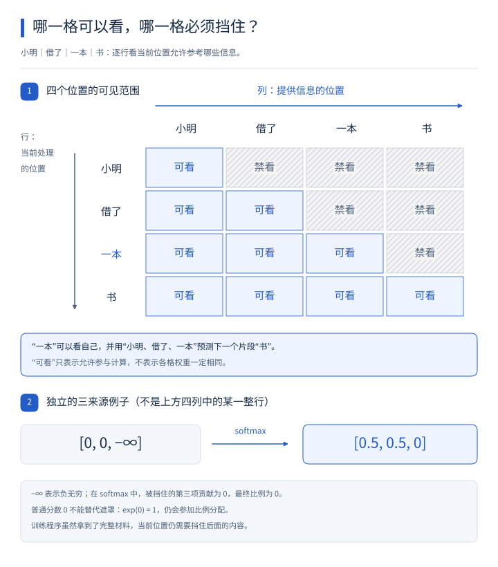](images/causal-mask-grid.svg)

先认清图的两个方向：行表示“现在处理哪个位置”，列表示“信息由哪个位置提供”。沿“一本”这一行横着看，它可以参考“小明、借了、一本”，但“书”这一格被挡住。“一本”位置使用这些已给出的内容预测下一个片段“书”，看自己并没有偷看目标。

再看沿对角线排列的“可看”：每个位置都允许参考自己和前面的位置。“可看”只是允许参与计算，并不表示这些位置的注意力权重相同。训练程序即使拿到了完整材料，也仍需挡住右上方的未来位置。

最后看下方独立的三来源例子，箭头表示对 `[0, 0, -∞]` 做 softmax，得到 `[0.5, 0.5, 0]`。它不是上方四列中某一整行的数字。`-∞` 让禁止位置对应的比例为零；普通分数 `0` 经指数运算得到 `1`，仍会分到比例，不能代替遮罩。

有些任务允许输入中的各个位置同时参考两边内容，因此不会使用相同的因果限制。限制方式要与模型的任务相匹配。

### 本章想一想与解答

**问题 1：“自注意力”里的“自”，是不是要求“它”这个位置只能参考“它”自己？**

**解答：** 不是。“自”表示 Q、K、V 来自同一段序列的相应表示。只要可见范围允许，“它”可以结合这段话前面的“书”等位置。它与“只能看自己”是两回事。

**问题 2：训练程序明明知道完整答案，为什么不直接让每个位置都看完整句子？这样不是更容易答对吗？**

**解答：** 对下一 token 预测来说，那样可能把要预测的后文直接泄露给模型。训练时看起来答得很好，实际生成时却没有这些尚未生成的后文可用。因果遮罩要求模型根据允许看到的内容预测，使这个学习任务与逐步生成的条件相符。

**问题 3：“一本”位置可以看见“一本”自己，难道不是偷看答案吗？**

**解答：** 这里“一本”位置要预测的是后面的“书”，并不是预测“一本”自己。允许看到“小明、借了、一本”，但不允许提前看到目标“书”。判断是否偷看，要先分清当前位置的输入与它负责预测的下一个片段。

## 8. 一套注意力不够，可以把多套结果组合起来

一句话可能包含不同类型的关系：谁做了什么、动作与什么对象有关、某个代词可能指向哪里等。

如果只使用一套信息匹配方式，表达能力可能受到限制。模型可以使用多套不同参数的注意力计算，再组合结果。

其中每一套计算叫作**注意力头（Head：一套用自己的参数形成 Q/K/V 并执行注意力计算的单元）**。

把多个头的结果组合起来，就是**多头注意力（Multi-head attention：并行使用多套注意力计算，再将结果汇合的方式）**。这里的“并行”就是多套计算可以一起组织执行。

用读故事来比喻，好像从不同角度整理同一句话的线索。不过，真实模型没有被人预先指定成“这个头只找人名，那个头只找书”；不同头的作用由训练形成，也不一定都能被人清楚命名。

还有两个容易混淆的地方：

- 多个头通常都能处理这段序列的可见位置，并不是把前半句话分给头 1、后半句分给头 2。
- 多个头通常使用各自较小的向量，再把结果拼接和变换；不一定把同样宽的一整套计算完整复制很多遍。

再看“把结果组合”到底怎样计算。假设两个头在同一位置分别输出 `[1, 2]` 和 `[3, 4]`。先把它们按顺序接成 `[1, 2, 3, 4]`，这个操作叫作**拼接（按指定顺序连接几组数字）**，没有在这里求平均。

接着用一组学到的参数做乘加，得到交给下一步的表示。例如，为了只展示动作，假设第一个输出数取 `1 × 1 + 2 × 0 + 3 × 1 + 4 × 0 = 4`，第二个取 `1 × 0 + 2 × 1 + 3 × 0 + 4 × 1 = 6`，结果就是 `[4, 6]`。

真实的系数由训练决定，不被规定为简单相加；输出长度也按网络的设计选取。于是多个头各自得到的信息，经过拼接和一次参数控制的变换，才汇合成供下一步处理的表示。

用图把这次汇合的顺序展开，就能分清“各头自己计算”“把结果排在一起”和“再做一次变换”这三个动作。

[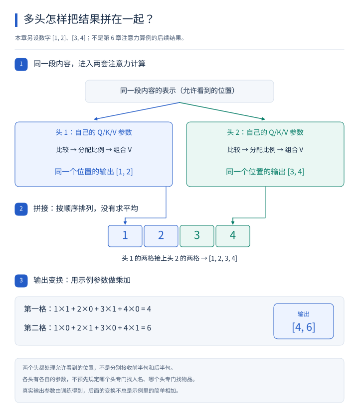](images/multihead-concatenation.svg)

从最上方顺着箭头往下看：同一段内容的表示分别进入两个头，每个头有自己的 Q/K/V 计算参数，在允许看到的位置之间分别比较、分配比例、组合 V。这里没有把前半句和后半句分给不同的头，也没有预先规定哪个头专门找人名或找物品。

接着只跟踪同一个位置：头 1 的 `[1, 2]` 与头 2 的 `[3, 4]` 按顺序拼成 `[1, 2, 3, 4]`。拼接本身没有相加或求平均。图中的这两份输出是本章另设的教学数字，不是第 6 章 `[6.42, 4.38]` 算例的后续结果。

最后读下方的输出变换，核对两格计算：`1 × 1 + 2 × 0 + 3 × 1 + 4 × 0 = 4`，`1 × 0 + 2 × 1 + 3 × 0 + 4 × 1 = 6`，得到 `[4, 6]`。这组示例参数恰好取出两对数字相加；真实输出参数由训练得到，变换不总是这样简单相加。

现在，相关信息已经经过一套或多套注意力结合起来。接下来还要对得到的表示做进一步加工。

### 本章想一想与解答

**问题 1：一句话有 8 个 token，使用两个注意力头，是不是每个头只分到 4 个 token？**

**解答：** 通常不是。两个头都处理这些位置，并在允许的可见范围内计算联系。它们主要区别在于使用不同的参数变换；经典结构里每个头的向量通常更窄，最后再把结果组合起来。分头不等于把句子截成几段。

**问题 2：能不能直接认定头 1 负责找人名、头 2 负责找物品？**

**解答：** 不能。那只是帮助理解“多种匹配方式”的比喻。不同头实际怎样工作是训练形成的，作用可能交叠，也可能难以用一个中文标签概括。理解多头，重点是多套计算和结果组合。

## 9. 结合完线索，还要怎样处理

刚才的注意力，主要解决“当前位置怎样结合其他位置的信息”。但结合完以后，仍然得到一串数字。这串数字还需要经过加工，才能逐步变成对任务更有用的表示。

### 9.1 对每个位置的信息继续加工

这个步骤通常由**前馈网络（Feed-forward network，简称 FFN：对每个位置的数字表示分别进行加工的一小组计算）**完成。

可以沿用信息卡的比喻：注意力把其他卡上的相关线索带过来，FFN 再加工当前卡上已经收集到的内容。

常见的 FFN 会先把向量转换成一串更长的数字，中间做一次有变化能力的处理，再转换回原来的长度。例如，假设输入有 4 个数字，中间变成 12 个，最后回到 4 个。这个长度只用于举例，具体模型会选择自己的设置。

中间为什么需要额外处理？如果所有步骤都只是把数字乘以固定系数、再相加，那么连续做很多步，仍能合并成同一类简单变换，表达能力会受到限制。

因此，中间通常会加入**非线性处理（让输入与输出的关系不再只是固定比例相加的计算）**。举一个简单规则：负数变成 0，正数保持原值。这样 `[-2, 3]` 就变成 `[0, 3]`。不同范围的输入接受了不同处理，计算就能表达更多种关系。

这种中间处理也叫**激活函数（用于加入非线性变化的计算规则）**。真实模型可能选择比上面更复杂的规则，但它在这里承担的用途相同。

在同一个 FFN 中，各个位置通常使用同一套参数。它在这一刻分别加工每个位置；其他位置的线索，已经由前面的注意力带进当前表示。

把一轮 FFN 算完整，假设输入是 `[2, -1]`，中间用三个数字，最后回到两个数字。为便于手算，这里不加偏置，并人为选择乘数。

第一步，用三个不同的组合产生三项：

- 第一项：`2 × 1 + (-1) × 0 = 2`。
- 第二项：`2 × (-1) + (-1) × 1 = -3`。
- 第三项：`2 × 1 + (-1) × 1 = 1`。

得到 `[2, -3, 1]`。第二步使用刚才“负数变零”的激活规则，得到 `[2, 0, 1]`。这条具体规则叫作 **ReLU**，读到这个名字时，记住本例的处理动作即可。

第三步用另一次参数控制的乘加把三项变回两项：

- 第一项：`2 × 1 + 0 × 0 + 1 × 1 = 3`。
- 第二项：`2 × 0 + 0 × 1 + 1 × 1 = 1`。

于是这一轮是 `[2, -1] → [2, -3, 1] → [2, 0, 1] → [3, 1]`。这个小例子说明，FFN 不只是“把数字变长又缩短”，中间的处理规则会改变哪些信息怎样影响结果。数字是教学构造，并没有固定对应某两个词义属性。

### 9.2 怎样保留原来的信息

如果每一步都把原来的表示彻底替换，层数多了以后，信息传递和训练都会更困难。

一种办法是把“进入这一步之前的表示”保留下来，与“这一步算出的结果”相加。这叫作**残差连接（Residual connection：让原来的输入绕过一段计算，再与这段计算的结果相加）**。

例如，原来的向量是 `[2, 3]`，这一段算出了 `[0.5, -1]`，相加得到：

> `[2 + 0.5, 3 + (-1)]`，也就是 `[2.5, 2]`。

可以理解成：在原有信息上补充一个调整量。模型有机会保留原信息，也有机会逐步修改它。

这里的“残差”不是在说“剩下的垃圾数据”，也不是前面预测答案产生的误差；在这个结构里，它指这种把输入加回去的设计。

### 9.3 怎样让数字保持在便于处理的范围

经过多次计算，有的数字可能变得很大，有的变化很小。直接把这些结果不断传下去，可能让后续计算与训练更难稳定。

因此，网络还会安排**归一化（Normalization：按一定规则调整数值的尺度，使后续计算更容易处理）**。

原始 Transformer 中常见的是**层归一化（Layer normalization，常写作 LayerNorm：通常在同一个位置的向量内部，根据各个数字的整体情况进行调整）**。

举一个只有三个数字的例子：`[10, 20, 30]`。

先算它们的平均值：`(10 + 20 + 30) ÷ 3 = 20`。每个数字减去平均值，得到 `[-10, 0, 10]`。接着，再根据这些数字分散的程度调整大小，并使用模型学到的参数进一步缩放、平移。

这里**平移**的意思是加上一个调整量，并不是把数字挪到别的位置。实现时还会有防止除数为 0 的小量。

把刚才略过的“分散程度”算出来：三个数与均值的差是 -10、0、10，分别自己乘自己得到 100、0、100，再取平均，是 `200 ÷ 3 ≈ 66.6667`。这个平均的平方差叫作**方差**。

再取方差的平方根，约为 8.1650，叫作**标准差**。用减过均值的各项除以它，得到：

> `[-10 ÷ 8.1650, 0 ÷ 8.1650, 10 ÷ 8.1650] ≈ [-1.2247, 0, 1.2247]`。

为便于看数字，这里暂时忽略了防止除零的小量，并假设后面的缩放参数都是 1、平移参数都是 0。实际 LayerNorm 会把小量加到方差上再开平方，并允许每一项再乘自己的缩放参数、加自己的平移参数。

因此，这一步不是把每个位置都强行改成同一个向量：输入数字之间的关系会影响输出；学到的缩放和平移还会继续调整结果。但减均值和除尺度确实会去掉某些整体数值信息，所以也不能说它原封不动地保留了输入的全部信息。

这个过程保留了数字之间可供后续利用的差别，同时调整了它们的尺度。

它与前面的 softmax 用途不同：softmax 把分数变成总和为 1 的非负比例；这里整理的是内部表示的数值范围，结果仍然可以包含负数，总和也不必是 1。

### 9.4 把这些步骤组成一个可重复的单元

现在我们有了四种已经认识的动作：

| 动作 | 在这一段计算中做什么 |
| --- | --- |
| 多头注意力 | 用多套匹配方式结合可见位置的信息 |
| FFN | 对每个位置得到的信息继续加工 |
| 残差连接 | 把输入保留下来，与加工结果相加 |
| 归一化 | 调整内部数值的尺度 |

把这些动作按设计连接起来，就构成一个 **Transformer block（Transformer 块：一组可以重复堆叠的处理步骤）**。介绍模型时，说“有多少层”，常常就是在数这样的处理块。

以原始 Transformer 中的一种排列为例：

```text
一段内容的数字表示
       ↓
多头自注意力
       ↓
加回这一小段的输入，再做归一化
       ↓
FFN
       ↓
加回这一小段的输入，再做归一化
       ↓
这一块处理后的数字表示
```

这里有两次“加回输入”：第一次加回的是进入注意力之前的表示，第二次加回的是进入 FFN 之前的表示。

具体模型的排列可能不同，例如把归一化放到注意力和 FFN 之前；某些结构还会增加一个信息来源。后面讲翻译模型时，就会说明这个来源是什么。

### 9.5 为什么还要重复很多块

一块的输出可以交给下一块。下一块接收到的，已经是结合过上下文、加工过的表示，它会在这个基础上继续处理。

因此，多层处理给了模型逐步组织更复杂关系的机会。各层通常有自己的参数，也没有被统一指定成“第一层只看词义，第二层只看语法”。

处理到最后，得到的仍然是每个位置对应的一串数字。下一步，需要把这些数字与可以输出的文字联系起来。

### 本章想一想与解答

**问题 1：FFN 分别加工每个位置，为什么它还能处理与上下文有关的信息？**

**解答：** 因为送到 FFN 的向量已经经过注意力，里面可以带有其他位置的信息。就像你已经把几份资料的要点整理到一张卡上，再加工这张卡时，处理的内容已经来自多份资料。FFN 此刻不直接混合其他位置，不等于它的输入与上下文无关。

**问题 2：原输入是 `[-1, 2]`，某一段的计算结果是 `[0.5, 3]`，残差相加后是什么？如果这段算出了全 0 呢？**

**解答：** 第一种情况逐项相加，得到 `[-0.5, 5]`。第二种情况得到原来的 `[-1, 2]`。这说明残差路径让原输入有一条直接传下去的路线；不过，后面如果还有归一化或其他计算，结果仍可能继续改变。

**问题 3：归一化是不是把所有数字都改成 1，或者都变成概率？**

**解答：** 都不是。它按规则调整数值尺度，数字之间仍可以保留差别，也可以出现负数。本章 `[10, 20, 30]` 仅做减均值这一步，就变成 `[-10, 0, 10]`。后续还会调整大小；整个过程不要求像 softmax 那样得到总和为 1 的非负比例。

**问题 4：既然多层可以反复加工，是不是多堆几层就一定回答得更好？**

**解答：** 不一定。更多层提供了更多计算能力，但这些计算要经过合适的训练才能有用。数据、参数设置和训练是否成功都会影响结果。不能只数处理块的数量，就判断一个具体模型的能力。

## 10. 怎样从数字变成回答

前面举例时，我们观察过故事中“它”这个位置怎样结合线索。真正回答问题时，模型还需要处理问题本身，并利用整个输入中可见的信息。

例如，把下面的内容交给一个已经训练成能够回答问题的模型：

> 小明从图书馆借了一本书，读完后把它还了回去。
>
> 问：小明还回去的是什么？
>
> 答：

对于常见的逐步生成模型，处理完当前输入后，会利用最后一个位置得到的表示，计算接下来应当输出哪个 token。

### 10.1 给每个候选片段打分

模型配套的所有 token 组成**词表（模型可以识别和输出的 token 编号集合）**。

模型末尾会有一组负责产生候选分数的计算，称为**输出层（把内部数字表示转换成输出候选分数的计算部分）**。

这一步得到的分数常叫作 **logits（每个候选 token 对应的原始分数）**。接着要把分数转换成**概率（这里指模型给每个候选分配的可能性大小）**，从而决定后面怎样选择。

候选分数仍然可以用乘加算出来。假设最后位置的表示为 `[2, 1]`，三个候选分别有一组学到的系数：书用 `[1, 1]`，伞用 `[1, 0]`，球用 `[0, 1]`。暂时不加额外偏置，就得到：

- 书：`2 × 1 + 1 × 1 = 3`。
- 伞：`2 × 1 + 1 × 0 = 2`。
- 球：`2 × 0 + 1 × 1 = 1`。

一次输出层计算会给词表中的各个候选分别产生分数。不是先把内部向量直接翻译成一个词，再给那个词补上概率。这里的表示和系数同样都是教学设定。

为了看清过程，假设这里只有三个候选，并假设输出层给出了下面的分数。真实词表通常远不止三个，这些分数也不是实际模型的结果。

| 候选 token | 假设的原始分数 |
| --- | --- |
| 书 | 3 |
| 伞 | 2 |
| 球 | 1 |

接着使用前面已经算过的 softmax：先把分数转换成正数，再除以总和。

| 候选 | 转换得到的正数 | 在这三个候选中的概率 |
| --- | --- | --- |
| 书 | 约 20.0855 | 约 66.52% |
| 伞 | 约 7.3891 | 约 24.47% |
| 球 | 约 2.7183 | 约 9.00% |

把候选与各自的概率放在一起，就得到**概率分布（说明每个候选分别占多少可能性的一组结果）**。表中保留两位小数，所以显示的百分比加起来会有一点舍入误差，精确结果的总和是 100%。

这一处 softmax 分配的是“各个输出候选占多少概率”；注意力里的 softmax 分配的是“各个可参考位置占多少比例”。它们使用相同的计算方法，但分配的对象不同。

### 10.2 从候选里选出一个

常见选择方式包括：

- **贪心选择（每一步都选择当前概率最高的候选）**：在上面的例子里会选“书”。
- **采样（按照概率进行带随机性的抽取）**：可以类比把候选放进一个抽签箱，概率越大，对应签越多；抽一次可能得到“书”，也可能得到其他候选。

真实采样通常还会调整或限制候选范围。无论使用哪种方式，这一步的作用都是从概率分布里确定实际输出的 token。

例如，可以在做 softmax 前，把候选分数除以一个正数。这个设置叫作**温度（Temperature，用来调节候选分布集中程度的数值）**：小于 1 时通常让高分候选更突出，大于 1 时通常让分布更平缓。它改变选择的多样程度，不是给事实准确性设置保证；把温度调低，模型仍可能稳定地产生错误答案。

### 10.3 把刚生成的内容接上，再计算下一步

假设这一步选中了“书”，接下来就把它接到当前输入后面，让后续生成能参考它。

```text
故事 + 问题 + “答：”
       ↓ 计算并选择一个 token
故事 + 问题 + “答：书”
       ↓ 继续计算并选择
故事 + 问题 + “答：书。”
```

这里把“书”和句号分成两步，只为说明逐步追加的过程，实际拆分仍取决于 tokenizer。

这种“用已有内容预测下一部分，再把新内容接回去继续”的方式，叫作**自回归生成（Autoregressive generation：后续输出依赖已经给定和已经生成的内容）**。

模型还可以输出专门的**结束标记（表示这一段生成应当结束的特殊 token）**。服务程序也可能因为达到预设输出长度等条件停止生成。

因此，常见聊天模型呈现为文字逐步出现。每一步依赖之前已经生成的内容；它内部有许多可以一起执行的数值计算，但通常不会一次独立确定整篇回答的每个 token。

### 10.4 为什么流畅的回答仍可能出错

下一 token 的概率，是模型根据参数和当前输入算出来的。这个计算过程不会自动保证现实中的每件事都经过核实。

如果故事里明确说借了一本书，模型有线索可用。如果问的是一个它没有可靠依据的人名、日期或故障原因，它仍然可能接出看起来顺畅的文字。

这种生成了错误、无依据或与输入矛盾内容的现象，常被称为**幻觉（模型给出貌似合理、实际上不可靠的内容）**。

理解了生成过程，就能分清两个问题：一个回答是否符合常见表达习惯，以及它说的事情是否有可靠依据。

### 10.5 自回归是一种模型结构，还是一种生成算法

先看两个不同的问题。一个是“怎样描述整段输出出现的可能性”，另一个是“程序接下来具体执行什么步骤”。

假设用一个极小词表生成两步内容：第一步给“书”分配的概率是 0.6；在已经选到“书”的前提下，第二步给句号分配的概率是 0.5。那么模型给“书。”这条路径分配的概率就是 `0.6 × 0.5 = 0.3`。这里第二个概率带着条件，必须使用“前一步已经是书”时算出的分布。若直接按这两步的原概率分布采样，抽出这条路径的机会也是 0.3；若改用贪心、温度等规则，实际输出机会还会随选择规则变化。

把整段序列的概率按这种方式拆成“第一个片段的概率 × 给定前文后的第二个片段概率 × ……”，就是语言模型中常见的**自回归建模**。采用这类分解来预测序列的模型，可以叫作**自回归模型**。这里的“回归”不专指画一条直线，重点是后面的预测依赖前面已有的内容。

真正生成时，程序照着下面的步骤运行，就构成一种**算法（为完成任务而规定的一组执行步骤）**：

```text
准备：把问题和已有文字作为当前内容
重复：
    用模型计算下一个 token 的候选概率
    用贪心或采样规则选一个 token
    若选到结束标记，则停止
    把选中的 token 接到当前内容后面
达到长度等限制时，也停止
```

所以“自回归”描述的是预测之间的依赖方式；Transformer 描述内部计算怎样组织；贪心或采样描述怎样实际选候选。它们是不同问题的答案，可以组合使用。RNN 也能做自回归语言模型；Transformer 也可以用于判断类别，而不逐步生成文章。

### 10.6 怎样从这些步骤理解生成式大语言模型

如果程序只能给一封邮件选“垃圾／正常”，它输出的是一个类别。如果程序能接着输入生成一段新的文字，输出空间就远不止两个标签。这种根据输入和学到的规律产生文本、图像等内容的能力，属于**生成式 AI（以生成内容为重要任务的人工智能方法与系统）**。

对文字序列的规律建模的模型，叫作**语言模型**。前面根据已有文字计算后续片段可能性的做法，就是语言建模的一种常见形式。在大量数据上训练、使用大规模参数并具备较广泛语言处理能力的这一类模型，通常称为**大语言模型（Large Language Model，简称 LLM）**。“大”没有一个适用于所有场景的统一参数门槛，也不意味着每个回答都正确。

结合这两个名称，**生成式大语言模型**就是能利用这种大规模语言建模能力生成文字的模型。许多常见做法把 Transformer 架构、预测后续 token 的训练任务和自回归生成组合起来；这一组合很常见，但这几个词不是同义词。

之所以一个“逐片段生成”的机制能写摘要、解释代码、回答问题，是因为这些任务都可以写成“输入中交代任务与材料，输出接上符合任务的文字”。训练材料与训练方式使模型有机会学习这类关系。它不是只凭当前字的局部外形猜下一个字：内部多层计算能够利用允许看到的整个上下文；但这种能力也不等于自动具备可靠的事实核验。

生成式模型并不只包括自回归文字模型。生成图片等任务还可以采用别的生成方式。这里跟着 Transformer 语言模型深入这一条路线，不能据此把整个生成式 AI 领域都缩成同一种算法。

### 本章想一想与解答

**问题 1：三个候选的概率是 40%、35%、25%，最高只有 40%，贪心选择还能选出结果吗？采样也一定选它吗？**

**解答：** 贪心选择比较的是谁最高，并不要求超过 50%，所以会选择第一个候选。采样则按概率抽取，第二、第三个也有机会被选中。概率分布相同，选择规则不同，实际输出就可能不同。

**问题 2：为什么选出“书”以后，还要把“书”加入已有内容，再继续计算？**

**解答：** 因为下一步要根据已经写出的内容继续接下去。“书”已经成为后文需要考虑的一部分，例如后面可能接句号，也可能继续补充说明。若后续选择完全不参考先前输出，就失去了这种逐步接续的依赖关系。

**问题 3：模型给某个后续片段分配了 99% 的概率，就说明整句话有 99% 的可能符合事实吗？**

**解答：** 不能这样解释。这里的概率是给“下一 token 候选”分配的，并不是对整句话进行事实核查后的准确率。如果输入缺少依据，模型也可能非常倾向于一个错误续写。判断事实仍要看信息依据和实际结果。


**问题 4：自回归、Transformer、LLM 分别在回答什么问题？它们必然同时出现吗？**

**解答：** 自回归说明后续预测依赖前面内容，Transformer 说明计算怎样组织，LLM 说明模型属于大规模语言建模这一类别。常见生成式 LLM 会把三者结合起来，但 RNN 也可以自回归，Transformer 也可以只做分类，所以不能把三者当成同义词。

**问题 5：第一步“书”的概率是 0.6，给定“书”后第二步句号的概率是 0.5；“书。”这条两步路径的概率为何是 0.3？是否表示这句话有 30% 的概率是真话？**

**解答：** 要先走到“书”，再在这个条件下走到句号，因此这条路径的概率是 `0.6 × 0.5 = 0.3`。它描述模型为这串片段分配的概率，没有核验现实事实，不是句子的真假概率；实际采用贪心或调整过的采样规则时，输出机会还受选择规则影响。

## 11. 回答一句话时，前面的内容要反复计算吗

刚才我们把生成描述成“接上一个 token，再继续”。如果每一步都重新计算整段前文，会做很多重复工作。

前面已经介绍过：在使用因果遮罩的模型里，一个位置只能参考自己和前面的内容。后面追加一个 token，通常不会改变前面那些位置在同样条件下应当得到的结果。

因此，可以把之前每一层算过的 K、V 保存起来。处理新 token 时，计算它自己的 Q、K、V，再用它的 Q 与之前保存的 K 及当前 K 比较，按得到的比例组合对应的 V。

这个办法叫作 **KV Cache（K、V 缓存：保存之前位置的键向量和值向量，供后续生成复用）**。**缓存**就是把以后还会用到的结果暂时保留，减少重复计算。

第一次收到整个问题时，系统可以一起处理这些已经给定的位置，算好各层需要保留的 K、V；这段过程常叫作 **Prefill（预填充，处理已知输入并建立缓存）**。随后一次接上一个新 token 的阶段，常叫作 **Decode（解码，这里指逐步生成后文的阶段）**。

这两个名称区分计算阶段。“解码”在这里不表示把答案解密，也不表示每一步都会把全部旧输入从头算一遍。保存 K、V 能省去旧位置的一部分重复计算，但新的 Q 仍要参考已有 K、V；上下文变长时，需要读取和组合的信息通常也会更多。

例如刚刚选出“书”，下一轮就把“书”作为新的输入位置，为它计算 Q、K、V，同时复用故事、问题等之前输入的 K、V。这样可以继续选择后面的句号，而不必把前面的所有位置从头重新算一遍。

这类缓存保存的是本次输入产生的中间结果；它与训练出来的参数是两类东西，也不等同于聊天软件存下来的文字记录。

到这里，我们已经走完了一次普通生成的大体过程。接下来回到最初的问题：控制这些计算的参数，到底是怎样学出来的？

### 本章想一想与解答

**问题 1：为什么在因果遮罩下，追加一个新 token 通常可以复用前面的 K、V？如果把前面某个词改掉呢？**

**解答：** 追加内容位于后面，旧位置原本就不能看这些未来内容，因此在相同计算条件下，旧结果通常仍然有效。如果改的是前面的词，这个位置及依赖它的后续位置就可能得到不同结果，相关缓存不能继续照搬。能否复用，要看产生缓存的输入与条件是否仍然匹配。

**问题 2：保存了 KV Cache，是不是就把这次对话永久学进模型了？**

**解答：** 不是。缓存保存的是本次计算产生的中间向量，参数则是训练得到的计算依据。缓存被清理后，可以用相同输入和参数重新计算；保存或清理缓存本身，都不等于进行参数训练。

## 12. 训练怎样把一堆数字变成有用的模型

第 2 节已经说过，训练就是利用样本调整参数。现在我们认识了输入、内部处理和输出概率，就能把这件事讲得更具体。

### 12.1 先准备一个可以核对的目标

假设某条训练样本是：

> 小明｜借了｜一本｜书。

当模型得到“小明｜借了｜一本”时，这条样本中的下一个目标片段是“书”。

模型按照前面讲过的步骤进行计算，并给所有候选分配概率。假设它给“书”的概率只有 10%，那么这次预测与样本的目标不够接近。

训练需要把这种差距转换成一个能计算的数字。这个数字叫作**损失（Loss：用来衡量本次预测与训练目标差距的数值）**。

对于常见的下一 token 训练方式，给目标 token 的概率越低，损失越大；把它从 10% 提高到 80%，这一项损失就会降低。

常见的具体规则是：对目标的概率取自然对数，再加一个负号，写成 `损失 = -ln(目标概率)`。**自然对数 ln** 可以看作前面指数运算的反向提问：要让 `exp(x)` 得到这个概率，x 应是多少？

例如 `exp(-2.3026)` 约为 0.1，所以目标概率为 10% 时，这项损失约为 2.3026；概率为 80% 时，损失约为 0.2231。概率越接近 1，损失越接近 0。对这里“目标明确是某个 token”的任务，这种计算通常称为**交叉熵损失**。

整批训练中会把多个位置的这类损失按训练设置汇总，不能只观察某一个位置就断定整个模型训练成功。

所以，训练的方向不是只问“抽出来的字碰巧对不对”，还会看目标 token 得到了多少概率。这样才能连续地判断参数调整有没有让预测更接近目标。

### 12.2 怎样知道应该改哪些参数

一个模型中可能有非常多参数，不可能让人逐个试旋钮。训练程序会计算：每个参数稍微改变一点，损失大约会怎样变化。

这种描述局部变化关系的信息，叫作**梯度（Gradient：反映参数发生微小变化时，损失怎样随之变化的一组数）**。

“局部”就是当前参数附近的一小步。它提供调整方向，不保证一步就能找到全局最好的参数。

例如，假设其他条件不变，把某个参数从 0.20 稍微调大，会让当前损失上升，那么常见的调整方向就是让它略微减小；如果略微调大会让损失下降，就有理由向增大的方向尝试。

这些变化关系会沿着之前执行过的计算，从结果往前逐步算回来。这个求梯度的过程叫作**反向传播（Backpropagation：沿计算过程反向计算各参数对损失的影响）**。

它不是把输出文字倒着读一遍，而是在数值计算中追踪前后步骤的变化关系。

随后由**优化器（Optimizer：根据梯度等信息决定怎样更新参数的计算方法）**修改参数。每次大致调多少，还会受到**学习率（控制参数更新步幅大小的设置）**影响。

先用一个比语言模型小得多的例子，看梯度怎样算出、参数怎样修改。假设只有一个参数，用字母 w 表示，输出按 `输出 = w × 2` 计算，目标是 4。这里用“输出与目标的差，自己乘自己”作为损失；它叫作**平方误差**，只是为了方便手算，不是刚才的下一 token 交叉熵。

当前 `w = 1`，输出为 2，损失是 `(2 - 4) × (2 - 4) = 4`。计算经过两步：`w → 输出 → 损失`。先分别看这两步怎样传递变化。

**第一步，w 怎样影响输出？** 输出始终是 w 的 2 倍，所以 w 增加 0.01，输出就增加 0.02。用“输出的改变量 ÷ w 的改变量”衡量变化率，得到 2。这一步是固定的倍数关系。

**第二步，输出怎样影响损失？** 暂时只看输出从 2 稍微增加时发生什么。用 h 表示输出的这一点增加量，输出就从 2 变成 `2 + h`。上标 ² 表示自己乘自己，`4h` 就是 `4 × h`。先取不为 0 的 h，把新的平方误差展开：

```text
新损失 = (2 + h - 4)² = (-2 + h) × (-2 + h)
       = 4 - 4h + h²
损失的改变量 = 新损失 - 原损失 = -4h + h²
损失的改变量 ÷ 输出的改变量 = (-4h + h²) ÷ h = -4 + h
```

比如 h 是 0.01，变化率为 -3.99；h 是 0.001，变化率为 -3.999。h 越接近 0，这个比值越接近 -4。因此，在当前输出等于 2 的位置，损失对输出的**局部变化率**是 -4。它描述足够小的变化，不是说输出无论增加多少，损失都会按固定倍数下降。

现在从损失往回接：输出稍变一点，损失按局部变化率 -4 随之变化；而 w 的变化会先被放大 2 倍，成为输出的变化。因此：

> `损失对 w 的局部变化率 = (-4) × 2 = -8`。

这就是当前 w 的梯度。把相邻步骤的局部变化率相乘，连接前后影响，叫作**链式法则**。这个小例子的反向传播，就是先得到损失对输出的 -4，再沿前一步乘上 2，求出损失对参数的 -8；此时还没有修改参数。

也可以用一次实际的小改动核对：把 w 从 1 调到 1.01，输出变为 2.02，损失为 3.9204，损失改变量为 -0.0796。`-0.0796 ÷ 0.01 = -7.96`，与 -8 接近；步子继续缩小，这个比值会更接近 -8。这里的试算是在验证已经求出的变化率，真实网络不需要为求梯度逐个试改所有参数。

最简单的一种更新方法是“新参数 = 旧参数 - 学习率 × 梯度”。若学习率取 0.1：

> `新 w = 1 - 0.1 × (-8) = 1.8`。

再计算一次，输出为 `1.8 × 2 = 3.6`，损失为 `(3.6 - 4)² = 0.16`。优化器在这一步实际改变了参数，当前样本的损失也从 4 降到了 0.16。

这个例子展示一次更新，不说明每次更新都能让所有样本更好。真实网络的反向传播把局部变化关系沿多步计算传递，求出许多参数的梯度，而不是给每个参数都试改一遍；实际优化器也常比这个最简单规则复杂。

整个过程可以连起来看：

```text
给出训练样本和目标
       ↓
用当前参数算出候选概率
       ↓
计算与目标的差距，也就是损失
       ↓
反向传播，求出参数对应的梯度
       ↓
优化器更新参数
       ↓
在后续样本上继续计算和调整
```

不只是输出层会学习。前面见过的 embedding 表、产生 Q/K/V 的参数、FFN 等可学习部分，都可以通过这条过程得到调整。

参数经过大量样本的共同影响，才可能形成对语法、词语联系、事实模式或任务方式有用的处理能力。是否学得好，还取决于数据、训练方法和模型规模等条件。

### 12.3 为什么训练时可以同时处理多个位置

训练程序通常已经拥有整段样本，因此可以为不同位置准备各自的下一 token 目标：

| 输入处理到哪里 | 根据这条样本，下一步应预测什么 |
| --- | --- |
| 小明 | 借了 |
| 小明、借了 | 一本 |
| 小明、借了、一本 | 书 |

这些目标来自已有样本，不需要等模型先猜出前一个 token。因此，同一层里多个位置的计算可以一起组织执行。

同时，因果遮罩会保证每个位置只能利用允许看到的前文。例如预测“借了”的位置，仍然不能把后面的“借了”作为自己的输入线索。

**训练时，样本中的后文已经存在；实际生成时，下一步内容尚未确定。** 这是训练与逐步生成在组织计算时的一处重要区别。

### 12.4 学会续写以后，怎样学会回答问题

大规模地从文字等材料中学习一般规律，通常叫作**预训练（在大量数据上学习基础能力的训练阶段）**。

在已有模型上，用更多特定任务的数据继续训练，叫作**微调（在已有参数基础上，为某类任务或行为继续调整模型）**。

例如，给它许多“问题—合适回答”的样本，训练目标就会包含怎样按提问方式回答、怎样遵守任务要求等。实际聊天模型还可能经过其他训练步骤。

把过程具体化：同样看到“请解释小明还了什么”，一个只学过一般续写的模型可能继续编故事；如果训练样本明确给出“问题：……／回答：他还了一本书”，模型就能在这种任务形式中学习怎样回答。用示范输入和示范答案继续调整模型，常叫作**监督微调（Supervised Fine-Tuning，SFT）**。这里的“监督”指有可学习的示范目标，不是有人在聊天时盯着每次输出。

除了给一个示范答案，还可以让人比较同一问题的两个回答。例如，一个回答简洁地解释“它”指书；另一个答非所问。这样的比较提供了**偏好数据（记录哪些回答相对更符合要求的数据）**。

一种利用它的路线是先训练**奖励模型（给候选回答提供偏好评分的模型）**，再用评分指导聊天模型调整输出行为。这属于**基于人类反馈的强化学习（Reinforcement Learning from Human Feedback，RLHF）**的一类常见做法。**强化学习**是根据行为及其反馈来调整行为策略的学习方法；这里的行为包括生成回答，反馈来自相应的评分。[聊2]

不是每个聊天模型都使用完全相同的训练流程，偏好数据也可以通过其他方法直接用于训练。把基础模型继续训练成更符合目标行为的模型，这些后续步骤统称为**后训练**。

人的偏好、奖励评分与客观正确性之间仍有差别。回答可能因为语气肯定而得到较高评价，但其中的日期依旧可能有误。因此，更适合聊天不等于每个事实都已经验证，评价数据和任务检查仍然重要。

这也解释了为什么“采用 Transformer 架构”与“已经是一个好用的聊天助手”之间还有距离：架构提供计算组织方式，训练使具体模型学会相应的行为。

### 12.5 为什么聊天时给出新信息，不等于重新训练

你可以在提问中说明“这里的服务名叫 BookAPI”，模型据此继续回答。这是它使用当前上下文里的信息。

普通推理通常不会因此修改模型参数。当前表示与 K、V 可以随着输入变化，训练得到的参数仍保持原样。

以后能否在另一段对话里继续利用这条信息，还取决于应用有没有保存并再次提供相关内容。不能仅凭一次对话，就认定模型把它永久学进了参数。

最后回到第 12.2 节的单参数例子，用一张图对照“训练改变参数”和“新输入使用已有参数”。这样既能看到那次损失为何下降，也能看清输出变化不一定意味着重新训练。

[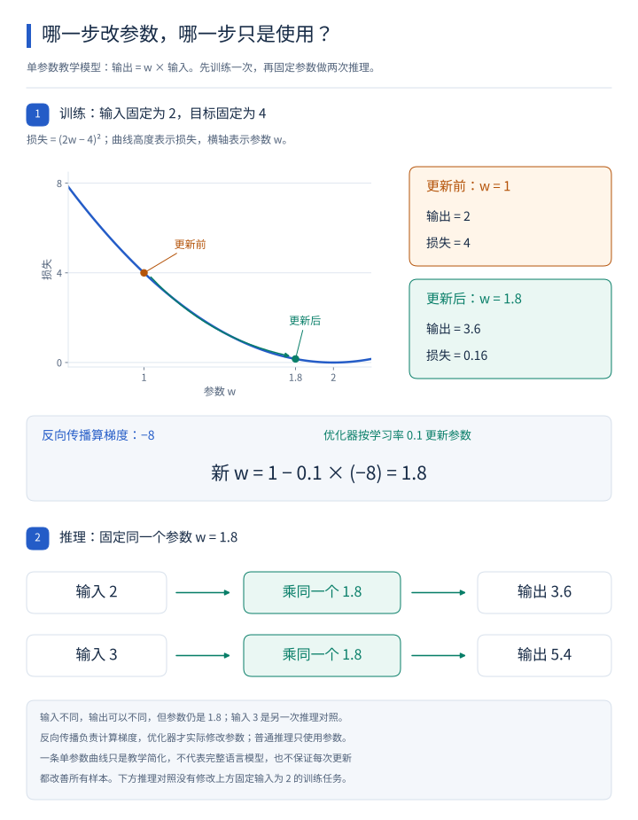](images/training-and-inference.svg)

先读上半部分的曲线：横轴上每一点代表一种参数 `w`，曲线高度是训练输入固定为 `2`、目标固定为 `4` 时的损失 `(2w - 4)²`。从更新前的点看起，`w = 1`，输出为 `2`，损失为 `4`。

再沿更新箭头走到 `w = 1.8`：反向传播先算出梯度 `-8`，优化器才按学习率 `0.1` 执行 `新 w = 1 - 0.1 × (-8) = 1.8`。更新后输出为 `3.6`、损失为 `0.16`。箭头连接的是更新前后的状态，不表示反向传播求出梯度时就已经改了参数。

最后读下半部分的两条推理路线，箭头表示输入经过乘法得到输出：输入 `2` 乘同一个 `1.8` 得到 `3.6`；另一次输入 `3` 乘同一个 `1.8` 得到 `5.4`。输入和输出可以不同，参数始终是 `1.8`。这里的输入 `3` 是另一次推理的对照，没有把上方训练曲线的输入或目标改掉。

这条曲线只展示一个参数、一个样本的简化任务，并不代表完整语言模型，也不能据此保证每次更新都改善所有样本。

### 本章想一想与解答

**问题 1：样本目标是“书”。模型把“书”的概率从 10% 提高到 80%，这一项损失会怎样变化？这就能证明所有问题都会答对吗？**

**解答：** 对这里讲的下一 token 训练目标，这一项损失会降低，因为预测给目标分配了更高概率。但这只说明在这个样本、这个目标上的表现改善了，不能直接推出其他问题也正确。判断整体能力还要看更多合适的例子。

**问题 2：计算出了损失，是不是参数就已经改好了？反向传播和优化器分别还要做什么？**

**解答：** 损失只是把预测差距变成数字。反向传播继续计算参数变化会怎样影响损失，得到梯度；优化器再据此更新参数。可以把这三步区分成“衡量差距”“计算调整依据”“实际修改参数”。少了最后的更新，参数不会仅因得到一个损失值就自动变好。

**问题 3：训练时可以一起处理“小明、借了、一本”，为什么生成时不能照搬这个做法，直接一次确定所有后文？**

**解答：** 训练中这些片段来自已有样本，可以提前准备好各位置的输入和目标，同时用遮罩防止偷看。生成时后文还没确定，下一步需要使用刚选出的实际结果。两种情况下“后文是否已经给定”不同，不能把已知输入的并行处理直接等同于未知输出的同时决定。

**问题 4：简单更新例子中，w 从 1 变到 1.8，新的输出和损失是多少？为什么这次算得更好不等于已经训练出语言模型？**

**解答：** 输出为 `1.8 × 2 = 3.6`，平方误差为 `(3.6 - 4)² = 0.16`，小于原来的 4。这个例子只有一个参数和一个数值目标，只验证了一次更新的效果。语言模型还有词表、上下文计算和大量训练目标，不能从这个结果推出语言能力。

**问题 5：如果人更喜欢一个回答，它就一定符合事实吗？RLHF 是否等于用户每聊一句，参数都会立即更新？**

**解答：** 人的评价可能有遗漏，也可能偏好流畅但错误的表达，所以偏好评分不能代替事实依据。RLHF 描述一种训练流程；普通聊天使用已准备好的参数，用户反馈是否被另行收集并用于未来训练，取决于产品和训练安排，不能认为当前每条消息都立即更新参数。

**问题 6：单参数例子中的梯度 -8 从哪里来？为什么一次试改得到 -7.96，不是恰好 -8？**

**解答：** 输出对 w 的局部变化率为 2；输出等于 2 时，输出增加 h 会让损失改变 `-4h + h²`，除以 h 得到 `-4 + h`，当 h 趋近于 0 时得到局部变化率 -4。沿两步相乘，梯度就是 `(-4) × 2 = -8`。试改 w 到 1.01 走的是一段有限距离，平方项仍有影响，所以得到 -7.96；梯度描述当前点的局部关系。反向传播求出这个关系，优化器才按学习率更新 w。

## 13. 为什么有的 Transformer 分成两部分

前面为了说明回答如何逐步产生，主要跟着常见生成模型的工作方式讲解。现在，我们已经认识了内部组件，可以进一步看它们怎样被组合成不同结构。

### 13.1 原始 Transformer 要完成的典型任务：翻译

2017 年提出的原始 Transformer，典型应用之一是把一种语言翻译成另一种语言。例如：

> 输入：I love cats.
>
> 输出：我爱猫。

这里有两段内容：完整给定的原文，以及正在逐步生成的译文。

它把处理过程分成两部分。

第一部分叫作**编码器（Encoder：把输入内容处理成供后续使用的上下文表示的部分）**。它对完整原文做多层处理，让原文的各个位置结合彼此的信息。在这种翻译任务中，原文已经完整给定，因此编码器通常允许原文位置相互参考，不遮住右侧原文。

第二部分叫作**解码器（Decoder：结合可用信息，逐步产生输出的部分）**。它处理已有译文，用因果遮罩防止读取还不应看到的后文，并参考编码器处理好的原文信息。

这里的“编码、解码”是模型部分的名字，不是在说把文件加密再解密。

### 13.2 生成译文时，怎样读取原文

假设译文已经生成“我爱”，现在需要确定后续内容。模型既要知道译文已经写了什么，也需要利用原文中的 “cats”。

它会增加一套**交叉注意力（Cross-attention：用一段内容产生 Q，用另一段内容提供 K、V，从而结合另一段内容的信息）**。

在这个翻译例子中：

- Q 来自解码器当前处理的译文表示。
- K、V 来自编码器输出的原文表示。
- 仍然按照前面学过的方式比较 Q 与 K，再按比例组合 V。

因此，原始解码器中的一个处理块，比前面举的自注意力处理块多了一段交叉注意力。它的主要处理顺序是：对已有译文做带因果遮罩的自注意力，再通过交叉注意力利用原文，最后经过 FFN；这些部分同样配有残差连接和归一化。

“自注意力”和“交叉注意力”的主要区别，由此就明确了：前者在同一段表示内部结合信息，后者把另一段表示作为信息来源。

### 13.3 为什么许多聊天模型没有单独的编码器

另一种常见组合叫作 **Decoder-only（只使用解码器式结构：主要用带因果限制的处理块，处理输入并逐步生成后续内容）**。

它一般会把问题和已有回答放在同一条内容序列里处理。生成新内容的位置可以通过自注意力参考前面的提问，所以即使没有单独叫“编码器”的部分，也可以处理问题中的信息。

这种结构通常没有原始翻译解码器里那套“读取独立编码器输出”的交叉注意力。

另外还有 **Encoder-only（只使用编码器式结构：主要对已经给定的输入形成表示）**，常用于判断一段文字属于什么类别、比较文本内容等任务。

这些名称描述的是不同的组织方式。它们共享前面学过的许多基本计算，不代表每种 Transformer 都必须长得与原始翻译模型完全一样。

### 本章想一想与解答

**问题 1：翻译时，解码器可以看到完整英文原文，这是不是违反了“不能看未来”的规则？**

**解答：** 没有。英文原文是任务开始时已经给定的输入；需要避免偷看的，是尚未生成的中文后文。因果遮罩限制译文内部的信息范围，交叉注意力则可以读取完整原文的表示。要区分“原文已经给定”与“译文后续尚未产生”。

**问题 2：交叉注意力与自注意力的计算思路很像，区别到底在哪里？**

**解答：** 关键在 Q、K、V 的来源。自注意力在同一段表示内部形成相应 Q、K、V；这个翻译例子中的交叉注意力，用译文一侧提供 Q，用编码器处理的原文提供 K、V。比较分数、得到比例、组合 V 的思路仍然适用。

**问题 3：Decoder-only 没有独立编码器，问题中的信息从哪里进入计算？**

**解答：** 问题本身就在输入 token 序列里，也会经过模型的处理块。生成新内容的位置可以参考前面的问题，因此能利用问题的信息。“没有独立编码器”描述的是组织结构，并不表示输入问题被忽略了。

## 14. 把整个借书故事重新走一遍

现在回到开头的任务：

> 小明从图书馆借了一本书，读完后把它还了回去。
>
> 小明还回去的是什么？

假设使用一个已经具备相应问答能力的 Decoder-only 模型，这次计算可以顺着下面的过程理解。

**第一步，输入变成编号。** tokenizer 按模型配套的规则，把故事和问题转换成 token 编号。

**第二步，编号变成向量，并加入位置信息。** embedding 提供基础数字表示；位置机制让内部计算能够利用顺序。

**第三步，结合可见的上下文。** 每个处理块里的自注意力产生 Q、K、V，计算相关分数，经过缩放和 softmax 得到比例，再按比例组合 V。因果遮罩规定各位置可以参考哪些内容，多头提供多套学习到的组合方式。

**第四步，继续加工和传递。** FFN 分别加工每个位置的表示，残差连接保留并加入原输入，归一化调整数值尺度。多个处理块依次执行。

**第五步，给下一个 token 打分并选择。** 最后位置的表示经过输出层得到 logits，再转换成候选概率，由选择规则确定下一个 token。

**第六步，继续生成直到结束。** 新 token 被接回当前内容，后续生成可以利用已有内容和保存的 K、V，直到输出结束标记或触发其他停止条件。

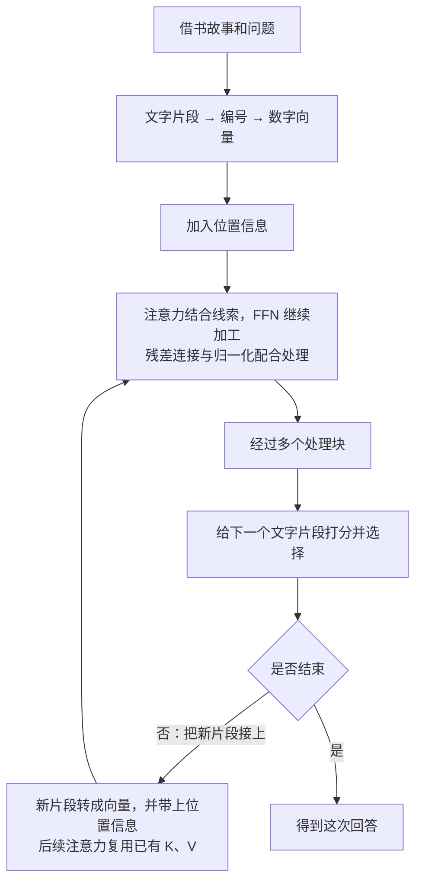

在这个任务里，“书”和“读完”等信息提供了判断依据。经过训练的模型可能利用这些线索回答“书”，但这一结果是整套计算共同作用的产物，不能简单说成“某个注意力头直接把‘它’替换成了‘书’”。

我们从头使用的每个小向量和概率，都是为了看清步骤而设置的教学数字。真正模型中的数字来自训练和当前输入，是否答对仍需要实际检验。

### 本章想一想与解答

**问题 1：把“选出后续片段、转换成编号和向量、得到候选分数、处理上下文”按一次生成的顺序排好，并说明每一步为什么接在这里。**

**解答：** 顺序是：转换成编号和向量 → 处理上下文 → 得到候选分数 → 选出后续片段。先有可计算的输入，内部组件才能结合和加工信息；有了最后的表示，输出层才能给候选打分；有了分数和相应概率，选择规则才能确定实际输出。随后把新片段接上，继续后续生成。

**问题 2：故事中的“书、读完”改成“伞、天晴”，哪些东西需要随之变化？是否需要重新训练模型？**

**解答：** 输入片段与编号可能改变，查到的向量、后续 Q/K/V、注意力比例和候选分数也可能改变。模型可以用同一套参数处理这个新故事，通常不需要为每个新输入重新训练。它能否正确回答“伞”，取决于已有能力和这次计算，不能只凭结构名称保证。

如果想把这些步骤放进一套连续的数字中核对，可以按需阅读计算参考的[第 12 章：完整前向算例](Transformer-原理与计算参考.md#12-把组件串起来一次前向计算的教学示意)，或动手运行[第 15 章：两个无需 GPU 的 Python 小实验](Transformer-原理与计算参考.md#15-两个无需-gpu-的小实验)。也可以继续顺读下面的硬件与应用部分。

## 15. 这些计算为什么常用 GPU

到这里，模型内部已经不只是名词：取向量、计算 Q/K/V、组合信息、FFN、给候选打分，都包含大量重复的乘法和加法。下一件要理解的事是，这些工作由什么来执行。

### 15.1 一个人顺着算，与很多份相似计算一起算

第 3 章的矩阵例子里，第一行可以算出 `[8, 3]`，第二行可以算出 `[6, 1]`。只要两行输入和参数都已经给定，算第二行不需要等第一行告诉它答案。较大的矩阵中，会出现大量这种可以一起安排的计算。

**CPU（中央处理器）**负责执行通用程序，很擅长处理复杂控制、分支与多种不同任务。**GPU（图形处理器）**最初广泛用于处理图形，也适合把大量相似的数值运算分给许多计算单元一起做，所以能加速神经网络中的许多矩阵运算。[硬1]

可以类比一大批格式相同的计算表格：若只让一个人依次填写，会需要很多时间；把可独立计算的表格分给多个人，常能更快完成。比喻只对应“拆分可同时做的工作”；真实 GPU 的效率还依赖数据如何放置、怎样读取、每批工作够不够多，不能把计算单元数直接当成速度倍数。

Transformer 对已经给定输入的许多计算很适合这样组织。RNN 也能使用 GPU，但逐位置更新状态的那部分依赖仍然存在。反过来，Transformer 的不同处理块之间也有先后依赖，自回归生成下一 token 时还要使用刚才已经选出的结果；GPU 不会消除这些依赖。

### 15.2 能算得快，还得放得下、拿得到数据

GPU 用来存放数据的内存叫作**显存**。除了模型参数，还要放本次计算的中间向量；生成长回答时，前面解释的 K、V 缓存也会占用空间。

先估算最简单的一项。假设模型有 70 亿个参数，每个参数用 16 个二进制位存储。**位（bit）**是一个只能取 0 或 1 的存储单位，8 位组成一个**字节（byte）**，所以这里每个参数占 2 字节。下面按 1 GB 等于 10 亿字节计算。

> `70 亿 × 2 字节 = 140 亿字节`，按十进制约为 14 GB。

这只是参数本身的粗算，不是“14 GB 显存必然能运行它”。运行还需要缓存、中间结果和程序空间；训练还要保存梯度以及优化器使用的其他数字，具体开销取决于实现。GB 与另一种单位 GiB 的换算也不同：1 GiB 是 2 的 30 次方字节，所以这份参数约占 13.0 GiB。

减少每个数的存储位数，可以降低部分空间与传输开销。例如把一些数字转换成更低精度的表示，叫作**量化**。它会涉及表示范围、舍入和误差，需要相应实现与任务验证；不能只把所有文件大小除以二，就认为能力和速度都保持不变。

还有一个常被忽略的限制：计算单元要先从存储中拿到数据。单位时间可以传多少数据，叫作**内存带宽**。某些生成场景花了很多时间读取参数和缓存，即使理论乘加能力很高，也可能受取数据速度限制。

### 15.3 多人同时使用，与一个人等下一段回答

服务可以把多个请求中适合一起做的计算合在一批，这叫作**批处理**。一次工作量更大，有时能更充分利用 GPU。但多等一会儿凑一批，也可能增加某位用户的等待时间。

因此要区分两个指标：**吞吐量**是单位时间总共处理多少请求或 token，**延迟**是一次请求或一步输出要等多久。提高总吞吐量，不一定使每个用户都更快收到第一个字。

GPU 在这里负责执行计算；它不会仅因变快就自动让固定参数的模型知道更多事实。更强计算设备可以帮助训练更大的模型、处理更多数据，也可以加速推理，但是否学到有用规律，仍取决于实际训练。

### 15.4 与运维简单接上

**Kubernetes（用于安排和管理应用运行的平台）**可以在机器之间安排模型服务、管理它们的启动和运行。它处理的是服务运行与资源管理；模型的向量怎样乘加、回答怎样产生，仍由相应模型程序完成。

这样就能把三件事接起来：Transformer 规定一类计算组织方式，CPU/GPU 执行程序，运行平台安排服务如何使用机器。理解硬件的意义，是更清楚为什么这些计算需要时间、存储和资源。

### 本章想一想与解答

**问题 1：把同一个模型换到更快的 GPU，并由 Kubernetes 管理，它会自动学到更多语言知识吗？**

**解答：** 不会仅因为这件事就学到新知识。更快的硬件可以改善执行速度，运行平台负责安排和管理程序；如果参数和计算任务没有因此改变，就没有发生新的学习。这把“模型怎样计算”“计算在哪里执行”“程序怎样管理”区分开了。

**问题 2：70 亿参数、每个 2 字节，为什么不能直接承诺只要 14 GB 显存就能运行？**

**解答：** 14 GB 只统计这份参数存储。还要考虑计算中间结果、K/V 缓存和程序占用；训练还需要其他数据。同样参数量下，上下文长度、请求数量和实现方式都可能改变额外用量。

**问题 3：显卡能让很多数字一起算，为什么回答通常仍要一段段产生？**

**解答：** 一步内部的许多乘加可以并行，但下一步的输入需要包含刚才实际选出的 token。这是生成过程的依赖关系，与单步能调动多少计算单元不同。缓存可以省重复工作，也不会凭空消除这个依赖。

**问题 4：服务器一秒能处理更多 token，是否说明我每次都能更快收到第一段文字？**

**解答：** 不一定。每秒总处理量是吞吐量，个人等多久属于延迟。把更多请求合成一批可能提高总量，却增加等待凑批或排队的时间，判断体验需要分别看这两个指标。


## 16. 从 Transformer 到 ChatGPT，中间还发生了什么

你已经知道一种网络怎样计算、怎样学会生成。接下来再看大家熟悉的聊天界面，就不会把产品名字误当成单个算法。

### 16.1 有了架构，为什么还不能直接打开一个聊天助手

拿到一套 Transformer 结构，只说明如何组织计算。要做成能聊天的产品，还需要确定模型规模、准备训练材料、训练参数，使它学会语言与任务；再把输入消息交给模型，把输出呈现给用户。

其中一条很有影响的路线是先通过大量文字学习预测后文，再为具体任务继续训练。2018 年的 GPT 工作采用了这一思路。[聊1] **GPT** 是 *Generative Pre-trained Transformer* 的缩写，可以依次理解为：用于生成、先做预训练、采用 Transformer 设计。

这里的“预训练”是先从大量数据学习基础能力；“生成”是能够继续产生文字；“Transformer”是内部结构。三个词已经分别有对应的计算或训练过程，不是一个名字就额外赋予了模型智能。

2018 年这条路线先回答了一个问题：能否把预训练学到的东西，经过任务微调用于不同任务？接着，2019 年的 GPT-2 进一步探索：能否减少为每项任务另做微调，只通过当前输入来告诉同一个模型要做什么？它研究了**零样本任务迁移（不为当前任务另做参数训练，也不在本次输入中提供该任务的示范答案，尝试利用已有能力完成任务）**。[聊4] 这里是在说明一种被研究的设置，不是说模型已经可靠解决所有任务。

放进输入、用来说明当前任务的文字，叫作**提示**。例如提供一段文章，再接上“摘要：”，让模型继续生成，是提示任务的一种教学示意。它改变了输入内容，没有因为这一条提示就训练参数。

如果光说明任务还不够，还可以先给少量“输入—答案”示例。2020 年的 GPT-3 系统研究了这种**少样本上下文学习（把少量任务示例放在当前输入里，让模型参考它们完成后续任务）**，也比较了不给示例、只给一个示例等设置。[聊5] 这类探索并非到了 GPT-3 才首次出现。

例如先写“这本书讲得很清楚 → 正面”“这本书错漏很多 → 负面”，再请模型判断新的一句。这些只是帮助理解的教学示例；普通运行时，模型参数保持不变，“学习”在这里指利用上下文表现出对任务的适应，不等于第 12 章的参数训练。

但会根据提示续写，仍不等于总能按用户意图回答。2022 年的 InstructGPT 针对这个问题，先用人写的任务示范做监督微调，再利用人对回答的排序，通过奖励模型与 RLHF 继续调整模型。[聊6] 这是第 12 章讲过的后训练；与刚才把示例放进提示不同，这些步骤确实更新了可学习参数。指令与人类反馈的训练，为后来的聊天助手提供了另一项关键准备。

更大规模的数据、参数和计算投入推动了这条路线，但“模型更大”也不是唯一条件。数据质量、训练方法和应用怎样使用模型，都影响最终结果。规模变化不能保证每项能力按同一比例提高。

### 16.2 2022 年的 ChatGPT，为什么让更多人直接感受到这些能力

OpenAI 在 2022 年 11 月 30 日发布 ChatGPT 的研究预览，发布说明把初期系统介绍为在 GPT-3.5 系列模型基础上训练的对话系统，并说明使用了包括人类反馈在内的训练方法。[聊3]

**ChatGPT 是用户可以交互的产品**；其背后的模型及功能会随产品发展而变化。不能把最初版本的训练说明当成所有后续版本的全部技术细节，也不能把这个产品当作 Transformer 的发明时间。

为什么它带来了广泛关注？可以从用户实际跨过的几道门槛理解，而不把走红归因于某个孤立公式。

首先，用户不用学习专用命令，就能输入“帮我解释这段代码”“把这封信改得礼貌些”。模型已经具备跨多种文字任务工作的能力，聊天界面把这些能力放到一个容易尝试的入口中。

其次，围绕指令与对话的后训练，使模型更常按照“用户提出问题、助手给出回答”的方式工作。与只展示文字续写相比，人更容易看出它能为当前任务提供什么帮助。

再次，用户可以继续说“再简单一点”或“请给一个例子”。产品把先前消息作为后续输入的一部分，使同一次尝试可以逐步修改和澄清。这种反馈短、结果可见的交互，也使人容易把使用过程演示给别人。

这些因素共同解释了它为什么容易被普通用户体验和传播，属于基于产品与能力的分析，不是声称某个因素已被单独证明为走红的唯一原因。这里也不依赖未经核对的用户数量或增长排行来解释技术。

### 16.3 一段对话在程序里怎样接到模型上

例如用户先问“它指什么”，又补充“我说的是借书那个故事”。程序需要让模型知道谁说了哪句话，并把相关历史和当前问题放进本次输入。

为消息标明用户、助手等身份，并加上模型约定的分隔方式，通常使用**聊天模板（把不同角色的消息整理成模型所需输入格式的规则）**。它让模型更容易区分提问、已有回答以及其他上下文；具体标记因模型而异。

如果一直聊下去，历史越来越长，还能全部放进去吗？模型一次计算能处理的 token 数量有上限，这个可容纳的范围叫作**上下文窗口**。对这里讨论的常见自回归聊天模型，输入和接下来生成的内容通常要共同占用这个范围；具体容量与限制要看模型和服务设置。

只用一个教学假设来算：某次运行最多容纳 8,000 个 token，应用为回答预留 1,000 个，就最多剩 7,000 个给本次输入。这份输入还要容纳当前问题、应用给模型的说明等，因此旧聊天不能独占全部 7,000 个名额。这些数是为了说明如何分配空间，不是 ChatGPT 某个版本的规格。

超过可用空间时，应用可能选取部分旧消息、截去较早内容、概括历史，或从保存的记录中检索相关片段后再放入输入；不同产品的做法并不统一。例如很早以前提到的书名若没有被保留或重新取回，这一轮就可能缺少“它指哪本书”的线索。界面仍能显示那条消息，只说明应用存着它，不证明本次模型收到了它。

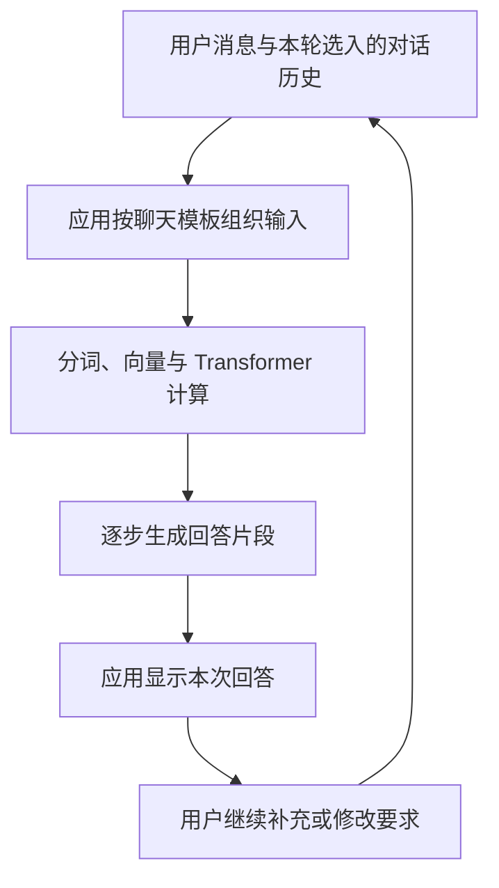

图中再次把历史消息交给模型，不表示这些消息都被永久写进了参数。应用保存历史、当前计算使用历史、未来训练是否使用某些数据，是不同的安排。

### 16.4 为什么一个好用的聊天产品还需要模型以外的部分

如果问“小明那本书现在还在不在馆”，答案可能在实时馆藏系统里，而不在模型已有参数或当前文字里。单靠流畅生成，不能得出可信的当前库存。

应用可以先查询馆藏，把查到的内容作为额外输入，再让模型解释。这种先找到相关材料、再带着材料生成的方式，常叫作**检索增强生成（Retrieval-Augmented Generation，RAG）**。例如把“查询时间、书名、剩余可借数量”一起提供，回答就有了具体依据。

但检索到了错误记录、资料过时，或模型误读了材料，结果仍可能出错。RAG 增加可参考依据，并没有把模型输出变成必然正确。产品还需要设计资料来源、界面、执行工具、记录和错误处理等部分。

从这里开始，我们将从“说出一段回答”继续走到“根据目标执行多步任务”。

### 本章想一想与解答

**问题 1：为什么不能说“ChatGPT 在 2022 年发明了 Transformer”？**

**解答：** Transformer 是 2017 年提出的网络架构；ChatGPT 是后来把模型、训练、聊天交互等组织起来的产品。产品受到广泛关注的时间，不等于内部架构首次提出的时间。

**问题 2：为什么同样能续写文字的模型，未必同样适合当聊天助手？**

**解答：** 一般文字续写与按用户要求回答问题，目标和数据形式不同。指令示范、偏好训练与聊天输入组织，会影响模型是否跟随任务、怎样回应追问。架构相同，也不能保证这些训练和应用安排相同。

**问题 3：接上实时馆藏查询后，回答是不是就再也不会错？**

**解答：** 查询可以带来当前依据，但还可能查错书、读到过时记录，或在生成时解释错误。因此应检查来源和查询对象，并让最终回答与实际返回结果对应。增加信息来源改善了条件，没有取消核对结果的需要。

**问题 4：在问题前加两个“输入—答案”示例，和用这些示例微调模型，有什么区别？**

**解答：** 前一种做法把示例放进本次上下文，模型用已有参数参考它们生成结果；普通推理不会因此更新参数。微调则用示例计算训练目标、求梯度并更新可学习参数。两种方式都可能改变回答，但改变当前输入与改变模型参数是两回事。

**问题 5：教学例子的窗口有 8,000 个 token，为回答留了 1,000 个，能否再放入 8,000 个旧聊天 token？界面显示着旧消息又说明什么？**

**解答：** 不能。按这个例子的共享上限，本次输入最多占 7,000 个 token，而且当前问题和其他说明也要占用这部分空间。应用需要按自身规则安排旧历史。界面显示旧消息说明记录被保存，不保证它被送进本次计算；选取或概括历史改变的是输入，也不等于训练模型参数。

## 17. 从回答问题，到完成多步任务：Agent

假设你提出的不再是“这本书讲什么”，而是：“帮我找一本适合零基础的 Transformer 入门书，查询附近图书馆能否借到，再给我一个借阅方案。”

这里需要决定查什么、发起查询、读回结果、必要时换一本书继续查，最后整理方案。模型只写一句“已经找到”并不能代表这些步骤真的完成。

### 17.1 先把任务中缺少的动作补出来

要查馆藏，需要一个实际能访问馆藏数据的程序接口。在这类系统中，提供给模型驱动的流程使用的外部能力，叫作**工具**，例如查询目录、读取文件、执行计算或调用业务接口。

**接口**就是程序之间按约定传递输入、取得结果的入口。例如查询工具可以接收书名和城市，返回图书馆名称及可借情况。

模型的一个作用，是根据目标和当前信息，提出下一次要调用哪个工具、应填写书名、城市等哪些工具输入。这些工具输入也叫作**调用参数**，与训练得到的模型参数不同。例如，模型可以提出“查询书名 A 在杭州的馆藏”。实际执行由外部程序完成，程序再把结果放回后续输入。

这叫作**工具调用（由系统按照指定工具和参数执行外部能力，再把结果交回后续处理的机制）**。模型说“我查询了”与程序确实发起请求、收到返回结果，是两件事。

把“查询书名 A 在杭州的馆藏”完整走一遍，就能看清生成的内容怎样接上真实程序。下面的书名、图书馆和结果都是教学假设，没有实际查询馆藏；字段是为讲解自行约定的，不是某家服务通用的调用协议。

**第一步，应用把工具说明放进本次模型输入。** 除了用户的需求，模型还需要知道有哪些工具可用、各自做什么、要填什么。这里用 **JSON（一种用字段名和字段值组织数据的文本格式）**展示这份说明：

```json
{
  "name": "query_library",
  "description": "按书名和城市查询馆藏",
  "input_fields": {
    "book_title": "书名，文本，必填",
    "city": "城市，文本，必填"
  }
}
```

冒号前是字段名，后面是值；花括号可以嵌套，组织一组相关记录。`name` 是工具名称，`description` 是用途，`input_fields` 列出需要填写的输入字段。应用按所用模型支持的方式提供这些说明，使它们成为本次上下文的一部分；模型不会自动知道应用后台藏着哪些函数。

**第二步，模型生成约定格式的调用请求。** 假设已经确定书名和城市，它可以生成：

```json
{
  "type": "tool_call",
  "name": "query_library",
  "arguments": {
    "book_title": "书名 A",
    "city": "杭州"
  }
}
```

这里约定 `type` 为 `tool_call` 时表示工具调用请求，`name` 指定工具，`arguments` 装着具体调用参数。它们是本次任务的输入值，不是 embedding 表或 Q/K/V 变换中的训练参数。生成这段内容，仍只是提出请求。

**第三步，应用检查请求，再执行实际函数。** 程序检查工具名称是否存在、必填字段是否齐全、值的类型及取值是否符合接口和允许范围。通过检查后，才把“书名 A”和“杭州”交给对应的馆藏查询函数。JSON 格式正确只说明能按约定读取，不保证查对了书，更不代表查询已经成功。

**第四步，应用把工具返回值加入下一轮输入。** 假设实际函数返回了下面这种结果，程序把它与相关目标、调用记录一起提供给模型：

```json
{
  "type": "tool_result",
  "name": "query_library",
  "result": {
    "status": "ok",
    "book_title": "书名 A",
    "city": "杭州",
    "library": "示例图书馆",
    "available_copies": 0
  }
}
```

这里的 `tool_result` 表示工具返回；`status` 为 `ok` 只表示查询成功，`available_copies` 为 0 才说明这条记录在查询时没有可借副本。程序把事实记录交回来，模型才有这次查询的依据。

**第五步，模型依据新结果继续。** 它可以说“这次结果显示，书名 A 在所查的示例图书馆有 0 本可借；可以继续查书名 B”，或提出下一次工具请求。若工具返回的是查询失败，就只能知道查询没完成，不能据此断言有书或没书。无库存与查询失败，需要不同的下一步。

### 17.2 为什么需要“做一步，再看结果”

假设第一次查询发现书名 A 在所查馆内没有库存。系统就需要据此换一家馆、改查书名 B，或告诉用户当前查询范围内无法满足条件。如果完全无视返回结果，只照着最初计划往下走，就可能生成一个不存在的借阅方案。

于是流程可以循环：根据目标和现状选择下一步 → 执行工具 → 观察结果 → 决定继续、修正还是结束。能在环境中观察信息、选择行动并围绕目标持续工作的系统，通常称为**Agent（智能体）**。

Agent 是比语言模型更早、更广的系统概念，不必都使用 LLM。这里讲的是常见的 **LLM Agent**：用语言模型参与下一步选择，再与工具、程序规则和执行结果组合。[系1]

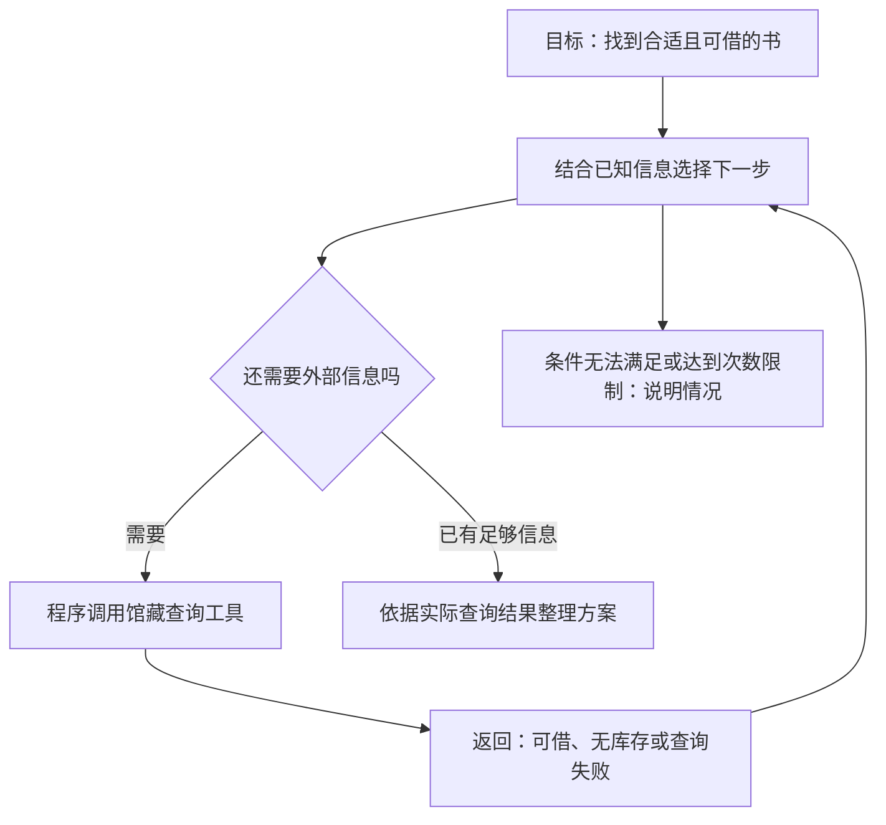

图里模型参与“选择下一步”和“整理方案”，工具负责真实查询，程序还规定什么时候停止。一次工具结果返回后，系统可以把它作为新上下文再次调用模型；这不要求在每一轮都重新训练模型参数。

### 17.3 能调用工具，还缺哪些安排

首先，要知道当前已经做了什么。保留目标、已查询书目、工具结果和待解决问题的这份记录，可以称为任务的**状态**。它通常由应用维护，再挑选合适内容交给模型；不能指望模型凭空知道尚未输入的真实进展。

其次，需要规定哪些动作允许自动执行。查询公开目录与替用户提交借阅预约，对外界的影响不同。若任务只要求整理方案，系统不应仅因模型建议就自动预约；若用户和应用已经允许特定预约操作，执行程序仍需检查所填信息与权限。

再次，要处理失败。接口超时、书名重名、返回结果相互矛盾时，应有重试、补充查询、明确无法完成或转交人工的路径。还要限制循环次数或资源使用，避免系统一直查下去。

这些都是完整系统的一部分。把一个语言模型接上工具只是起点，任务是否完成要看实际动作与结果，不只看最终文字有多像完成报告。

### 17.4 固定流程与 Agent 有什么联系

如果每次都严格按“查询 A → 查询 B → 合并结果”的顺序执行，这是一个预先规定的工作流程。如果系统会根据“书已借完”“另一本更适合”等结果选择不同的下一步，就多了根据当前状态调整行动的能力。

二者之间并没有一条所有产品都认可的命名分界。实际应用经常把固定步骤与模型判断结合起来：关键操作用明确程序控制，有歧义的部分交给模型辅助。

**能灵活选择步骤不等于具有通用智能**。一个只在馆藏查询范围内工作良好的 Agent，遇到修车、数学证明或新业务规则时，仍可能完全不适用。

### 本章想一想与解答

**问题 1：模型输出“我已经查到有库存”，是不是证明它调用了馆藏工具？**

**解答：** 不是。要看程序是否实际执行查询、返回了什么记录。模型可以生成类似完成报告的文字，但文字本身不证明动作发生。可靠的回答需要对应真实工具结果。

**问题 2：查询结果从“有库存”变成“已借完”，Agent 下一步也变了，这是重新训练吗？**

**解答：** 通常不是。工具结果进入新的任务状态和上下文，原模型在新输入上重新计算，就可能选择另一步。参数有没有更新，才是是否发生训练的关键。

**问题 3：接上十个工具，是不是就比接上一个工具的系统更聪明、更可靠？**

**解答：** 不能只按工具数量判断。系统还要选对工具、填对参数、理解返回结果、处理失败，并遵守任务允许的动作范围。更多工具增加可用能力，也增加选择和协调难度，实际结果要用任务验证。

**问题 4：模型怎样知道可以使用 `query_library`？它生成了调用请求以后，为什么还不能说已经查完？**

**解答：** 应用先把工具名称、用途和输入字段说明放进模型输入；模型才能根据这些说明和任务生成请求。随后程序还要检查请求、调用实际函数，并把返回值交回下一轮输入。模型依据结果继续，才走完这次工具交互。调用参数只是书名、城市等输入，整个过程不要求更新模型的训练参数。

**问题 5：返回 `status` 为 `ok`、`available_copies` 为 0，和返回“查询失败”，能否都解释成“这本书没法借到”？**

**解答：** 前者说明查询成功，但这条馆藏记录在查询时没有可借副本，可以换馆或换书；它不能代表所有图书馆都没有库存。后者只说明没有成功取得结果，库存情况仍未知，可能需要重试或说明暂时无法确认。两种情况都不能被改写成“已找到可借的书”。

## 18. 只需要一个明确判断时：怎样理解 Jev

上一章的系统需要写借阅方案，也需要作一些很短的判断：“这个请求是在查询库存，还是要求真正预约？”“信息是否足够？”每次都让模型写一长段解释，再从中猜类别，并不总是方便。

本章讨论用户提供文章中的 **Jev**，即 TypeSafe 的结构化评估模型。这里指的是这个具体产品与它公开提供的接口。

### 18.1 先把“写一段内容”与“在明确选项间判断”分开

例如用户说：“先看看附近哪家能借到，别替我预约。”系统可能只想选择一个意图类别：查询馆藏、申请预约、信息不足。

这个任务有预先规定的输出范围，叫作**分类（按给定类别判断输入属于哪一类的任务）**。如果要评价“请求信息有多完整”，可以使用等级或数值，属于**评分**。它们都可以服务于决策，但“得到评分”与“执行哪个动作”仍是两步。

传统分类模型、明确规则、采用约束输出的语言模型，都可以参与这类工作。**约束输出**是要求输出符合给定格式或候选范围，例如只能返回三种类别之一。Jev 是这一需求下的一种具体评估组件，并不是机器第一次能够作选择，也不意味着这类任务一律应使用它。

### 18.2 Jev 接收什么，返回什么

已经核对的 Cloudflare 模型目录与 LangChain 官方集成，把 Jev 用于对给定状态提出类型明确的问题，返回分类或评分结果。[决1][决2]

这里的**状态（state）**是交给评估器判断的材料，例如用户请求、已有任务信息和工具结果；“问题”则说明要判断什么，以及可以返回哪些类型的答案。

这些材料可以用普通文本，也可以用前面见过的 JSON 格式。例如下面只是在展示材料的组织方法，不是可直接运行的调用代码：

```json
{
  "用户请求": "先看看附近哪家能借到，别替我预约",
  "任务": {
    "书名": "某本入门书",
    "城市": "杭州"
  }
}
```

冒号前是字段名，后面是相应内容；花括号中的记录还可以包含另一组记录，所以任务信息能分层组织。这种格式方便程序读取，却不能保证填写的城市、书名或判断本身正确。

Jev 集成提供三类问题，名称要与返回含义一起看：

| 题型 | 想判断的事情 | 已核对接口中结果的含义 |
| --- | --- | --- |
| **Noul** | 一个明确的“是／否”问题，例如“用户是否要求现在预约” | 返回 yes 一侧的概率值，范围 0 到 1；不是直接返回布尔开关 |
| **Choice** | 在指定类别中选择，例如“查询馆藏／申请预约／信息不足” | 返回选中类别、各类别的概率，以及另一个反映概率分布集中程度的 confidence 指标 |
| **Score** | 按有顺序的等级评价，例如信息不足、部分明确、足够明确 | 返回等级概率与按概率求平均得到的等级分数等信息，结果可以是小数 |

**布尔值**是只取“真／假”两种结果的值。Noul 返回概率后，应用可以再按自己的规则形成布尔判断，但概率与已经决定执行的开关不是同一个东西。

### 18.3 概率、confidence 和评分，为什么不能混读

假设一次 Choice 的教学结果给三个类别分配了 0.7、0.2、0.1。这里分别是当前输出给三个选项的概率；它们相加为 1。选择 0.7 对应的类别，表示它在这次结果里最高，不说明它一定正确。

官方 TypeSafe 集成对 **confidence** 的说明是反映概率分布的集中程度，并明确指出它不是所选标签的概率。[决2] 因此，不能看到 `confidence = 0.8` 就翻译成“这次有 80% 保证判断正确”，也不能把它与某个类别的 0.7 互相替换。若需要使用这一指标，必须先看相应版本的字段定义。

再看 Score。假设把三级按顺序编号为 0、1、2，对应概率是 0.1、0.2、0.7。把每级编号乘相应概率再相加，得到 `0 × 0.1 + 1 × 0.2 + 2 × 0.7 = 1.6`。这个按概率加权的平均数，叫作**期望值**。

1.6 不是偷偷增加了“第 1.6 个选项”，而是对一组等级概率的汇总。等级怎么定义、编号如何使用，会影响这个分数的意义；不同问题的 1.6 也不能不加说明地直接比较。以上概率全是教学构造，不是我们运行 Jev 测出的性能。

### 18.4 有概率输出，是否就已经“校准”

假设一个评估器在很多相似条件的判断中，都给自己的“是”选项分配约 0.8。随后用真实结果核对，如果这些“是”大约有 80% 成立，这组概率就与实际频率比较一致。

这种“所报概率与大量实际结果的频率是否相符”的性质，叫作**概率校准**。评估校准需要收集合适的验证例子，把类似概率的预测分组，再观察实际正确或事件发生的比例；不能只看一个回答是否带小数。

即使某组预测整体校准得不错，其中某一个 0.8 仍然可能判断错误。换了任务、语言、输入分布或类别定义，原先的评估结果也未必继续成立。校准描述统计关系，并不为单次行为提供绝对保证。

用户提供的文章转述厂商把 Jev 定位为 **System One Model（系统一模型）**，并称训练采用 **RLCD（Reinforcement Learning for Calibrated Decisions，可译为面向校准决策的强化学习）**。[决3] 这些名称可以帮助了解其宣称的产品方向，但名称本身不是训练效果的验证，也不足以还原未公开的网络和训练细节。

“系统一／系统二”在这里借用了人类思考方式的说法：这个比喻把快速、直觉式的判断称作系统一，把较慢、刻意比较和检查的思考称作系统二。不能因此断言 Jev 就有人类直觉、所有 LLM 都是系统二，或把二者当成已经确定的网络结构分类。LLM 也能迅速分类，也能生成经过多步检查的文字。

### 18.5 怎样把判断接到 Agent 的实际行动上

仍然使用“先查询，不预约”的请求。一个应用可以先让评估器判断意图，再由程序按明确规则决定走哪个流程。例如，确定为查询意图时使用只读查询；信息不足时要求补齐；真正涉及预约时，检查用户授权和必要字段。

把输入送到不同后续流程的动作，叫作**路由**。下面展示的是教学系统的组织方法，不是声称 Jev 自动包含所有这些步骤：

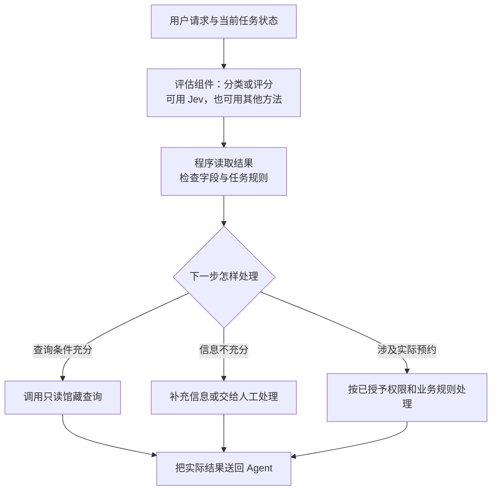

读这张图时，先从最上面的用户请求走到评估结果，再走到程序检查。程序根据当前信息与规则选择查询、补充信息或处理预约中的一条分支，最后把实际处理结果带回 Agent，供它决定后续步骤。

若应用规定“某类概率超过 0.85 才走这条路径”，0.85 就是**阈值（程序用于划分处理分支的界限）**。它需要结合错误代价和实际验证选择，不能把“超过阈值”当成“操作必然安全”。阈值来自应用策略，也不等于模型已经替用户授予了权限。

官方集成中的工具拦截中间件可以按配置阻止某些工具调用；**中间件**是插在原流程前后执行检查或处理的程序。它不自动等于一个完整的人工审批系统，转交人工和继续执行仍需上层应用安排。[决2]

### 18.6 Jev 与 Transformer、LLM 各处在哪一层

Transformer 说的是网络计算怎样组织，LLM 说的是大规模语言模型这一类能力与训练对象，Jev 是公开提供结构化评估接口的具体模型产品，Agent 是使用模型、工具和反馈来执行任务的系统。

仅凭 Jev 返回结构化字段，不能推断它内部一定不采用 Transformer、一定不用自回归计算，或已经公开了一种全新网络架构。我们能从已读官方目录和集成代码确认的是接口与使用方式；内部机制、训练效果和性能承诺需要对应证据。

选择组件时，实际要比较的是：在自己的输入上判断得怎样、错误怎样处理、总时间和费用是多少，以及是否值得增加一个独立评估环节。有限选项没有消除误判；一个 LLM 即使能输出合法 JSON，也同样需要任务验证。

### 本章想一想与解答

**问题 1：Jev 的结果是结构化字段，为什么仍不能说“它不会出错”？**

**解答：** 格式约束限制的是答案长什么样，判断准确性取决于输入、类别定义和模型能力。它可以返回完全合法的类别或 JSON，却把“只查询”误判成“要预约”。格式正确与内容正确必须分别检查。

**问题 2：Choice 的某个标签概率为 0.7，confidence 为 0.8，可以说“它有 80% 的概率选对”吗？**

**解答：** 不能这样换算。官方集成把 confidence 定义为分布集中程度，它不是选中标签的概率。即使使用标签本身的 0.7，也需要在合适数据上检查概率与实际频率是否一致，不能把一个字段当成单次正确性保证。

**问题 3：三级评分 0、1、2 的概率为 0.1、0.2、0.7，为什么 Score 可以得到 1.6？**

**解答：** 它可以汇总成等级的期望：`0 × 0.1 + 1 × 0.2 + 2 × 0.7 = 1.6`。这是一组概率的加权平均，不是增加了一个类别，也不是说某个现实属性精确测量为 1.6。

**问题 4：只要判断概率超过 0.85，就可以不看任务授权，自动预约吗？**

**解答：** 不可以。概率阈值只是应用分支规则；授权与业务条件是另外需要满足的条件。模型还可能误判，阈值也要用实际任务数据评估。系统应把评估结果、程序策略和真正执行的动作区分开。

## 19. AGI 是什么，为什么它不等于“模型更大”或“多接几个工具”

现在可以回答开头一组容易混在一起的问题：能写文章、能理解图表、能执行任务，是不是就已经等于人们说的“通用人工智能”？

### 19.1 从单项能力到跨任务能力，中间差在哪里

一个程序可以很擅长查馆藏，却完全不会规划实验。一个聊天模型可以回答多个领域的问题，却仍会在简单事实、长期任务或陌生环境中失败。

人们用**通用人工智能（Artificial General Intelligence，AGI）**讨论能够在广泛任务和新情境中学习、迁移知识并完成工作的智能系统。**迁移**在这里指把已有知识用到新的任务或条件中，而不是每遇到一种任务都只靠人为重新写好一整套专用流程。

不同研究者和机构对“广泛”“达到什么水平”“需要多少自主性”采用不同标准，AGI 没有一个所有人共同接受的单一验收测试。因此讨论某个系统是否达到 AGI，必须先说明采用的定义、任务范围和证据，不能只凭产品名称或演示。

### 19.2 为什么多做对几道题，还不足以替代完整评估

比如一个系统在一套固定考题上成绩很好，这提供了它能完成那些任务的证据；但实际工作可能还要求识别信息不足、遇到工具故障时恢复、在新规则下调整计划，并长期维持正确行为。

这些能力之间有联系，却不能直接互相代替。语言流畅不能证明事实可靠；会调用工具不能证明遇到任何问题都能找对方法；会给决策输出概率，也不能证明其判断跨所有场景都可靠。

评估时，需要看任务覆盖范围、是否遇过类似训练材料、失败模式、对新条件的适应，以及重复执行是否稳定。本文解释的是一些模型与系统怎样工作，没有把这些机制本身作为“AGI 已实现”的证据。

### 19.3 再把各个名词放回它们回答的问题

| 想问的事情 | 对应名词 | 应怎样理解 |
| --- | --- | --- |
| 研究什么样的问题 | AI | 包括识别、预测、规划、语言等广泛智能任务 |
| 怎样从例子中调整做法 | 机器学习 | 根据数据训练模型的一类方法 |
| 怎样组织许多可学习计算 | 神经网络、深度学习 | 神经网络连接带参数的计算，深度学习使用多层网络 |
| 信息在网络中怎样交流 | Transformer | 以注意力等组件组织计算的一种架构 |
| 怎样逐步描述和生成后文 | 自回归 | 后续预测依赖前面已经给定或生成的内容 |
| 什么模型负责广泛语言处理 | LLM | 一类大规模语言模型，常与 Transformer 和自回归结合 |
| 用户在哪里对话 | ChatGPT 等产品 | 组织模型、交互和其他功能的应用 |
| 怎样围绕目标执行任务 | Agent | 组合观察、选择行动、工具执行与反馈的系统 |
| 明确选项之间怎样提供评估 | Jev 等组件 | 可承担分类、评分和流程路由中的判断部分 |
| 追求怎样的跨任务能力 | AGI | 对广泛任务、新情境中通用智能能力的研究目标与讨论 |
| 数字计算在哪里执行 | CPU、GPU | 实际执行程序的计算设备 |

这些词落在不同层次，因此很多时候不是“选哪个替代哪个”。一个产品可以在 GPU 上运行 Transformer 语言模型，用自回归方式生成回答；它也可以把模型放进 Agent 流程，并增加独立的分类或评估组件。是否具备某种能力，还要看训练和实际任务结果。

### 19.4 回到这篇文章的主角

理解 Transformer 最重要的收获，不是记住最多的缩写，而是能够沿着计算回答：文字怎样变成数字，哪些位置能够交换信息，哪些参数决定变换，怎样得到候选概率，训练又怎样改变这些参数。

在此基础上，再看到聊天产品、结构化决策或能执行任务的系统，就能继续追问：这里新增了哪些输入、训练或程序步骤？输出是在生成内容、评估选项，还是已经执行了外部动作？哪些结论来自真实结果，哪些只是模型预测？

这些问题把前身、内部计算和应用连接起来，也让新的产品名称有了可以安放的位置。

### 本章想一想与解答

**问题 1：一个 Agent 会查资料、调用计算器，还能输出很长的报告，是否就能认定它是 AGI？**

**解答：** 不能仅凭这些功能认定。它们说明某些任务能力，还需要说明 AGI 的具体定义，并评估系统在广泛任务、陌生条件和长期执行中的表现。功能数量与通用性之间不能直接画等号。

**问题 2：Jev、LLM、Transformer、GPU，能不能按“新旧版本”排成一条替代链？**

**解答：** 不能。Jev 是具体评估模型产品，LLM 是模型类别，Transformer 是架构，GPU 是执行计算的硬件。它们回答不同层面的问题，可能共同出现在一个系统里，出现时间先后也不能证明彼此替代。

**问题 3：某模型在测试中得分很高，怎样表述这个结论才准确？**

**解答：** 说明测试包含什么任务、在什么条件下运行以及实际得到什么结果。成绩支持该范围内的表现结论；要推到其他任务、新环境或 AGI，需要额外定义和证据，不能仅把一个分数换成无限范围的能力承诺。


## 资料来源

- [Attention Is All You Need，2017 年原始论文](https://arxiv.org/abs/1706.03762)：Transformer 原始结构，以及注意力、位置编码、FFN 等设计的来源。
- [The Annotated Transformer，Harvard NLP](https://nlp.seas.harvard.edu/annotated-transformer/)：带说明的实现，展示各个计算步骤怎样组成网络。
- [The Illustrated Transformer，Jay Alammar](https://jalammar.github.io/illustrated-transformer/)：用图示解释文字表示和不同组件之间的信息传递。

本文已在正文中解释上述基础机制，引用资料用于标明来源。

为便于把历史、产品与实现分开，新增内容使用以下编号指向相应资料：

- **[史1]** [达特茅斯人工智能研究项目提案，1955](https://www-formal.stanford.edu/jmc/history/dartmouth/dartmouth.html)：1955 年提案与 1956 年计划举办的夏季项目。
- **[史2]** [Long Short-Term Memory，Hochreiter 与 Schmidhuber，1997](https://doi.org/10.1162/neco.1997.9.8.1735)：LSTM 的信息保留与门控设计。
- **[史3]** [Sequence to Sequence Learning with Neural Networks，2014](https://arxiv.org/abs/1409.3215)；[TensorFlow 官方 NMT 教程](https://github.com/tensorflow/nmt/blob/master/README.md)：顺序编码、解码、训练输入与注意力背景。
- **[史4]** [Neural Machine Translation by Jointly Learning to Align and Translate](https://arxiv.org/abs/1409.0473)：2014 年预印本、ICLR 2015 论文，说明注意力并非始于 Transformer。
- **[史5]** [ImageNet Classification with Deep Convolutional Neural Networks，2012](https://proceedings.neurips.cc/paper/2012/hash/c399862d3b9d6b76c8436e924a68c45b-Paper.html)：AlexNet 的深层卷积网络、数据与 GPU 计算背景。
- **[史6]** [McCulloch 与 Pitts，1943](https://doi.org/10.1007/BF02478259)；[Rosenblatt 的感知机论文，1958](https://doi.org/10.1037/h0042519)；[Learning representations by back-propagating errors，1986](https://doi.org/10.1038/323533a0)：神经网络的早期数学模型、学习模型和多层训练的重要节点，不表示反向传播在 1986 年首次出现。
- **[变1]** [Attention Is All You Need，2017](https://arxiv.org/abs/1706.03762)：原始 Transformer、缩放点积注意力、位置编码及机器翻译实验。
- **[变2]** [RoFormer: Enhanced Transformer with Rotary Position Embedding](https://arxiv.org/abs/2104.09864)：旋转位置编码。
- **[聊1]** [Improving Language Understanding by Generative Pre-Training 的作者代码](https://github.com/openai/finetune-transformer-lm)：2018 年 GPT 的生成式预训练与任务微调路线。
- **[聊2]** [OpenAI 人类偏好语言模型代码](https://github.com/openai/lm-human-preferences)；[Learning to Summarize from Human Feedback 的作者代码](https://github.com/openai/summarize-from-feedback)：奖励模型与使用人类反馈继续训练的具体研究路线。
- **[聊3]** [Introducing ChatGPT，2022-11-30](https://openai.com/index/chatgpt/)：初次发布的产品、GPT-3.5 基础及对话训练说明；本文对走红原因的解释是结合产品交互与能力的分析。
- **[聊4]** [GPT-2 官方模型卡，固定版本](https://github.com/openai/gpt-2/blob/9b63575ef42771a015060c964af2c3da4cf7c8ab/model_card.md)；[Language Models are Unsupervised Multitask Learners，2019 年论文](https://cdn.openai.com/better-language-models/language_models_are_unsupervised_multitask_learners.pdf)：GPT-2 的研究背景与零样本任务迁移出处。本次读取了官方模型卡、README 与提示生成代码，未直接读取论文正文；不把教学提示当成原论文实验。
- **[聊5]** [GPT-3 作者仓库 README，固定版本](https://github.com/openai/gpt-3/blob/d7a9bb505df6f630f9bab3b30c889e52f22eb9ea/README.md)：其中收录的 2020 年《Language Models are Few-Shot Learners》摘要明确说明，任务与少样本示例通过文本交互指定，评估时没有梯度更新或微调。本次读取了这份 README，没有据此声称读完论文全文。
- **[聊6]** [InstructGPT 作者仓库 README](https://github.com/openai/following-instructions-human-feedback/blob/5c0534c78136809ab0118c5c1b74d159befa2467/README.md)与[模型卡](https://github.com/openai/following-instructions-human-feedback/blob/5c0534c78136809ab0118c5c1b74d159befa2467/model-card.md)，固定版本：本次读取的官方说明，支持 2022 年从 GPT-3 出发，使用人工示范、回答排序与人类反馈继续训练的路线。
- **[硬1]** [NVIDIA CUTLASS](https://github.com/NVIDIA/cutlass)：GPU 上的高性能矩阵运算；[Megatron-LM](https://github.com/NVIDIA/Megatron-LM)：使用 GPU 训练 Transformer 的实现。
- **[系1]** [OpenAI Agents SDK 的 Agent 说明](https://github.com/openai/openai-agents-python/blob/main/docs/agents.md)与[运行循环](https://github.com/openai/openai-agents-python/blob/main/docs/running_agents.md)：一种 LLM Agent 的具体工程实现，不作为所有智能体的唯一形式。
- **[决1]** [Cloudflare 官方 Jev 模型目录，固定版本](https://github.com/cloudflare/cloudflare-docs/blob/1805e7cc6c565a8d94eb633c41596758d2025cc0/src/content/catalog-models/typesafe-jev.json)：Jev 的结构化评估定位、输入输出示意。
- **[决2]** [LangChain 官方 TypeSafe 集成说明，固定版本](https://github.com/langchain-ai/langchain/blob/ff46bb478bfbef98dd35ea705fa4e92a33881142/libs/partners/typesafe/README.md)及[返回类型定义](https://github.com/langchain-ai/langchain/blob/ff46bb478bfbef98dd35ea705fa4e92a33881142/libs/partners/typesafe/langchain_typesafe/types.py)：Noul、Choice、Score，概率与 confidence 的字段含义，以及工具拦截等用途。
- **[决3]** [用户提供的 Jev 文章](https://www.cnblogs.com/sing1ee/p/23040079)：通过用户粘贴的全文阅读，用于理解讨论背景和文章转述的厂商说法；System One、RLCD 等表述按此归属，不当成独立性能验证。

本次扩充实际读取的资料包括 TensorFlow NMT 教程、OpenAI 早期偏好学习与反馈训练代码、GPT-2 官方说明与提示生成代码、GPT-3 README 中的论文摘要、InstructGPT README 与模型卡、NVIDIA CUTLASS 与 Megatron-LM、Agents SDK 说明，以及 LangChain TypeSafe 与 Cloudflare Jev 的固定版本资料。历史论文、2018 年 GPT 原始工作的入口与 ChatGPT 原始发布页用于标明出处，本次环境未逐项直接读取其正文；新增 GPT 系列资料的具体阅读边界另见 [聊4]—[聊6]。Jev 网页也由用户粘贴全文提供，网页请求本身未成功。本文没有调用 Jev API（程序接口）做性能测试，没有复用文章中的价格／延迟倍率作为已验证结论，也没有从公开接口推断未公开的网络结构。

文中的小数字与 JSON 均标明为教学示例。它们用于说明计算或数据怎样组织，不代表真实模型测量值，也不能证明某个模型具备通用智能。
