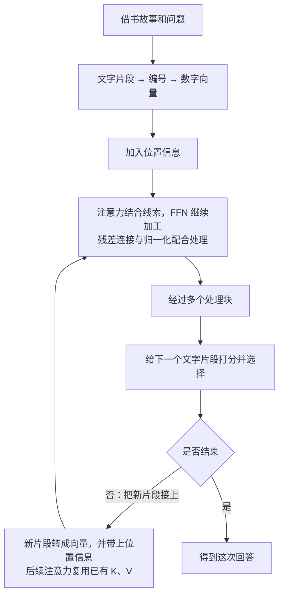

# Transformer：从一句话到一次回答

Transformer 是一种组织计算步骤的设计方法。用来处理文字时，它会把有关联的信息结合起来，经过多轮加工，让这些信息帮助完成理解、判断或生成文字等任务。

下面沿着一个完整例子展开：先看计算机要解决什么问题，再看文字怎样进入计算、内部怎样处理，最后看回答怎样产生。需要用到的术语会在出现的地方解释。

## 1. 先弄清楚：我们想让计算机做什么

读这句话：

> 小明从图书馆借了一本书，读完后把它还了回去。

如果问你“小明还回去的是什么”，你会说“一本书”。

你能回答，是因为把前后的信息联系起来了：前面说借了一本书，后面说读完了，因此这里的“它”指的是书。

这些帮助你理解当前内容的前后文字，叫作**上下文（理解某处内容时可以参考的前后文字或相关信息）**。

只看一个孤零零的“它”，就无法知道它指什么。换一句话：

> 小明借了一把伞，天晴后把它还了回去。

这次，“它”指伞。同一个字，在不同上下文里指向不同东西。

所以，计算机处理语言时，需要能利用词与词之间的联系。仅仅存一张“这个词是什么意思”的词典还不够，因为当前句子会改变它的具体含义。

我们这篇要解释的，就是计算机怎样把这些联系变成可以执行的计算。

## 2. 在讲内部步骤前，先认识“模型”和“学习”

你使用聊天工具时，背后负责根据输入计算输出的程序，通常被称为**模型（根据一套已经学到的规律，对输入进行计算并产生结果的程序）**。

这个程序内部有很多会影响计算结果的数字，叫作**参数（学习时可以被调整、之后参与计算的数字）**。可以把它们想成一大批可调的小旋钮：旋钮的设置不同，同样的输入就可能得到不同的处理结果。

这些数字是怎样确定的？一种常见做法是给程序许多文字样本：让它根据前面的内容预测接下来的文字，再与样本里的实际后文比较，根据差距调整参数。这个过程叫作**训练（利用样本和目标，调整模型参数的学习过程）**。

例如，样本里写着“小明借了一本书”。程序根据“小明借了一本”预测后文，再拿自己的预测与实际的“书”比较。经过大量不同的样本，参数会被不断调整。

训练完成后，使用这些参数处理一个新问题，叫作**推理（使用已经准备好的模型，对当前输入进行计算并得到输出）**。这里的“推理”是技术用语，续写几个字也算一次推理，不只指做逻辑题。

下面我们先跟着一个已经训练好的模型，看它怎样处理“小明借书”的故事。这样，在后面见到“学到的数字”时，你就知道它们从哪里来。

### Transformer 在其中是什么位置

把许多由参数控制的计算步骤连接起来，就可以形成**神经网络（由许多可学习的数值计算步骤组成的一类模型）**。

这些步骤怎样排列、怎样传递信息，叫作**架构（组织计算步骤和连接方式的设计）**。Transformer 就是一种这样的架构。

因此，“采用 Transformer”说明模型怎样组织计算；某个具体模型学到了什么、表现怎样，还取决于参数、数据和训练过程。

### 为什么会需要这种设计

语言经常有远距离联系。“书”和“它”之间可能隔着很长一段描述，后面的内容仍然需要利用前面的线索。

一些早期的顺序处理方法，可以类比为：读一小段，更新一份摘要，再带着摘要继续读。文字越长，保留和传递关键细节就越困难；后一步还常常要等前一步完成。

Transformer 的一个重要改进方向，就是让不同位置能更直接地结合相关信息，并把许多已经确定输入的计算一起组织起来。接下来，我们看看这种联系怎样真正发生。

## 3. 第一步：让文字进入数字计算

计算机不会直接拿“书”这个汉字做乘法。它需要先把文字转换成可以计算的数字。

### 3.1 把文字拆成小片段

模型会使用**token（文本处理中的基本片段）**。一个 token 可能是一个字、词的一部分、标点或其他片段，所以 token 不等于“一个汉字”。

为了说明用途，我们把故事示意拆成：

> 小明｜从｜图书馆｜借了｜一本｜书｜，｜读完｜后｜把｜它｜还了｜回去｜。

竖线只是帮你看清片段边界。这是教学切法，实际模型的切法可能不同。

把这些片段按先后顺序排在一起，就得到**序列（按顺序排列的一串内容，这里指这一串 token）**。

执行这种切分并转换编号的工具，叫作**tokenizer（分词器：按照配套规则，把文本转成 token 编号，并能把编号转回文字的工具）**。

每种片段有自己的编号，例如假设“书”的编号是 17，“伞”的编号是 42。**编号只用于识别片段，不表示 42 比 17 更重要，也不表示两个词的含义相差 25。**

### 3.2 给每个片段一份可计算的表示

只有编号，还不足以方便模型处理词语之间的复杂关系。模型会根据编号查到一串数字，例如：

| 片段 | 假设编号 | 假设的数字表示 |
| --- | --- | --- |
| 书 | 17 | `[0.2, -0.4]` |
| 伞 | 42 | `[-0.1, 0.7]` |

从编号映射到这串数字的步骤，叫作**embedding（嵌入：为一个 token 找到对应数字表示的步骤）**。

这串按顺序排列的数字，数学上叫作**向量（有顺序的一组数字）**。它包含多少个数字，就有多少个**维度（向量中数值位置的数量）**。上面的向量有两个数字，所以称为“二维向量”；真实模型通常会用更多维度。

这里的数字都是为了说明形式而编的。模型里的实际数字通过训练调整，不能简单认定第一位代表“颜色”，第二位代表“用途”。

你可以把向量理解成一张机器能计算的信息卡。卡上是一串数字；后续计算会逐步修改当前信息卡的内容，让它与当前句子联系起来。

### 3.3 为什么同一个词还能有不同含义

同一个 token 编号，在同一模型的 embedding 表里，会查到同一份基础向量。

但它进入句子之后，还会结合周围内容继续计算。比如“它”出现在借书的故事里，与出现在借伞的故事里，经过上下文处理后可以得到不同的结果。

因此要分清：**刚查到的基础向量**，以及**结合这次上下文之后的向量**。前者是起点，后者才逐步包含这一次输入的相关信息。

### 3.4 很多片段的数字放在一起，就是一张表

一段话有很多 token，每个 token 有自己的向量。把这些向量一行一行排起来，就得到**矩阵（按行、列排列的一张数字表）**。

例如三个 token，每个有两个数字，就可以排成“三行两列”。

“矩阵”在这里不是额外一层神秘东西，只是把许多数字组织在一起，方便批量计算。后面我们会继续用小表和简单乘加解释计算过程。

## 4. 第二步：把顺序也告诉模型

比较这两句话：

> 小明借走了书。
>
> 书借走了小明。

主要词相同，但顺序变了，意思就不同。

因此，模型不能只知道“有哪些片段”，还需要知道它们处于什么位置。为计算加入位置信息的方法，叫作**位置编码（用数值向计算提供顺序和位置相关信息的方法）**。

可以类比一本书的内容与页码：内容告诉你写了什么，页码帮助你知道它在什么顺序中。

原始 Transformer 会给不同位置准备相应的位置向量，再与 token 的基础向量相加。向量相加，就是对应位置的数字分别相加。

为了只看清这个动作，假设某个片段的向量是 `[2, 3]`，它的位置向量是 `[0.1, 0.2]`，相加就得到 `[2.1, 3.2]`。这些仍是人为举例的数字，真实位置向量按相应规则产生。

现代模型也有其他加入位置信息的方式，但要解决的问题相同：让计算能够利用“谁在前面、谁在后面”等信息。

现在，文字已经变成了带有位置相关信息的数字。下一步，就可以让不同位置之间交换线索了。

## 5. 第三步：把不同位置的相关信息结合起来

回到故事中的“它”：

> 小明从图书馆借了一本书，读完后把**它**还了回去。

“书”“借”“读完”等内容，都能帮助解释这里的“它”。但它们提供的帮助不一定相同。

模型会计算当前位置与其他可参考位置的相关程度，再按照得到的比例，把那些位置提供的信息结合起来。这个过程叫作**注意力（Attention：计算各份信息应占的比例，再按比例组合信息的机制）**。

“注意”在这里有具体的计算含义：不同信息在组合结果中所占的比例不同。它不是人在主观上把目光转向某个词。

### 5.1 先分清三个角色

用找资料来比喻：你带着一个需求，比较几份资料是否相关，再从相关资料里取用内容。这件事可以分成三个角色。

**第一个角色：当前要找什么样的信息。**

模型用 **Q（Query，查询向量：代表当前位置要匹配什么的一串数字）** 来参与这项工作。它是一串数字，不是一句真实的中文提问。

**第二个角色：其他位置拿什么来参与比较。**

模型用 **K（Key，键向量：供 Q 比较相关程度的一串数字）** 来参与匹配。可以类比资料上用于检索的标签，但实际也是数字。

**第三个角色：如果相关，这个位置提供什么信息。**

模型用 **V（Value，值向量：最后被按比例组合的信息）** 来参与输出。可以类比资料的内容。

把三个角色放到一句话里，就是：

> **Q 与各个 K 比较，得到各份 V 应该占多少比例，再把 V 按这个比例组合。**

### 5.2 为什么同一个位置要产生三种向量

因为“怎样参与匹配”与“提供什么内容”是不同用途。使用不同的计算变换，模型就有机会为这些用途学到不同的表示。

这些向量通常来自已有的中间数字，经过不同的参数计算得到。前面说过，参数就是训练时调整的那些数字。

因此需要分清：

- **形成 Q、K、V 的参数**，是模型训练中学到的计算规则的一部分。
- **本次产生的 Q、K、V**，是这些规则处理当前输入后得到的结果。

换一句话，参数可以相同，本次的 Q、K、V 却可以不同。就像使用同一套计算方法，输入换了，结果会跟着变。

## 6. 把“比较相关程度”真正算一次

这一节只用几个小数字，把上面的三个角色接起来。每一步都接着上一步的结果计算。

下面是独立构造的教学数字，只展示一次注意力运算。它不是实际模型的词义记录，也不是一个完整模型。

### 6.1 先准备一个 Q 和三个 K

假设当前位置的 Q 是 `[1, 0]`，三份可参考信息的 K 分别是：

| 可参考的信息 | 假设的 K |
| --- | --- |
| “书”所在位置 | `[1, 0]` |
| “图书馆”所在位置 | `[0, 1]` |
| “读完”所在位置 | `[1, 1]` |

这里每个向量都只有两个数字。

一种常见的比较方法叫作**点积（把两个等长向量对应位置的数字相乘，再把乘积加起来）**。

例如 `[1, 2]` 与 `[3, 4]` 的点积是：

> 1 × 3 + 2 × 4 = 11。

在我们的例子里，用 Q 分别与三个 K 做点积：

| 比较对象 | 计算 | 分数 |
| --- | --- | --- |
| 书 | 1 × 1 + 0 × 0 | 1 |
| 图书馆 | 1 × 0 + 0 × 1 | 0 |
| 读完 | 1 × 1 + 0 × 1 | 1 |

得到 `[1, 0, 1]`。在这组人为设定的数字中，第一个和第三个位置分数相同，高于第二个。

分数相同来自这里的数字设定，不代表所有真实模型在这个故事里都会这么分配注意力。

### 6.2 调整一下打分的大小

常见的 Transformer 注意力会把分数除以 Q/K 维度的平方根。

**平方根（一个非负数，自己乘自己可以得到原来的数）**，例如 4 的平方根是 2，因为 2 × 2 = 4。

这里的向量有两个数字，维度是 2，2 的平方根约为 1.4142。因此：

> `[1, 0, 1]` ÷ 1.4142，约得到 `[0.7071, 0, 0.7071]`。

这个动作叫作**缩放（用一个系数调整数值的大小）**。当向量维度很大时，在常见条件下点积分数的波动会增大；缩放有助于让下一步的比例分配保持在更适合计算和训练的范围。

### 6.3 把分数变成可以分配的比例

刚才的分数还不能直接当百分比：它们的总和不是 1，一般情况下还可能有负数。

我们要把它们变成一组非负、加起来等于 1 的比例。按固定规则把输入变成输出，在数学上叫作**函数（按照给定规则计算输入所对应的输出）**。

这里会用到 **softmax（把一组分数转换成非负且总和为 1 的比例的一种函数）**。它的操作是：先把每个分数转换成正数，再让每个正数除以它们的总和。

第一步使用**指数运算（这里记作 exp(x)，意思是让常数 e 取 x 次方；e 约等于 2.7183）**。例如，e 的 1 次方就是 e，2 次方就是 e × e，0 次方规定为 1；小数次方则是把这套运算连续延伸。计算器和程序可以给出对应结果。

使用这条转换规则时，即使原分数为负数，结果也是正数；原分数越大，转换后的正数也越大。因此，这些结果可以继续用来分配比例。

你可以直接跟着这组结果看：

| 调整后的分数 | 指数运算得到的正数 | 除以总和后的比例 |
| --- | --- | --- |
| 0.7071 | 约 2.0281 | 约 0.4011，即 40.11% |
| 0 | 1 | 约 0.1978，即 19.78% |
| 0.7071 | 约 2.0281 | 约 0.4011，即 40.11% |

这些正数的总和约为 5.0562。例如第一项的比例就是 2.0281 ÷ 5.0562，约等于 0.4011。

现在，我们得到了三个信息来源各自的分配比例。它们叫作**注意力权重（本次计算中，各份信息被加权组合时使用的比例）**。

这里“权重”说的是本次算出来的比例；你有时看到的“模型权重”，则通常是在说模型学到的参数。两种说法要看上下文区分。

### 6.4 按比例组合 V

假设三个位置实际提供的 V 是：

| 位置 | 假设的 V | 使用比例 |
| --- | --- | --- |
| 书 | `[10, 0]` | 约 0.4011 |
| 图书馆 | `[0, 10]` | 约 0.1978 |
| 读完 | `[6, 6]` | 约 0.4011 |

输出就是把这些向量按比例相加。

先算输出的第一个数字：

> 0.4011 × 10 + 0.1978 × 0 + 0.4011 × 6 ≈ 6.42。

再算第二个数字：

> 0.4011 × 0 + 0.1978 × 10 + 0.4011 × 6 ≈ 4.38。

所以，输出约为 `[6.42, 4.38]`。这是把多份信息结合起来得到的新向量。

**注意力这一步产出的是新的数字表示，还没有直接决定输出“书”这个字。** 这个结果还要继续经过后面的计算。

到这里，“Q、K、V”已经对应上具体动作了：用 Q 和 K 算分数，把分数变成比例，再按比例组合 V。

## 7. 哪些位置可以提供信息

前面计算时，只用了三个可参考位置。真实模型还必须规定：当前位置允许看见哪些位置。

### 7.1 在同一段内容内部结合信息

当 Q、K、V 来自同一序列的相应表示时，这种注意力叫作**自注意力（Self-attention：一段内容内部的不同位置之间结合信息）**。

例如故事中的“它”结合这段故事前面的“书”等位置，就可以用来理解“同一段内容内部相互参考”的意思。

“自”强调来源在同一序列，并不表示一个位置只能看自己。

模型会对多个位置执行这种计算，产生多个新的中间向量。这些中间向量常叫作**隐藏状态（模型内部在某一步产生、供后续计算继续使用的数字表示）**。它们是一串串数字，不是一份藏起来的中文思考稿。

### 7.2 逐步生成时，要避免偷看后面的答案

假设训练材料是：

> 小明｜借了｜一本｜书。

我们希望模型根据“小明”预测“借了”。如果计算“小明”位置时，已经把后面的“借了”直接给它看，就等于把答案提前告诉了它。

因此，常见的逐步生成模型会使用**因果遮罩（Causal mask：让一个位置只能参考自己及前面位置，阻止它读取未来位置的规则）**。

| 当前处理到的位置 | 允许参考的内容 |
| --- | --- |
| 小明 | 小明 |
| 借了 | 小明、借了 |
| 一本 | 小明、借了、一本 |
| 书 | 小明、借了、一本、书 |

实现时，被禁止位置的分数会被屏蔽，使它们经过 softmax 后的比例为 0，就不会参与相应的信息组合。

训练程序虽然拥有完整的样本，当前每个位置的计算仍然要遵守这条规则。

有些任务允许输入中的各个位置同时参考两边内容，因此不会使用相同的因果限制。限制方式要与模型的任务相匹配。

## 8. 一套注意力不够，可以把多套结果组合起来

一句话可能包含不同类型的关系：谁做了什么、动作与什么对象有关、某个代词可能指向哪里等。

如果只使用一套信息匹配方式，表达能力可能受到限制。模型可以使用多套不同参数的注意力计算，再组合结果。

其中每一套计算叫作**注意力头（Head：一套用自己的参数形成 Q/K/V 并执行注意力计算的单元）**。

把多个头的结果组合起来，就是**多头注意力（Multi-head attention：并行使用多套注意力计算，再将结果汇合的方式）**。这里的“并行”就是多套计算可以一起组织执行。

用读故事来比喻，好像从不同角度整理同一句话的线索。不过，真实模型没有被人预先指定成“这个头只找人名，那个头只找书”；不同头的作用由训练形成，也不一定都能被人清楚命名。

还有两个容易混淆的地方：

- 多个头通常都能处理这段序列的可见位置，并不是把前半句话分给头 1、后半句分给头 2。
- 多个头通常使用各自较小的向量，再把结果拼接和变换；不一定把同样宽的一整套计算完整复制很多遍。

现在，相关信息已经经过一套或多套注意力结合起来。接下来还要对得到的表示做进一步加工。

## 9. 结合完线索，还要怎样处理

刚才的注意力，主要解决“当前位置怎样结合其他位置的信息”。但结合完以后，仍然得到一串数字。这串数字还需要经过加工，才能逐步变成对任务更有用的表示。

### 9.1 对每个位置的信息继续加工

这个步骤通常由**前馈网络（Feed-forward network，简称 FFN：对每个位置的数字表示分别进行加工的一小组计算）**完成。

可以沿用信息卡的比喻：注意力把其他卡上的相关线索带过来，FFN 再加工当前卡上已经收集到的内容。

常见的 FFN 会先把向量转换成一串更长的数字，中间做一次有变化能力的处理，再转换回原来的长度。例如，假设输入有 4 个数字，中间变成 12 个，最后回到 4 个。这个长度只用于举例，具体模型会选择自己的设置。

中间为什么需要额外处理？如果所有步骤都只是把数字乘以固定系数、再相加，那么连续做很多步，仍能合并成同一类简单变换，表达能力会受到限制。

因此，中间通常会加入**非线性处理（让输入与输出的关系不再只是固定比例相加的计算）**。举一个简单规则：负数变成 0，正数保持原值。这样 `[-2, 3]` 就变成 `[0, 3]`。不同范围的输入接受了不同处理，计算就能表达更多种关系。

这种中间处理也叫**激活函数（用于加入非线性变化的计算规则）**。真实模型可能选择比上面更复杂的规则，但它在这里承担的用途相同。

在同一个 FFN 中，各个位置通常使用同一套参数。它在这一刻分别加工每个位置；其他位置的线索，已经由前面的注意力带进当前表示。

### 9.2 怎样保留原来的信息

如果每一步都把原来的表示彻底替换，层数多了以后，信息传递和训练都会更困难。

一种办法是把“进入这一步之前的表示”保留下来，与“这一步算出的结果”相加。这叫作**残差连接（Residual connection：让原来的输入绕过一段计算，再与这段计算的结果相加）**。

例如，原来的向量是 `[2, 3]`，这一段算出了 `[0.5, -1]`，相加得到：

> `[2 + 0.5, 3 + (-1)]`，也就是 `[2.5, 2]`。

可以理解成：在原有信息上补充一个调整量。模型有机会保留原信息，也有机会逐步修改它。

这里的“残差”不是在说“剩下的垃圾数据”，也不是前面预测答案产生的误差；在这个结构里，它指这种把输入加回去的设计。

### 9.3 怎样让数字保持在便于处理的范围

经过多次计算，有的数字可能变得很大，有的变化很小。直接把这些结果不断传下去，可能让后续计算与训练更难稳定。

因此，网络还会安排**归一化（Normalization：按一定规则调整数值的尺度，使后续计算更容易处理）**。

原始 Transformer 中常见的是**层归一化（Layer normalization，常写作 LayerNorm：通常在同一个位置的向量内部，根据各个数字的整体情况进行调整）**。

举一个只有三个数字的例子：`[10, 20, 30]`。

先算它们的平均值：`(10 + 20 + 30) ÷ 3 = 20`。每个数字减去平均值，得到 `[-10, 0, 10]`。接着，再根据这些数字分散的程度调整大小，并使用模型学到的参数进一步缩放、平移。

这里**平移**的意思是加上一个调整量，并不是把数字挪到别的位置。实现时还会有防止除数为 0 的小量。

这个过程保留了数字之间可供后续利用的差别，同时调整了它们的尺度。

它与前面的 softmax 用途不同：softmax 把分数变成总和为 1 的非负比例；这里整理的是内部表示的数值范围，结果仍然可以包含负数，总和也不必是 1。

### 9.4 把这些步骤组成一个可重复的单元

现在我们有了四种已经认识的动作：

| 动作 | 在这一段计算中做什么 |
| --- | --- |
| 多头注意力 | 用多套匹配方式结合可见位置的信息 |
| FFN | 对每个位置得到的信息继续加工 |
| 残差连接 | 把输入保留下来，与加工结果相加 |
| 归一化 | 调整内部数值的尺度 |

把这些动作按设计连接起来，就构成一个 **Transformer block（Transformer 块：一组可以重复堆叠的处理步骤）**。介绍模型时，说“有多少层”，常常就是在数这样的处理块。

以原始 Transformer 中的一种排列为例：

```text
一段内容的数字表示
       ↓
多头自注意力
       ↓
加回这一小段的输入，再做归一化
       ↓
FFN
       ↓
加回这一小段的输入，再做归一化
       ↓
这一块处理后的数字表示
```

这里有两次“加回输入”：第一次加回的是进入注意力之前的表示，第二次加回的是进入 FFN 之前的表示。

具体模型的排列可能不同，例如把归一化放到注意力和 FFN 之前；某些结构还会增加一个信息来源。后面讲翻译模型时，就会说明这个来源是什么。

### 9.5 为什么还要重复很多块

一块的输出可以交给下一块。下一块接收到的，已经是结合过上下文、加工过的表示，它会在这个基础上继续处理。

因此，多层处理给了模型逐步组织更复杂关系的机会。各层通常有自己的参数，也没有被统一指定成“第一层只看词义，第二层只看语法”。

处理到最后，得到的仍然是每个位置对应的一串数字。下一步，需要把这些数字与可以输出的文字联系起来。

## 10. 怎样从数字变成回答

前面举例时，我们观察过故事中“它”这个位置怎样结合线索。真正回答问题时，模型还需要处理问题本身，并利用整个输入中可见的信息。

例如，把下面的内容交给一个已经训练成能够回答问题的模型：

> 小明从图书馆借了一本书，读完后把它还了回去。
>
> 问：小明还回去的是什么？
>
> 答：

对于常见的逐步生成模型，处理完当前输入后，会利用最后一个位置得到的表示，计算接下来应当输出哪个 token。

### 10.1 给每个候选片段打分

模型配套的所有 token 组成**词表（模型可以识别和输出的 token 编号集合）**。

模型末尾会有一组负责产生候选分数的计算，称为**输出层（把内部数字表示转换成输出候选分数的计算部分）**。

这一步得到的分数常叫作 **logits（每个候选 token 对应的原始分数）**。接着要把分数转换成**概率（这里指模型给每个候选分配的可能性大小）**，从而决定后面怎样选择。

为了看清过程，假设这里只有三个候选，并假设输出层给出了下面的分数。真实词表通常远不止三个，这些分数也不是实际模型的结果。

| 候选 token | 假设的原始分数 |
| --- | --- |
| 书 | 3 |
| 伞 | 2 |
| 球 | 1 |

接着使用前面已经算过的 softmax：先把分数转换成正数，再除以总和。

| 候选 | 转换得到的正数 | 在这三个候选中的概率 |
| --- | --- | --- |
| 书 | 约 20.0855 | 约 66.52% |
| 伞 | 约 7.3891 | 约 24.47% |
| 球 | 约 2.7183 | 约 9.00% |

把候选与各自的概率放在一起，就得到**概率分布（说明每个候选分别占多少可能性的一组结果）**。表中保留两位小数，所以显示的百分比加起来会有一点舍入误差，精确结果的总和是 100%。

这一处 softmax 分配的是“各个输出候选占多少概率”；注意力里的 softmax 分配的是“各个可参考位置占多少比例”。它们使用相同的计算方法，但分配的对象不同。

### 10.2 从候选里选出一个

常见选择方式包括：

- **贪心选择（每一步都选择当前概率最高的候选）**：在上面的例子里会选“书”。
- **采样（按照概率进行带随机性的抽取）**：可以类比把候选放进一个抽签箱，概率越大，对应签越多；抽一次可能得到“书”，也可能得到其他候选。

真实采样通常还会调整或限制候选范围。无论使用哪种方式，这一步的作用都是从概率分布里确定实际输出的 token。

### 10.3 把刚生成的内容接上，再计算下一步

假设这一步选中了“书”，接下来就把它接到当前输入后面，让后续生成能参考它。

```text
故事 + 问题 + “答：”
       ↓ 计算并选择一个 token
故事 + 问题 + “答：书”
       ↓ 继续计算并选择
故事 + 问题 + “答：书。”
```

这里把“书”和句号分成两步，只为说明逐步追加的过程，实际拆分仍取决于 tokenizer。

这种“用已有内容预测下一部分，再把新内容接回去继续”的方式，叫作**自回归生成（Autoregressive generation：后续输出依赖已经给定和已经生成的内容）**。

模型还可以输出专门的**结束标记（表示这一段生成应当结束的特殊 token）**。服务程序也可能因为达到预设输出长度等条件停止生成。

因此，常见聊天模型呈现为文字逐步出现。每一步依赖之前已经生成的内容；它内部有许多可以一起执行的数值计算，但通常不会一次独立确定整篇回答的每个 token。

### 10.4 为什么流畅的回答仍可能出错

下一 token 的概率，是模型根据参数和当前输入算出来的。这个计算过程不会自动保证现实中的每件事都经过核实。

如果故事里明确说借了一本书，模型有线索可用。如果问的是一个它没有可靠依据的人名、日期或故障原因，它仍然可能接出看起来顺畅的文字。

这种生成了错误、无依据或与输入矛盾内容的现象，常被称为**幻觉（模型给出貌似合理、实际上不可靠的内容）**。

理解了生成过程，就能分清两个问题：一个回答是否符合常见表达习惯，以及它说的事情是否有可靠依据。

## 11. 回答一句话时，前面的内容要反复计算吗

刚才我们把生成描述成“接上一个 token，再继续”。如果每一步都重新计算整段前文，会做很多重复工作。

前面已经介绍过：在使用因果遮罩的模型里，一个位置只能参考自己和前面的内容。后面追加一个 token，通常不会改变前面那些位置在同样条件下应当得到的结果。

因此，可以把之前每一层算过的 K、V 保存起来。处理新 token 时，计算它自己的 Q、K、V，再用它的 Q 与之前保存的 K 及当前 K 比较，按得到的比例组合对应的 V。

这个办法叫作 **KV Cache（K、V 缓存：保存之前位置的键向量和值向量，供后续生成复用）**。**缓存**就是把以后还会用到的结果暂时保留，减少重复计算。

例如刚刚选出“书”，下一轮就把“书”作为新的输入位置，为它计算 Q、K、V，同时复用故事、问题等之前输入的 K、V。这样可以继续选择后面的句号，而不必把前面的所有位置从头重新算一遍。

这类缓存保存的是本次输入产生的中间结果；它与训练出来的参数是两类东西，也不等同于聊天软件存下来的文字记录。

到这里，我们已经走完了一次普通生成的大体过程。接下来回到最初的问题：控制这些计算的参数，到底是怎样学出来的？

## 12. 训练怎样把一堆数字变成有用的模型

第 2 节已经说过，训练就是利用样本调整参数。现在我们认识了输入、内部处理和输出概率，就能把这件事讲得更具体。

### 12.1 先准备一个可以核对的目标

假设某条训练样本是：

> 小明｜借了｜一本｜书。

当模型得到“小明｜借了｜一本”时，这条样本中的下一个目标片段是“书”。

模型按照前面讲过的步骤进行计算，并给所有候选分配概率。假设它给“书”的概率只有 10%，那么这次预测与样本的目标不够接近。

训练需要把这种差距转换成一个能计算的数字。这个数字叫作**损失（Loss：用来衡量本次预测与训练目标差距的数值）**。

对于常见的下一 token 训练方式，给目标 token 的概率越低，损失越大；把它从 10% 提高到 80%，这一项损失就会降低。

所以，训练的方向不是只问“抽出来的字碰巧对不对”，还会看目标 token 得到了多少概率。这样才能连续地判断参数调整有没有让预测更接近目标。

### 12.2 怎样知道应该改哪些参数

一个模型中可能有非常多参数，不可能让人逐个试旋钮。训练程序会计算：每个参数稍微改变一点，损失大约会怎样变化。

这种描述局部变化关系的信息，叫作**梯度（Gradient：反映参数发生微小变化时，损失怎样随之变化的一组数）**。

“局部”就是当前参数附近的一小步。它提供调整方向，不保证一步就能找到全局最好的参数。

例如，假设其他条件不变，把某个参数从 0.20 稍微调大，会让当前损失上升，那么常见的调整方向就是让它略微减小；如果略微调大会让损失下降，就有理由向增大的方向尝试。

这些变化关系会沿着之前执行过的计算，从结果往前逐步算回来。这个求梯度的过程叫作**反向传播（Backpropagation：沿计算过程反向计算各参数对损失的影响）**。

它不是把输出文字倒着读一遍，而是在数值计算中追踪前后步骤的变化关系。

随后由**优化器（Optimizer：根据梯度等信息决定怎样更新参数的计算方法）**修改参数。每次大致调多少，还会受到**学习率（控制参数更新步幅大小的设置）**影响。

整个过程可以连起来看：

```text
给出训练样本和目标
       ↓
用当前参数算出候选概率
       ↓
计算与目标的差距，也就是损失
       ↓
反向传播，求出参数对应的梯度
       ↓
优化器更新参数
       ↓
在后续样本上继续计算和调整
```

不只是输出层会学习。前面见过的 embedding 表、产生 Q/K/V 的参数、FFN 等可学习部分，都可以通过这条过程得到调整。

参数经过大量样本的共同影响，才可能形成对语法、词语联系、事实模式或任务方式有用的处理能力。是否学得好，还取决于数据、训练方法和模型规模等条件。

### 12.3 为什么训练时可以同时处理多个位置

训练程序通常已经拥有整段样本，因此可以为不同位置准备各自的下一 token 目标：

| 输入处理到哪里 | 根据这条样本，下一步应预测什么 |
| --- | --- |
| 小明 | 借了 |
| 小明、借了 | 一本 |
| 小明、借了、一本 | 书 |

这些目标来自已有样本，不需要等模型先猜出前一个 token。因此，同一层里多个位置的计算可以一起组织执行。

同时，因果遮罩会保证每个位置只能利用允许看到的前文。例如预测“借了”的位置，仍然不能把后面的“借了”作为自己的输入线索。

**训练时，样本中的后文已经存在；实际生成时，下一步内容尚未确定。** 这是训练与逐步生成在组织计算时的一处重要区别。

### 12.4 学会续写以后，怎样学会回答问题

大规模地从文字等材料中学习一般规律，通常叫作**预训练（在大量数据上学习基础能力的训练阶段）**。

在已有模型上，用更多特定任务的数据继续训练，叫作**微调（在已有参数基础上，为某类任务或行为继续调整模型）**。

例如，给它许多“问题—合适回答”的样本，训练目标就会包含怎样按提问方式回答、怎样遵守任务要求等。实际聊天模型还可能经过其他训练步骤。

这也解释了为什么“采用 Transformer 架构”与“已经是一个好用的聊天助手”之间还有距离：架构提供计算组织方式，训练使具体模型学会相应的行为。

### 12.5 为什么聊天时给出新信息，不等于重新训练

你可以在提问中说明“这里的服务名叫 BookAPI”，模型据此继续回答。这是它使用当前上下文里的信息。

普通推理通常不会因此修改模型参数。当前表示与 K、V 可以随着输入变化，训练得到的参数仍保持原样。

以后能否在另一段对话里继续利用这条信息，还取决于应用有没有保存并再次提供相关内容。不能仅凭一次对话，就认定模型把它永久学进了参数。

## 13. 为什么有的 Transformer 分成两部分

前面为了说明回答如何逐步产生，主要跟着常见生成模型的工作方式讲解。现在，我们已经认识了内部组件，可以进一步看它们怎样被组合成不同结构。

### 13.1 原始 Transformer 要完成的典型任务：翻译

2017 年提出的原始 Transformer，典型应用之一是把一种语言翻译成另一种语言。例如：

> 输入：I love cats.
>
> 输出：我爱猫。

这里有两段内容：完整给定的原文，以及正在逐步生成的译文。

它把处理过程分成两部分。

第一部分叫作**编码器（Encoder：把输入内容处理成供后续使用的上下文表示的部分）**。它对完整原文做多层处理，让原文的各个位置结合彼此的信息。在这种翻译任务中，原文已经完整给定，因此编码器通常允许原文位置相互参考，不遮住右侧原文。

第二部分叫作**解码器（Decoder：结合可用信息，逐步产生输出的部分）**。它处理已有译文，用因果遮罩防止读取还不应看到的后文，并参考编码器处理好的原文信息。

这里的“编码、解码”是模型部分的名字，不是在说把文件加密再解密。

### 13.2 生成译文时，怎样读取原文

假设译文已经生成“我爱”，现在需要确定后续内容。模型既要知道译文已经写了什么，也需要利用原文中的 “cats”。

它会增加一套**交叉注意力（Cross-attention：用一段内容产生 Q，用另一段内容提供 K、V，从而结合另一段内容的信息）**。

在这个翻译例子中：

- Q 来自解码器当前处理的译文表示。
- K、V 来自编码器输出的原文表示。
- 仍然按照前面学过的方式比较 Q 与 K，再按比例组合 V。

因此，原始解码器中的一个处理块，比前面举的自注意力处理块多了一段交叉注意力。它的主要处理顺序是：对已有译文做带因果遮罩的自注意力，再通过交叉注意力利用原文，最后经过 FFN；这些部分同样配有残差连接和归一化。

“自注意力”和“交叉注意力”的主要区别，由此就明确了：前者在同一段表示内部结合信息，后者把另一段表示作为信息来源。

### 13.3 为什么许多聊天模型没有单独的编码器

另一种常见组合叫作 **Decoder-only（只使用解码器式结构：主要用带因果限制的处理块，处理输入并逐步生成后续内容）**。

它一般会把问题和已有回答放在同一条内容序列里处理。生成新内容的位置可以通过自注意力参考前面的提问，所以即使没有单独叫“编码器”的部分，也可以处理问题中的信息。

这种结构通常没有原始翻译解码器里那套“读取独立编码器输出”的交叉注意力。

另外还有 **Encoder-only（只使用编码器式结构：主要对已经给定的输入形成表示）**，常用于判断一段文字属于什么类别、比较文本内容等任务。

这些名称描述的是不同的组织方式。它们共享前面学过的许多基本计算，不代表每种 Transformer 都必须长得与原始翻译模型完全一样。

## 14. 把整个借书故事重新走一遍

现在回到开头的任务：

> 小明从图书馆借了一本书，读完后把它还了回去。
>
> 小明还回去的是什么？

假设使用一个已经具备相应问答能力的 Decoder-only 模型，这次计算可以顺着下面的过程理解。

**第一步，输入变成编号。** tokenizer 按模型配套的规则，把故事和问题转换成 token 编号。

**第二步，编号变成向量，并加入位置信息。** embedding 提供基础数字表示；位置机制让内部计算能够利用顺序。

**第三步，结合可见的上下文。** 每个处理块里的自注意力产生 Q、K、V，计算相关分数，经过缩放和 softmax 得到比例，再按比例组合 V。因果遮罩规定各位置可以参考哪些内容，多头提供多套学习到的组合方式。

**第四步，继续加工和传递。** FFN 分别加工每个位置的表示，残差连接保留并加入原输入，归一化调整数值尺度。多个处理块依次执行。

**第五步，给下一个 token 打分并选择。** 最后位置的表示经过输出层得到 logits，再转换成候选概率，由选择规则确定下一个 token。

**第六步，继续生成直到结束。** 新 token 被接回当前内容，后续生成可以利用已有内容和保存的 K、V，直到输出结束标记或触发其他停止条件。



在这个任务里，“书”和“读完”等信息提供了判断依据。经过训练的模型可能利用这些线索回答“书”，但这一结果是整套计算共同作用的产物，不能简单说成“某个注意力头直接把‘它’替换成了‘书’”。

我们从头使用的每个小向量和概率，都是为了看清步骤而设置的教学数字。真正模型中的数字来自训练和当前输入，是否答对仍需要实际检验。

## 15. 与 GPU、运维简单接上

现在已经能看出，Transformer 内部有大量向量、矩阵以及乘加计算。**GPU（擅长同时处理大量数值运算的处理器）**能够加速其中许多计算；模型参数和本次计算的中间结果则需要占用内存或显存，**显存就是 GPU 使用的内存**。

你正在学习的 **Kubernetes（用于安排和管理应用运行的平台）**，是在程序外部管理它怎样运行。它与 Transformer 的联系是承载和管理执行这些计算的服务。理解模型内部的计算步骤之后，就更容易理解运行它为什么需要相应资源。

## 资料来源

- [Attention Is All You Need，2017 年原始论文](https://arxiv.org/abs/1706.03762)：Transformer 原始结构，以及注意力、位置编码、FFN 等设计的来源。
- [The Annotated Transformer，Harvard NLP](https://nlp.seas.harvard.edu/annotated-transformer/)：带说明的实现，展示各个计算步骤怎样组成网络。
- [The Illustrated Transformer，Jay Alammar](https://jalammar.github.io/illustrated-transformer/)：用图示解释文字表示和不同组件之间的信息传递。

本文已在正文中解释上述基础机制，引用资料用于标明来源。
