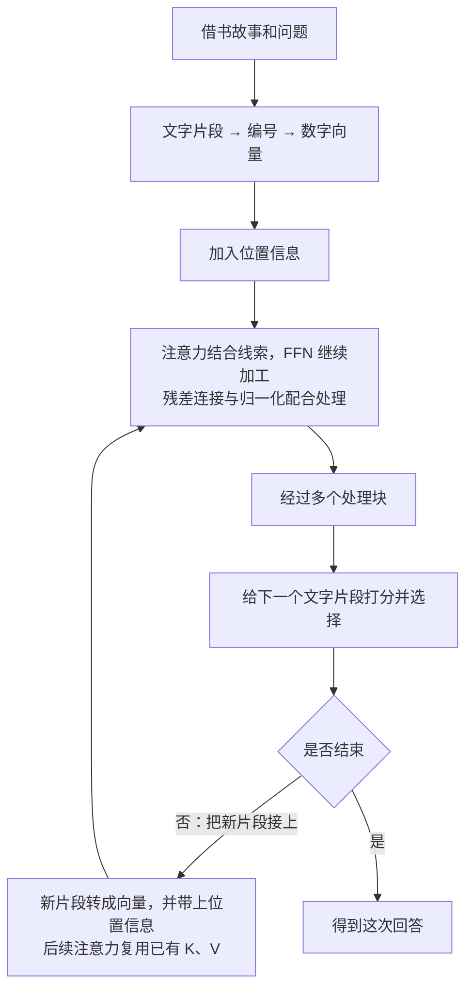

# Transformer：从一句话到一次回答

Transformer 是一种组织计算步骤的设计方法。用来处理文字时，它会把有关联的信息结合起来，经过多轮加工，让这些信息帮助完成理解、判断或生成文字等任务。

下面沿着一个完整例子展开：先看计算机要解决什么问题，再看文字怎样进入计算、内部怎样处理，最后看回答怎样产生。需要用到的术语会在出现的地方解释。

每章末尾都有“想一想与解答”。问题围绕本章内容，答案紧接着解释原因、计算步骤或容易混淆的地方。

## 1. 先弄清楚：我们想让计算机做什么

读这句话：

> 小明从图书馆借了一本书，读完后把它还了回去。

如果问你“小明还回去的是什么”，你会说“一本书”。

你能回答，是因为把前后的信息联系起来了：前面说借了一本书，后面说读完了，因此这里的“它”指的是书。

这些帮助你理解当前内容的前后文字，叫作**上下文（理解某处内容时可以参考的前后文字或相关信息）**。

只看一个孤零零的“它”，就无法知道它指什么。换一句话：

> 小明借了一把伞，天晴后把它还了回去。

这次，“它”指伞。同一个字，在不同上下文里指向不同东西。

所以，计算机处理语言时，需要能利用词与词之间的联系。仅仅存一张“这个词是什么意思”的词典还不够，因为当前句子会改变它的具体含义。

我们这篇要解释的，就是计算机怎样把这些联系变成可以执行的计算。

### 本章想一想与解答

**问题 1：如果词典已经写明“它是一个代词”，为什么计算机还需要看前面的故事？**

**解答：** 词典说明这个字的一般用途，却没有说明这一次在指什么。借书的故事里，它可能指书；借伞的故事里，它可能指伞。确定这次的对象，需要把当前文字与前面的线索联系起来。这就是上下文发挥作用的地方。

**问题 2：只要看到了上下文，就一定能确定“他”指谁吗？例如“小明告诉小刚，他明天出发”。**

**解答：** 不一定。这句话里的“他”可能指小明，也可能指小刚，单靠这一句没有充分依据确定。上下文提供线索，但线索也可能不够。合理的处理应当承认这里有歧义，或者补充信息，而不是把猜测当成确定答案。

## 2. 在讲内部步骤前，先认识“模型”和“学习”

你使用聊天工具时，背后负责根据输入计算输出的程序，通常被称为**模型（根据一套已经学到的规律，对输入进行计算并产生结果的程序）**。

这个程序内部有很多会影响计算结果的数字，叫作**参数（学习时可以被调整、之后参与计算的数字）**。可以把它们想成一大批可调的小旋钮：旋钮的设置不同，同样的输入就可能得到不同的处理结果。

这些数字是怎样确定的？一种常见做法是给程序许多文字样本：让它根据前面的内容预测接下来的文字，再与样本里的实际后文比较，根据差距调整参数。这个过程叫作**训练（利用样本和目标，调整模型参数的学习过程）**。

例如，样本里写着“小明借了一本书”。程序根据“小明借了一本”预测后文，再拿自己的预测与实际的“书”比较。经过大量不同的样本，参数会被不断调整。

训练完成后，使用这些参数处理一个新问题，叫作**推理（使用已经准备好的模型，对当前输入进行计算并得到输出）**。这里的“推理”是技术用语，续写几个字也算一次推理，不只指做逻辑题。

下面我们先跟着一个已经训练好的模型，看它怎样处理“小明借书”的故事。这样，在后面见到“学到的数字”时，你就知道它们从哪里来。

### Transformer 在其中是什么位置

把许多由参数控制的计算步骤连接起来，就可以形成**神经网络（由许多可学习的数值计算步骤组成的一类模型）**。

这些步骤怎样排列、怎样传递信息，叫作**架构（组织计算步骤和连接方式的设计）**。Transformer 就是一种这样的架构。

因此，“采用 Transformer”说明模型怎样组织计算；某个具体模型学到了什么、表现怎样，还取决于参数、数据和训练过程。

### 为什么会需要这种设计

语言经常有远距离联系。“书”和“它”之间可能隔着很长一段描述，后面的内容仍然需要利用前面的线索。

一些早期的顺序处理方法，可以类比为：读一小段，更新一份摘要，再带着摘要继续读。文字越长，保留和传递关键细节就越困难；后一步还常常要等前一步完成。

Transformer 的一个重要改进方向，就是让不同位置能更直接地结合相关信息，并把许多已经确定输入的计算一起组织起来。接下来，我们看看这种联系怎样真正发生。

### 本章想一想与解答

**问题 1：两个人都采用 Transformer 设计，做出的模型表现就一定相同吗？**

**解答：** 不一定。架构规定怎样组织计算，而参数、训练数据和训练方法会影响具体能力。可以类比两所学校采用相同的课程安排，学生学过的材料、练习过程和掌握程度仍然可能不同。相同的计算设计不等于相同的学习结果。

**问题 2：模型刚刚答错，我在下一条消息里告诉它正确答案，这就完成了一次训练吗？**

**解答：** 普通聊天中通常没有。你的纠正成为了新的输入，模型可以根据这条信息重新计算；训练则还需要用目标和差距去调整参数。判断关键在于“有没有更新参数”，而不是“回答有没有变化”。

**问题 3：让模型翻译一句它以前没见过的话，为什么也叫推理？它又没在做数学证明。**

**解答：** 这里的“推理”指使用准备好的参数处理输入。翻译、续写、回答问题都可以属于推理。它描述的是模型所处的使用阶段，不要求任务本身是逻辑推导。

## 3. 第一步：让文字进入数字计算

计算机不会直接拿“书”这个汉字做乘法。它需要先把文字转换成可以计算的数字。

### 3.1 把文字拆成小片段

模型会使用**token（文本处理中的基本片段）**。一个 token 可能是一个字、词的一部分、标点或其他片段，所以 token 不等于“一个汉字”。

为了说明用途，我们把故事示意拆成：

> 小明｜从｜图书馆｜借了｜一本｜书｜，｜读完｜后｜把｜它｜还了｜回去｜。

竖线只是帮你看清片段边界。这是教学切法，实际模型的切法可能不同。

把这些片段按先后顺序排在一起，就得到**序列（按顺序排列的一串内容，这里指这一串 token）**。

执行这种切分并转换编号的工具，叫作**tokenizer（分词器：按照配套规则，把文本转成 token 编号，并能把编号转回文字的工具）**。

每种片段有自己的编号，例如假设“书”的编号是 17，“伞”的编号是 42。**编号只用于识别片段，不表示 42 比 17 更重要，也不表示两个词的含义相差 25。**

### 3.2 给每个片段一份可计算的表示

上一节给“书”“伞”等片段分配了编号。编号解决了“这是哪个片段”的问题，却没有告诉模型怎样利用这个片段的信息。

这就像买饮料时，只知道两瓶饮料的商品编号，并不能判断哪瓶更甜。编号当然也能相减，但编号相差多少，与口味差多少没有直接关系。要比较口味，需要另外准备能描述饮料的信息。

#### 先看怎样用几个数字描述一瓶饮料

假设我们给饮料的甜度、酸度分别打分，都是 0 到 10 分，数字越大表示这种味道越强。这些分数是人为设定的例子。

再约定一个固定顺序：先记甜度，再记酸度。

| 饮料 | 甜度评分 | 酸度评分 | 按“甜度、酸度”的顺序记录 |
| --- | --- | --- | --- |
| 甲 | 8 | 2 | `[8, 2]` |
| 乙 | 3 | 7 | `[3, 7]` |

这时，`[8, 2]` 就是在说：“这瓶饮料的甜度是 8，酸度是 2。”方括号把两个数放成一组，逗号把它们隔开。

看这两组记录，我们可以比较出甲更甜、乙更酸。这些数字能用于比较，是因为它们记录了相应的信息；商品编号本身没有提供这种信息。

#### 这样一组有顺序的数字，就叫向量

数学上把这种**按顺序排列的一组数字叫作向量**。在这里，可以把它理解成一张按固定顺序填了数字的信息卡。

顺序很重要：按刚才的约定，`[8, 2]` 是“甜度 8、酸度 2”，`[2, 8]` 则是“甜度 2、酸度 8”。即使包含同样的两个数字，交换位置后，表示的内容也变了。

一组里有多少个数字，就称它有多少个**维度（向量中数值位置的数量）**。`[8, 2]` 有两个数字，所以是二维向量。如果再加一个记录苦味的数字，写成 `[8, 2, 1]`，就是三维向量。

这里的“二维”“三维”是在数一张信息卡上有几格数字，不是在数有几瓶饮料。类似地，一个 token 可以对应一个包含很多数字的向量，并不要求一个数字就对应一个 token。

饮料的例子说明：一组数字可以一起描述一个对象，供程序比较和处理。不过，这个例子里每格的含义由我们提前规定；模型里的数字通常没有这样逐格命名。

#### 把饮料的两格数字画出来

先画一条横着的直线，按顺序标上 0、1、2 等数字，用它记录甜度。这条线叫作**横轴**，本图中越往右，甜度评分越大。

再画一条竖着的直线，同样标上数字，用它记录酸度。这条线叫作**纵轴**，本图中越往上，酸度评分越大。

让两条线在各自的 0 处相交，这个交点叫作**原点**，用 `[0, 0]` 表示。图中每个小方格的宽、高都代表 1 分。


沿着图，给饮料甲的 `[8, 2]` 找位置：

1. 第一个数字是 8，从原点沿横轴向右找到 8。
2. 第二个数字是 2，从刚才的位置向上数 2 格。
3. 在那里画一个点，它就同时记录了“甜度 8、酸度 2”。这组表示点的位置的数字，也叫作这个点的**坐标**。

饮料乙的 `[3, 7]` 则是先向右 3 格，再向上 7 格。图中甲更靠右、乙更靠上，正好对应“甲更甜、乙更酸”。

图里的虚线帮助你把点与轴上的刻度对齐。彩色箭头从原点指向相应的点，是画向量的另一种方式：点标出这组数对应的位置，箭头把从原点到那个位置的方向和长度画出来。它没有表示饮料真的在移动。

每份记录只需要两个数字，对应横、竖两个方向，所以是二维。即使在这张图上再画十瓶饮料，只要仍然每瓶只记录甜度和酸度，每个向量就仍然是二维。

#### 回到文字：根据编号，查到对应的向量

模型也会为每种 token 准备一组数字。可以把这些记录排成一张表，用 token 编号查找对应的记录。下面仍然用两个数字举例，实际编号和数值都是假设的：

| 片段 | 假设编号 | 假设的数字表示 |
| --- | --- | --- |
| 书 | 17 | `[0.2, -0.4]` |
| 伞 | 42 | `[-0.1, 0.7]` |

当输入中出现“书”这个片段时，程序就可以按这样的过程处理：

1. 分词器给出“书”的编号 17。
2. 用编号 17，在这张表中找到对应的记录。
3. 取出这一行的 `[0.2, -0.4]`，送给后续计算。

这个**根据 token 编号取得对应数字向量的步骤，叫作 embedding（嵌入）**；存放这些向量的表就叫 embedding 表。这里的操作是查表，不是把 17 拆开，也不是对 17 做一次固定的算术就必然得到 `[0.2, -0.4]`。

因此，这里的 `[0.2, -0.4]` 就是“书”对应的二维向量：第一个数字是 0.2，第二个数字是 -0.4，整组数字一起参与计算。真实模型通常会为一个 token 使用更多数字，例如几百个或几千个；同一张 embedding 表里的各个向量长度相同，具体长度由模型设计决定。

#### 这些数字的含义，为什么不能逐个翻译

饮料例子中，我们事先规定了第一格是甜度、第二格是酸度。但是模型里的第一格通常没有被规定为“知识”，第二格也没有被规定为“纸张”。不能据此把“书”的 0.2 和 -0.4 分别翻译成两个固定的中文属性。

这些数字怎样变得有用？从头训练一个模型时，embedding 表通常先填入随机产生的数字。模型用查到的向量参与后续计算，预测接下来的文字，再与训练材料里的实际后文比较。

例如，材料里出现“小明借了一本书”。模型根据“小明借了一本”预测后文，如果预测与实际的“书”有差距，训练就会据此调整有关参数，其中可以包括 embedding 表中的数字，以及后续计算使用的参数。

经过大量不同样本的训练，表里的数字与后面的计算逐渐配合起来，有机会支持对词语用法和关系的处理。**有用的是这一组数字与后续计算的配合，不是某个小数天生就带着一个中文含义。** 这也是为什么不能随便换一组随机数，就指望已经训练好的模型保持相同表现。

表里的这些数字属于模型参数的一部分。普通推理按照编号取用已经准备好的向量，不会因为查了一次表，就重新学习或改写表中的数字。

#### “像坐标”可以怎样理解

现在，把同样的画法用到“书”和“伞”的示例向量。这里的横轴只叫“第一个数字”，纵轴只叫“第二个数字”，因为没有为它们预先规定甜度、酸度之类的含义。

这次会遇到负数，因此把横轴向左、纵轴向下延伸：第一个数为正时向右找，为负时向左找；第二个数为正时向上找，为负时向下找。每个小方格的宽、高都代表 0.1。


按图中的蓝色虚线读“书”的 `[0.2, -0.4]`：从原点先向右 0.2，也就是两小格；再向下 0.4，也就是四小格，到达蓝点。第二个数带负号，所以往下找。

“伞”的 `[-0.1, 0.7]` 则是先向左 0.1，再向上 0.7，到达橙点。它的第一个数带负号，所以往左找。

不过，这个点没有表示一本书在房间里的实际位置，也没有表示“书”排在句子的第几个位置。模型中的小数、负数参与的是数值计算，负号本身没有“好”或“坏”的含义。

把向量画成点，可以帮助观察一些数字关系。但不能仅凭两个点靠得近，就断定对应词语在任何句子里意思都相同。模型还会对这些数字进行计算，并结合具体上下文；真实向量有很多维时，也仍然可以按一串数字处理，不必把它画在纸上。

#### 模型拿到这组数字以后，能做什么

有了向量，模型就可以让多个数字一起参与运算。例如，仅为演示乘加，假设取第一个数乘以 3，再加上第二个数乘以 1：

> `0.2 × 3 + (-0.4) × 1 = 0.2`。

这个结果同时用到了原向量里的两个数字。这里的乘数和结果都只是教学例子，算出 0.2 并不等于得到了“书是什么意思”的文字答案。真实模型会使用许多由参数控制的计算，逐步加工向量，并结合其他位置提供的信息。

所以，编号在这里负责找到对应记录，向量负责把学到的数字送进后续计算。给词语一份向量，是让它进入计算过程的起点；还需要结合它出现的句子，才能进一步处理这一次的含义。

### 3.3 为什么同一个词还能有不同含义

在模型参数不变时，同一个 token 编号，在同一模型的 embedding 表里会查到同一份基础向量。

但它进入句子之后，还会结合周围内容继续计算。比如“它”出现在借书的故事里，与出现在借伞的故事里，经过上下文处理后可以得到不同的结果。

这里加工的是当前输入对应的数字表示，不意味着把 embedding 表里的原记录改写了。同一份基础向量，可以在不同上下文里参与计算，得到不同的新表示。

因此要分清：**刚查到的基础向量**，以及**结合这次上下文之后的向量**。前者是起点，后者才逐步包含这一次输入的相关信息。

### 3.4 很多片段的数字放在一起，就是一张表

一段话有很多 token，每个 token 有自己的向量。把这些向量一行一行排起来，就得到**矩阵（按行、列排列的一张数字表）**。

例如三个 token，每个有两个数字，就可以排成“三行两列”。

“矩阵”在这里不是额外一层神秘东西，只是把许多数字组织在一起，方便批量计算。后面我们会继续用小表和简单乘加解释计算过程。

### 本章想一想与解答

**问题 1：“伞”的编号是 42，“书”的编号是 17，能不能据此说“伞”更重要，或者它们的含义相差 25？**

**解答：** 都不能。编号的用途是让系统知道要查哪个片段，就像图书编号不表示书的内容有多重要。查到的向量才会参与后续数值计算；编号相减没有这里所说的词义差距含义。

**问题 2：两句话里的“它”如果使用同一个 token 编号，基础向量相同，模型岂不是永远分不清它指书还是伞？**

**解答：** 基础向量只是起点，后面还会结合当前句子的内容继续计算。借书故事提供“书”“读完”等线索，借伞故事提供“伞”“天晴”等线索，因此同一个起点可以产生不同的上下文表示。这里改变的是本次计算得到的表示，普通推理不需要为此改写 embedding 表里的原向量。

**问题 3：100 个汉字是不是必然变成 100 行数字？每行有 4 个数字，是不是表示它包含 4 个 token？**

**解答：** 两个说法都不成立。汉字怎样拆成 token 要看分词器，100 个字不保证得到 100 个 token。在这里“一行表示一个 token”的排列方式下，行数表示 token 数，每行的数字个数表示向量维度。例如 3 个 token、每个 4 维，就得到 3 行 4 列的表。

**问题 4：饮料记录 `[8, 2]` 和 `[2, 8]` 包含同样两个数字，为什么不是同一个向量？它们各有几维？**

**解答：** 向量保留数字的排列顺序。在约定“先甜度、后酸度”以后，前者是甜度 8、酸度 2，后者是甜度 2、酸度 8，所以描述不同。两者都包含两个数字，因此都是二维向量。这里的维度数的是每组里有几个数字，不是数字加起来有多大。

**问题 5：“书”的示例向量是 `[0.2, -0.4]`，能不能说 0.2 代表知识、-0.4 代表纸张，或者负数表示这个词不好？**

**解答：** 都不能这样认定。与人工规定甜度、酸度的饮料例子不同，模型通常没有为每一格预先指定一个中文属性。数字通过训练与后续计算配合，整组参与对语言的处理；小数和负数都是正常的计算数值，不能凭正负判断词语好坏。表里的具体数值还是教学假设，不能当成某个真实模型的实际记录。

**问题 6：普通推理遇到编号 17 时，要临时随机生成一组数字吗？查表和训练这张表有什么区别？**

**解答：** 在本章的查表方式下，模型取出已经存好的第 17 号记录，也就是示例中的 `[0.2, -0.4]`。随机数可以用作从头训练时的起点；训练会根据预测与目标的差距调整有关数字。普通推理使用准备好的表，不会为每次出现的“书”随机生成一份新记录，也不会仅因查表就修改参数。

**问题 7：怎样在图上找到“伞”的 `[-0.1, 0.7]`？如果再画十个词的点，这张图里的向量会变成十维吗？**

**解答：** 从原点先向左 0.1，再向上 0.7，就找到它的位置：第一个数的正负决定左右，第二个数的正负决定上下。增加十个点，只是增加十份记录；每份仍然只有两个数字、使用横纵两个方向，所以仍然是二维向量。只有给每份记录增加数值位置，向量的维度才会增加。

## 4. 第二步：把顺序也告诉模型

比较这两句话：

> 小明借走了书。
>
> 书借走了小明。

主要词相同，但顺序变了，意思就不同。

因此，模型不能只知道“有哪些片段”，还需要知道它们处于什么位置。为计算加入位置信息的方法，叫作**位置编码（用数值向计算提供顺序和位置相关信息的方法）**。

可以类比一本书的内容与页码：内容告诉你写了什么，页码帮助你知道它在什么顺序中。

原始 Transformer 会给不同位置准备相应的位置向量，再与 token 的基础向量相加。向量相加，就是对应位置的数字分别相加。

为了只看清这个动作，假设某个片段的向量是 `[2, 3]`，它的位置向量是 `[0.1, 0.2]`，相加就得到 `[2.1, 3.2]`。这些仍是人为举例的数字，真实位置向量按相应规则产生。

现代模型也有其他加入位置信息的方式，但要解决的问题相同：让计算能够利用“谁在前面、谁在后面”等信息。

在上面的加法例子里，每个片段已经有了包含自身内容和位置信息的数字表示。但知道“它”位于哪里，还不足以知道“它”指的是书。下一步，需要让“它”所在位置的数字结合其他位置提供的线索。

### 本章想一想与解答

**问题 1：“小猫追小狗”和“小狗追小猫”包含相同的主要词，为什么不能只把这些词当成一袋物品来处理？**

**解答：** 因为谁追谁取决于顺序。只记录“有小猫、有小狗、有追这个动作”，会丢失这两句话的区别。位置机制让计算能够利用顺序，帮助模型形成不同的表示；是否正确处理，仍要靠学到的参数和后续计算。

**问题 2：同一个 token 的基础向量是 `[2, 3]`。两个位置的向量分别是 `[0.1, 0.2]` 和 `[0.3, 0.4]`，相加以后一样吗？这是否把 token 编号改掉了？**

**解答：** 相加后分别是 `[2.1, 3.2]` 和 `[2.3, 3.4]`，所以不一样。它改变的是送入后续计算的数字表示，没有修改 token 编号。相同内容因为处于不同位置，可以带着不同的位置信息参与计算。

## 5. 第三步：把不同位置的相关信息结合起来

回到故事中的“它”：

> 小明从图书馆借了一本书，读完后把**它**还了回去。

“书”“借”“读完”等内容，都能帮助解释这里的“它”。但它们提供的帮助不一定相同。

这里要解决的是两个相连的问题：哪些位置的信息更值得参考？确定了参考的程度之后，怎样把它们提供的信息带到当前位置？

先用一件日常生活里的事，把这个过程完整走一遍，再回到模型的数字计算。

### 5.1 先走完一个例子：找资料学做番茄炒蛋

#### 先明确自己遇到了什么问题

假设你第一次做番茄炒蛋。你知道要用番茄和鸡蛋，却不知道番茄怎样处理、鸡蛋什么时候下锅、两样东西怎样合在一起炒。

现在，你面前有三本书：《家常菜做法》《厨房食材处理》《汽车维修》。你的目标是从资料里学到能帮助自己做这道菜的办法。

这时候，仅仅知道“面前有三本书”没有解决问题。你需要先判断哪些书更可能有帮助，然后从中获得具体做法。

#### 用书名和目录，判断哪些资料相关

你先看《家常菜做法》的书名，再翻目录，发现其中有“番茄炒蛋”这一节。这和你正在做的事直接相关，因此它很值得重点参考。

再看《厨房食材处理》，目录里有“番茄怎样切”“鸡蛋怎样打散”。它未必给出完整的炒菜流程，但能帮助解决准备食材的问题，所以也有用。

《汽车维修》的目录主要讲轮胎、发动机等内容。对于这次学做菜的需求，它能提供的帮助很少。

你在这里做了一次比较：把“我想学做番茄炒蛋”这个需求，与每本书介绍自己内容的书名、目录放在一起看，判断它们是否相关。换成“我想学换轮胎”，同样三本书的重要程度就会改变。

#### 判断相关以后，还要读实际的制作步骤

找到目录里的“番茄炒蛋”，并不等于已经知道怎样做。这个标题告诉你去哪里找，却没有把具体步骤交给你。

你还要翻到正文，读到类似这样的过程：先把鸡蛋打散，炒至成形后盛出；接着炒番茄；最后把鸡蛋倒回锅里合炒。你从这些内容里，才获得了可以照着操作的步骤。

如果还不清楚番茄怎样切，就再读《厨房食材处理》中的相关说明，用它补充准备食材的细节。

因此，**“用来判断资料是否相关的信息”和“真正拿来解决问题的内容”，用途不同。** 书名、目录帮助你判断该参考哪里，具体步骤帮助你完成做菜。它们有联系，但只拿到前者，并不能代替后者。

#### 几份资料都有帮助，就有主有次地结合

最后，你可以主要按照《家常菜做法》的流程做菜，同时用《厨房食材处理》补充切番茄、打鸡蛋的细节。《汽车维修》对这次做菜基本没有帮助。

这里的“重点参考一本书”，并不意味着另外一本有用的书就完全不能参与。你可以从几份资料吸收不同内容，只是依赖的程度不同。

把这个过程连起来，就是：带着当前需求判断各份资料的相关程度，再结合它们实际提供的内容，其中更相关的资料可以发挥更大的作用。

模型也需要一种办法，让当前位置更多地结合某些位置提供的信息，同时结合其他可参考位置的信息。它通过计算得到各份信息的使用比例，再按比例组合信息。这个机制叫作**注意力（Attention：计算各份信息应占的比例，再按比例组合信息的机制）**。

找书的例子帮助我们理解“先判断参考程度，再结合内容”这两个相连的动作。人会阅读和理解制作步骤；模型在这里处理的是一串串数字，按照算出的比例做乘法和加法。“注意力”这个名称不表示模型像人一样有意识地决定翻哪本书。

### 5.2 把找资料的过程，逐步对应到模型计算

回到借书的故事。第 3、4 章已经说明，每个文字片段都有一串可以参与计算的数字。现在要做的，是让“它”所在位置的数字结合“书”等位置提供的信息。

找资料的过程里，有当前的需求，有资料用来参与比较的说明，还有真正取用的内容。下面逐个对应它们在模型中的用途。

#### 先对应“我这次需要什么”

做菜时，你带着“我想学做番茄炒蛋”的需求去找资料。模型处理某个位置时，也需要一份用于寻找相关信息的数字表示。

这份表示叫作 **Q（Query，查询向量：当前位置用来与可参考信息进行比较的一串数字）**。“查询”可以借用“带着需求找资料”来理解，但模型没有在内部写下一句“我想知道什么”；它准备的是数字。

例如，处理故事里的“它”时，就用“它”这个位置的查询向量去参与后续比较。这里的 Q 对应一个位置的计算用途，并不等于用户输入的整句问题。

#### 再对应“这份资料拿什么参与比较”

你有了做菜的需求，还得有每本书的书名、目录等说明，才能判断它与需求是否相关。只有需求，缺少比较对象，就无法作出这次判断。

在模型里，每个可参考位置也会提供一串用于比较的数字，叫作 **K（Key，键向量：供查询向量比较、计算相关程度的一串数字）**。

于是，当前位置的 Q 可以分别与各个可参考位置的 K 进行计算，每比较一份，就得到一个分数。这些分数表示模型在这次计算中怎样给不同信息分配参考程度，不能直接当成“这份信息一定正确”的保证。

书名和目录只是帮助理解 K 的用途。真实模型并不会先给每个词写出一份中文目录，而是直接对数字进行计算。

#### 最后对应“真正取用的内容”

比较完成后，还需要内容来解决问题。就像你发现《家常菜做法》很相关，仍然要阅读其中的制作步骤；如果只把书名抄下来，做菜的问题还没有解决。

模型里用于实际组合的那份数字表示，叫作 **V（Value，值向量：这个位置提供给信息组合步骤的一串数字）**。它对应的是“取用内容”这个用途，而不是“参与相关程度比较”这个用途。

每个来源的 K 和 V 要配套看：某个位置用自己的 K 参与比较，算出的比例随后用在同一位置的 V 上。就像根据一本书的目录判断它有帮助后，接着读的是这本书的内容。

这样，完整过程才连接起来：**用当前位置的 Q 与各个可参考位置的 K 算分数，把分数转换成比例，再用这些比例组合对应的 V。** K 参与前面的比较，V 参与后面的内容组合；这就是它们用途不同的地方。

“组合 V”在计算中也有具体含义：把每份 V 里的数字分别乘以这份信息的比例，再将对应数值位置的结果相加。这样得到的仍然是一串数字，供后续步骤继续处理，还没有直接输出“书”这个字。

这里的 V 也不是从原文抄出来的一段中文，更不是一本书的全部正文。Q、K、V 都是数字；找书的比喻只对应它们在计算中的用途。

#### 为什么一个位置也要准备这三种数字

在当前讨论的“同一段话内部相互参考”场景里，一个位置既需要结合其他位置的信息，也可能为其他位置提供信息。因此，它要为不同用途分别做好准备。

例如，计算“它”这个位置的新表示时，用的是“它”自己的 Q：拿它与可以参考的位置的 K 比较，再按照比例组合那些位置的 V。

当另一个位置允许参考“它”时，用来比较的是“它”的 K，用来提供内容的是“它”的 V。这里换了要更新表示的位置，也就换了发起这次比较的 Q。

所以，“它”并不是永远只充当查询方，“书”也不是永远只提供内容。每个位置都可以准备自己的 Q、K、V；这次计算具体用哪一份，取决于正在更新哪个位置、它可以参考哪些位置。

#### 这些数字怎样从已有表示中产生

它们不是把一句话切成前、中、后三段，也不是把某个位置的一串数字切成三截。模型会把**同一个位置已有的数字表示，分别交给三套用途不同的计算，产生对应的 Q、K、V**。

这里的计算可以从简单的乘加理解：用已有的数字分别乘以一些指定的数，再把结果相加，就能得到新的数字。那些控制“乘多少”的数，就是第 2 章介绍的参数。

先只看怎样产生一份 Q。假设某个位置已有的表示是 `[2, 3]`，我们人为规定：

- 新向量的第一个数，用原来的第一个数乘以 1，再加上原来的第二个数乘以 2：`2 × 1 + 3 × 2 = 8`。
- 新向量的第二个数，用原来的第一个数乘以 0，再加上原来的第二个数乘以 1：`2 × 0 + 3 × 1 = 3`。

这样就从 `[2, 3]` 算出了 Q：`[8, 3]`。这说明“产生一种新表示”可以是明确的数字运算，不需要把中文句子拆成几个角色。

产生 K 和 V 时，也从这个位置已有的表示出发，但使用各自的参数计算。把用途分开，模型就有机会分别学到适合比较、适合传递内容的数字表示，不必要求同一串数同时承担全部用途。

上面的数值只是教学设定，8 并不被规定为“做菜需求有多强”。真实模型使用更多数字，并通过训练调整参数，使这些计算产生的表示有助于完成任务。

#### 训练学到的参数，与本次算出的结果有什么区别

在刚才的例子里，控制乘法的那两组数——第一组 1、2，第二组 0、1——是计算 Q 所用的参数；输入 `[2, 3]` 经过计算得到的 `[8, 3]`，才是这一次的 Q。

假如参数不变，送入这一步的表示换成 `[4, 1]`，仍然按相同方法计算：第一个数是 `4 × 1 + 1 × 2 = 6`，第二个数是 `4 × 0 + 1 × 1 = 1`。这次得到的 Q 就是 `[6, 1]`。

Q 变了，但计算所用的参数没有变。K 和 V 也是同样的道理：它们是参数处理当前表示后产生的结果，可以随着输入的变化而变化。

普通推理使用已经训练好的参数处理输入；训练才会根据任务表现去调整这些参数。因此，模型用原有参数为新输入计算 Q、K、V，并不等于重新训练。

### 本章想一想与解答

**问题 1：我已经从目录里找到了“番茄炒蛋”，为什么还需要翻到正文？这与 K、V 的区别有什么关系？**

**解答：** 目录帮助你判断这本书可能解决问题，但没有交代先炒什么、后放什么。还要阅读实际制作步骤，才能获得有用的内容。对应到模型，K 用于与 Q 比较，V 才是后面按比例组合的信息。同一位置的 K、V 彼此配套，却承担不同工作。书的目录和正文是比喻，真实的 K、V 都是一串数字。

**问题 2：既然《家常菜做法》最有帮助，为什么还要结合《厨房食材处理》？模型又怎样理解这种“结合”？**

**解答：** 一本书可以提供整体流程，另一本补充切番茄、打鸡蛋的方法，重点参考前者仍然可以从后者受益。在模型里，结合有明确的数值含义：按计算得到的比例乘各份 V，再将对应数值位置相加。它不要求只能保留分数最高的一份，也不是把几段中文直接拼接起来。

**问题 3：Q、K、V 都来自同一句话，为什么还要分成三种？是不是把句子切成三份？**

**解答：** 区分的是用途：Q 是当前位置用来发起比较的表示，K 是各个来源参与比较的表示，V 是这些来源实际交给组合步骤的表示。当前讨论的计算会从每个位置已有的同一份数字出发，分别用不同参数得到这三种表示，让模型有机会为不同用途学到合适的表示。它没有把前半句指定成 Q、后半句指定成 K 或 V。

**问题 4：计算“它”时，为什么“它”所在位置除了 Q，也要准备 K 和 V？**

**解答：** “它”需要结合信息时，用自己的 Q 参与比较；其他位置允许参考“它”时，需要用“它”的 K 参与比较，再用“它”的 V 提供内容。一个位置可以在不同计算中承担不同用途，并非某个词永远只负责找信息、另一个词永远只提供信息。

**问题 5：如果“书”所在位置得分最高，注意力是不是就直接输出了“书”？**

**解答：** 不是。分数会先变成各份信息应占的比例，再按比例组合 V，得到一个新向量。其他可参考位置也可能贡献信息。产生文字答案是后续步骤，这里得到的仍是数字表示；得分最高也不等于已经保证答案正确。

**问题 6：把本章乘加例子的输入从 `[2, 3]` 换成 `[4, 1]`，Q 为什么变成了 `[6, 1]`？这是否说明模型已经重新训练？**

**解答：** 仍然使用原先的两组乘数：第一项是 `4 × 1 + 1 × 2 = 6`，第二项是 `4 × 0 + 1 × 1 = 1`。输入变了，所以计算结果可以变；参数仍然是第一组 1、2 和第二组 0、1，没有发生更新。这与普通推理的情况一致：本次的 Q、K、V 可以因输入改变而不同，不能据此认定模型重新训练了。

## 6. 把“比较相关程度”真正算一次

第 5 章已经说明了怎样从已有表示产生 Q、K、V，以及它们分别用在什么地方。现在还需要算清楚：怎样由 Q 和 K 得到参考比例，又怎样用这些比例组合 V？

下面回到“它”参考“书”等位置的故事，用几个小数字完整走一次。每一步都接着上一步的结果计算。

这里另选一组已经准备好的 Q、K、V，从比较开始计算；它们不承接上一章演示“怎样产生 Q”时用的数值。这些都是独立构造的教学数字，不是实际模型的词义记录，也不是一个完整模型。

### 6.1 先准备一个 Q 和三个 K

假设要更新的是“它”所在位置的表示，它的 Q 是 `[1, 0]`。为看清计算，这里只选三个可参考位置，它们的 K 分别是：

| 可参考的信息 | 假设的 K |
| --- | --- |
| “书”所在位置 | `[1, 0]` |
| “图书馆”所在位置 | `[0, 1]` |
| “读完”所在位置 | `[1, 1]` |

这里每个向量都只有两个数字。

一种常见的比较方法叫作**点积（把两个等长向量对应位置的数字相乘，再把乘积加起来）**。

例如 `[1, 2]` 与 `[3, 4]` 的点积是：

> 1 × 3 + 2 × 4 = 11。

在我们的例子里，用 Q 分别与三个 K 做点积：

| 比较对象 | 计算 | 分数 |
| --- | --- | --- |
| 书 | 1 × 1 + 0 × 0 | 1 |
| 图书馆 | 1 × 0 + 0 × 1 | 0 |
| 读完 | 1 × 1 + 0 × 1 | 1 |

得到 `[1, 0, 1]`。在这组人为设定的数字中，第一个和第三个位置分数相同，高于第二个。

分数相同来自这里的数字设定，不代表所有真实模型在这个故事里都会这么分配注意力。

### 6.2 调整一下打分的大小

常见的 Transformer 注意力会把分数除以 Q/K 维度的平方根。

**平方根（一个非负数，自己乘自己可以得到原来的数）**，例如 4 的平方根是 2，因为 2 × 2 = 4。

这里的向量有两个数字，维度是 2，2 的平方根约为 1.4142。因此：

> `[1, 0, 1]` ÷ 1.4142，约得到 `[0.7071, 0, 0.7071]`。

这个动作叫作**缩放（用一个系数调整数值的大小）**。当向量维度很大时，在常见条件下点积分数的波动会增大；缩放有助于让下一步的比例分配保持在更适合计算和训练的范围。

### 6.3 把分数变成可以分配的比例

刚才的分数还不能直接当百分比：它们的总和不是 1，一般情况下还可能有负数。

我们要把它们变成一组非负、加起来等于 1 的比例。按固定规则把输入变成输出，在数学上叫作**函数（按照给定规则计算输入所对应的输出）**。

这里会用到 **softmax（把一组分数转换成非负且总和为 1 的比例的一种函数）**。它的操作是：先把每个分数转换成正数，再让每个正数除以它们的总和。

第一步使用**指数运算（这里记作 exp(x)，意思是让常数 e 取 x 次方；e 约等于 2.7183）**。例如，e 的 1 次方就是 e，2 次方就是 e × e，0 次方规定为 1；小数次方则是把这套运算连续延伸。计算器和程序可以给出对应结果。

使用这条转换规则时，即使原分数为负数，结果也是正数；原分数越大，转换后的正数也越大。因此，这些结果可以继续用来分配比例。

你可以直接跟着这组结果看：

| 调整后的分数 | 指数运算得到的正数 | 除以总和后的比例 |
| --- | --- | --- |
| 0.7071 | 约 2.0281 | 约 0.4011，即 40.11% |
| 0 | 1 | 约 0.1978，即 19.78% |
| 0.7071 | 约 2.0281 | 约 0.4011，即 40.11% |

这些正数的总和约为 5.0562。例如第一项的比例就是 2.0281 ÷ 5.0562，约等于 0.4011。

现在，我们得到了三个信息来源各自的分配比例。它们叫作**注意力权重（本次计算中，各份信息被加权组合时使用的比例）**。

这里“权重”说的是本次算出来的比例；你有时看到的“模型权重”，则通常是在说模型学到的参数。两种说法要看上下文区分。

### 6.4 按比例组合 V

假设三个位置实际提供的 V 是：

| 位置 | 假设的 V | 使用比例 |
| --- | --- | --- |
| 书 | `[10, 0]` | 约 0.4011 |
| 图书馆 | `[0, 10]` | 约 0.1978 |
| 读完 | `[6, 6]` | 约 0.4011 |

输出就是把这些向量按比例相加。

先算输出的第一个数字：

> 0.4011 × 10 + 0.1978 × 0 + 0.4011 × 6 ≈ 6.42。

再算第二个数字：

> 0.4011 × 0 + 0.1978 × 10 + 0.4011 × 6 ≈ 4.38。

所以，输出约为 `[6.42, 4.38]`。这是把多份信息结合起来得到的新向量。

**注意力这一步产出的是新的数字表示，还没有直接决定输出“书”这个字。** 这个结果还要继续经过后面的计算。

到这里，“Q、K、V”已经对应上具体动作了：用 Q 和 K 算分数，把分数变成比例，再按比例组合 V。

### 本章想一想与解答

**问题 1：某个位置的打分是 0，是不是说明它经过 softmax 后的比例也是 0？**

**解答：** 不是。指数运算会把 0 转成 1，这个正数还会参与总和与比例计算。例如两个可见位置的分数都是 0，就先得到 `[1, 1]`，再除以总和 2，得到 `[0.5, 0.5]`。不要把“原始分数为 0”和“最终使用比例为 0”混为一谈。

**问题 2：两份 V 分别是 `[10, 0]` 和 `[0, 8]`，比例分别为 75% 和 25%，组合结果是什么？**

**解答：** 对两个数值位置分别计算。第一个数是 `0.75 × 10 + 0.25 × 0 = 7.5`；第二个数是 `0.75 × 0 + 0.25 × 8 = 2`。所以结果为 `[7.5, 2]`。它综合了两份信息，不是把比例较大的那份直接原样拿出来。

**问题 3：在这一次注意力计算中，Q、K 和可见范围都不变，只改 V，会发生什么？**

**解答：** 匹配分数和由它算出的比例不变，因为这些步骤没有使用 V；按比例组合后的输出则可能变化，因为被组合的信息变了。这个问题正好检验三个角色的分工：Q、K 控制这次怎样分配，V 决定被分配的内容是什么。

## 7. 哪些位置可以提供信息

前面计算时，只用了三个可参考位置。真实模型还必须规定：当前位置允许看见哪些位置。

### 7.1 在同一段内容内部结合信息

当 Q、K、V 来自同一序列的相应表示时，这种注意力叫作**自注意力（Self-attention：一段内容内部的不同位置之间结合信息）**。

例如故事中的“它”结合这段故事前面的“书”等位置，就可以用来理解“同一段内容内部相互参考”的意思。

“自”强调来源在同一序列，并不表示一个位置只能看自己。

模型会对多个位置执行这种计算，产生多个新的中间向量。这些中间向量常叫作**隐藏状态（模型内部在某一步产生、供后续计算继续使用的数字表示）**。它们是一串串数字，不是一份藏起来的中文思考稿。

### 7.2 逐步生成时，要避免偷看后面的答案

假设训练材料是：

> 小明｜借了｜一本｜书。

我们希望模型根据“小明”预测“借了”。如果计算“小明”位置时，已经把后面的“借了”直接给它看，就等于把答案提前告诉了它。

因此，常见的逐步生成模型会使用**因果遮罩（Causal mask：让一个位置只能参考自己及前面位置，阻止它读取未来位置的规则）**。

| 当前处理到的位置 | 允许参考的内容 |
| --- | --- |
| 小明 | 小明 |
| 借了 | 小明、借了 |
| 一本 | 小明、借了、一本 |
| 书 | 小明、借了、一本、书 |

实现时，被禁止位置的分数会被屏蔽，使它们经过 softmax 后的比例为 0，就不会参与相应的信息组合。

训练程序虽然拥有完整的样本，当前每个位置的计算仍然要遵守这条规则。

有些任务允许输入中的各个位置同时参考两边内容，因此不会使用相同的因果限制。限制方式要与模型的任务相匹配。

### 本章想一想与解答

**问题 1：“自注意力”里的“自”，是不是要求“它”这个位置只能参考“它”自己？**

**解答：** 不是。“自”表示 Q、K、V 来自同一段序列的相应表示。只要可见范围允许，“它”可以结合这段话前面的“书”等位置。它与“只能看自己”是两回事。

**问题 2：训练程序明明知道完整答案，为什么不直接让每个位置都看完整句子？这样不是更容易答对吗？**

**解答：** 对下一 token 预测来说，那样可能把要预测的后文直接泄露给模型。训练时看起来答得很好，实际生成时却没有这些尚未生成的后文可用。因果遮罩要求模型根据允许看到的内容预测，使这个学习任务与逐步生成的条件相符。

**问题 3：“一本”位置可以看见“一本”自己，难道不是偷看答案吗？**

**解答：** 这里“一本”位置要预测的是后面的“书”，并不是预测“一本”自己。允许看到“小明、借了、一本”，但不允许提前看到目标“书”。判断是否偷看，要先分清当前位置的输入与它负责预测的下一个片段。

## 8. 一套注意力不够，可以把多套结果组合起来

一句话可能包含不同类型的关系：谁做了什么、动作与什么对象有关、某个代词可能指向哪里等。

如果只使用一套信息匹配方式，表达能力可能受到限制。模型可以使用多套不同参数的注意力计算，再组合结果。

其中每一套计算叫作**注意力头（Head：一套用自己的参数形成 Q/K/V 并执行注意力计算的单元）**。

把多个头的结果组合起来，就是**多头注意力（Multi-head attention：并行使用多套注意力计算，再将结果汇合的方式）**。这里的“并行”就是多套计算可以一起组织执行。

用读故事来比喻，好像从不同角度整理同一句话的线索。不过，真实模型没有被人预先指定成“这个头只找人名，那个头只找书”；不同头的作用由训练形成，也不一定都能被人清楚命名。

还有两个容易混淆的地方：

- 多个头通常都能处理这段序列的可见位置，并不是把前半句话分给头 1、后半句分给头 2。
- 多个头通常使用各自较小的向量，再把结果拼接和变换；不一定把同样宽的一整套计算完整复制很多遍。

现在，相关信息已经经过一套或多套注意力结合起来。接下来还要对得到的表示做进一步加工。

### 本章想一想与解答

**问题 1：一句话有 8 个 token，使用两个注意力头，是不是每个头只分到 4 个 token？**

**解答：** 通常不是。两个头都处理这些位置，并在允许的可见范围内计算联系。它们主要区别在于使用不同的参数变换；经典结构里每个头的向量通常更窄，最后再把结果组合起来。分头不等于把句子截成几段。

**问题 2：能不能直接认定头 1 负责找人名、头 2 负责找物品？**

**解答：** 不能。那只是帮助理解“多种匹配方式”的比喻。不同头实际怎样工作是训练形成的，作用可能交叠，也可能难以用一个中文标签概括。理解多头，重点是多套计算和结果组合。

## 9. 结合完线索，还要怎样处理

刚才的注意力，主要解决“当前位置怎样结合其他位置的信息”。但结合完以后，仍然得到一串数字。这串数字还需要经过加工，才能逐步变成对任务更有用的表示。

### 9.1 对每个位置的信息继续加工

这个步骤通常由**前馈网络（Feed-forward network，简称 FFN：对每个位置的数字表示分别进行加工的一小组计算）**完成。

可以沿用信息卡的比喻：注意力把其他卡上的相关线索带过来，FFN 再加工当前卡上已经收集到的内容。

常见的 FFN 会先把向量转换成一串更长的数字，中间做一次有变化能力的处理，再转换回原来的长度。例如，假设输入有 4 个数字，中间变成 12 个，最后回到 4 个。这个长度只用于举例，具体模型会选择自己的设置。

中间为什么需要额外处理？如果所有步骤都只是把数字乘以固定系数、再相加，那么连续做很多步，仍能合并成同一类简单变换，表达能力会受到限制。

因此，中间通常会加入**非线性处理（让输入与输出的关系不再只是固定比例相加的计算）**。举一个简单规则：负数变成 0，正数保持原值。这样 `[-2, 3]` 就变成 `[0, 3]`。不同范围的输入接受了不同处理，计算就能表达更多种关系。

这种中间处理也叫**激活函数（用于加入非线性变化的计算规则）**。真实模型可能选择比上面更复杂的规则，但它在这里承担的用途相同。

在同一个 FFN 中，各个位置通常使用同一套参数。它在这一刻分别加工每个位置；其他位置的线索，已经由前面的注意力带进当前表示。

### 9.2 怎样保留原来的信息

如果每一步都把原来的表示彻底替换，层数多了以后，信息传递和训练都会更困难。

一种办法是把“进入这一步之前的表示”保留下来，与“这一步算出的结果”相加。这叫作**残差连接（Residual connection：让原来的输入绕过一段计算，再与这段计算的结果相加）**。

例如，原来的向量是 `[2, 3]`，这一段算出了 `[0.5, -1]`，相加得到：

> `[2 + 0.5, 3 + (-1)]`，也就是 `[2.5, 2]`。

可以理解成：在原有信息上补充一个调整量。模型有机会保留原信息，也有机会逐步修改它。

这里的“残差”不是在说“剩下的垃圾数据”，也不是前面预测答案产生的误差；在这个结构里，它指这种把输入加回去的设计。

### 9.3 怎样让数字保持在便于处理的范围

经过多次计算，有的数字可能变得很大，有的变化很小。直接把这些结果不断传下去，可能让后续计算与训练更难稳定。

因此，网络还会安排**归一化（Normalization：按一定规则调整数值的尺度，使后续计算更容易处理）**。

原始 Transformer 中常见的是**层归一化（Layer normalization，常写作 LayerNorm：通常在同一个位置的向量内部，根据各个数字的整体情况进行调整）**。

举一个只有三个数字的例子：`[10, 20, 30]`。

先算它们的平均值：`(10 + 20 + 30) ÷ 3 = 20`。每个数字减去平均值，得到 `[-10, 0, 10]`。接着，再根据这些数字分散的程度调整大小，并使用模型学到的参数进一步缩放、平移。

这里**平移**的意思是加上一个调整量，并不是把数字挪到别的位置。实现时还会有防止除数为 0 的小量。

这个过程保留了数字之间可供后续利用的差别，同时调整了它们的尺度。

它与前面的 softmax 用途不同：softmax 把分数变成总和为 1 的非负比例；这里整理的是内部表示的数值范围，结果仍然可以包含负数，总和也不必是 1。

### 9.4 把这些步骤组成一个可重复的单元

现在我们有了四种已经认识的动作：

| 动作 | 在这一段计算中做什么 |
| --- | --- |
| 多头注意力 | 用多套匹配方式结合可见位置的信息 |
| FFN | 对每个位置得到的信息继续加工 |
| 残差连接 | 把输入保留下来，与加工结果相加 |
| 归一化 | 调整内部数值的尺度 |

把这些动作按设计连接起来，就构成一个 **Transformer block（Transformer 块：一组可以重复堆叠的处理步骤）**。介绍模型时，说“有多少层”，常常就是在数这样的处理块。

以原始 Transformer 中的一种排列为例：

```text
一段内容的数字表示
       ↓
多头自注意力
       ↓
加回这一小段的输入，再做归一化
       ↓
FFN
       ↓
加回这一小段的输入，再做归一化
       ↓
这一块处理后的数字表示
```

这里有两次“加回输入”：第一次加回的是进入注意力之前的表示，第二次加回的是进入 FFN 之前的表示。

具体模型的排列可能不同，例如把归一化放到注意力和 FFN 之前；某些结构还会增加一个信息来源。后面讲翻译模型时，就会说明这个来源是什么。

### 9.5 为什么还要重复很多块

一块的输出可以交给下一块。下一块接收到的，已经是结合过上下文、加工过的表示，它会在这个基础上继续处理。

因此，多层处理给了模型逐步组织更复杂关系的机会。各层通常有自己的参数，也没有被统一指定成“第一层只看词义，第二层只看语法”。

处理到最后，得到的仍然是每个位置对应的一串数字。下一步，需要把这些数字与可以输出的文字联系起来。

### 本章想一想与解答

**问题 1：FFN 分别加工每个位置，为什么它还能处理与上下文有关的信息？**

**解答：** 因为送到 FFN 的向量已经经过注意力，里面可以带有其他位置的信息。就像你已经把几份资料的要点整理到一张卡上，再加工这张卡时，处理的内容已经来自多份资料。FFN 此刻不直接混合其他位置，不等于它的输入与上下文无关。

**问题 2：原输入是 `[-1, 2]`，某一段的计算结果是 `[0.5, 3]`，残差相加后是什么？如果这段算出了全 0 呢？**

**解答：** 第一种情况逐项相加，得到 `[-0.5, 5]`。第二种情况得到原来的 `[-1, 2]`。这说明残差路径让原输入有一条直接传下去的路线；不过，后面如果还有归一化或其他计算，结果仍可能继续改变。

**问题 3：归一化是不是把所有数字都改成 1，或者都变成概率？**

**解答：** 都不是。它按规则调整数值尺度，数字之间仍可以保留差别，也可以出现负数。本章 `[10, 20, 30]` 仅做减均值这一步，就变成 `[-10, 0, 10]`。后续还会调整大小；整个过程不要求像 softmax 那样得到总和为 1 的非负比例。

**问题 4：既然多层可以反复加工，是不是多堆几层就一定回答得更好？**

**解答：** 不一定。更多层提供了更多计算能力，但这些计算要经过合适的训练才能有用。数据、参数设置和训练是否成功都会影响结果。不能只数处理块的数量，就判断一个具体模型的能力。

## 10. 怎样从数字变成回答

前面举例时，我们观察过故事中“它”这个位置怎样结合线索。真正回答问题时，模型还需要处理问题本身，并利用整个输入中可见的信息。

例如，把下面的内容交给一个已经训练成能够回答问题的模型：

> 小明从图书馆借了一本书，读完后把它还了回去。
>
> 问：小明还回去的是什么？
>
> 答：

对于常见的逐步生成模型，处理完当前输入后，会利用最后一个位置得到的表示，计算接下来应当输出哪个 token。

### 10.1 给每个候选片段打分

模型配套的所有 token 组成**词表（模型可以识别和输出的 token 编号集合）**。

模型末尾会有一组负责产生候选分数的计算，称为**输出层（把内部数字表示转换成输出候选分数的计算部分）**。

这一步得到的分数常叫作 **logits（每个候选 token 对应的原始分数）**。接着要把分数转换成**概率（这里指模型给每个候选分配的可能性大小）**，从而决定后面怎样选择。

为了看清过程，假设这里只有三个候选，并假设输出层给出了下面的分数。真实词表通常远不止三个，这些分数也不是实际模型的结果。

| 候选 token | 假设的原始分数 |
| --- | --- |
| 书 | 3 |
| 伞 | 2 |
| 球 | 1 |

接着使用前面已经算过的 softmax：先把分数转换成正数，再除以总和。

| 候选 | 转换得到的正数 | 在这三个候选中的概率 |
| --- | --- | --- |
| 书 | 约 20.0855 | 约 66.52% |
| 伞 | 约 7.3891 | 约 24.47% |
| 球 | 约 2.7183 | 约 9.00% |

把候选与各自的概率放在一起，就得到**概率分布（说明每个候选分别占多少可能性的一组结果）**。表中保留两位小数，所以显示的百分比加起来会有一点舍入误差，精确结果的总和是 100%。

这一处 softmax 分配的是“各个输出候选占多少概率”；注意力里的 softmax 分配的是“各个可参考位置占多少比例”。它们使用相同的计算方法，但分配的对象不同。

### 10.2 从候选里选出一个

常见选择方式包括：

- **贪心选择（每一步都选择当前概率最高的候选）**：在上面的例子里会选“书”。
- **采样（按照概率进行带随机性的抽取）**：可以类比把候选放进一个抽签箱，概率越大，对应签越多；抽一次可能得到“书”，也可能得到其他候选。

真实采样通常还会调整或限制候选范围。无论使用哪种方式，这一步的作用都是从概率分布里确定实际输出的 token。

### 10.3 把刚生成的内容接上，再计算下一步

假设这一步选中了“书”，接下来就把它接到当前输入后面，让后续生成能参考它。

```text
故事 + 问题 + “答：”
       ↓ 计算并选择一个 token
故事 + 问题 + “答：书”
       ↓ 继续计算并选择
故事 + 问题 + “答：书。”
```

这里把“书”和句号分成两步，只为说明逐步追加的过程，实际拆分仍取决于 tokenizer。

这种“用已有内容预测下一部分，再把新内容接回去继续”的方式，叫作**自回归生成（Autoregressive generation：后续输出依赖已经给定和已经生成的内容）**。

模型还可以输出专门的**结束标记（表示这一段生成应当结束的特殊 token）**。服务程序也可能因为达到预设输出长度等条件停止生成。

因此，常见聊天模型呈现为文字逐步出现。每一步依赖之前已经生成的内容；它内部有许多可以一起执行的数值计算，但通常不会一次独立确定整篇回答的每个 token。

### 10.4 为什么流畅的回答仍可能出错

下一 token 的概率，是模型根据参数和当前输入算出来的。这个计算过程不会自动保证现实中的每件事都经过核实。

如果故事里明确说借了一本书，模型有线索可用。如果问的是一个它没有可靠依据的人名、日期或故障原因，它仍然可能接出看起来顺畅的文字。

这种生成了错误、无依据或与输入矛盾内容的现象，常被称为**幻觉（模型给出貌似合理、实际上不可靠的内容）**。

理解了生成过程，就能分清两个问题：一个回答是否符合常见表达习惯，以及它说的事情是否有可靠依据。

### 本章想一想与解答

**问题 1：三个候选的概率是 40%、35%、25%，最高只有 40%，贪心选择还能选出结果吗？采样也一定选它吗？**

**解答：** 贪心选择比较的是谁最高，并不要求超过 50%，所以会选择第一个候选。采样则按概率抽取，第二、第三个也有机会被选中。概率分布相同，选择规则不同，实际输出就可能不同。

**问题 2：为什么选出“书”以后，还要把“书”加入已有内容，再继续计算？**

**解答：** 因为下一步要根据已经写出的内容继续接下去。“书”已经成为后文需要考虑的一部分，例如后面可能接句号，也可能继续补充说明。若后续选择完全不参考先前输出，就失去了这种逐步接续的依赖关系。

**问题 3：模型给某个后续片段分配了 99% 的概率，就说明整句话有 99% 的可能符合事实吗？**

**解答：** 不能这样解释。这里的概率是给“下一 token 候选”分配的，并不是对整句话进行事实核查后的准确率。如果输入缺少依据，模型也可能非常倾向于一个错误续写。判断事实仍要看信息依据和实际结果。

## 11. 回答一句话时，前面的内容要反复计算吗

刚才我们把生成描述成“接上一个 token，再继续”。如果每一步都重新计算整段前文，会做很多重复工作。

前面已经介绍过：在使用因果遮罩的模型里，一个位置只能参考自己和前面的内容。后面追加一个 token，通常不会改变前面那些位置在同样条件下应当得到的结果。

因此，可以把之前每一层算过的 K、V 保存起来。处理新 token 时，计算它自己的 Q、K、V，再用它的 Q 与之前保存的 K 及当前 K 比较，按得到的比例组合对应的 V。

这个办法叫作 **KV Cache（K、V 缓存：保存之前位置的键向量和值向量，供后续生成复用）**。**缓存**就是把以后还会用到的结果暂时保留，减少重复计算。

例如刚刚选出“书”，下一轮就把“书”作为新的输入位置，为它计算 Q、K、V，同时复用故事、问题等之前输入的 K、V。这样可以继续选择后面的句号，而不必把前面的所有位置从头重新算一遍。

这类缓存保存的是本次输入产生的中间结果；它与训练出来的参数是两类东西，也不等同于聊天软件存下来的文字记录。

到这里，我们已经走完了一次普通生成的大体过程。接下来回到最初的问题：控制这些计算的参数，到底是怎样学出来的？

### 本章想一想与解答

**问题 1：为什么在因果遮罩下，追加一个新 token 通常可以复用前面的 K、V？如果把前面某个词改掉呢？**

**解答：** 追加内容位于后面，旧位置原本就不能看这些未来内容，因此在相同计算条件下，旧结果通常仍然有效。如果改的是前面的词，这个位置及依赖它的后续位置就可能得到不同结果，相关缓存不能继续照搬。能否复用，要看产生缓存的输入与条件是否仍然匹配。

**问题 2：保存了 KV Cache，是不是就把这次对话永久学进模型了？**

**解答：** 不是。缓存保存的是本次计算产生的中间向量，参数则是训练得到的计算依据。缓存被清理后，可以用相同输入和参数重新计算；保存或清理缓存本身，都不等于进行参数训练。

## 12. 训练怎样把一堆数字变成有用的模型

第 2 节已经说过，训练就是利用样本调整参数。现在我们认识了输入、内部处理和输出概率，就能把这件事讲得更具体。

### 12.1 先准备一个可以核对的目标

假设某条训练样本是：

> 小明｜借了｜一本｜书。

当模型得到“小明｜借了｜一本”时，这条样本中的下一个目标片段是“书”。

模型按照前面讲过的步骤进行计算，并给所有候选分配概率。假设它给“书”的概率只有 10%，那么这次预测与样本的目标不够接近。

训练需要把这种差距转换成一个能计算的数字。这个数字叫作**损失（Loss：用来衡量本次预测与训练目标差距的数值）**。

对于常见的下一 token 训练方式，给目标 token 的概率越低，损失越大；把它从 10% 提高到 80%，这一项损失就会降低。

所以，训练的方向不是只问“抽出来的字碰巧对不对”，还会看目标 token 得到了多少概率。这样才能连续地判断参数调整有没有让预测更接近目标。

### 12.2 怎样知道应该改哪些参数

一个模型中可能有非常多参数，不可能让人逐个试旋钮。训练程序会计算：每个参数稍微改变一点，损失大约会怎样变化。

这种描述局部变化关系的信息，叫作**梯度（Gradient：反映参数发生微小变化时，损失怎样随之变化的一组数）**。

“局部”就是当前参数附近的一小步。它提供调整方向，不保证一步就能找到全局最好的参数。

例如，假设其他条件不变，把某个参数从 0.20 稍微调大，会让当前损失上升，那么常见的调整方向就是让它略微减小；如果略微调大会让损失下降，就有理由向增大的方向尝试。

这些变化关系会沿着之前执行过的计算，从结果往前逐步算回来。这个求梯度的过程叫作**反向传播（Backpropagation：沿计算过程反向计算各参数对损失的影响）**。

它不是把输出文字倒着读一遍，而是在数值计算中追踪前后步骤的变化关系。

随后由**优化器（Optimizer：根据梯度等信息决定怎样更新参数的计算方法）**修改参数。每次大致调多少，还会受到**学习率（控制参数更新步幅大小的设置）**影响。

整个过程可以连起来看：

```text
给出训练样本和目标
       ↓
用当前参数算出候选概率
       ↓
计算与目标的差距，也就是损失
       ↓
反向传播，求出参数对应的梯度
       ↓
优化器更新参数
       ↓
在后续样本上继续计算和调整
```

不只是输出层会学习。前面见过的 embedding 表、产生 Q/K/V 的参数、FFN 等可学习部分，都可以通过这条过程得到调整。

参数经过大量样本的共同影响，才可能形成对语法、词语联系、事实模式或任务方式有用的处理能力。是否学得好，还取决于数据、训练方法和模型规模等条件。

### 12.3 为什么训练时可以同时处理多个位置

训练程序通常已经拥有整段样本，因此可以为不同位置准备各自的下一 token 目标：

| 输入处理到哪里 | 根据这条样本，下一步应预测什么 |
| --- | --- |
| 小明 | 借了 |
| 小明、借了 | 一本 |
| 小明、借了、一本 | 书 |

这些目标来自已有样本，不需要等模型先猜出前一个 token。因此，同一层里多个位置的计算可以一起组织执行。

同时，因果遮罩会保证每个位置只能利用允许看到的前文。例如预测“借了”的位置，仍然不能把后面的“借了”作为自己的输入线索。

**训练时，样本中的后文已经存在；实际生成时，下一步内容尚未确定。** 这是训练与逐步生成在组织计算时的一处重要区别。

### 12.4 学会续写以后，怎样学会回答问题

大规模地从文字等材料中学习一般规律，通常叫作**预训练（在大量数据上学习基础能力的训练阶段）**。

在已有模型上，用更多特定任务的数据继续训练，叫作**微调（在已有参数基础上，为某类任务或行为继续调整模型）**。

例如，给它许多“问题—合适回答”的样本，训练目标就会包含怎样按提问方式回答、怎样遵守任务要求等。实际聊天模型还可能经过其他训练步骤。

这也解释了为什么“采用 Transformer 架构”与“已经是一个好用的聊天助手”之间还有距离：架构提供计算组织方式，训练使具体模型学会相应的行为。

### 12.5 为什么聊天时给出新信息，不等于重新训练

你可以在提问中说明“这里的服务名叫 BookAPI”，模型据此继续回答。这是它使用当前上下文里的信息。

普通推理通常不会因此修改模型参数。当前表示与 K、V 可以随着输入变化，训练得到的参数仍保持原样。

以后能否在另一段对话里继续利用这条信息，还取决于应用有没有保存并再次提供相关内容。不能仅凭一次对话，就认定模型把它永久学进了参数。

### 本章想一想与解答

**问题 1：样本目标是“书”。模型把“书”的概率从 10% 提高到 80%，这一项损失会怎样变化？这就能证明所有问题都会答对吗？**

**解答：** 对这里讲的下一 token 训练目标，这一项损失会降低，因为预测给目标分配了更高概率。但这只说明在这个样本、这个目标上的表现改善了，不能直接推出其他问题也正确。判断整体能力还要看更多合适的例子。

**问题 2：计算出了损失，是不是参数就已经改好了？反向传播和优化器分别还要做什么？**

**解答：** 损失只是把预测差距变成数字。反向传播继续计算参数变化会怎样影响损失，得到梯度；优化器再据此更新参数。可以把这三步区分成“衡量差距”“计算调整依据”“实际修改参数”。少了最后的更新，参数不会仅因得到一个损失值就自动变好。

**问题 3：训练时可以一起处理“小明、借了、一本”，为什么生成时不能照搬这个做法，直接一次确定所有后文？**

**解答：** 训练中这些片段来自已有样本，可以提前准备好各位置的输入和目标，同时用遮罩防止偷看。生成时后文还没确定，下一步需要使用刚选出的实际结果。两种情况下“后文是否已经给定”不同，不能把已知输入的并行处理直接等同于未知输出的同时决定。

## 13. 为什么有的 Transformer 分成两部分

前面为了说明回答如何逐步产生，主要跟着常见生成模型的工作方式讲解。现在，我们已经认识了内部组件，可以进一步看它们怎样被组合成不同结构。

### 13.1 原始 Transformer 要完成的典型任务：翻译

2017 年提出的原始 Transformer，典型应用之一是把一种语言翻译成另一种语言。例如：

> 输入：I love cats.
>
> 输出：我爱猫。

这里有两段内容：完整给定的原文，以及正在逐步生成的译文。

它把处理过程分成两部分。

第一部分叫作**编码器（Encoder：把输入内容处理成供后续使用的上下文表示的部分）**。它对完整原文做多层处理，让原文的各个位置结合彼此的信息。在这种翻译任务中，原文已经完整给定，因此编码器通常允许原文位置相互参考，不遮住右侧原文。

第二部分叫作**解码器（Decoder：结合可用信息，逐步产生输出的部分）**。它处理已有译文，用因果遮罩防止读取还不应看到的后文，并参考编码器处理好的原文信息。

这里的“编码、解码”是模型部分的名字，不是在说把文件加密再解密。

### 13.2 生成译文时，怎样读取原文

假设译文已经生成“我爱”，现在需要确定后续内容。模型既要知道译文已经写了什么，也需要利用原文中的 “cats”。

它会增加一套**交叉注意力（Cross-attention：用一段内容产生 Q，用另一段内容提供 K、V，从而结合另一段内容的信息）**。

在这个翻译例子中：

- Q 来自解码器当前处理的译文表示。
- K、V 来自编码器输出的原文表示。
- 仍然按照前面学过的方式比较 Q 与 K，再按比例组合 V。

因此，原始解码器中的一个处理块，比前面举的自注意力处理块多了一段交叉注意力。它的主要处理顺序是：对已有译文做带因果遮罩的自注意力，再通过交叉注意力利用原文，最后经过 FFN；这些部分同样配有残差连接和归一化。

“自注意力”和“交叉注意力”的主要区别，由此就明确了：前者在同一段表示内部结合信息，后者把另一段表示作为信息来源。

### 13.3 为什么许多聊天模型没有单独的编码器

另一种常见组合叫作 **Decoder-only（只使用解码器式结构：主要用带因果限制的处理块，处理输入并逐步生成后续内容）**。

它一般会把问题和已有回答放在同一条内容序列里处理。生成新内容的位置可以通过自注意力参考前面的提问，所以即使没有单独叫“编码器”的部分，也可以处理问题中的信息。

这种结构通常没有原始翻译解码器里那套“读取独立编码器输出”的交叉注意力。

另外还有 **Encoder-only（只使用编码器式结构：主要对已经给定的输入形成表示）**，常用于判断一段文字属于什么类别、比较文本内容等任务。

这些名称描述的是不同的组织方式。它们共享前面学过的许多基本计算，不代表每种 Transformer 都必须长得与原始翻译模型完全一样。

### 本章想一想与解答

**问题 1：翻译时，解码器可以看到完整英文原文，这是不是违反了“不能看未来”的规则？**

**解答：** 没有。英文原文是任务开始时已经给定的输入；需要避免偷看的，是尚未生成的中文后文。因果遮罩限制译文内部的信息范围，交叉注意力则可以读取完整原文的表示。要区分“原文已经给定”与“译文后续尚未产生”。

**问题 2：交叉注意力与自注意力的计算思路很像，区别到底在哪里？**

**解答：** 关键在 Q、K、V 的来源。自注意力在同一段表示内部形成相应 Q、K、V；这个翻译例子中的交叉注意力，用译文一侧提供 Q，用编码器处理的原文提供 K、V。比较分数、得到比例、组合 V 的思路仍然适用。

**问题 3：Decoder-only 没有独立编码器，问题中的信息从哪里进入计算？**

**解答：** 问题本身就在输入 token 序列里，也会经过模型的处理块。生成新内容的位置可以参考前面的问题，因此能利用问题的信息。“没有独立编码器”描述的是组织结构，并不表示输入问题被忽略了。

## 14. 把整个借书故事重新走一遍

现在回到开头的任务：

> 小明从图书馆借了一本书，读完后把它还了回去。
>
> 小明还回去的是什么？

假设使用一个已经具备相应问答能力的 Decoder-only 模型，这次计算可以顺着下面的过程理解。

**第一步，输入变成编号。** tokenizer 按模型配套的规则，把故事和问题转换成 token 编号。

**第二步，编号变成向量，并加入位置信息。** embedding 提供基础数字表示；位置机制让内部计算能够利用顺序。

**第三步，结合可见的上下文。** 每个处理块里的自注意力产生 Q、K、V，计算相关分数，经过缩放和 softmax 得到比例，再按比例组合 V。因果遮罩规定各位置可以参考哪些内容，多头提供多套学习到的组合方式。

**第四步，继续加工和传递。** FFN 分别加工每个位置的表示，残差连接保留并加入原输入，归一化调整数值尺度。多个处理块依次执行。

**第五步，给下一个 token 打分并选择。** 最后位置的表示经过输出层得到 logits，再转换成候选概率，由选择规则确定下一个 token。

**第六步，继续生成直到结束。** 新 token 被接回当前内容，后续生成可以利用已有内容和保存的 K、V，直到输出结束标记或触发其他停止条件。



在这个任务里，“书”和“读完”等信息提供了判断依据。经过训练的模型可能利用这些线索回答“书”，但这一结果是整套计算共同作用的产物，不能简单说成“某个注意力头直接把‘它’替换成了‘书’”。

我们从头使用的每个小向量和概率，都是为了看清步骤而设置的教学数字。真正模型中的数字来自训练和当前输入，是否答对仍需要实际检验。

### 本章想一想与解答

**问题 1：把“选出后续片段、转换成编号和向量、得到候选分数、处理上下文”按一次生成的顺序排好，并说明每一步为什么接在这里。**

**解答：** 顺序是：转换成编号和向量 → 处理上下文 → 得到候选分数 → 选出后续片段。先有可计算的输入，内部组件才能结合和加工信息；有了最后的表示，输出层才能给候选打分；有了分数和相应概率，选择规则才能确定实际输出。随后把新片段接上，继续后续生成。

**问题 2：故事中的“书、读完”改成“伞、天晴”，哪些东西需要随之变化？是否需要重新训练模型？**

**解答：** 输入片段与编号可能改变，查到的向量、后续 Q/K/V、注意力比例和候选分数也可能改变。模型可以用同一套参数处理这个新故事，通常不需要为每个新输入重新训练。它能否正确回答“伞”，取决于已有能力和这次计算，不能只凭结构名称保证。

## 15. 与 GPU、运维简单接上

现在已经能看出，Transformer 内部有大量向量、矩阵以及乘加计算。**GPU（擅长同时处理大量数值运算的处理器）**能够加速其中许多计算；模型参数和本次计算的中间结果则需要占用内存或显存，**显存就是 GPU 使用的内存**。

你正在学习的 **Kubernetes（用于安排和管理应用运行的平台）**，是在程序外部管理它怎样运行。它与 Transformer 的联系是承载和管理执行这些计算的服务。理解模型内部的计算步骤之后，就更容易理解运行它为什么需要相应资源。

### 本章想一想与解答

**问题 1：把同一个模型换到更快的 GPU，并由 Kubernetes 管理，它会自动学到更多语言知识吗？**

**解答：** 不会仅因为这件事就学到新知识。更快的硬件可以改善执行速度，运行平台负责安排和管理程序；如果参数和计算任务没有因此改变，就没有发生新的学习。这把“模型怎样计算”“计算在哪里执行”“程序怎样管理”区分开了。

## 资料来源

- [Attention Is All You Need，2017 年原始论文](https://arxiv.org/abs/1706.03762)：Transformer 原始结构，以及注意力、位置编码、FFN 等设计的来源。
- [The Annotated Transformer，Harvard NLP](https://nlp.seas.harvard.edu/annotated-transformer/)：带说明的实现，展示各个计算步骤怎样组成网络。
- [The Illustrated Transformer，Jay Alammar](https://jalammar.github.io/illustrated-transformer/)：用图示解释文字表示和不同组件之间的信息传递。

本文已在正文中解释上述基础机制，引用资料用于标明来源。
